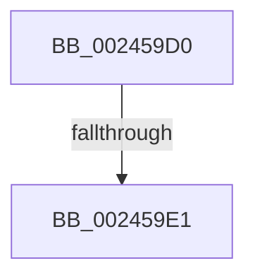

# MiRemoveLockedPageChargeAndDecRef

- RVA: `0x002459D0`–`0x002459E7` (길이 `23` bytes)
- VA: `0x00000001402459D0`
- 실행 섹션: `.text`
- PDB 이름 있음: `예`; PDB Function 태그: `예`
- unwind 정보 RVA: `0x00061D0C`
- 디코드: `8`개 명령, `23/23` bytes 표시
- 미해석 바이트: `0` (있으면 어셈블리에 `.byte`로 보존)

> 이 문서는 커널 이미지의 기계어와 PDB 기호를 분석해 생성했습니다. 4번과 5번은 함수 원형과 자료형을 바이너리 사용 방식에서 추정한 C 해석이며 원본 소스 복구 결과는 아닙니다.

## 1. Dependencies

- 직접 호출 지점: **1**; 고유 호출 대상: **1**
- 직접 호출자로 확인된 함수: **29**
- RIP 상대 이미지 참조: **0**

### Outgoing calls
- `0x002459E1` → [MiBadRefCount](MiBadRefCount_function_00246E08.md) (function, `0x00246E08`)

### Direct callers
- [sub_0023C6E5](../23/Unknown_function_0023C6E5.md) at `0x0023C6FC`
- [MiProbeUnlockPage](MiProbeUnlockPage_function_00243860.md) at `0x002439C8`
- [MiWalkVaRange](MiWalkVaRange_function_00243BF0.md) at `0x00243EA3`
- [MiWalkVaRange](MiWalkVaRange_function_00243BF0.md) at `0x00243EDA`
- [MiResolveTransitionFault](../28/MiResolveTransitionFault_function_00282940.md) at `0x00282D0C`
- [MiResolveTransitionFault](../28/MiResolveTransitionFault_function_00282940.md) at `0x00283074`
- [MiMigratePfn](../28/MiMigratePfn_function_0028DBB0.md) at `0x0028DF85`
- [MiUnlockCodePage](../2A/MiUnlockCodePage_function_002A2AB8.md) at `0x002A2B8E`
- [MiInitializeImageProtos](../2A/MiInitializeImageProtos_function_002ABDAC.md) at `0x002AC020`
- [MiHardFaultPageRelease](../2B/MiHardFaultPageRelease_function_002B5728.md) at `0x002B580B`
- [MiFinishHardFault](../2B/MiFinishHardFault_function_002B6F10.md) at `0x002B7096`
- [MiFinishHardFault](../2B/MiFinishHardFault_function_002B6F10.md) at `0x002B7619`
- [MmCopyToCachedPage](../34/MmCopyToCachedPage_function_00347B44.md) at `0x00348084`
- [MiMakeFaultPfnActive](../36/MiMakeFaultPfnActive_function_00361D00.md) at `0x00361D6A`
- [MiReturnPfnReferenceCountAtDpc](../36/MiReturnPfnReferenceCountAtDpc_function_00364010.md) at `0x0036402B`
- [MiPrivateFixup](../36/MiPrivateFixup_function_003693E8.md) at `0x0036980D`
- [MiHandleCollidedFault](../36/MiHandleCollidedFault_function_00369B48.md) at `0x00369C13`
- [MiHandleCollidedFault](../36/MiHandleCollidedFault_function_00369B48.md) at `0x00369CB7`
- [MiWaitForCollidedFaultComplete](../36/MiWaitForCollidedFaultComplete_function_00369EDC.md) at `0x0036A0E8`
- [MiWaitForCollidedFaultComplete](../36/MiWaitForCollidedFaultComplete_function_00369EDC.md) at `0x0036A1E4`
- [MiWaitForCollidedFaultComplete](../36/MiWaitForCollidedFaultComplete_function_00369EDC.md) at `0x0036A202`
- [MiCopyFileOnlyGlobalSubsectionPage](../36/MiCopyFileOnlyGlobalSubsectionPage_function_0036A9EC.md) at `0x0036ADE9`
- [MiBuildReservationCluster](../40/MiBuildReservationCluster_function_004071A0.md) at `0x0040765F`
- [MiDoubleUnlockMdlPage](../41/MiDoubleUnlockMdlPage_function_0041F43C.md) at `0x0041F46F`
- [MiUpdateImportRelocationsOnDriverPrivatePages](../44/MiUpdateImportRelocationsOnDriverPrivatePages_function_00449BCC.md) at `0x00449D2A`
- [MiMirrorPerformBrownWrites](../45/MiMirrorPerformBrownWrites_function_0045C560.md) at `0x0045CA66`
- [MiUnlockPagedAddress](../49/MiUnlockPagedAddress_function_00492FC4.md) at `0x00493020`
- [MiFinalizeImageHeaderPage](../4A/MiFinalizeImageHeaderPage_function_004A89A8.md) at `0x004A8A3C`
- [MiFinishLastForkPageTable](../4B/MiFinishLastForkPageTable_function_004B2AD4.md) at `0x004B2B8B`
- [MiLockDownWorkingSet](../4D/MiLockDownWorkingSet_function_004D4950.md) at `0x004D4A27`
- [MiIdealClusterPage](../4D/MiIdealClusterPage_function_004DB964.md) at `0x004DC15D`
- [MmDbgMarkPfnModifiedWorker](../68/MmDbgMarkPfnModifiedWorker_function_00686298.md) at `0x006862EC`
- [sub_006DAAE6](../6D/Unknown_function_006DAAE6.md) at `0x006DACED`
- [sub_006E3B88](../6E/Unknown_function_006E3B88.md) at `0x006E3B94`
- [sub_006F60F8](../6F/Unknown_function_006F60F8.md) at `0x006F62B4`

### Static image references
- 디코드된 RIP-relative 메모리 참조가 없습니다.

## 2. Other-region calls and transfers

- 다른 실행 섹션으로 향하는 call: **0**
- call이 아닌 외부 분기/꼬리 이동: **1**
  - `0x002459DF` → [sub_002459E7](Unknown_function_002459E7.md) (`tail-transfer`)

## 3. Assembly (complete function range)

```asm
002459D0  40 53                           push rbx
002459D2  48 83 EC 60                     sub rsp, 0x60
002459D6  8B 41 20                        mov eax, dword ptr [rcx + 0x20]
002459D9  48 8B D9                        mov rbx, rcx
002459DC  66 85 C0                        test ax, ax
002459DF  75 06                           jne 0x1402459e7
002459E1  E8 22 14 00 00                  call 0x140246e08
002459E6  CC                              int3
```

## 4. C-style interpretation (structured pseudocode)

```c
__int64 __fastcall MiRemoveLockedPageChargeAndDecRef(__int64 a1)
{
    __int64 result;
    __int64 v_rsp;

    v_rsp = (v_rsp) - (96);
    result = MiBadRefCount(a1, a2, a3, a4);
    return result;
}
```

## 5. (Beta) C Style

```c
int64_t MiRemoveLockedPageChargeAndDecRef(void *Arg1)
{
    uint8_t *arg1 = (uint8_t *)Arg1;

    int64_t result;
    int64_t local_rsp;

    local_rsp = (local_rsp) - (96);
    result = MiBadRefCount(Arg1, a2, a3, a4);
    return result;
}
```

### 관측된 메모리 오프셋

구조체 형식이 확인되지 않은 접근은 인자 기준의 오프셋으로만 기록했습니다.

| 기준 인자 | 오프셋 표현 | 폭 (bit) | 접근 |
|---|---:|---:|---|
| `Arg1` | `+ 0x20` | `32` | `R` |

## 6. Execution-region graph

[열기: 2D/3D 그래프와 함수 탐색 컨트롤 패널](../../../control-panel.html?section=text&rva=0x002459D0&view=graph)

- 2D 그래프는 위에서 아래로 흐르고, 3D 그래프는 빈 공간을 드래그해 회전합니다. Shift+드래그는 이동, 휠은 확대·축소, 함수 노드 선택은 대상 보고서 이동입니다.

### Static fallback


