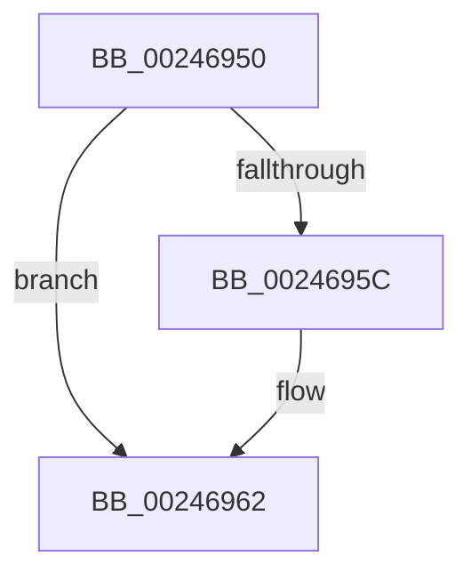

# MiRemoveLockedPageCharge

- RVA: `0x00246950`–`0x0024697D` (길이 `45` bytes)
- VA: `0x0000000140246950`
- 실행 섹션: `.text`
- PDB 이름 있음: `예`; PDB Function 태그: `예`
- unwind 정보 RVA: `0x0006217C`
- 디코드: `12`개 명령, `45/45` bytes 표시
- 미해석 바이트: `0` (있으면 어셈블리에 `.byte`로 보존)

> 이 문서는 커널 이미지의 기계어와 PDB 기호를 분석해 생성했습니다. 4번과 5번은 함수 원형과 자료형을 바이너리 사용 방식에서 추정한 C 해석이며 원본 소스 복구 결과는 아닙니다.

## 1. Dependencies

- 직접 호출 지점: **1**; 고유 호출 대상: **1**
- 직접 호출자로 확인된 함수: **8**
- RIP 상대 이미지 참조: **0**

### Outgoing calls
- `0x0024695C` → [MiBadRefCount](MiBadRefCount_function_00246E08.md) (function, `0x00246E08`)

### Direct callers
- [MiCanBatchHardFaultPages](MiCanBatchHardFaultPages_function_0024AE00.md) at `0x0024AEEA`
- [MiCanBatchHardFaultPages](MiCanBatchHardFaultPages_function_0024AE00.md) at `0x0024AF26`
- [MiMigratePfn](../28/MiMigratePfn_function_0028DBB0.md) at `0x0028DFFC`
- [MiHardFaultPageRelease](../2B/MiHardFaultPageRelease_function_002B5728.md) at `0x002B5782`
- [MiWalkEntireImage](../36/MiWalkEntireImage_function_00365D70.md) at `0x003662D5`
- [MiWalkEntireImage](../36/MiWalkEntireImage_function_00365D70.md) at `0x003667CE`
- [MiSwapHardFaultPage](../38/MiSwapHardFaultPage_function_00385F34.md) at `0x00386035`
- [MiIdealClusterPage](../4D/MiIdealClusterPage_function_004DB964.md) at `0x004DC0EE`
- [MiFlushFileOnlyDeleteChain](../4F/MiFlushFileOnlyDeleteChain_function_004F5534.md) at `0x004F55F9`
- [MiPurgeBadFileOnlyPages](../68/MiPurgeBadFileOnlyPages_function_00681ADC.md) at `0x00681C44`

### Static image references
- 디코드된 RIP-relative 메모리 참조가 없습니다.

## 2. Other-region calls and transfers

- 다른 실행 섹션으로 향하는 call: **0**
- 별도 외부 분기/꼬리 이동을 확인하지 못했습니다.

## 3. Assembly (complete function range)

```asm
00246950  48 83 EC 48                     sub rsp, 0x48
00246954  8B 41 20                        mov eax, dword ptr [rcx + 0x20]
00246957  66 85 C0                        test ax, ax
0024695A  75 06                           jne 0x140246962
0024695C  E8 A7 04 00 00                  call 0x140246e08
00246961  CC                              int3
00246962  44 8B 41 20                     mov r8d, dword ptr [rcx + 0x20]
00246966  44 89 44 24 50                  mov dword ptr [rsp + 0x50], r8d
0024696B  66 41 83 E8 01                  sub r8w, 1
00246970  66 44 89 44 24 50               mov word ptr [rsp + 0x50], r8w
00246976  8B 44 24 50                     mov eax, dword ptr [rsp + 0x50]
0024697A  89 41 20                        mov dword ptr [rcx + 0x20], eax
```

## 4. C-style interpretation (structured pseudocode)

```c
__int64 __fastcall MiRemoveLockedPageCharge(__int64 a1)
{
    __int64 result;
    __int64 v_rsp;
    unsigned int v_stack_p8;

    v_rsp = (v_rsp) - (72);
    result = (unsigned int)(*(unsigned int *)(a1 + 32));
    if ((unsigned __int16)((unsigned int)(*(unsigned int *)(a1 + 32))) == 0) {
        result = MiBadRefCount(a1, a2, a3, a4);
    }
    v_stack_p8 = (unsigned int)((unsigned int)(*(unsigned int *)(a1 + 32)));
    a3 = (unsigned __int16)(((unsigned int)(*(unsigned int *)(a1 + 32))) - (1));
    v_stack_p8 = (unsigned __int16)(a3);
    *(unsigned int *)(a1 + 32) = (unsigned int)((unsigned int)(v_stack_p8));
    return (unsigned int)(v_stack_p8);
}
```

## 5. (Beta) C Style

```c
int64_t MiRemoveLockedPageCharge(void *Arg1)
{
    uint8_t *arg1 = (uint8_t *)Arg1;

    int64_t result;
    int64_t local_rsp;
    uint32_t v_stack_p8;

    local_rsp = (local_rsp) - (72);
    result = (uint32_t)(*(uint32_t *)(arg1 + 0x20));
    if ((uint16_t)((uint32_t)(*(uint32_t *)(arg1 + 0x20))) == 0) {
        result = MiBadRefCount(Arg1, a2, a3, a4);
    }
    v_stack_p8 = (uint32_t)((uint32_t)(*(uint32_t *)(arg1 + 0x20)));
    a3 = (uint16_t)(((uint32_t)(*(uint32_t *)(arg1 + 0x20))) - (1));
    v_stack_p8 = (uint16_t)(a3);
    *(uint32_t *)(arg1 + 0x20) = (uint32_t)((uint32_t)(v_stack_p8));
    return (uint32_t)(v_stack_p8);
}
```

### 관측된 메모리 오프셋

구조체 형식이 확인되지 않은 접근은 인자 기준의 오프셋으로만 기록했습니다.

| 기준 인자 | 오프셋 표현 | 폭 (bit) | 접근 |
|---|---:|---:|---|
| `Arg1` | `+ 0x20` | `32` | `R` |

## 6. Execution-region graph

[열기: 2D/3D 그래프와 함수 탐색 컨트롤 패널](../../../control-panel.html?section=text&rva=0x00246950&view=graph)

- 2D 그래프는 위에서 아래로 흐르고, 3D 그래프는 빈 공간을 드래그해 회전합니다. Shift+드래그는 이동, 휠은 확대·축소, 함수 노드 선택은 대상 보고서 이동입니다.

### Static fallback


