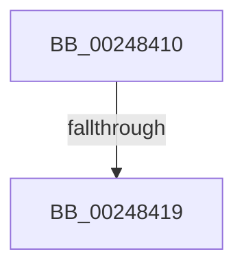

# MiReturnCommit

- RVA: `0x00248410`–`0x00248433` (길이 `35` bytes)
- VA: `0x0000000140248410`
- 실행 섹션: `.text`
- PDB 이름 있음: `예`; PDB Function 태그: `예`
- unwind 정보 RVA: `0x000624C8`
- 디코드: `8`개 명령, `35/35` bytes 표시
- 미해석 바이트: `0` (있으면 어셈블리에 `.byte`로 보존)

> 이 문서는 커널 이미지의 기계어와 PDB 기호를 분석해 생성했습니다. 4번과 5번은 함수 원형과 자료형을 바이너리 사용 방식에서 추정한 C 해석이며 원본 소스 복구 결과는 아닙니다.

## 1. Dependencies

- 직접 호출 지점: **0**; 고유 호출 대상: **0**
- 직접 호출자로 확인된 함수: **67**
- RIP 상대 이미지 참조: **0**

### Outgoing calls
- 직접 디코드된 call 명령이 없습니다.

### Direct callers
- [MiGetCloneCharges](../22/MiGetCloneCharges_function_0022CB5C.md) at `0x0022CBED`
- [MiGetCloneCharges](../22/MiGetCloneCharges_function_0022CB5C.md) at `0x0022CC29`
- [MiGetCloneCharges](../22/MiGetCloneCharges_function_0022CB5C.md) at `0x0022CC3B`
- [MiGetCloneCharges](../22/MiGetCloneCharges_function_0022CB5C.md) at `0x0022CC62`
- [MiGetCloneCharges](../22/MiGetCloneCharges_function_0022CB5C.md) at `0x0022CC78`
- [sub_0023C62B](../23/Unknown_function_0023C62B.md) at `0x0023C68B`
- [MiChargeForLockedPage](../28/MiChargeForLockedPage_function_00285AA0.md) at `0x00285C12`
- [sub_002860AF](../28/Unknown_function_002860AF.md) at `0x00286196`
- [MiCheckControlArea](../28/MiCheckControlArea_function_002861B0.md) at `0x002865D4`
- [MiAcquireNonPagedResources](../28/MiAcquireNonPagedResources_function_00286C60.md) at `0x00286D4C`
- [MiCreateUltraThreadContext](../28/MiCreateUltraThreadContext_function_00288200.md) at `0x00288349`
- [MiAddLockedPageCharge](../28/MiAddLockedPageCharge_function_0028B550.md) at `0x0028B740`
- [MiRemoveMappedPtes](../29/MiRemoveMappedPtes_function_00296A50.md) at `0x00296C0F`
- [MmFreeIndependentPages](../2A/MmFreeIndependentPages_function_002A2510.md) at `0x002A2702`
- [MiLockProtoPoolPage](../2B/MiLockProtoPoolPage_function_002B8B80.md) at `0x002B918C`
- [sub_002C37D9](../2C/Unknown_function_002C37D9.md) at `0x002C39FE`
- [sub_002C3A7C](../2C/Unknown_function_002C3A7C.md) at `0x002C4052`
- [sub_002C3A7C](../2C/Unknown_function_002C3A7C.md) at `0x002C4569`
- [MiCreateUltraThreadContextHelper](../2C/MiCreateUltraThreadContextHelper_function_002CB380.md) at `0x002CB483`
- [MiReplenishUltraPageTables](../2C/MiReplenishUltraPageTables_function_002CB4EC.md) at `0x002CB66C`
- [MiDeleteKernelStackPages](../2D/MiDeleteKernelStackPages_function_002D9938.md) at `0x002D99F6`
- [MiCheckProtoPtePageState](../31/MiCheckProtoPtePageState_function_003183E0.md) at `0x003186F6`
- [MiLockProtoPoolPageForce](../32/MiLockProtoPoolPageForce_function_00320E10.md) at `0x003211E7`
- [MiResolveProtoPteFault](../32/MiResolveProtoPteFault_function_00321750.md) at `0x00322365`
- [MiReferenceActiveSubsection](../32/MiReferenceActiveSubsection_function_00325060.md) at `0x003256D3`
- [MiDeleteSegmentPages](../32/MiDeleteSegmentPages_function_003261D4.md) at `0x003262DD`
- [MiReturnExcessPoolCommit](../32/MiReturnExcessPoolCommit_function_00328D3C.md) at `0x00328D94`
- [MiCommitExistingVad](../32/MiCommitExistingVad_function_0032A860.md) at `0x0032B557`
- [MiCopyOnWrite](../36/MiCopyOnWrite_function_00362A0C.md) at `0x00363304`
- [MiReturnPoolCharges](../36/MiReturnPoolCharges_function_003679B4.md) at `0x003679E6`
- [MiReturnSystemCharges](../36/MiReturnSystemCharges_function_00367A48.md) at `0x00367A69`
- [MiResolveMappedFileFault](../36/MiResolveMappedFileFault_function_0036B640.md) at `0x0036BBB3`
- [MiReturnFaultCharges](../36/MiReturnFaultCharges_function_0036D928.md) at `0x0036D94F`
- [MiReturnCloneCharges](../37/MiReturnCloneCharges_function_00370F50.md) at `0x00370F94`
- [MiReturnCloneCharges](../37/MiReturnCloneCharges_function_00370F50.md) at `0x00370FA9`
- [MiWriteCompletePfn](../37/MiWriteCompletePfn_function_003737C4.md) at `0x00373A2D`
- [MiObtainSystemCharges](../37/MiObtainSystemCharges_function_003771F4.md) at `0x00377249`
- [MiInsertInSystemSpace](../3B/MiInsertInSystemSpace_function_003B2F5C.md) at `0x003B361F`
- [MiReleaseOutSwappedProcessCommit](../3C/MiReleaseOutSwappedProcessCommit_function_003C8320.md) at `0x003C852E`
- [MiCreateLargePfnList](../3D/MiCreateLargePfnList_function_003D2DA8.md) at `0x003D3144`
- [MiReleaseNonPagedResourcesNotExposed](../3F/MiReleaseNonPagedResourcesNotExposed_function_003F8258.md) at `0x003F826E`
- [MiUnlockWsle](../40/MiUnlockWsle_function_00407F84.md) at `0x004080D1`
- [NtLockVirtualMemory](../40/NtLockVirtualMemory_function_004088A0.md) at `0x004092F7`
- [MiObtainPoolCharges](../46/MiObtainPoolCharges_function_00460AD8.md) at `0x00460B6E`
- [MiSetPagesModified](../49/MiSetPagesModified_function_0049DC2C.md) at `0x0049E06E`
- [MiSetPagesModified](../49/MiSetPagesModified_function_0049DC2C.md) at `0x0049E10F`
- [MiDeletePerSessionProtos](../4A/MiDeletePerSessionProtos_function_004A0840.md) at `0x004A08EF`
- [MiReturnCrossPartitionSectionCharges](../4B/MiReturnCrossPartitionSectionCharges_function_004BA61C.md) at `0x004BA669`
- [MiReleaseCommitForResetPages](../66/MiReleaseCommitForResetPages_function_0066FAF8.md) at `0x0066FBDF`
- [MiMarkBootGuardPage](../68/MiMarkBootGuardPage_function_0068643C.md) at `0x00686570`
- [MiInsertPartitionPages](../69/MiInsertPartitionPages_function_006911A0.md) at `0x00691395`
- [sub_006E1B8C](../6E/Unknown_function_006E1B8C.md) at `0x006E1BB0`
- [sub_006E313A](../6E/Unknown_function_006E313A.md) at `0x006E31F7`
- [sub_006F1BC0](../6F/Unknown_function_006F1BC0.md) at `0x006F1BE0`
- [sub_006F503A](../6F/Unknown_function_006F503A.md) at `0x006F51B4`
- [sub_006F7544](../6F/Unknown_function_006F7544.md) at `0x006F7592`
- [MiRemovePhysicalMemory](../../page/7F/MiRemovePhysicalMemory_function_007FAD3C.md) at `0x007FAF79`
- [MiDeletePagingFiles](../../page/7F/MiDeletePagingFiles_function_007FFD34.md) at `0x007FFDAD`
- [MiFreePartitionPhysicalPages](../../page/80/MiFreePartitionPhysicalPages_function_0080D42C.md) at `0x0080D57F`
- [MiDecommitRegion](../../page/88/MiDecommitRegion_function_008807A0.md) at `0x008808E2`
- [MiChargeSegmentCommit](../../page/8C/MiChargeSegmentCommit_function_008CEDE4.md) at `0x008CF0E0`
- [MiCreateImageFileMap](../../page/98/MiCreateImageFileMap_function_00986830.md) at `0x009870B3`
- [MiCreateFileOnlyImageFixupList](../../page/98/MiCreateFileOnlyImageFixupList_function_00989AD0.md) at `0x00989C56`
- [MiRemoveVadCharges](../../page/9B/MiRemoveVadCharges_function_009BAEC4.md) at `0x009BAFA7`
- [MiReturnFullProcessCommitment](../../page/9E/MiReturnFullProcessCommitment_function_009E5D58.md) at `0x009E5D76`
- [MiUnmapReturnSystemCommit](../../page/A3/MiUnmapReturnSystemCommit_function_00A35600.md) at `0x00A35612`
- [MiRotateToFrameBuffer](../../page/A3/MiRotateToFrameBuffer_function_00A38214.md) at `0x00A38353`
- [MiRotateToFrameBuffer](../../page/A3/MiRotateToFrameBuffer_function_00A38214.md) at `0x00A3840E`
- [MiDeleteVadBitmap](../../page/A4/MiDeleteVadBitmap_function_00A45F18.md) at `0x00A4600F`
- [MmCreateProcessAddressSpace](../../page/A5/MmCreateProcessAddressSpace_function_00A5EE5C.md) at `0x00A5F0D1`
- [MiUnmapReturnCharges](../../page/AA/MiUnmapReturnCharges_function_00AA6C40.md) at `0x00AA6C66`
- [MmDeleteProcessAddressSpace](../../page/AC/MmDeleteProcessAddressSpace_function_00AC804C.md) at `0x00AC81FB`
- [sub_00B2AD32](../../page/B2/Unknown_function_00B2AD32.md) at `0x00B2AF82`
- [sub_00B3E76E](../../page/B3/Unknown_function_00B3E76E.md) at `0x00B3E781`
- [MiInitializeBootShadowStackPage](../../init/C6/MiInitializeBootShadowStackPage_function_00C67D8C.md) at `0x00C67F31`

### Static image references
- 디코드된 RIP-relative 메모리 참조가 없습니다.

## 2. Other-region calls and transfers

- 다른 실행 섹션으로 향하는 call: **0**
- call이 아닌 외부 분기/꼬리 이동: **1**
  - `0x00248413` → [sub_00248433 + 0x7F](Unknown_function_00248433.md) (`tail-transfer`)

## 3. Assembly (complete function range)

```asm
00248410  48 85 D2                        test rdx, rdx
00248413  0F 84 99 00 00 00               je 0x1402484b2
00248419  48 89 5C 24 18                  mov qword ptr [rsp + 0x18], rbx
0024841E  48 89 74 24 20                  mov qword ptr [rsp + 0x20], rsi
00248423  57                              push rdi
00248424  48 83 EC 20                     sub rsp, 0x20
00248428  48 83 B9 08 42 00 00 00         cmp qword ptr [rcx + 0x4208], 0
00248430  41 8B F0                        mov esi, r8d
```

## 4. C-style interpretation (structured pseudocode)

```c
void __fastcall MiReturnCommit(__int64 a1, __int64 a2, int a3)
{
    __int64 v_rsp;
    unsigned __int64 v_stack_p18;
    unsigned __int64 v_stack_p20;

    v_stack_p18 = v_rbx;
    v_stack_p20 = v_rsi;
    v_rsp = (v_rsp) - (32);
    return;
}
```

## 5. (Beta) C Style

```c
void MiReturnCommit(void *Arg1, int64_t Arg2, int32_t Arg3)
{
    uint8_t *arg1 = (uint8_t *)Arg1;

    int64_t local_rsp;
    uint64_t v_stack_p18;
    uint64_t v_stack_p20;

    v_stack_p18 = local_rbx;
    v_stack_p20 = local_rsi;
    local_rsp = (local_rsp) - (32);
    return;
}
```

### 관측된 메모리 오프셋

구조체 형식이 확인되지 않은 접근은 인자 기준의 오프셋으로만 기록했습니다.

| 기준 인자 | 오프셋 표현 | 폭 (bit) | 접근 |
|---|---:|---:|---|
| `Arg1` | `+ 0x4208` | `64` | `R` |

## 6. Execution-region graph

[열기: 2D/3D 그래프와 함수 탐색 컨트롤 패널](../../../control-panel.html?section=text&rva=0x00248410&view=graph)

- 2D 그래프는 위에서 아래로 흐르고, 3D 그래프는 빈 공간을 드래그해 회전합니다. Shift+드래그는 이동, 휠은 확대·축소, 함수 노드 선택은 대상 보고서 이동입니다.

### Static fallback


