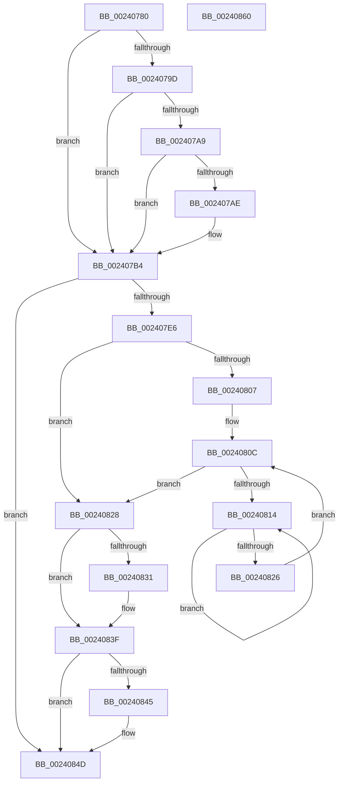

# MiReturnPagedPoolLockCharge

- RVA: `0x00240780`–`0x00240861` (길이 `225` bytes)
- VA: `0x0000000140240780`
- 실행 섹션: `.text`
- PDB 이름 있음: `예`; PDB Function 태그: `아니요`
- unwind 정보 RVA: `0x00061768`
- 디코드: `62`개 명령, `225/225` bytes 표시
- 미해석 바이트: `0` (있으면 어셈블리에 `.byte`로 보존)

> 이 문서는 커널 이미지의 기계어와 PDB 기호를 분석해 생성했습니다. 4번과 5번은 함수 원형과 자료형을 바이너리 사용 방식에서 추정한 C 해석이며 원본 소스 복구 결과는 아닙니다.

## 1. Dependencies

- 직접 호출 지점: **2**; 고유 호출 대상: **2**
- 직접 호출자로 확인된 함수: **4**
- RIP 상대 이미지 참조: **2**

### Outgoing calls
- `0x002407DD` → [MiIsPfnSystemCharged](../43/MiIsPfnSystemCharged_function_0043E910.md) (function, `0x0043E910`)
- `0x00240819` → [KeYieldProcessorEx](../3F/KeYieldProcessorEx_function_003FBD00.md) (function, `0x003FBD00`)

### Direct callers
- [MiDecommitHandleTransitionPte](MiDecommitHandleTransitionPte_function_0024037C.md) at `0x002406D6`
- [sub_00241B5E](Unknown_function_00241B5E.md) at `0x00241B5E`
- [sub_00241E90](Unknown_function_00241E90.md) at `0x00242192`
- [MiDeleteVa](../27/MiDeleteVa_function_002789E0.md) at `0x00278E8B`

### Static image references
- `0x0024079D` → RVA `0x00E2DC80` (`.data`; read)
- `0x002407EE` → RVA `0x00E30088` (`.data`; read)

## 2. Other-region calls and transfers

- 다른 실행 섹션으로 향하는 call: **0**
- 별도 외부 분기/꼬리 이동을 확인하지 못했습니다.

## 3. Assembly (complete function range)

```asm
00240780  48 89 5C 24 08                  mov qword ptr [rsp + 8], rbx
00240785  48 89 6C 24 18                  mov qword ptr [rsp + 0x18], rbp
0024078A  56                              push rsi
0024078B  57                              push rdi
0024078C  41 56                           push r14
0024078E  48 83 EC 20                     sub rsp, 0x20
00240792  48 8B F2                        mov rsi, rdx
00240795  48 8B E9                        mov rbp, rcx
00240798  83 E6 01                        and esi, 1
0024079B  75 17                           jne 0x1402407b4
0024079D  48 8B 05 DC D4 BE 00            mov rax, qword ptr [rip + 0xbed4dc]
002407A4  48 85 C0                        test rax, rax
002407A7  74 0B                           je 0x1402407b4
002407A9  F6 C2 10                        test dl, 0x10
002407AC  75 06                           jne 0x1402407b4
002407AE  48 F7 D0                        not rax
002407B1  48 23 D0                        and rdx, rax
002407B4  48 C1 EA 0C                     shr rdx, 0xc
002407B8  48 B8 FF FF FF FF FF 00 00 00   movabs rax, 0xffffffffff
002407C2  48 23 D0                        and rdx, rax
002407C5  48 8D 3C 52                     lea rdi, [rdx + rdx*2]
002407C9  48 C1 E7 04                     shl rdi, 4
002407CD  48 B8 00 00 00 00 00 DE FF FF   movabs rax, 0xffffde0000000000
002407D7  48 03 F8                        add rdi, rax
002407DA  48 8B CF                        mov rcx, rdi
002407DD  E8 2E E1 1F 00                  call 0x14043e910
002407E2  85 C0                           test eax, eax
002407E4  74 67                           je 0x14024084d
002407E6  48 8B 47 28                     mov rax, qword ptr [rdi + 0x28]
002407EA  48 8D 5F 18                     lea rbx, [rdi + 0x18]
002407EE  48 8B 0D 93 F8 BE 00            mov rcx, qword ptr [rip + 0xbef893]
002407F5  48 C1 E8 2B                     shr rax, 0x2b
002407F9  25 FF 03 00 00                  and eax, 0x3ff
002407FE  4C 8B 34 C1                     mov r14, qword ptr [rcx + rax*8]
00240802  48 85 F6                        test rsi, rsi
00240805  74 21                           je 0x140240828
00240807  83 64 24 48 00                  and dword ptr [rsp + 0x48], 0
0024080C  F0 48 0F BA 2B 3F               lock bts qword ptr [rbx], 0x3f
00240812  73 14                           jae 0x140240828
00240814  48 8D 4C 24 48                  lea rcx, [rsp + 0x48]
00240819  E8 E2 B4 1B 00                  call 0x1403fbd00
0024081E  48 8B 03                        mov rax, qword ptr [rbx]
00240821  48 85 C0                        test rax, rax
00240824  78 EE                           js 0x140240814
00240826  EB E4                           jmp 0x14024080c
00240828  80 67 23 DF                     and byte ptr [rdi + 0x23], 0xdf
0024082C  48 85 F6                        test rsi, rsi
0024082F  74 0E                           je 0x14024083f
00240831  48 B8 FF FF FF FF FF FF FF 7F   movabs rax, 0x7fffffffffffffff
0024083B  F0 48 21 03                     lock and qword ptr [rbx], rax
0024083F  4C 3B 75 08                     cmp r14, qword ptr [rbp + 8]
00240843  75 08                           jne 0x14024084d
00240845  48 8B 45 18                     mov rax, qword ptr [rbp + 0x18]
00240849  48 FF 40 08                     inc qword ptr [rax + 8]
0024084D  48 8B 5C 24 40                  mov rbx, qword ptr [rsp + 0x40]
00240852  48 8B 6C 24 50                  mov rbp, qword ptr [rsp + 0x50]
00240857  48 83 C4 20                     add rsp, 0x20
0024085B  41 5E                           pop r14
0024085D  5F                              pop rdi
0024085E  5E                              pop rsi
0024085F  C3                              ret
00240860  CC                              int3
```

## 4. C-style interpretation (structured pseudocode)

```c
__int64 __fastcall MiReturnPagedPoolLockCharge(__int64 a1, __int64 a2)
{
    __int64 result;
    __int64 v_rdi;
    __int64 v_rsi;
    __int64 v_rsp;
    unsigned int v_stack_p10;
    unsigned __int64 v_stack_p18;
    unsigned __int64 v_stack_p8;

    v_stack_p8 = v_rbx;
    v_stack_p18 = v_rbp;
    v_rsp = (v_rsp) - (32);
    v_rsi = (unsigned int)((a2) & (1));
    if (condition_is_not_equal) goto loc_002407B4;
    if (*(unsigned __int64 *)(v_rip + 12506332) == 0) goto loc_002407B4;
    result = *(unsigned __int64 *)(v_rip + 12506332);
    if ((((unsigned __int8)(a2)) & (16)) == 0) {
        result = ~(*(unsigned __int64 *)(v_rip + 12506332));
        a2 = (a2) & (result);
    }
    a2 = (a2) >> (12);
    a2 = (a2) & (result);
    v_rdi = (a2 + a2 * 2) << (4);
    v_rdi = (v_rdi) + (result);
    result = MiIsPfnSystemCharged(v_rdi, a2, a3, a4);
    if ((unsigned int)(result) == 0) goto loc_0024084D;
    result = (*(unsigned __int64 *)(v_rdi + 40)) >> (43);
    result = (unsigned int)((result) & (0x3FFULL));
    if (v_rsi == 0) goto loc_00240828;
loc_0024080C:
    if (condition_is_above_or_equal) goto loc_00240828;
loc_00240814:
    result = KeYieldProcessorEx(v_stack_p10, a2, a3, a4);
    if (sign_flag) goto loc_00240814;
    goto loc_0024080C;
loc_00240828:
    if (v_rsi != 0) {
    }
    result = *(unsigned __int64 *)(v_rdi + 24);
    if ((*(unsigned __int64 *)(*(unsigned __int64 *)(v_rip + 12515475) + result * 8)) == (*(unsigned __int64 *)(a1 + 8))) {
        result = *(unsigned __int64 *)(a1 + 24);
    }
    v_rsp = (v_rsp) + (32);
    return result;
}
```

## 5. (Beta) C Style

```c
int64_t MiReturnPagedPoolLockCharge(void *Arg1, int64_t Arg2)
{
    uint8_t *arg1 = (uint8_t *)Arg1;

    int64_t result;
    int64_t local_rdi;
    int64_t local_rsi;
    int64_t local_rsp;
    uint32_t v_stack_p10;
    uint64_t v_stack_p18;
    uint64_t v_stack_p8;

    v_stack_p8 = local_rbx;
    v_stack_p18 = local_rbp;
    local_rsp = (local_rsp) - (32);
    local_rsi = (uint32_t)((Arg2) & (1));
    if (condition_is_not_equal) goto loc_002407B4;
    if (*(uint64_t *)(v_rip + 0xBED4DC) == 0) goto loc_002407B4;
    result = *(uint64_t *)(v_rip + 0xBED4DC);
    if ((((uint8_t)(Arg2)) & (16)) == 0) {
        result = ~(*(uint64_t *)(v_rip + 0xBED4DC));
        Arg2 = (Arg2) & (result);
    }
    Arg2 = (Arg2) >> (12);
    Arg2 = (Arg2) & (result);
    local_rdi = (Arg2 + Arg2 * 2) << (4);
    local_rdi = (local_rdi) + (result);
    result = MiIsPfnSystemCharged(local_rdi, Arg2, a3, a4);
    if ((uint32_t)(result) == 0) goto loc_0024084D;
    result = (*(uint64_t *)(local_rdi + 0x28)) >> (43);
    result = (uint32_t)((result) & (0x3FFULL));
    if (local_rsi == 0) goto loc_00240828;
loc_0024080C:
    if (condition_is_above_or_equal) goto loc_00240828;
loc_00240814:
    result = KeYieldProcessorEx(v_stack_p10, Arg2, a3, a4);
    if (sign_flag) goto loc_00240814;
    goto loc_0024080C;
loc_00240828:
    if (local_rsi != 0) {
    }
    result = *(uint64_t *)(local_rdi + 0x18);
    if ((*(uint64_t *)(*(uint64_t *)(v_rip + 0xBEF893) + result * 8)) == (*(uint64_t *)(arg1 + 0x8))) {
        result = *(uint64_t *)(arg1 + 0x18);
    }
    local_rsp = (local_rsp) + (32);
    return result;
}
```

### 관측된 메모리 오프셋

구조체 형식이 확인되지 않은 접근은 인자 기준의 오프셋으로만 기록했습니다.

| 기준 인자 | 오프셋 표현 | 폭 (bit) | 접근 |
|---|---:|---:|---|
| `Arg1` | `+ 0x8` | `64` | `R` |
| `Arg1` | `+ 0x18` | `64` | `R` |

## 6. Execution-region graph

[열기: 2D/3D 그래프와 함수 탐색 컨트롤 패널](../../../control-panel.html?section=text&rva=0x00240780&view=graph)

- 2D 그래프는 위에서 아래로 흐르고, 3D 그래프는 빈 공간을 드래그해 회전합니다. Shift+드래그는 이동, 휠은 확대·축소, 함수 노드 선택은 대상 보고서 이동입니다.

### Static fallback


