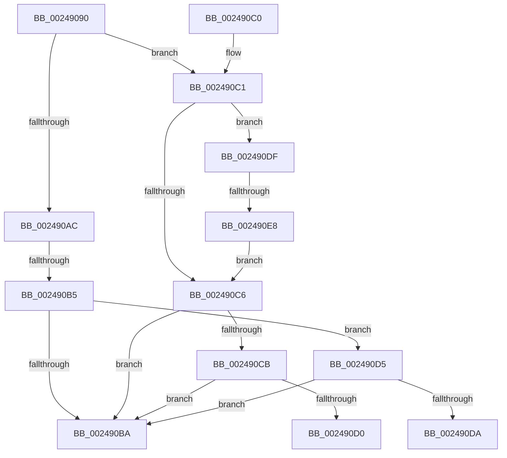

# MiSignalCommitSignals

- RVA: `0x00249090`–`0x002490EA` (길이 `90` bytes)
- VA: `0x0000000140249090`
- 실행 섹션: `.text`
- PDB 이름 있음: `예`; PDB Function 태그: `예`
- unwind 정보 RVA: `0x000626A8`
- 디코드: `28`개 명령, `90/90` bytes 표시
- 미해석 바이트: `0` (있으면 어셈블리에 `.byte`로 보존)

> 이 문서는 커널 이미지의 기계어와 PDB 기호를 분석해 생성했습니다. 4번과 5번은 함수 원형과 자료형을 바이너리 사용 방식에서 추정한 C 해석이며 원본 소스 복구 결과는 아닙니다.

## 1. Dependencies

- 직접 호출 지점: **0**; 고유 호출 대상: **0**
- 직접 호출자로 확인된 함수: **6**
- RIP 상대 이미지 참조: **0**

### Outgoing calls
- 직접 디코드된 call 명령이 없습니다.

### Direct callers
- [MiAddPageToInsertList](MiAddPageToInsertList_function_0024A950.md) at `0x0024AAB4`
- [sub_00285D83](../28/Unknown_function_00285D83.md) at `0x00285DA3`
- [sub_0033E839](../33/Unknown_function_0033E839.md) at `0x0033E972`
- [MiReleaseWriteInProgressCharges](../40/MiReleaseWriteInProgressCharges_function_00407B4C.md) at `0x00407BF8`
- [sub_0040843C](../40/Unknown_function_0040843C.md) at `0x00408499`
- [MiReplenishLocalCommit](../43/MiReplenishLocalCommit_function_0043D920.md) at `0x0043D9BF`

### Static image references
- 디코드된 RIP-relative 메모리 참조가 없습니다.

## 2. Other-region calls and transfers

- 다른 실행 섹션으로 향하는 call: **0**
- call이 아닌 외부 분기/꼬리 이동: **4**
  - `0x002490AF` → [sub_0024918B](Unknown_function_0024918B.md) (`tail-transfer`)
  - `0x002490D0` → [sub_0024918B + 0x9](Unknown_function_0024918B.md) (`tail-transfer`)
  - `0x002490DA` → [sub_0024918B + 0x9](Unknown_function_0024918B.md) (`tail-transfer`)
  - `0x002490E2` → [sub_0024918B + 0x9](Unknown_function_0024918B.md) (`tail-transfer`)

## 3. Assembly (complete function range)

```asm
00249090  40 53                           push rbx
00249092  48 83 EC 20                     sub rsp, 0x20
00249096  48 8B D9                        mov rbx, rcx
00249099  48 8B 89 E0 41 00 00            mov rcx, qword ptr [rcx + 0x41e0]
002490A0  48 8B 83 D8 41 00 00            mov rax, qword ptr [rbx + 0x41d8]
002490A7  49 3B D0                        cmp rdx, r8
002490AA  77 15                           ja 0x1402490c1
002490AC  4C 3B C1                        cmp r8, rcx
002490AF  0F 83 D6 00 00 00               jae 0x14024918b
002490B5  4C 3B C0                        cmp r8, rax
002490B8  73 1B                           jae 0x1402490d5
002490BA  48 83 C4 20                     add rsp, 0x20
002490BE  5B                              pop rbx
002490BF  C3                              ret
002490C0  CC                              int3
002490C1  48 3B D1                        cmp rdx, rcx
002490C4  73 19                           jae 0x1402490df
002490C6  48 3B D0                        cmp rdx, rax
002490C9  72 EF                           jb 0x1402490ba
002490CB  4C 3B C0                        cmp r8, rax
002490CE  73 EA                           jae 0x1402490ba
002490D0  E9 BF 00 00 00                  jmp 0x140249194
002490D5  48 3B D0                        cmp rdx, rax
002490D8  73 E0                           jae 0x1402490ba
002490DA  E9 B5 00 00 00                  jmp 0x140249194
002490DF  4C 3B C1                        cmp r8, rcx
002490E2  0F 82 AC 00 00 00               jb 0x140249194
002490E8  EB DC                           jmp 0x1402490c6
```

## 4. C-style interpretation (structured pseudocode)

```c
__int64 __fastcall MiSignalCommitSignals(__int64 a1, __int64 a2, __int64 a3)
{
    __int64 v_rsp;

    v_rsp = (v_rsp) - (32);
    if (a2 > a3) goto loc_002490C1;
    if (a3 >= (*(unsigned __int64 *)(a1 + 16856))) goto loc_002490D5;
loc_002490BA:
    v_rsp = (v_rsp) + (32);
    return *(unsigned __int64 *)(a1 + 16856);
loc_002490C1:
    if (a2 >= (*(unsigned __int64 *)(a1 + 16864))) goto loc_002490DF;
loc_002490C6:
    if (a2 < (*(unsigned __int64 *)(a1 + 16856))) goto loc_002490BA;
    if (a3 >= (*(unsigned __int64 *)(a1 + 16856))) goto loc_002490BA;
loc_002490D5:
    if (a2 >= (*(unsigned __int64 *)(a1 + 16856))) goto loc_002490BA;
loc_002490DF:
    goto loc_002490C6;
}
```

## 5. (Beta) C Style

```c
int64_t MiSignalCommitSignals(void *Arg1, int64_t Arg2, int64_t Arg3)
{
    uint8_t *arg1 = (uint8_t *)Arg1;

    int64_t local_rsp;

    local_rsp = (local_rsp) - (32);
    if (Arg2 > Arg3) goto loc_002490C1;
    if (Arg3 >= (*(uint64_t *)(arg1 + 0x41D8))) goto loc_002490D5;
loc_002490BA:
    local_rsp = (local_rsp) + (32);
    return *(uint64_t *)(arg1 + 0x41D8);
loc_002490C1:
    if (Arg2 >= (*(uint64_t *)(arg1 + 0x41E0))) goto loc_002490DF;
loc_002490C6:
    if (Arg2 < (*(uint64_t *)(arg1 + 0x41D8))) goto loc_002490BA;
    if (Arg3 >= (*(uint64_t *)(arg1 + 0x41D8))) goto loc_002490BA;
loc_002490D5:
    if (Arg2 >= (*(uint64_t *)(arg1 + 0x41D8))) goto loc_002490BA;
loc_002490DF:
    goto loc_002490C6;
}
```

### 관측된 메모리 오프셋

구조체 형식이 확인되지 않은 접근은 인자 기준의 오프셋으로만 기록했습니다.

| 기준 인자 | 오프셋 표현 | 폭 (bit) | 접근 |
|---|---:|---:|---|
| `Arg1` | `+ 0x41D8` | `64` | `R` |
| `Arg1` | `+ 0x41E0` | `64` | `R` |

## 6. Execution-region graph

[열기: 2D/3D 그래프와 함수 탐색 컨트롤 패널](../../../control-panel.html?section=text&rva=0x00249090&view=graph)

- 2D 그래프는 위에서 아래로 흐르고, 3D 그래프는 빈 공간을 드래그해 회전합니다. Shift+드래그는 이동, 휠은 확대·축소, 함수 노드 선택은 대상 보고서 이동입니다.

### Static fallback


