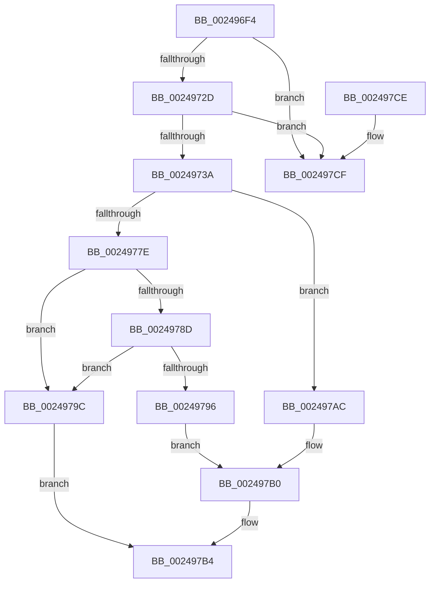

# MiUnlinkUnusedSubsection

- RVA: `0x002496F4`–`0x002497D6` (길이 `226` bytes)
- VA: `0x00000001402496F4`
- 실행 섹션: `.text`
- PDB 이름 있음: `예`; PDB Function 태그: `아니요`
- unwind 정보 RVA: `0x0005CEE8`
- 디코드: `53`개 명령, `226/226` bytes 표시
- 미해석 바이트: `0` (있으면 어셈블리에 `.byte`로 보존)

> 이 문서는 커널 이미지의 기계어와 PDB 기호를 분석해 생성했습니다. 4번과 5번은 함수 원형과 자료형을 바이너리 사용 방식에서 추정한 C 해석이며 원본 소스 복구 결과는 아닙니다.

## 1. Dependencies

- 직접 호출 지점: **1**; 고유 호출 대상: **1**
- 직접 호출자로 확인된 함수: **7**
- RIP 상대 이미지 참조: **2**

### Outgoing calls
- `0x0024971B` → [MiAdjustUnusedSegmentWalkers](../67/MiAdjustUnusedSegmentWalkers_function_006779FC.md) (function, `0x006779FC`)

### Direct callers
- [sub_0024926A](Unknown_function_0024926A.md) at `0x00249293`
- [sub_00249517](Unknown_function_00249517.md) at `0x0024951A`
- [MiRemoveUnusedSubsection](../2A/MiRemoveUnusedSubsection_function_002A6194.md) at `0x002A61C8`
- [MiReferenceActiveSubsection](../32/MiReferenceActiveSubsection_function_00325060.md) at `0x00325126`
- [MiDeleteEmptySubsections](../4E/MiDeleteEmptySubsections_function_004ED818.md) at `0x004ED8FC`
- [MiDeleteCachedEntries](../67/MiDeleteCachedEntries_function_00677A28.md) at `0x00677B25`
- [MiDeleteDeleteOnCloseSubsections](../67/MiDeleteDeleteOnCloseSubsections_function_00677D20.md) at `0x00677D8C`

### Static image references
- `0x00249702` → RVA `0x00E30088` (`.data`; read)
- `0x002497BA` → RVA `0x00E2CD18` (`.data`; read/write)

## 2. Other-region calls and transfers

- 다른 실행 섹션으로 향하는 call: **0**
- 별도 외부 분기/꼬리 이동을 확인하지 못했습니다.

## 3. Assembly (complete function range)

```asm
002496F4  48 83 EC 28                     sub rsp, 0x28
002496F8  48 8B 01                        mov rax, qword ptr [rcx]
002496FB  4C 8B D1                        mov r10, rcx
002496FE  0F B7 50 3C                     movzx edx, word ptr [rax + 0x3c]
00249702  48 8B 05 7F 69 BE 00            mov rax, qword ptr [rip + 0xbe697f]
00249709  81 E2 FF 03 00 00               and edx, 0x3ff
0024970F  45 8B 4A 20                     mov r9d, dword ptr [r10 + 0x20]
00249713  48 8B 0C D0                     mov rcx, qword ptr [rax + rdx*8]
00249717  49 8D 52 58                     lea rdx, [r10 + 0x58]
0024971B  E8 DC E2 42 00                  call 0x1406779fc
00249720  4C 8B 1A                        mov r11, qword ptr [rdx]
00249723  49 39 53 08                     cmp qword ptr [r11 + 8], rdx
00249727  0F 85 A2 00 00 00               jne 0x1402497cf
0024972D  48 8B 42 08                     mov rax, qword ptr [rdx + 8]
00249731  48 39 10                        cmp qword ptr [rax], rdx
00249734  0F 85 95 00 00 00               jne 0x1402497cf
0024973A  4C 89 18                        mov qword ptr [rax], r11
0024973D  41 0F BA F1 13                  btr r9d, 0x13
00249742  49 89 43 08                     mov qword ptr [r11 + 8], rax
00249746  45 89 4A 20                     mov dword ptr [r10 + 0x20], r9d
0024974A  48 89 52 08                     mov qword ptr [rdx + 8], rdx
0024974E  48 89 12                        mov qword ptr [rdx], rdx
00249751  49 8B 02                        mov rax, qword ptr [r10]
00249754  0F B7 48 3C                     movzx ecx, word ptr [rax + 0x3c]
00249758  48 8B 05 29 69 BE 00            mov rax, qword ptr [rip + 0xbe6929]
0024975F  81 E1 FF 03 00 00               and ecx, 0x3ff
00249765  48 8B 14 C8                     mov rdx, qword ptr [rax + rcx*8]
00249769  41 8B 42 2C                     mov eax, dword ptr [r10 + 0x2c]
0024976D  48 8D 0C C5 00 00 00 00         lea rcx, [rax*8]
00249775  48 81 F9 E0 0F 00 00            cmp rcx, 0xfe0
0024977C  76 2E                           jbe 0x1402497ac
0024977E  C1 E0 03                        shl eax, 3
00249781  25 FF 0F 00 00                  and eax, 0xfff
00249786  3D C0 0F 00 00                  cmp eax, 0xfc0
0024978B  77 0F                           ja 0x14024979c
0024978D  48 81 F9 00 00 01 00            cmp rcx, 0x10000
00249794  73 06                           jae 0x14024979c
00249796  48 83 C1 0F                     add rcx, 0xf
0024979A  EB 14                           jmp 0x1402497b0
0024979C  48 81 C1 FF 0F 00 00            add rcx, 0xfff
002497A3  48 81 E1 00 F0 FF FF            and rcx, 0xfffffffffffff000
002497AA  EB 08                           jmp 0x1402497b4
002497AC  48 83 C1 1F                     add rcx, 0x1f
002497B0  48 83 E1 F0                     and rcx, 0xfffffffffffffff0
002497B4  48 8B C1                        mov rax, rcx
002497B7  48 F7 D8                        neg rax
002497BA  F0 48 01 05 56 35 BE 00         lock add qword ptr [rip + 0xbe3556], rax
002497C2  48 29 8A 38 08 00 00            sub qword ptr [rdx + 0x838], rcx
002497C9  48 83 C4 28                     add rsp, 0x28
002497CD  C3                              ret
002497CE  CC                              int3
002497CF  B9 03 00 00 00                  mov ecx, 3
002497D4  CD 29                           int 0x29
```

## 4. C-style interpretation (structured pseudocode)

```c
__int64 __fastcall MiUnlinkUnusedSubsection(__int64 a1)
{
    __int64 result;
    __int64 v_rsp;

    v_rsp = (v_rsp) - (40);
    a2 = (unsigned int)((*(unsigned __int16 *)(*(unsigned __int64 *)(a1) + 60)) & (0x3FFULL));
    result = MiAdjustUnusedSegmentWalkers(*(unsigned __int64 *)(*(unsigned __int64 *)(v_rip + 12478847) + a2 * 8), a1 + 88, a3, (unsigned int)(*(unsigned int *)(a1 + 32)));
    if ((*(unsigned __int64 *)(*(unsigned __int64 *)(a1 + 88) + 8)) != (a1 + 88)) goto loc_002497CF;
    if ((*(unsigned __int64 *)(*(unsigned __int64 *)(a1 + 88 + 8))) != (a1 + 88)) goto loc_002497CF;
    *(unsigned __int64 *)(*(unsigned __int64 *)(a1 + 88 + 8)) = *(unsigned __int64 *)(a1 + 88);
    *(unsigned __int64 *)(*(unsigned __int64 *)(a1 + 88) + 8) = *(unsigned __int64 *)(a1 + 88 + 8);
    *(unsigned int *)(a1 + 32) = (unsigned int)((unsigned int)(*(unsigned int *)(a1 + 32)));
    *(unsigned __int64 *)(a1 + 88 + 8) = a1 + 88;
    *(unsigned __int64 *)(a1 + 88) = a1 + 88;
    a1 = (unsigned int)((*(unsigned __int16 *)(*(unsigned __int64 *)(a1) + 60)) & (0x3FFULL));
    if (((unsigned int)(*(unsigned int *)(a1 + 44)) * 8) <= 0xFE0ULL) goto loc_002497AC;
    result = (unsigned int)(((unsigned int)(*(unsigned int *)(a1 + 44))) << (3));
    result = (unsigned int)((result) & (0xFFFULL));
    if (((unsigned int)(result)) > 0xFC0ULL) goto loc_0024979C;
    if (((unsigned int)(*(unsigned int *)(a1 + 44)) * 8) >= 0x10000ULL) goto loc_0024979C;
    a1 = ((unsigned int)(*(unsigned int *)(a1 + 44)) * 8) + (15);
    goto loc_002497B0;
loc_0024979C:
    a1 = (a1) + (0xFFFULL);
    a1 = (a1) & (0xFFFFFFFFFFFFF000ULL);
    goto loc_002497B4;
loc_002497AC:
    a1 = (a1) + (31);
loc_002497B0:
    a1 = (a1) & (-16);
loc_002497B4:
    result = -(a1);
    v_rsp = (v_rsp) + (40);
    return result;
loc_002497CF:
    return result;
}
```

## 5. (Beta) C Style

```c
int64_t MiUnlinkUnusedSubsection(void *Arg1)
{
    uint8_t *arg1 = (uint8_t *)Arg1;

    int64_t result;
    int64_t local_rsp;

    local_rsp = (local_rsp) - (40);
    a2 = (uint32_t)((*(uint16_t *)(*(uint64_t *)(arg1) + 0x3C)) & (0x3FFULL));
    result = MiAdjustUnusedSegmentWalkers(*(uint64_t *)(*(uint64_t *)(v_rip + 0xBE697F) + a2 * 8), Arg1 + 88, a3, (uint32_t)(*(uint32_t *)(arg1 + 0x20)));
    if ((*(uint64_t *)(*(uint64_t *)(arg1 + 0x58) + 0x8)) != (Arg1 + 88)) goto loc_002497CF;
    if ((*(uint64_t *)(*(uint64_t *)(arg1 + 0x58 + 0x8))) != (Arg1 + 88)) goto loc_002497CF;
    *(uint64_t *)(*(uint64_t *)(arg1 + 0x58 + 0x8)) = *(uint64_t *)(arg1 + 0x58);
    *(uint64_t *)(*(uint64_t *)(arg1 + 0x58) + 0x8) = *(uint64_t *)(arg1 + 0x58 + 0x8);
    *(uint32_t *)(arg1 + 0x20) = (uint32_t)((uint32_t)(*(uint32_t *)(arg1 + 0x20)));
    *(void **)(arg1 + 0x58 + 0x8) = Arg1 + 88;
    *(void **)(arg1 + 0x58) = Arg1 + 88;
    Arg1 = (uint32_t)((*(uint16_t *)(*(uint64_t *)(arg1) + 0x3C)) & (0x3FFULL));
    if (((uint32_t)(*(uint32_t *)(arg1 + 0x2C)) * 8) <= 0xFE0ULL) goto loc_002497AC;
    result = (uint32_t)(((uint32_t)(*(uint32_t *)(arg1 + 0x2C))) << (3));
    result = (uint32_t)((result) & (0xFFFULL));
    if (((uint32_t)(result)) > 0xFC0ULL) goto loc_0024979C;
    if (((uint32_t)(*(uint32_t *)(arg1 + 0x2C)) * 8) >= 0x10000ULL) goto loc_0024979C;
    Arg1 = ((uint32_t)(*(uint32_t *)(arg1 + 0x2C)) * 8) + (15);
    goto loc_002497B0;
loc_0024979C:
    Arg1 = (Arg1) + (0xFFFULL);
    Arg1 = (Arg1) & (0xFFFFFFFFFFFFF000ULL);
    goto loc_002497B4;
loc_002497AC:
    Arg1 = (Arg1) + (31);
loc_002497B0:
    Arg1 = (Arg1) & (-16);
loc_002497B4:
    result = -(Arg1);
    local_rsp = (local_rsp) + (40);
    return result;
loc_002497CF:
    return result;
}
```

### 관측된 메모리 오프셋

구조체 형식이 확인되지 않은 접근은 인자 기준의 오프셋으로만 기록했습니다.

| 기준 인자 | 오프셋 표현 | 폭 (bit) | 접근 |
|---|---:|---:|---|
| `Arg1` | `+ 0x0` | `64` | `R` |
| `Arg1` | `+ 0x20` | `32` | `R` |
| `Arg1` | `+ 0x58` | `64` | `R` |

## 6. Execution-region graph

[열기: 2D/3D 그래프와 함수 탐색 컨트롤 패널](../../../control-panel.html?section=text&rva=0x002496F4&view=graph)

- 2D 그래프는 위에서 아래로 흐르고, 3D 그래프는 빈 공간을 드래그해 회전합니다. Shift+드래그는 이동, 휠은 확대·축소, 함수 노드 선택은 대상 보고서 이동입니다.

### Static fallback


