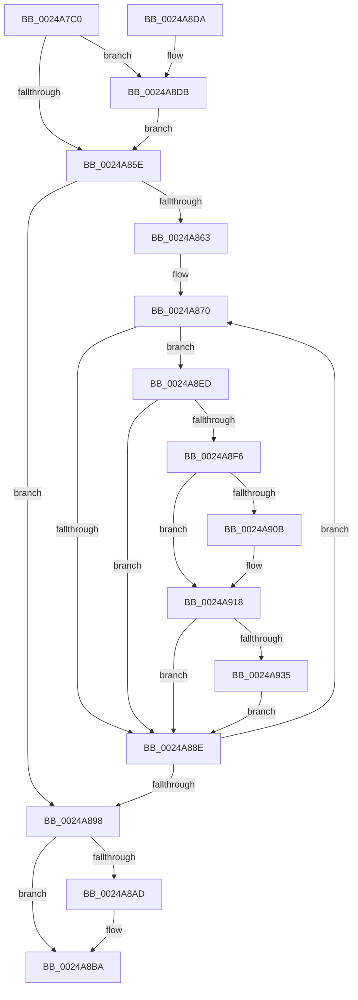

# MiUnlockMdlWritePages

- RVA: `0x0024A7C0`–`0x0024A943` (길이 `387` bytes)
- VA: `0x000000014024A7C0`
- 실행 섹션: `.text`
- PDB 이름 있음: `예`; PDB Function 태그: `아니요`
- unwind 정보 RVA: `0x00062B5C`
- 디코드: `93`개 명령, `387/387` bytes 표시
- 미해석 바이트: `0` (있으면 어셈블리에 `.byte`로 보존)

> 이 문서는 커널 이미지의 기계어와 PDB 기호를 분석해 생성했습니다. 4번과 5번은 함수 원형과 자료형을 바이너리 사용 방식에서 추정한 C 해석이며 원본 소스 복구 결과는 아닙니다.

## 1. Dependencies

- 직접 호출 지점: **9**; 고유 호출 대상: **6**
- 직접 호출자로 확인된 함수: **2**
- RIP 상대 이미지 참조: **1**

### Outgoing calls
- `0x0024A7E6` → [memset](../6C/memset_function_006C6C40.md) (function, `0x006C6C40`)
- `0x0024A880` → [MiAddPageToInsertList](MiAddPageToInsertList_function_0024A950.md) (function, `0x0024A950`)
- `0x0024A89F` → [MiInsertPagesInList](../33/MiInsertPagesInList_function_0033E270.md) (function, `0x0033E270`)
- `0x0024A8B5` → [KiLowerIrqlProcessIrqlFlags](../4F/KiLowerIrqlProcessIrqlFlags_function_004F5698.md) (function, `0x004F5698`)
- `0x0024A8E3` → [KiRaiseIrqlProcessIrqlFlags](../4F/KiRaiseIrqlProcessIrqlFlags_function_004F56FC.md) (function, `0x004F56FC`)
- `0x0024A8ED` → [KeShouldYieldProcessor](../27/KeShouldYieldProcessor_function_002773E0.md) (function, `0x002773E0`)
- `0x0024A8FD` → [MiInsertPagesInList](../33/MiInsertPagesInList_function_0033E270.md) (function, `0x0033E270`)
- `0x0024A913` → [KiLowerIrqlProcessIrqlFlags](../4F/KiLowerIrqlProcessIrqlFlags_function_004F5698.md) (function, `0x004F5698`)
- `0x0024A939` → [KiRaiseIrqlProcessIrqlFlags](../4F/KiRaiseIrqlProcessIrqlFlags_function_004F56FC.md) (function, `0x004F56FC`)

### Direct callers
- [MiFlushComplete](../29/MiFlushComplete_function_002980A0.md) at `0x002980E2`
- [MiUnlockFlushMdl](../40/MiUnlockFlushMdl_function_00404874.md) at `0x004048B6`

### Static image references
- `0x0024A856` → RVA `0x00FC6D20` (`ALMOSTRO`; read)

## 2. Other-region calls and transfers

- 다른 실행 섹션으로 향하는 call: **0**
- 별도 외부 분기/꼬리 이동을 확인하지 못했습니다.

## 3. Assembly (complete function range)

```asm
0024A7C0  48 89 5C 24 10                  mov qword ptr [rsp + 0x10], rbx
0024A7C5  48 89 6C 24 18                  mov qword ptr [rsp + 0x18], rbp
0024A7CA  56                              push rsi
0024A7CB  57                              push rdi
0024A7CC  41 56                           push r14
0024A7CE  48 81 EC 90 00 00 00            sub rsp, 0x90
0024A7D5  48 8B DA                        mov rbx, rdx
0024A7D8  48 8B F9                        mov rdi, rcx
0024A7DB  33 D2                           xor edx, edx
0024A7DD  48 8D 4C 24 20                  lea rcx, [rsp + 0x20]
0024A7E2  44 8D 42 68                     lea r8d, [rdx + 0x68]
0024A7E6  E8 55 C4 47 00                  call 0x1406c6c40
0024A7EB  48 63 03                        movsxd rax, dword ptr [rbx]
0024A7EE  33 F6                           xor esi, esi
0024A7F0  8B 4F 2C                        mov ecx, dword ptr [rdi + 0x2c]
0024A7F3  48 8D 5F 30                     lea rbx, [rdi + 0x30]
0024A7F7  03 4F 20                        add ecx, dword ptr [rdi + 0x20]
0024A7FA  8B 6F 28                        mov ebp, dword ptr [rdi + 0x28]
0024A7FD  81 E1 FF 0F 00 00               and ecx, 0xfff
0024A803  48 C1 F8 3F                     sar rax, 0x3f
0024A807  48 81 C5 FF 0F 00 00            add rbp, 0xfff
0024A80E  83 E0 43                        and eax, 0x43
0024A811  C7 84 24 80 00 00 00 01 00 00 00  mov dword ptr [rsp + 0x80], 1
0024A81C  48 89 84 24 B0 00 00 00         mov qword ptr [rsp + 0xb0], rax
0024A824  48 03 E9                        add rbp, rcx
0024A827  48 B8 FF FF FF FF 3F 00 00 00   movabs rax, 0x3fffffffff
0024A831  48 89 74 24 78                  mov qword ptr [rsp + 0x78], rsi
0024A836  48 89 44 24 30                  mov qword ptr [rsp + 0x30], rax
0024A83B  48 89 44 24 38                  mov qword ptr [rsp + 0x38], rax
0024A840  89 74 24 40                     mov dword ptr [rsp + 0x40], esi
0024A844  48 C1 ED 0C                     shr rbp, 0xc
0024A848  44 0F 20 C7                     mov rdi, cr8
0024A84C  41 BE 02 00 00 00               mov r14d, 2
0024A852  45 0F 22 C6                     mov cr8, r14
0024A856  39 35 C4 C4 D7 00               cmp dword ptr [rip + 0xd7c4c4], esi
0024A85C  75 7D                           jne 0x14024a8db
0024A85E  48 85 ED                        test rbp, rbp
0024A861  74 35                           je 0x14024a898
0024A863  0F 1F 40 00                     nop dword ptr [rax]
0024A867  66 0F 1F 84 00 00 00 00 00      nop word ptr [rax + rax]
0024A870  4C 8B 03                        mov r8, qword ptr [rbx]
0024A873  48 8D 94 24 B0 00 00 00         lea rdx, [rsp + 0xb0]
0024A87B  48 8D 4C 24 20                  lea rcx, [rsp + 0x20]
0024A880  E8 CB 00 00 00                  call 0x14024a950
0024A885  48 FF C6                        inc rsi
0024A888  40 F6 C6 3F                     test sil, 0x3f
0024A88C  74 5F                           je 0x14024a8ed
0024A88E  48 83 C3 08                     add rbx, 8
0024A892  48 83 ED 01                     sub rbp, 1
0024A896  75 D8                           jne 0x14024a870
0024A898  33 D2                           xor edx, edx
0024A89A  48 8D 4C 24 20                  lea rcx, [rsp + 0x20]
0024A89F  E8 CC 39 0F 00                  call 0x14033e270
0024A8A4  83 3D 75 C4 D7 00 00            cmp dword ptr [rip + 0xd7c475], 0
0024A8AB  74 0D                           je 0x14024a8ba
0024A8AD  44 0F 20 C1                     mov rcx, cr8
0024A8B1  40 0F B6 D7                     movzx edx, dil
0024A8B5  E8 DE AD 2A 00                  call 0x1404f5698
0024A8BA  40 0F B6 C7                     movzx eax, dil
0024A8BE  44 0F 22 C0                     mov cr8, rax
0024A8C2  4C 8D 9C 24 90 00 00 00         lea r11, [rsp + 0x90]
0024A8CA  49 8B 5B 28                     mov rbx, qword ptr [r11 + 0x28]
0024A8CE  49 8B 6B 30                     mov rbp, qword ptr [r11 + 0x30]
0024A8D2  49 8B E3                        mov rsp, r11
0024A8D5  41 5E                           pop r14
0024A8D7  5F                              pop rdi
0024A8D8  5E                              pop rsi
0024A8D9  C3                              ret
0024A8DA  CC                              int3
0024A8DB  41 0F B6 D6                     movzx edx, r14b
0024A8DF  40 0F B6 CF                     movzx ecx, dil
0024A8E3  E8 14 AE 2A 00                  call 0x1404f56fc
0024A8E8  E9 71 FF FF FF                  jmp 0x14024a85e
0024A8ED  E8 EE CA 02 00                  call 0x1402773e0
0024A8F2  85 C0                           test eax, eax
0024A8F4  74 98                           je 0x14024a88e
0024A8F6  33 D2                           xor edx, edx
0024A8F8  48 8D 4C 24 20                  lea rcx, [rsp + 0x20]
0024A8FD  E8 6E 39 0F 00                  call 0x14033e270
0024A902  83 3D 17 C4 D7 00 00            cmp dword ptr [rip + 0xd7c417], 0
0024A909  74 0D                           je 0x14024a918
0024A90B  44 0F 20 C1                     mov rcx, cr8
0024A90F  40 0F B6 D7                     movzx edx, dil
0024A913  E8 80 AD 2A 00                  call 0x1404f5698
0024A918  40 0F B6 C7                     movzx eax, dil
0024A91C  44 0F 22 C0                     mov cr8, rax
0024A920  44 0F 20 C1                     mov rcx, cr8
0024A924  45 0F 22 C6                     mov cr8, r14
0024A928  83 3D F1 C3 D7 00 00            cmp dword ptr [rip + 0xd7c3f1], 0
0024A92F  0F 84 59 FF FF FF               je 0x14024a88e
0024A935  41 0F B6 D6                     movzx edx, r14b
0024A939  E8 BE AD 2A 00                  call 0x1404f56fc
0024A93E  E9 4B FF FF FF                  jmp 0x14024a88e
```

## 4. C-style interpretation (structured pseudocode)

```c
__int64 __fastcall MiUnlockMdlWritePages(__int64 a1, __int64 a2)
{
    __int64 result;
    __int64 v_rbp;
    __int64 v_rbx;
    __int64 v_rsi;
    __int64 v_rsp;
    unsigned __int64 v_stack_m18;
    unsigned int v_stack_m28;
    unsigned __int64 v_stack_m30;
    unsigned int v_stack_m68;
    unsigned __int64 v_stack_m70;
    unsigned __int64 v_stack_m78;
    unsigned __int64 v_stack_m88;
    unsigned __int64 v_stack_p10;
    unsigned __int64 v_stack_p18;
    unsigned __int64 v_stack_p8;

    v_stack_p10 = v_rbx;
    v_stack_p18 = v_rbp;
    v_rsp = (v_rsp) - (144);
    a2 = 0;
    result = memset(v_stack_m88, a2, a2 + 104, a4);
    v_rsi = 0;
    a1 = (unsigned int)(((unsigned int)(*(unsigned int *)(a1 + 44))) + (*(unsigned int *)(a1 + 32)));
    a1 = (unsigned int)((a1) & (0xFFFULL));
    result = ((int)(*(unsigned int *)(a2))) >> (63);
    v_rbp = ((unsigned int)(*(unsigned int *)(a1 + 40))) + (0xFFFULL);
    result = (unsigned int)((result) & (67));
    v_stack_m28 = 1;
    v_stack_p8 = result;
    v_rbp = (v_rbp) + (a1);
    v_stack_m30 = 0;
    v_stack_m78 = result;
    v_stack_m70 = result;
    v_stack_m68 = 0;
    v_rbp = (v_rbp) >> (12);
    if ((*(unsigned int *)(v_rip + 14140612)) != 0) goto loc_0024A8DB;
loc_0024A85E:
    if (v_rbp == 0) goto loc_0024A898;
loc_0024A870:
    result = MiAddPageToInsertList(v_stack_m88, v_stack_p8, *(unsigned __int64 *)(a1 + 48), a4);
    v_rsi = (v_rsi) + 1;
    if ((((unsigned __int8)(v_rsi)) & (63)) == 0) goto loc_0024A8ED;
loc_0024A88E:
    v_rbx = (a1 + 48) + (8);
    v_rbp = (v_rbp) - (1);
    if (condition_is_not_equal) goto loc_0024A870;
loc_0024A898:
    a2 = 0;
    result = MiInsertPagesInList(v_stack_m88, a2, *(unsigned __int64 *)(a1 + 48), a4);
    if ((*(unsigned int *)(v_rip + 14140533)) != 0) {
        a1 = 2;
        a2 = (unsigned __int8)(v_cr8);
        result = KiLowerIrqlProcessIrqlFlags(a1, a2, *(unsigned __int64 *)(a1 + 48), a4);
    }
    return (unsigned __int8)(v_cr8);
loc_0024A8DB:
    result = KiRaiseIrqlProcessIrqlFlags((unsigned __int8)(v_cr8), 2, *(unsigned __int64 *)(a1 + 48), a4);
    goto loc_0024A85E;
loc_0024A8ED:
    result = KeShouldYieldProcessor((unsigned __int8)(v_cr8), 2, *(unsigned __int64 *)(a1 + 48), a4);
    if ((unsigned int)(result) == 0) goto loc_0024A88E;
    a2 = 0;
    result = MiInsertPagesInList(v_stack_m70, a2, *(unsigned __int64 *)(a1 + 48), a4);
    if ((*(unsigned int *)(v_rip + 14140439)) != 0) {
        a1 = (unsigned __int8)(v_cr8);
        a2 = (unsigned __int8)(v_cr8);
        result = KiLowerIrqlProcessIrqlFlags(a1, a2, *(unsigned __int64 *)(a1 + 48), a4);
    }
    if ((*(unsigned int *)(v_rip + 14140401)) == 0) goto loc_0024A88E;
    result = KiRaiseIrqlProcessIrqlFlags((unsigned __int8)(v_cr8), 2, *(unsigned __int64 *)(a1 + 48), a4);
    goto loc_0024A88E;
}
```

## 5. (Beta) C Style

```c
int64_t MiUnlockMdlWritePages(void *Arg1, void *Arg2)
{
    uint8_t *arg1 = (uint8_t *)Arg1;
    uint8_t *arg2 = (uint8_t *)Arg2;

    int64_t result;
    int64_t local_rbp;
    int64_t local_rbx;
    int64_t local_rsi;
    int64_t local_rsp;
    uint64_t v_stack_m18;
    uint32_t v_stack_m28;
    uint64_t v_stack_m30;
    uint32_t v_stack_m68;
    uint64_t v_stack_m70;
    uint64_t v_stack_m78;
    uint64_t v_stack_m88;
    uint64_t v_stack_p10;
    uint64_t v_stack_p18;
    uint64_t v_stack_p8;

    v_stack_p10 = local_rbx;
    v_stack_p18 = local_rbp;
    local_rsp = (local_rsp) - (144);
    Arg2 = 0;
    result = memset(v_stack_m88, Arg2, Arg2 + 104, a4);
    local_rsi = 0;
    Arg1 = (uint32_t)(((uint32_t)(*(uint32_t *)(arg1 + 0x2C))) + (*(uint32_t *)(arg1 + 0x20)));
    Arg1 = (uint32_t)((Arg1) & (0xFFFULL));
    result = ((int32_t)(*(uint32_t *)(arg2))) >> (63);
    local_rbp = ((uint32_t)(*(uint32_t *)(arg1 + 0x28))) + (0xFFFULL);
    result = (uint32_t)((result) & (67));
    v_stack_m28 = 1;
    v_stack_p8 = result;
    local_rbp = (local_rbp) + (Arg1);
    v_stack_m30 = 0;
    v_stack_m78 = result;
    v_stack_m70 = result;
    v_stack_m68 = 0;
    local_rbp = (local_rbp) >> (12);
    if ((*(uint32_t *)(v_rip + 0xD7C4C4)) != 0) goto loc_0024A8DB;
loc_0024A85E:
    if (local_rbp == 0) goto loc_0024A898;
loc_0024A870:
    result = MiAddPageToInsertList(v_stack_m88, v_stack_p8, *(uint64_t *)(arg1 + 0x30), a4);
    local_rsi = (local_rsi) + 1;
    if ((((uint8_t)(local_rsi)) & (63)) == 0) goto loc_0024A8ED;
loc_0024A88E:
    local_rbx = (Arg1 + 48) + (8);
    local_rbp = (local_rbp) - (1);
    if (condition_is_not_equal) goto loc_0024A870;
loc_0024A898:
    Arg2 = 0;
    result = MiInsertPagesInList(v_stack_m88, Arg2, *(uint64_t *)(arg1 + 0x30), a4);
    if ((*(uint32_t *)(v_rip + 0xD7C475)) != 0) {
        Arg1 = 2;
        Arg2 = (uint8_t)(v_cr8);
        result = KiLowerIrqlProcessIrqlFlags(Arg1, Arg2, *(uint64_t *)(arg1 + 0x30), a4);
    }
    return (uint8_t)(v_cr8);
loc_0024A8DB:
    result = KiRaiseIrqlProcessIrqlFlags((uint8_t)(v_cr8), 2, *(uint64_t *)(arg1 + 0x30), a4);
    goto loc_0024A85E;
loc_0024A8ED:
    result = KeShouldYieldProcessor((uint8_t)(v_cr8), 2, *(uint64_t *)(arg1 + 0x30), a4);
    if ((uint32_t)(result) == 0) goto loc_0024A88E;
    Arg2 = 0;
    result = MiInsertPagesInList(v_stack_m70, Arg2, *(uint64_t *)(arg1 + 0x30), a4);
    if ((*(uint32_t *)(v_rip + 0xD7C417)) != 0) {
        Arg1 = (uint8_t)(v_cr8);
        Arg2 = (uint8_t)(v_cr8);
        result = KiLowerIrqlProcessIrqlFlags(Arg1, Arg2, *(uint64_t *)(arg1 + 0x30), a4);
    }
    if ((*(uint32_t *)(v_rip + 0xD7C3F1)) == 0) goto loc_0024A88E;
    result = KiRaiseIrqlProcessIrqlFlags((uint8_t)(v_cr8), 2, *(uint64_t *)(arg1 + 0x30), a4);
    goto loc_0024A88E;
}
```

### 관측된 메모리 오프셋

구조체 형식이 확인되지 않은 접근은 인자 기준의 오프셋으로만 기록했습니다.

| 기준 인자 | 오프셋 표현 | 폭 (bit) | 접근 |
|---|---:|---:|---|
| `Arg1` | `+ 0x0` | `64` | `R` |
| `Arg1` | `+ 0x20` | `32` | `R` |
| `Arg1` | `+ 0x28` | `32` | `R` |
| `Arg1` | `+ 0x2C` | `32` | `R` |
| `Arg1` | `+ 0x30` | `64` | `R` |
| `Arg2` | `+ 0x0` | `32` | `R` |

## 6. Execution-region graph

[열기: 2D/3D 그래프와 함수 탐색 컨트롤 패널](../../../control-panel.html?section=text&rva=0x0024A7C0&view=graph)

- 2D 그래프는 위에서 아래로 흐르고, 3D 그래프는 빈 공간을 드래그해 회전합니다. Shift+드래그는 이동, 휠은 확대·축소, 함수 노드 선택은 대상 보고서 이동입니다.

### Static fallback


