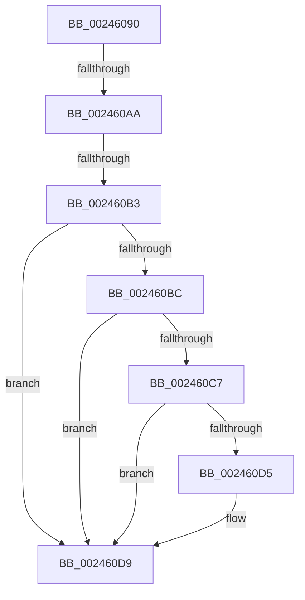

# MiUnlockProtoPoolPage

- RVA: `0x00246090`–`0x002460E6` (길이 `86` bytes)
- VA: `0x0000000140246090`
- 실행 섹션: `.text`
- PDB 이름 있음: `예`; PDB Function 태그: `예`
- unwind 정보 RVA: `0x00061EE0`
- 디코드: `25`개 명령, `86/86` bytes 표시
- 미해석 바이트: `0` (있으면 어셈블리에 `.byte`로 보존)

> 이 문서는 커널 이미지의 기계어와 PDB 기호를 분석해 생성했습니다. 4번과 5번은 함수 원형과 자료형을 바이너리 사용 방식에서 추정한 C 해석이며 원본 소스 복구 결과는 아닙니다.

## 1. Dependencies

- 직접 호출 지점: **0**; 고유 호출 대상: **0**
- 직접 호출자로 확인된 함수: **64**
- RIP 상대 이미지 참조: **0**

### Outgoing calls
- 직접 디코드된 call 명령이 없습니다.

### Direct callers
- [MmCopyMemory](../22/MmCopyMemory_function_002285B0.md) at `0x00228950`
- [MiCombineWithStandbyExisting](../22/MiCombineWithStandbyExisting_function_00229E74.md) at `0x00229F43`
- [MiCombineWithStandbyExisting](../22/MiCombineWithStandbyExisting_function_00229E74.md) at `0x00229F54`
- [MiCombineWithStandbyExisting](../22/MiCombineWithStandbyExisting_function_00229E74.md) at `0x0022A0F9`
- [MiCombineWithStandbyExisting](../22/MiCombineWithStandbyExisting_function_00229E74.md) at `0x0022A12D`
- [MiCombineWithExisting](../22/MiCombineWithExisting_function_0022B4B8.md) at `0x0022B671`
- [MiCombineWithExisting](../22/MiCombineWithExisting_function_0022B4B8.md) at `0x0022B87B`
- [MiResolveProtoCombine](../22/MiResolveProtoCombine_function_0022CD00.md) at `0x0022CDD6`
- [MiResolveProtoCombine](../22/MiResolveProtoCombine_function_0022CD00.md) at `0x0022CF9B`
- [MiWalkVaRange](MiWalkVaRange_function_00243BF0.md) at `0x00244204`
- [MiWalkVaRange](MiWalkVaRange_function_00243BF0.md) at `0x002445EC`
- [MiWalkVaRange](MiWalkVaRange_function_00243BF0.md) at `0x0024476C`
- [MiWalkVaRange](MiWalkVaRange_function_00243BF0.md) at `0x00244A8F`
- [MiResolveTransitionFault](../28/MiResolveTransitionFault_function_00282940.md) at `0x00282E13`
- [MiResolveTransitionFault](../28/MiResolveTransitionFault_function_00282940.md) at `0x002837B6`
- [sub_00283AFC](../28/Unknown_function_00283AFC.md) at `0x00283BC1`
- [sub_00283AFC](../28/Unknown_function_00283AFC.md) at `0x00283C6F`
- [sub_00283AFC](../28/Unknown_function_00283AFC.md) at `0x00283D34`
- [MiMigratePfn](../28/MiMigratePfn_function_0028DBB0.md) at `0x0028DF19`
- [MiInitializeNewImageSectionProtos](../2A/MiInitializeNewImageSectionProtos_function_002ABB80.md) at `0x002ABCDF`
- [MiInitializeNewImageSectionProtos](../2A/MiInitializeNewImageSectionProtos_function_002ABB80.md) at `0x002ABD94`
- [MiInitializeImageProtos](../2A/MiInitializeImageProtos_function_002ABDAC.md) at `0x002AC06E`
- [MiInitializeImageProtos](../2A/MiInitializeImageProtos_function_002ABDAC.md) at `0x002AC10D`
- [MiFinishMdlForMappedFileFault](../2A/MiFinishMdlForMappedFileFault_function_002AC974.md) at `0x002ACB3D`
- [MiCopyDataPageToImagePage](../2A/MiCopyDataPageToImagePage_function_002AE818.md) at `0x002AED1C`
- [MiUnlockDataCopyPages](../2A/MiUnlockDataCopyPages_function_002AEE14.md) at `0x002AEE44`
- [MiUnlockDataCopyPages](../2A/MiUnlockDataCopyPages_function_002AEE14.md) at `0x002AEE61`
- [MiGetWorkingSetInfoList](../2A/MiGetWorkingSetInfoList_function_002AF770.md) at `0x002AFC0B`
- [MiGetWorkingSetInfoList](../2A/MiGetWorkingSetInfoList_function_002AF770.md) at `0x002AFF26`
- [MiGetWorkingSetInfoList](../2A/MiGetWorkingSetInfoList_function_002AF770.md) at `0x002B02EB`
- [MiGetWorkingSetInfoList](../2A/MiGetWorkingSetInfoList_function_002AF770.md) at `0x002B0588`
- [MiGetWorkingSetInfoList](../2A/MiGetWorkingSetInfoList_function_002AF770.md) at `0x002B09BE`
- [MiGetWorkingSetInfoList](../2A/MiGetWorkingSetInfoList_function_002AF770.md) at `0x002B0AFA`
- [MiStealPage](../2B/MiStealPage_function_002B28D0.md) at `0x002B3236`
- [MiStealPage](../2B/MiStealPage_function_002B28D0.md) at `0x002B3A55`
- [MiStealPage](../2B/MiStealPage_function_002B28D0.md) at `0x002B3DE7`
- [MiStealPage](../2B/MiStealPage_function_002B28D0.md) at `0x002B3E07`
- [sub_002B5C0F](../2B/Unknown_function_002B5C0F.md) at `0x002B5C87`
- [sub_002B5D4A](../2B/Unknown_function_002B5D4A.md) at `0x002B5E1A`
- [sub_002B5FA0](../2B/Unknown_function_002B5FA0.md) at `0x002B604B`
- [sub_002B609E](../2B/Unknown_function_002B609E.md) at `0x002B60A3`
- [MiFinishHardFault](../2B/MiFinishHardFault_function_002B6F10.md) at `0x002B7382`
- [MiMakePageAvoidRead](../2B/MiMakePageAvoidRead_function_002B7DE0.md) at `0x002B825E`
- [MiMakePageAvoidRead](../2B/MiMakePageAvoidRead_function_002B7DE0.md) at `0x002B84B3`
- [MiWaitForPageWriteCompletion](../2C/MiWaitForPageWriteCompletion_function_002C9EBC.md) at `0x002C9F40`
- [sub_002F6DF4](../2F/Unknown_function_002F6DF4.md) at `0x002F6DFC`
- [sub_002F6E32](../2F/Unknown_function_002F6E32.md) at `0x002F6EEB`
- [sub_002F6E32](../2F/Unknown_function_002F6E32.md) at `0x002F75C1`
- [sub_002F6E32](../2F/Unknown_function_002F6E32.md) at `0x002F7625`
- [sub_002F6E32](../2F/Unknown_function_002F6E32.md) at `0x002F76A7`
- [sub_002F6E32](../2F/Unknown_function_002F6E32.md) at `0x002F76C1`
- [sub_002F7743](../2F/Unknown_function_002F7743.md) at `0x002F7776`
- [MiResolveProtoPteFault](../32/MiResolveProtoPteFault_function_00321750.md) at `0x00321B17`
- [MiResolveProtoPteFault](../32/MiResolveProtoPteFault_function_00321750.md) at `0x00321E66`
- [MiResolveProtoPteFault](../32/MiResolveProtoPteFault_function_00321750.md) at `0x00321F83`
- [MiResolveProtoPteFault](../32/MiResolveProtoPteFault_function_00321750.md) at `0x003220DB`
- [MiResolveProtoPteFault](../32/MiResolveProtoPteFault_function_00321750.md) at `0x00322175`
- [MiResolveProtoPteFault](../32/MiResolveProtoPteFault_function_00321750.md) at `0x003221E7`
- [MiResolveProtoPteFault](../32/MiResolveProtoPteFault_function_00321750.md) at `0x0032220D`
- [MiResolveProtoPteFault](../32/MiResolveProtoPteFault_function_00321750.md) at `0x003223AA`
- [sub_0032BD21](../32/Unknown_function_0032BD21.md) at `0x0032C05B`
- [MmCopyToCachedPage](../34/MmCopyToCachedPage_function_00347B44.md) at `0x00347EC6`
- [MmCopyToCachedPage](../34/MmCopyToCachedPage_function_00347B44.md) at `0x00347FFC`
- [MmCopyToCachedPage](../34/MmCopyToCachedPage_function_00347B44.md) at `0x00348110`
- [MmCopyToCachedPage](../34/MmCopyToCachedPage_function_00347B44.md) at `0x003481A8`
- [MiPfPutPagesInTransition](../36/MiPfPutPagesInTransition_function_003640EC.md) at `0x00364A5C`
- [MiPfPutPagesInTransition](../36/MiPfPutPagesInTransition_function_003640EC.md) at `0x00364ADD`
- [MiPfPutPagesInTransition](../36/MiPfPutPagesInTransition_function_003640EC.md) at `0x00364B3B`
- [MiPfPutPagesInTransition](../36/MiPfPutPagesInTransition_function_003640EC.md) at `0x00364B7D`
- [MiSoftFaultMappedView](../36/MiSoftFaultMappedView_function_00365364.md) at `0x003656A2`
- [MiSoftFaultMappedView](../36/MiSoftFaultMappedView_function_00365364.md) at `0x003656E1`
- [MiSoftFaultMappedView](../36/MiSoftFaultMappedView_function_00365364.md) at `0x0036576F`
- [MiSoftFaultMappedView](../36/MiSoftFaultMappedView_function_00365364.md) at `0x003657CE`
- [MiWalkEntireImage](../36/MiWalkEntireImage_function_00365D70.md) at `0x00365F86`
- [MiWalkEntireImage](../36/MiWalkEntireImage_function_00365D70.md) at `0x003661C0`
- [MiWalkEntireImage](../36/MiWalkEntireImage_function_00365D70.md) at `0x0036651B`
- [MiWalkEntireImage](../36/MiWalkEntireImage_function_00365D70.md) at `0x00366573`
- [MiWalkEntireImage](../36/MiWalkEntireImage_function_00365D70.md) at `0x00366B9E`
- [MiZeroCfgSystemWideBitmapWorker](../36/MiZeroCfgSystemWideBitmapWorker_function_00367060.md) at `0x0036738D`
- [MiZeroCfgSystemWideBitmapWorker](../36/MiZeroCfgSystemWideBitmapWorker_function_00367060.md) at `0x0036746D`
- [MiHandleCollidedFault](../36/MiHandleCollidedFault_function_00369B48.md) at `0x00369C31`
- [MiHandleCollidedFault](../36/MiHandleCollidedFault_function_00369B48.md) at `0x00369CFC`
- [MiWaitForCollidedFaultComplete](../36/MiWaitForCollidedFaultComplete_function_00369EDC.md) at `0x00369FA8`
- [MiCopyFileOnlyGlobalSubsectionPage](../36/MiCopyFileOnlyGlobalSubsectionPage_function_0036A9EC.md) at `0x0036ABEB`
- [MiCopyFileOnlyGlobalSubsectionPage](../36/MiCopyFileOnlyGlobalSubsectionPage_function_0036A9EC.md) at `0x0036AD65`
- [MiCopyFileOnlyGlobalSubsectionPage](../36/MiCopyFileOnlyGlobalSubsectionPage_function_0036A9EC.md) at `0x0036AD6F`
- [MiResolveMappedFileFault](../36/MiResolveMappedFileFault_function_0036B640.md) at `0x0036B868`
- [MiResolveMappedFileFault](../36/MiResolveMappedFileFault_function_0036B640.md) at `0x0036BB27`
- [MiResolveMappedFileFault](../36/MiResolveMappedFileFault_function_0036B640.md) at `0x0036BB43`
- [MiResolveMappedFileFault](../36/MiResolveMappedFileFault_function_0036B640.md) at `0x0036BC4B`
- [MiResolveMappedFileFault](../36/MiResolveMappedFileFault_function_0036B640.md) at `0x0036BE39`
- [MiResolvePageFileFault](../36/MiResolvePageFileFault_function_0036D968.md) at `0x0036E150`
- [MiResolvePageFileFault](../36/MiResolvePageFileFault_function_0036D968.md) at `0x0036E7BB`
- [MiResolvePageFileFault](../36/MiResolvePageFileFault_function_0036D968.md) at `0x0036EEB3`
- [MiResolvePageFileFault](../36/MiResolvePageFileFault_function_0036D968.md) at `0x0036EF56`
- [MiResolvePageFileFault](../36/MiResolvePageFileFault_function_0036D968.md) at `0x0036F073`
- [MiAllocateInPageSupport](../36/MiAllocateInPageSupport_function_0036F100.md) at `0x0036F192`
- [MiLockCode](../36/MiLockCode_function_0036F91C.md) at `0x0036FF2A`
- [MiDeleteMergedPte](../37/MiDeleteMergedPte_function_00371040.md) at `0x003710B5`
- [MiPurgeSubsection](../37/MiPurgeSubsection_function_003712F0.md) at `0x00371817`
- [MiPurgeSubsection](../37/MiPurgeSubsection_function_003712F0.md) at `0x00371897`
- [MiPurgeSubsection](../37/MiPurgeSubsection_function_003712F0.md) at `0x003718DE`
- [MiReplaceLockedPage](../38/MiReplaceLockedPage_function_0038351C.md) at `0x00383691`
- [MiReplaceLockedPage](../38/MiReplaceLockedPage_function_0038351C.md) at `0x003836DC`
- [MiReservePageFileSpace](../38/MiReservePageFileSpace_function_00383ED8.md) at `0x00384275`
- [MiInsertLargeVadMapping](../3F/MiInsertLargeVadMapping_function_003F0498.md) at `0x003F04E7`
- [MiFlushSection](../40/MiFlushSection_function_004036B0.md) at `0x00403AE5`
- [MiFlushSection](../40/MiFlushSection_function_004036B0.md) at `0x00403BB5`
- [MiFlushSection](../40/MiFlushSection_function_004036B0.md) at `0x00403C25`
- [MiFlushSection](../40/MiFlushSection_function_004036B0.md) at `0x00403DBF`
- [MiBuildReservationCluster](../40/MiBuildReservationCluster_function_004071A0.md) at `0x004078BB`
- [MiAnyProtosAreMapped](../46/MiAnyProtosAreMapped_function_00465464.md) at `0x00465505`
- [MiAnyProtosAreMapped](../46/MiAnyProtosAreMapped_function_00465464.md) at `0x00465561`
- [MiCopyHeaderIfResident](../48/MiCopyHeaderIfResident_function_00482184.md) at `0x004822C9`
- [MiCopyHeaderIfResident](../48/MiCopyHeaderIfResident_function_00482184.md) at `0x0048234F`
- [MiMakeImageReadOnly](../49/MiMakeImageReadOnly_function_0049CB74.md) at `0x0049CC6C`
- [MiMakeImageReadOnly](../49/MiMakeImageReadOnly_function_0049CB74.md) at `0x0049CC7F`
- [MiDeletePerSessionProtos](../4A/MiDeletePerSessionProtos_function_004A0840.md) at `0x004A08E1`
- [MiDeletePerSessionProtos](../4A/MiDeletePerSessionProtos_function_004A0840.md) at `0x004A097B`
- [MiReleasePageFileSectionInfo](../4A/MiReleasePageFileSectionInfo_function_004A9A44.md) at `0x004A9A59`
- [MiIdealClusterPage](../4D/MiIdealClusterPage_function_004DB964.md) at `0x004DBD5C`
- [MiInitializeDynamicPfns](../67/MiInitializeDynamicPfns_function_00672BD0.md) at `0x00672E94`
- [MiEliminateStaleExtents](../68/MiEliminateStaleExtents_function_006809A8.md) at `0x00680A4D`
- [MiEnableLargeSubsection](../68/MiEnableLargeSubsection_function_00680BC4.md) at `0x00680C49`
- [MiEnableLargeSubsection](../68/MiEnableLargeSubsection_function_00680BC4.md) at `0x00680D6F`
- [MiEnableLargeSubsection](../68/MiEnableLargeSubsection_function_00680BC4.md) at `0x00680D91`
- [MiFillFileOnlyProtoAsBad](../68/MiFillFileOnlyProtoAsBad_function_00680DB8.md) at `0x00680E26`
- [MiPurgeFileOnlyPfn](../68/MiPurgeFileOnlyPfn_function_00681CEC.md) at `0x00681DBA`
- [sub_006D6E94](../6D/Unknown_function_006D6E94.md) at `0x006D6F91`
- [sub_006D6E94](../6D/Unknown_function_006D6E94.md) at `0x006D6FB2`
- [sub_006D6E94](../6D/Unknown_function_006D6E94.md) at `0x006D703B`
- [sub_006D7070](../6D/Unknown_function_006D7070.md) at `0x006D70AC`
- [sub_006DA4DA](../6D/Unknown_function_006DA4DA.md) at `0x006DA53B`
- [sub_006DF29A](../6D/Unknown_function_006DF29A.md) at `0x006DF2D4`
- [sub_006E313A](../6E/Unknown_function_006E313A.md) at `0x006E32EB`
- [sub_006E3418](../6E/Unknown_function_006E3418.md) at `0x006E3478`
- [sub_006E3418](../6E/Unknown_function_006E3418.md) at `0x006E3555`
- [sub_006E3BD0](../6E/Unknown_function_006E3BD0.md) at `0x006E3BDE`

### Static image references
- 디코드된 RIP-relative 메모리 참조가 없습니다.

## 2. Other-region calls and transfers

- 다른 실행 섹션으로 향하는 call: **0**
- call이 아닌 외부 분기/꼬리 이동: **2**
  - `0x002460A4` → [sub_00246760](Unknown_function_00246760.md) (`tail-transfer`)
  - `0x002460B1` → [sub_00246120](Unknown_function_00246120.md) (`tail-transfer`)

## 3. Assembly (complete function range)

```asm
00246090  40 53                           push rbx
00246092  56                              push rsi
00246093  57                              push rdi
00246094  48 83 EC 50                     sub rsp, 0x50
00246098  0F B6 F2                        movzx esi, dl
0024609B  33 FF                           xor edi, edi
0024609D  48 8B D9                        mov rbx, rcx
002460A0  40 80 FE 12                     cmp sil, 0x12
002460A4  0F 84 B6 06 00 00               je 0x140246760
002460AA  F0 48 0F BA 6B 18 3F            lock bts qword ptr [rbx + 0x18], 0x3f
002460B1  72 6D                           jb 0x140246120
002460B3  48 8B 43 28                     mov rax, qword ptr [rbx + 0x28]
002460B7  48 85 C0                        test rax, rax
002460BA  78 1D                           js 0x1402460d9
002460BC  48 8B 43 28                     mov rax, qword ptr [rbx + 0x28]
002460C0  48 0F BA E0 28                  bt rax, 0x28
002460C5  72 12                           jb 0x1402460d9
002460C7  48 8B 43 28                     mov rax, qword ptr [rbx + 0x28]
002460CB  48 C1 E8 3C                     shr rax, 0x3c
002460CF  24 07                           and al, 7
002460D1  3C 01                           cmp al, 1
002460D3  74 04                           je 0x1402460d9
002460D5  48 8B 43 08                     mov rax, qword ptr [rbx + 8]
002460D9  48 8B 03                        mov rax, qword ptr [rbx]
002460DC  48 B9 FE FF FF FF FF 0F 00 00   movabs rcx, 0xffffffffffe
```

## 4. C-style interpretation (structured pseudocode)

```c
__int64 __fastcall MiUnlockProtoPoolPage(__int64 a1, unsigned __int8 a2)
{
    __int64 result;
    __int64 v_rdi;
    __int64 v_rsp;

    v_rsp = (v_rsp) - (80);
    v_rdi = 0;
    if (sign_flag) goto loc_002460D9;
    if (condition_is_below) goto loc_002460D9;
    result = (*(unsigned __int64 *)(a1 + 40)) >> (60);
    result = (unsigned __int8)((result) & (7));
    if (((unsigned __int8)(result)) != 1) {
        result = *(unsigned __int64 *)(a1 + 8);
    }
    return *(unsigned __int64 *)(a1);
}
```

## 5. (Beta) C Style

```c
int64_t MiUnlockProtoPoolPage(void *Arg1, uint8_t Arg2)
{
    uint8_t *arg1 = (uint8_t *)Arg1;

    int64_t result;
    int64_t local_rdi;
    int64_t local_rsp;

    local_rsp = (local_rsp) - (80);
    local_rdi = 0;
    if (sign_flag) goto loc_002460D9;
    if (condition_is_below) goto loc_002460D9;
    result = (*(uint64_t *)(arg1 + 0x28)) >> (60);
    result = (uint8_t)((result) & (7));
    if (((uint8_t)(result)) != 1) {
        result = *(uint64_t *)(arg1 + 0x8);
    }
    return *(uint64_t *)(arg1);
}
```

### 관측된 메모리 오프셋

구조체 형식이 확인되지 않은 접근은 인자 기준의 오프셋으로만 기록했습니다.

| 기준 인자 | 오프셋 표현 | 폭 (bit) | 접근 |
|---|---:|---:|---|
| `Arg1` | `+ 0x0` | `64` | `R` |
| `Arg1` | `+ 0x8` | `64` | `R` |
| `Arg1` | `+ 0x18` | `64` | `R/W` |
| `Arg1` | `+ 0x28` | `64` | `R` |

## 6. Execution-region graph

[열기: 2D/3D 그래프와 함수 탐색 컨트롤 패널](../../../control-panel.html?section=text&rva=0x00246090&view=graph)

- 2D 그래프는 위에서 아래로 흐르고, 3D 그래프는 빈 공간을 드래그해 회전합니다. Shift+드래그는 이동, 휠은 확대·축소, 함수 노드 선택은 대상 보고서 이동입니다.

### Static fallback


