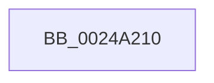

# MiWalkLeap

- RVA: `0x0024A210`–`0x0024A238` (길이 `40` bytes)
- VA: `0x000000014024A210`
- 실행 섹션: `.text`
- PDB 이름 있음: `예`; PDB Function 태그: `예`
- unwind 정보 RVA: `0x00062AC4`
- 디코드: `13`개 명령, `40/40` bytes 표시
- 미해석 바이트: `0` (있으면 어셈블리에 `.byte`로 보존)

> 이 문서는 커널 이미지의 기계어와 PDB 기호를 분석해 생성했습니다. 4번과 5번은 함수 원형과 자료형을 바이너리 사용 방식에서 추정한 C 해석이며 원본 소스 복구 결과는 아닙니다.

## 1. Dependencies

- 직접 호출 지점: **0**; 고유 호출 대상: **0**
- 직접 호출자로 확인된 함수: **1**
- RIP 상대 이미지 참조: **0**

### Outgoing calls
- 직접 디코드된 call 명령이 없습니다.

### Direct callers
- [sub_0027B90E](../27/Unknown_function_0027B90E.md) at `0x0027BAD1`

### Static image references
- 디코드된 RIP-relative 메모리 참조가 없습니다.

## 2. Other-region calls and transfers

- 다른 실행 섹션으로 향하는 call: **0**
- call이 아닌 외부 분기/꼬리 이동: **1**
  - `0x0024A232` → [sub_0024A3A0 + 0xE4](Unknown_function_0024A3A0.md) (`tail-transfer`)

## 3. Assembly (complete function range)

```asm
0024A210  40 55                           push rbp
0024A212  57                              push rdi
0024A213  41 55                           push r13
0024A215  41 56                           push r14
0024A217  41 57                           push r15
0024A219  48 83 EC 20                     sub rsp, 0x20
0024A21D  48 8B 41 20                     mov rax, qword ptr [rcx + 0x20]
0024A221  48 8B EA                        mov rbp, rdx
0024A224  4D 63 F8                        movsxd r15, r8d
0024A227  4C 8B F1                        mov r14, rcx
0024A22A  8B 80 B8 00 00 00               mov eax, dword ptr [rax + 0xb8]
0024A230  A8 0F                           test al, 0xf
0024A232  0F 85 4C 02 00 00               jne 0x14024a484
```

## 4. C-style interpretation (structured pseudocode)

```c
__int64 __fastcall MiWalkLeap(__int64 a1, __int64 a2, int a3)
{
    __int64 v_rsp;

    v_rsp = (v_rsp) - (32);
}
```

## 5. (Beta) C Style

```c
int64_t MiWalkLeap(void *Arg1, int64_t Arg2, int32_t Arg3)
{
    uint8_t *arg1 = (uint8_t *)Arg1;

    int64_t local_rsp;

    local_rsp = (local_rsp) - (32);
}
```

### 관측된 메모리 오프셋

구조체 형식이 확인되지 않은 접근은 인자 기준의 오프셋으로만 기록했습니다.

| 기준 인자 | 오프셋 표현 | 폭 (bit) | 접근 |
|---|---:|---:|---|
| `Arg1` | `+ 0x20` | `64` | `R` |

## 6. Execution-region graph

[열기: 2D/3D 그래프와 함수 탐색 컨트롤 패널](../../../control-panel.html?section=text&rva=0x0024A210&view=graph)

- 2D 그래프는 위에서 아래로 흐르고, 3D 그래프는 빈 공간을 드래그해 회전합니다. Shift+드래그는 이동, 휠은 확대·축소, 함수 노드 선택은 대상 보고서 이동입니다.

### Static fallback


