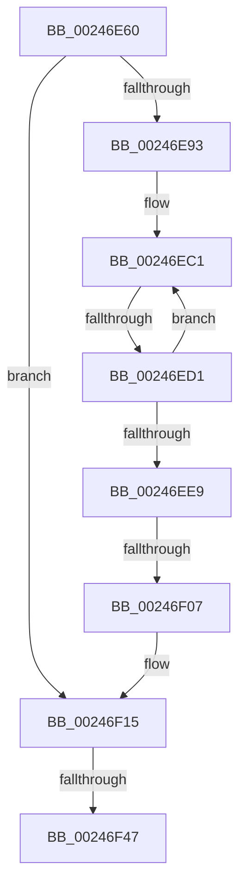

# MmUnmapLockedPages

- RVA: `0x00246E60`–`0x00246F4D` (길이 `237` bytes)
- VA: `0x0000000140246E60`
- 실행 섹션: `.text`
- PDB 이름 있음: `예`; PDB Function 태그: `예`
- unwind 정보 RVA: `0x000622F8`
- 디코드: `60`개 명령, `237/237` bytes 표시
- 미해석 바이트: `0` (있으면 어셈블리에 `.byte`로 보존)

> 이 문서는 커널 이미지의 기계어와 PDB 기호를 분석해 생성했습니다. 4번과 5번은 함수 원형과 자료형을 바이너리 사용 방식에서 추정한 C 해석이며 원본 소스 복구 결과는 아닙니다.

## 1. Dependencies

- 직접 호출 지점: **0**; 고유 호출 대상: **0**
- 직접 호출자로 확인된 함수: **70**
- RIP 상대 이미지 참조: **0**

### Outgoing calls
- 직접 디코드된 call 명령이 없습니다.

### Direct callers
- [SMKM_STORE_MGR&lt;SM_TRAITS&gt;::SmIoCtxWorkItemComplete](../20/SMKM_STORE_MGR_SM_TRAITS_SmIoCtxWorkItemComplete_function_00205850.md) at `0x00205A50`
- [MiFlushComplete](../29/MiFlushComplete_function_002980A0.md) at `0x002980D7`
- [IoFreeMdl](../29/IoFreeMdl_function_0029EA80.md) at `0x0029EB4A`
- [MmUnlockPages](../29/MmUnlockPages_function_0029EEE0.md) at `0x0029F0BC`
- [IopUnlockAndFreeMdl](../29/IopUnlockAndFreeMdl_function_0029F200.md) at `0x0029F21D`
- [MiZeroPageWrite](../29/MiZeroPageWrite_function_0029F280.md) at `0x0029F51F`
- [MiInitializeNewImageSectionProtos](../2A/MiInitializeNewImageSectionProtos_function_002ABB80.md) at `0x002ABBCA`
- [MiStoreWriteModifiedPages](../2B/MiStoreWriteModifiedPages_function_002B46C4.md) at `0x002B5375`
- [sub_0031763B](../31/Unknown_function_0031763B.md) at `0x00317654`
- [sub_003176F1](../31/Unknown_function_003176F1.md) at `0x003178B2`
- [MiPfCompleteCoalescedIo](../36/MiPfCompleteCoalescedIo_function_0036C344.md) at `0x0036C3AC`
- [SmKmUnlockMdl](../37/SmKmUnlockMdl_function_00372A44.md) at `0x00372A7F`
- [MiWaitForInPageComplete](../38/MiWaitForInPageComplete_function_00380AB8.md) at `0x00380CAE`
- [MiValidateInPage](../38/MiValidateInPage_function_00382E0C.md) at `0x00383224`
- [HalPutScatterGatherListV3](../3D/HalPutScatterGatherListV3_function_003DACA8.md) at `0x003DADA6`
- [HalFlushAdapterBuffersEx](../3D/HalFlushAdapterBuffersEx_function_003DADE0.md) at `0x003DB011`
- [sub_003DEC40](../3D/Unknown_function_003DEC40.md) at `0x003DEC50`
- [sub_003DF335](../3D/Unknown_function_003DF335.md) at `0x003DF378`
- [HalpDmaFreeMapRegisters](../3D/HalpDmaFreeMapRegisters_function_003DF5F4.md) at `0x003DF85F`
- [BgpFwFreeMemory](../3E/BgpFwFreeMemory_function_003E25E0.md) at `0x003E267A`
- [SMKM_STORE&lt;SM_TRAITS&gt;::SmStUnmapPhysicalRegion](../3E/SMKM_STORE_SM_TRAITS_SmStUnmapPhysicalRegion_function_003E76E0.md) at `0x003E774B`
- [PspIumFreePhysicalPages](../3E/PspIumFreePhysicalPages_function_003E7874.md) at `0x003E7904`
- [HalpAllocateCommonBufferVectorInternal](../3E/HalpAllocateCommonBufferVectorInternal_function_003E848C.md) at `0x003E883E`
- [HalpAllocateDomainCommonBufferInternal](../3E/HalpAllocateDomainCommonBufferInternal_function_003E8B64.md) at `0x003E8F9B`
- [HalpAllocateCommonBufferDmarThin](../3E/HalpAllocateCommonBufferDmarThin_function_003E8FF0.md) at `0x003E91CA`
- [HalpAllocateCommonBufferDmaThin](../3E/HalpAllocateCommonBufferDmaThin_function_003E9788.md) at `0x003E99E1`
- [EtwpAllocatePartitionMemory](../3E/EtwpAllocatePartitionMemory_function_003EB12C.md) at `0x003EB1B2`
- [EtwpFreePartitionMemory](../3E/EtwpFreePartitionMemory_function_003EBA08.md) at `0x003EBA37`
- [IopLiveDumpFreeDumpBuffers](../3F/IopLiveDumpFreeDumpBuffers_function_003F5FE8.md) at `0x003F60A7`
- [IopLiveDumpFreeDumpBuffers](../3F/IopLiveDumpFreeDumpBuffers_function_003F5FE8.md) at `0x003F6139`
- [HalFreeCommonBufferDmarThin](../3F/HalFreeCommonBufferDmarThin_function_003F6290.md) at `0x003F6306`
- [HalFreeCommonBufferDmaThin](../3F/HalFreeCommonBufferDmaThin_function_003F6800.md) at `0x003F6855`
- [MiFreePagesFromMdl](../3F/MiFreePagesFromMdl_function_003F8300.md) at `0x003F83A2`
- [HalFreeCommonBufferVector](../3F/HalFreeCommonBufferVector_function_003F87C0.md) at `0x003F8870`
- [MiPersistMdl](../40/MiPersistMdl_function_00402B2C.md) at `0x00402BAF`
- [MiUnlockFlushMdl](../40/MiUnlockFlushMdl_function_00404874.md) at `0x004048AB`
- [MiWriteComplete](../40/MiWriteComplete_function_004069B0.md) at `0x00406E46`
- [SmFpFree](../43/SmFpFree_function_00436350.md) at `0x0043639C`
- [HalpDmaReleaseBufferMappings](../46/HalpDmaReleaseBufferMappings_function_004637A0.md) at `0x004637F2`
- [HalInitializeBios](../53/HalInitializeBios_function_0053D9A0.md) at `0x0053DC82`
- [HalpDmaFreeChildAdapter](../55/HalpDmaFreeChildAdapter_function_00550E30.md) at `0x00550F7A`
- [HalpDmaFreeChildAdapter](../55/HalpDmaFreeChildAdapter_function_00550E30.md) at `0x00551054`
- [HalFreeCommonBufferV3](../55/HalFreeCommonBufferV3_function_00551A70.md) at `0x00551B3F`
- [IopLiveDumpAllocateFromIOSpace](../59/IopLiveDumpAllocateFromIOSpace_function_00599DEC.md) at `0x0059A23E`
- [PspIumAllocatePhysicalPages](../5E/PspIumAllocatePhysicalPages_function_005E4574.md) at `0x005E464C`
- [PspIumAllocateSecurePool](../5E/PspIumAllocateSecurePool_function_005E4698.md) at `0x005E47C7`
- [PspIumAllocateSecurePool](../5E/PspIumAllocateSecurePool_function_005E4698.md) at `0x005E4858`
- [PspIumAllocateSecurePool](../5E/PspIumAllocateSecurePool_function_005E4698.md) at `0x005E4876`
- [SmRecordDecompressionFailureDumpPayload](../61/SmRecordDecompressionFailureDumpPayload_function_00611120.md) at `0x00611373`
- [DifMmUnmapLockedPagesWrapper](../63/DifMmUnmapLockedPagesWrapper_function_00636F90.md) at `0x00637067`
- [MiReadPagefilePage](../66/MiReadPagefilePage_function_0066F78C.md) at `0x0066FA21`
- [MiZeroPageFile](../67/MiZeroPageFile_function_00671180.md) at `0x0067132C`
- [MiUnlockAndFreeDvPatchImage](../68/MiUnlockAndFreeDvPatchImage_function_00682A78.md) at `0x00682A97`
- [sub_006EA22C](../6E/Unknown_function_006EA22C.md) at `0x006EA290`
- [sub_006EB65A](../6E/Unknown_function_006EB65A.md) at `0x006EB6A3`
- [sub_006EB65A](../6E/Unknown_function_006EB65A.md) at `0x006EB711`
- [sub_006F88AE](../6F/Unknown_function_006F88AE.md) at `0x006F8D63`
- [PopFreeHiberContext](../../page/70/PopFreeHiberContext_function_00704F1C.md) at `0x00704FA7`
- [HalpDmaAllocateLocalContiguousPool](../../page/70/HalpDmaAllocateLocalContiguousPool_function_00708EE4.md) at `0x0070905A`
- [HalpDmaAllocateLocalScatterPool](../../page/70/HalpDmaAllocateLocalScatterPool_function_007091D4.md) at `0x007092B3`
- [IopSetFileObjectIosbRange](../../page/71/IopSetFileObjectIosbRange_function_0071C1C8.md) at `0x0071C603`
- [IoFreeKsrPersistentMemory](../../page/72/IoFreeKsrPersistentMemory_function_00724370.md) at `0x007243CA`
- [IoReserveKsrPersistentMemoryEx](../../page/72/IoReserveKsrPersistentMemoryEx_function_007248C0.md) at `0x00724BEC`
- [PipGetPersistentMemory](../../page/72/PipGetPersistentMemory_function_00725290.md) at `0x00725824`
- [PipGetPersistentMemory](../../page/72/PipGetPersistentMemory_function_00725290.md) at `0x007258E6`
- [ExpProfileDelete](../../page/7D/ExpProfileDelete_function_007D1FE0.md) at `0x007D2001`
- [NtStopProfile](../../page/7D/NtStopProfile_function_007D25C0.md) at `0x007D2678`
- [MiZeroPageFileFirstPage](../../page/80/MiZeroPageFileFirstPage_function_00800678.md) at `0x00800742`
- [MiApplyImageHotPatch](../../page/80/MiApplyImageHotPatch_function_00802330.md) at `0x0080254B`
- [MiCreateNewSection](../../page/98/MiCreateNewSection_function_00985DB0.md) at `0x009861FD`
- [MiDeleteImageCreationMdls](../../page/98/MiDeleteImageCreationMdls_function_009884FC.md) at `0x0098853E`
- [IopCleanupFileObjectIosbRange](../../page/9E/IopCleanupFileObjectIosbRange_function_009E88A8.md) at `0x009E8933`
- [HalpDmaGrowScatterMapBuffers](../../page/AA/HalpDmaGrowScatterMapBuffers_function_00AA2CF0.md) at `0x00AA2D5C`
- [HalpDmaGrowContiguousMapBuffers](../../page/AD/HalpDmaGrowContiguousMapBuffers_function_00AD6D14.md) at `0x00AD6DEA`
- [ViFreeMapRegisterFile](../../pagevrfy/B9/ViFreeMapRegisterFile_function_00B98B8C.md) at `0x00B98C16`
- [ViFreeMapRegisterFile](../../pagevrfy/B9/ViFreeMapRegisterFile_function_00B98B8C.md) at `0x00B98C2B`
- [VfFillAllocatePagesForMdl](../../pagevrfy/BB/VfFillAllocatePagesForMdl_function_00BB1020.md) at `0x00BB1070`

### Static image references
- 디코드된 RIP-relative 메모리 참조가 없습니다.

## 2. Other-region calls and transfers

- 다른 실행 섹션으로 향하는 call: **0**
- call이 아닌 외부 분기/꼬리 이동: **3**
  - `0x00246ECB` → [sub_002471D9](Unknown_function_002471D9.md) (`tail-transfer`)
  - `0x00246F01` → [sub_002471D9 + 0x18](Unknown_function_002471D9.md) (`tail-transfer`)
  - `0x00246F41` → [sub_002471AF](Unknown_function_002471AF.md) (`tail-transfer`)

## 3. Assembly (complete function range)

```asm
00246E60  48 89 5C 24 10                  mov qword ptr [rsp + 0x10], rbx
00246E65  48 89 6C 24 18                  mov qword ptr [rsp + 0x18], rbp
00246E6A  56                              push rsi
00246E6B  57                              push rdi
00246E6C  41 54                           push r12
00246E6E  41 56                           push r14
00246E70  41 57                           push r15
00246E72  48 83 EC 50                     sub rsp, 0x50
00246E76  44 0F B7 42 0A                  movzx r8d, word ptr [rdx + 0xa]
00246E7B  45 33 F6                        xor r14d, r14d
00246E7E  66 41 0F BA E0 09               bt r8w, 9
00246E84  48 8B F2                        mov rsi, rdx
00246E87  48 8B E9                        mov rbp, rcx
00246E8A  45 8B CE                        mov r9d, r14d
00246E8D  0F 83 82 00 00 00               jae 0x140246f15
00246E93  8B 4A 20                        mov ecx, dword ptr [rdx + 0x20]
00246E96  4C 8D 42 30                     lea r8, [rdx + 0x30]
00246E9A  03 4A 2C                        add ecx, dword ptr [rdx + 0x2c]
00246E9D  49 BC FF FF FF FF FF FF FF 7F   movabs r12, 0x7fffffffffffffff
00246EA7  8B 42 28                        mov eax, dword ptr [rdx + 0x28]
00246EAA  81 E1 FF 0F 00 00               and ecx, 0xfff
00246EB0  48 05 FF 0F 00 00               add rax, 0xfff
00246EB6  48 03 C8                        add rcx, rax
00246EB9  48 C1 E9 0C                     shr rcx, 0xc
00246EBD  49 8D 14 C8                     lea rdx, [r8 + rcx*8]
00246EC1  48 8B 1A                        mov rbx, qword ptr [rdx]
00246EC4  4C 8D 7A 08                     lea r15, [rdx + 8]
00246EC8  49 3B D0                        cmp rdx, r8
00246ECB  0F 85 08 03 00 00               jne 0x1402471d9
00246ED1  48 8B C3                        mov rax, rbx
00246ED4  49 83 C0 08                     add r8, 8
00246ED8  49 23 C4                        and rax, r12
00246EDB  41 FF C1                        inc r9d
00246EDE  48 89 02                        mov qword ptr [rdx], rax
00246EE1  49 8B D7                        mov rdx, r15
00246EE4  48 85 DB                        test rbx, rbx
00246EE7  79 D8                           jns 0x140246ec1
00246EE9  44 0F B7 46 0A                  movzx r8d, word ptr [rsi + 0xa]
00246EEE  41 C1 E1 0C                     shl r9d, 0xc
00246EF2  44 01 4E 28                     add dword ptr [rsi + 0x28], r9d
00246EF6  41 8B C9                        mov ecx, r9d
00246EF9  48 29 4E 20                     sub qword ptr [rsi + 0x20], rcx
00246EFD  41 F6 C0 01                     test r8b, 1
00246F01  0F 85 EA 02 00 00               jne 0x1402471f1
00246F07  B8 FF FD FF FF                  mov eax, 0xfffffdff
00246F0C  66 44 23 C0                     and r8w, ax
00246F10  66 44 89 46 0A                  mov word ptr [rsi + 0xa], r8w
00246F15  8B 4E 20                        mov ecx, dword ptr [rsi + 0x20]
00246F18  48 B8 FF FF FE FF FF 7F 00 00   movabs rax, 0x7ffffffeffff
00246F22  8B 56 2C                        mov edx, dword ptr [rsi + 0x2c]
00246F25  8B 7E 28                        mov edi, dword ptr [rsi + 0x28]
00246F28  03 CA                           add ecx, edx
00246F2A  48 81 C7 FF 0F 00 00            add rdi, 0xfff
00246F31  81 E1 FF 0F 00 00               and ecx, 0xfff
00246F37  48 03 F9                        add rdi, rcx
00246F3A  48 C1 EF 0C                     shr rdi, 0xc
00246F3E  48 3B E8                        cmp rbp, rax
00246F41  0F 86 68 02 00 00               jbe 0x1402471af
00246F47  41 8B C1                        mov eax, r9d
00246F4A  48 2B E8                        sub rbp, rax
```

## 4. C-style interpretation (structured pseudocode)

```c
__int64 __fastcall MmUnmapLockedPages(__int64 a1, __int64 a2)
{
    __int64 result;
    __int64 v_r14;
    __int64 v_rbp;
    __int64 v_rdi;
    __int64 v_rsp;
    unsigned __int64 v_stack_p10;
    unsigned __int64 v_stack_p18;

    v_stack_p10 = v_rbx;
    v_stack_p18 = v_rbp;
    v_rsp = (v_rsp) - (80);
    v_r14 = 0;
    if (condition_is_above_or_equal) goto loc_00246F15;
    a1 = (unsigned int)(((unsigned int)(*(unsigned int *)(a2 + 32))) + (*(unsigned int *)(a2 + 44)));
    a1 = (unsigned int)((a1) & (0xFFFULL));
    result = ((unsigned int)(*(unsigned int *)(a2 + 40))) + (0xFFFULL);
    a1 = (a1) + (result);
    a1 = (a1) >> (12);
loc_00246EC1:
    a3 = (a2 + 48) + (8);
    result = (*(unsigned __int64 *)(a2 + 48 + a1 * 8)) & (v_r12);
    a4 = (unsigned int)((0) + 1);
    *(unsigned __int64 *)(a2 + 48 + a1 * 8) = result;
    if (!sign_flag) goto loc_00246EC1;
    a4 = (unsigned int)((a4) << (12));
    a3 = (unsigned __int16)((*(unsigned __int16 *)(a2 + 10)) & ((unsigned __int16)((unsigned int)(0xFFFFFDFFULL))));
    *(unsigned __int16 *)(a2 + 10) = (unsigned __int16)(a3);
loc_00246F15:
    a1 = (unsigned int)(((unsigned int)(*(unsigned int *)(a2 + 32))) + ((unsigned int)((unsigned int)(*(unsigned int *)(a2 + 44)))));
    v_rdi = ((unsigned int)(*(unsigned int *)(a2 + 40))) + (0xFFFULL);
    a1 = (unsigned int)((a1) & (0xFFFULL));
    v_rdi = (v_rdi) + (a1);
    v_rdi = (v_rdi) >> (12);
    v_rbp = (a1) - ((unsigned int)((unsigned int)(a4)));
    return (unsigned int)((unsigned int)(a4));
}
```

## 5. (Beta) C Style

```c
int64_t MmUnmapLockedPages(int64_t Arg1, void *Arg2)
{
    uint8_t *arg2 = (uint8_t *)Arg2;

    int64_t result;
    int64_t local_r14;
    int64_t local_rbp;
    int64_t local_rdi;
    int64_t local_rsp;
    uint64_t v_stack_p10;
    uint64_t v_stack_p18;

    v_stack_p10 = local_rbx;
    v_stack_p18 = local_rbp;
    local_rsp = (local_rsp) - (80);
    local_r14 = 0;
    if (condition_is_above_or_equal) goto loc_00246F15;
    Arg1 = (uint32_t)(((uint32_t)(*(uint32_t *)(arg2 + 0x20))) + (*(uint32_t *)(arg2 + 0x2C)));
    Arg1 = (uint32_t)((Arg1) & (0xFFFULL));
    result = ((uint32_t)(*(uint32_t *)(arg2 + 0x28))) + (0xFFFULL);
    Arg1 = (Arg1) + (result);
    Arg1 = (Arg1) >> (12);
loc_00246EC1:
    a3 = (Arg2 + 48) + (8);
    result = (*(uint64_t *)(arg2 + 0x30 + Arg1 * 8)) & (local_r12);
    a4 = (uint32_t)((0) + 1);
    *(uint64_t *)(arg2 + 0x30 + Arg1 * 8) = result;
    if (!sign_flag) goto loc_00246EC1;
    a4 = (uint32_t)((a4) << (12));
    a3 = (uint16_t)((*(uint16_t *)(arg2 + 0xA)) & ((uint16_t)((uint32_t)(0xFFFFFDFFULL))));
    *(uint16_t *)(arg2 + 0xA) = (uint16_t)(a3);
loc_00246F15:
    Arg1 = (uint32_t)(((uint32_t)(*(uint32_t *)(arg2 + 0x20))) + ((uint32_t)((uint32_t)(*(uint32_t *)(arg2 + 0x2C)))));
    local_rdi = ((uint32_t)(*(uint32_t *)(arg2 + 0x28))) + (0xFFFULL);
    Arg1 = (uint32_t)((Arg1) & (0xFFFULL));
    local_rdi = (local_rdi) + (Arg1);
    local_rdi = (local_rdi) >> (12);
    local_rbp = (Arg1) - ((uint32_t)((uint32_t)(a4)));
    return (uint32_t)((uint32_t)(a4));
}
```

### 관측된 메모리 오프셋

구조체 형식이 확인되지 않은 접근은 인자 기준의 오프셋으로만 기록했습니다.

| 기준 인자 | 오프셋 표현 | 폭 (bit) | 접근 |
|---|---:|---:|---|
| `Arg2` | `+ 0x0` | `64` | `R` |
| `Arg2` | `+ 0x0 + rcx*8` | `64` | `R` |
| `Arg2` | `+ 0x8` | `64` | `R` |
| `Arg2` | `+ 0xA` | `16` | `R` |
| `Arg2` | `+ 0xA` | `16` | `W` |
| `Arg2` | `+ 0x20` | `32` | `R` |
| `Arg2` | `+ 0x20` | `64` | `R/W` |
| `Arg2` | `+ 0x28` | `32` | `R` |
| `Arg2` | `+ 0x28` | `32` | `R/W` |
| `Arg2` | `+ 0x2C` | `32` | `R` |
| `Arg2` | `+ 0x30` | `64` | `R` |

## 6. Execution-region graph

[열기: 2D/3D 그래프와 함수 탐색 컨트롤 패널](../../../control-panel.html?section=text&rva=0x00246E60&view=graph)

- 2D 그래프는 위에서 아래로 흐르고, 3D 그래프는 빈 공간을 드래그해 회전합니다. Shift+드래그는 이동, 휠은 확대·축소, 함수 노드 선택은 대상 보고서 이동입니다.

### Static fallback


