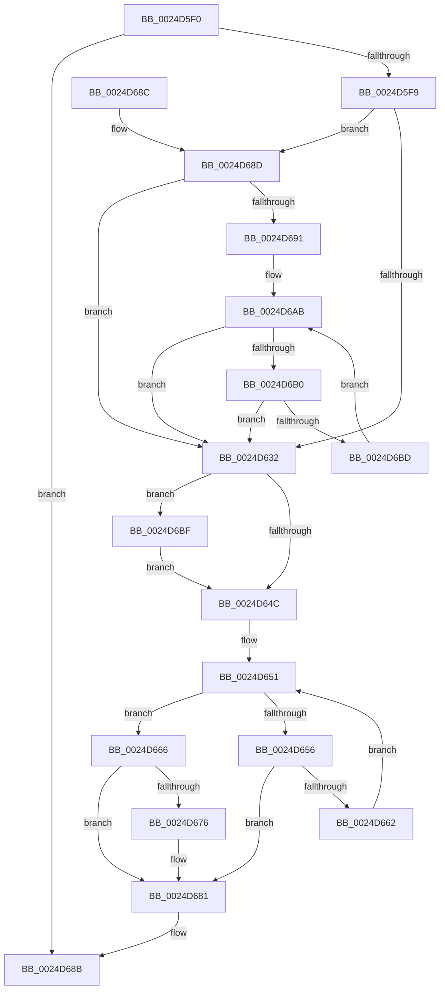

# PopPepCompleteComponentActiveActivity

- RVA: `0x0024D5F0`–`0x0024D6D8` (길이 `232` bytes)
- VA: `0x000000014024D5F0`
- 실행 섹션: `.text`
- PDB 이름 있음: `예`; PDB Function 태그: `아니요`
- unwind 정보 RVA: `0x00062E14`
- 디코드: `60`개 명령, `232/232` bytes 표시
- 미해석 바이트: `0` (있으면 어셈블리에 `.byte`로 보존)

> 이 문서는 커널 이미지의 기계어와 PDB 기호를 분석해 생성했습니다. 4번과 5번은 함수 원형과 자료형을 바이너리 사용 방식에서 추정한 C 해석이며 원본 소스 복구 결과는 아닙니다.

## 1. Dependencies

- 직접 호출 지점: **2**; 고유 호출 대상: **2**
- 직접 호출자로 확인된 함수: **1**
- RIP 상대 이미지 참조: **1**

### Outgoing calls
- `0x0024D63F` → [PopPepGetComponentPreferedIdleState](../2B/PopPepGetComponentPreferedIdleState_function_002BF800.md) (function, `0x002BF800`)
- `0x0024D6CE` → [PopPepTriggerActivity](PopPepTriggerActivity_function_0024CDB0.md) (function, `0x0024CDB0`)

### Direct callers
- [PopPepProcessEvent](PopPepProcessEvent_function_0024B930.md) at `0x0024BAC1`

### Static image references
- `0x0024D628` → RVA `0x00F0774C` (`.data`; read)

## 2. Other-region calls and transfers

- 다른 실행 섹션으로 향하는 call: **0**
- 별도 외부 분기/꼬리 이동을 확인하지 못했습니다.

## 3. Assembly (complete function range)

```asm
0024D5F0  48 85 D2                        test rdx, rdx
0024D5F3  0F 84 92 00 00 00               je 0x14024d68b
0024D5F9  48 89 5C 24 08                  mov qword ptr [rsp + 8], rbx
0024D5FE  57                              push rdi
0024D5FF  48 83 EC 20                     sub rsp, 0x20
0024D603  48 A1 08 00 00 00 80 F7 FF FF   movabs rax, qword ptr [0xfffff78000000008]
0024D60D  48 8B DA                        mov rbx, rdx
0024D610  48 89 82 88 00 00 00            mov qword ptr [rdx + 0x88], rax
0024D617  48 8B F9                        mov rdi, rcx
0024D61A  8B 92 BC 00 00 00               mov edx, dword ptr [rdx + 0xbc]
0024D620  FF CA                           dec edx
0024D622  89 93 98 00 00 00               mov dword ptr [rbx + 0x98], edx
0024D628  8A 05 1E A1 CB 00               mov al, byte ptr [rip + 0xcba11e]
0024D62E  84 C0                           test al, al
0024D630  74 5B                           je 0x14024d68d
0024D632  89 93 A0 00 00 00               mov dword ptr [rbx + 0xa0], edx
0024D638  48 8B CB                        mov rcx, rbx
0024D63B  83 63 04 FE                     and dword ptr [rbx + 4], 0xfffffffe
0024D63F  E8 BC 21 07 00                  call 0x1402bf800
0024D644  3B 83 B0 00 00 00               cmp eax, dword ptr [rbx + 0xb0]
0024D64A  75 73                           jne 0x14024d6bf
0024D64C  BA 01 00 00 00                  mov edx, 1
0024D651  83 FA 03                        cmp edx, 3
0024D654  77 10                           ja 0x14024d666
0024D656  8B C2                           mov eax, edx
0024D658  48 8B 4C C3 38                  mov rcx, qword ptr [rbx + rax*8 + 0x38]
0024D65D  83 39 00                        cmp dword ptr [rcx], 0
0024D660  75 1F                           jne 0x14024d681
0024D662  FF C2                           inc edx
0024D664  EB EB                           jmp 0x14024d651
0024D666  8B 83 BC 00 00 00               mov eax, dword ptr [rbx + 0xbc]
0024D66C  FF C8                           dec eax
0024D66E  39 83 B0 00 00 00               cmp dword ptr [rbx + 0xb0], eax
0024D674  75 0B                           jne 0x14024d681
0024D676  83 63 04 FD                     and dword ptr [rbx + 4], 0xfffffffd
0024D67A  F0 FF 8F 8C 00 00 00            lock dec dword ptr [rdi + 0x8c]
0024D681  48 8B 5C 24 30                  mov rbx, qword ptr [rsp + 0x30]
0024D686  48 83 C4 20                     add rsp, 0x20
0024D68A  5F                              pop rdi
0024D68B  C3                              ret
0024D68C  CC                              int3
0024D68D  85 D2                           test edx, edx
0024D68F  74 A1                           je 0x14024d632
0024D691  48 8B 83 C8 00 00 00            mov rax, qword ptr [rbx + 0xc8]
0024D698  4C 8D 04 55 01 00 00 00         lea r8, [rdx*2 + 1]
0024D6A0  4C 8B 4B 78                     mov r9, qword ptr [rbx + 0x78]
0024D6A4  4C 03 C2                        add r8, rdx
0024D6A7  4E 8D 04 C0                     lea r8, [rax + r8*8]
0024D6AB  4D 39 08                        cmp qword ptr [r8], r9
0024D6AE  76 82                           jbe 0x14024d632
0024D6B0  49 83 E8 18                     sub r8, 0x18
0024D6B4  83 C2 FF                        add edx, -1
0024D6B7  0F 84 75 FF FF FF               je 0x14024d632
0024D6BD  EB EC                           jmp 0x14024d6ab
0024D6BF  44 8B C8                        mov r9d, eax
0024D6C2  41 B8 01 00 00 00               mov r8d, 1
0024D6C8  48 8B D3                        mov rdx, rbx
0024D6CB  48 8B CF                        mov rcx, rdi
0024D6CE  E8 DD F6 FF FF                  call 0x14024cdb0
0024D6D3  E9 74 FF FF FF                  jmp 0x14024d64c
```

## 4. C-style interpretation (structured pseudocode)

```c
__int64 __fastcall PopPepCompleteComponentActiveActivity(__int64 a1, __int64 a2)
{
    __int64 result;
    __int64 v_rsp;
    unsigned __int64 v_stack_p8;

    if (a2 == 0) goto loc_0024D68B;
    v_stack_p8 = v_rbx;
    v_rsp = (v_rsp) - (32);
    *(unsigned __int64 *)(a2 + 136) = result;
    a2 = (unsigned int)(((unsigned int)(*(unsigned int *)(a2 + 188))) - 1);
    *(unsigned int *)(a2 + 152) = (unsigned int)(a2);
    if ((unsigned __int8)(*(unsigned __int8 *)(v_rip + 13345054)) == 0) goto loc_0024D68D;
loc_0024D632:
    *(unsigned int *)(a2 + 160) = (unsigned int)(a2);
    result = PopPepGetComponentPreferedIdleState(a2, a2, a3, a4);
    if (((unsigned int)(result)) != (*(unsigned int *)(a2 + 176))) goto loc_0024D6BF;
loc_0024D64C:
loc_0024D651:
    if (1 > 3) goto loc_0024D666;
    if ((*(unsigned int *)(*(unsigned __int64 *)(a2 + 1 * 8 + 56))) != 0) goto loc_0024D681;
    a2 = (unsigned int)((1) + 1);
    goto loc_0024D651;
loc_0024D666:
    result = (unsigned int)(((unsigned int)(*(unsigned int *)(a2 + 188))) - 1);
    if ((*(unsigned int *)(a2 + 176)) == ((unsigned int)(result))) {
    }
    v_rsp = (v_rsp) + (32);
loc_0024D68B:
    return result;
loc_0024D68D:
    if ((unsigned int)(a2) == 0) goto loc_0024D632;
    a3 = (a2 * 2 + 1) + (a2);
loc_0024D6AB:
    if ((*(unsigned __int64 *)(*(unsigned __int64 *)(v_stack_p8 + 200) + a3 * 8)) <= (*(unsigned __int64 *)(v_stack_p8 + 120))) goto loc_0024D632;
    a3 = (*(unsigned __int64 *)(v_stack_p8 + 200) + a3 * 8) - (24);
    a2 = (unsigned int)((a2) + (-1));
    if (condition_is_equal) goto loc_0024D632;
    goto loc_0024D6AB;
loc_0024D6BF:
    result = PopPepTriggerActivity(a1, v_stack_p8, 1, (unsigned int)((unsigned int)(*(unsigned __int64 *)(v_stack_p8 + 200))));
    goto loc_0024D64C;
}
```

## 5. (Beta) C Style

```c
int64_t PopPepCompleteComponentActiveActivity(void *Arg1, int64_t Arg2)
{
    uint8_t *arg1 = (uint8_t *)Arg1;

    int64_t result;
    int64_t local_rsp;
    uint64_t v_stack_p8;

    if (Arg2 == 0) goto loc_0024D68B;
    v_stack_p8 = local_rbx;
    local_rsp = (local_rsp) - (32);
    *(uint64_t *)(Arg2 + 0x88) = result;
    Arg2 = (uint32_t)(((uint32_t)(*(uint32_t *)(Arg2 + 0xBC))) - 1);
    *(uint32_t *)(Arg2 + 0x98) = (uint32_t)(Arg2);
    if ((uint8_t)(*(uint8_t *)(v_rip + 0xCBA11E)) == 0) goto loc_0024D68D;
loc_0024D632:
    *(uint32_t *)(Arg2 + 0xA0) = (uint32_t)(Arg2);
    result = PopPepGetComponentPreferedIdleState(Arg2, Arg2, a3, a4);
    if (((uint32_t)(result)) != (*(uint32_t *)(Arg2 + 0xB0))) goto loc_0024D6BF;
loc_0024D64C:
loc_0024D651:
    if (1 > 3) goto loc_0024D666;
    if ((*(uint32_t *)(*(uint64_t *)(Arg2 + 0x1 * 8 + 0x38))) != 0) goto loc_0024D681;
    Arg2 = (uint32_t)((1) + 1);
    goto loc_0024D651;
loc_0024D666:
    result = (uint32_t)(((uint32_t)(*(uint32_t *)(Arg2 + 0xBC))) - 1);
    if ((*(uint32_t *)(Arg2 + 0xB0)) == ((uint32_t)(result))) {
    }
    local_rsp = (local_rsp) + (32);
loc_0024D68B:
    return result;
loc_0024D68D:
    if ((uint32_t)(Arg2) == 0) goto loc_0024D632;
    a3 = (Arg2 * 2 + 1) + (Arg2);
loc_0024D6AB:
    if ((*(uint64_t *)(*(uint64_t *)(v_stack_p8 + 0xC8) + a3 * 8)) <= (*(uint64_t *)(v_stack_p8 + 0x78))) goto loc_0024D632;
    a3 = (*(uint64_t *)(v_stack_p8 + 0xC8) + a3 * 8) - (24);
    Arg2 = (uint32_t)((Arg2) + (-1));
    if (condition_is_equal) goto loc_0024D632;
    goto loc_0024D6AB;
loc_0024D6BF:
    result = PopPepTriggerActivity(Arg1, v_stack_p8, 1, (uint32_t)((uint32_t)(*(uint64_t *)(v_stack_p8 + 0xC8))));
    goto loc_0024D64C;
}
```

### 관측된 메모리 오프셋

구조체 형식이 확인되지 않은 접근은 인자 기준의 오프셋으로만 기록했습니다.

| 기준 인자 | 오프셋 표현 | 폭 (bit) | 접근 |
|---|---:|---:|---|
| `Arg1` | `+ 0x8C` | `32` | `R/W` |

## 6. Execution-region graph

[열기: 2D/3D 그래프와 함수 탐색 컨트롤 패널](../../../control-panel.html?section=text&rva=0x0024D5F0&view=graph)

- 2D 그래프는 위에서 아래로 흐르고, 3D 그래프는 빈 공간을 드래그해 회전합니다. Shift+드래그는 이동, 휠은 확대·축소, 함수 노드 선택은 대상 보고서 이동입니다.

### Static fallback


