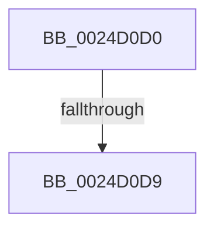

# PopPepPromoteActivities

- RVA: `0x0024D0D0`–`0x0024D0DE` (길이 `14` bytes)
- VA: `0x000000014024D0D0`
- 실행 섹션: `.text`
- PDB 이름 있음: `예`; PDB Function 태그: `아니요`
- unwind 정보 RVA: `0x00062CE4`
- 디코드: `4`개 명령, `14/14` bytes 표시
- 미해석 바이트: `0` (있으면 어셈블리에 `.byte`로 보존)

> 이 문서는 커널 이미지의 기계어와 PDB 기호를 분석해 생성했습니다. 4번과 5번은 함수 원형과 자료형을 바이너리 사용 방식에서 추정한 C 해석이며 원본 소스 복구 결과는 아닙니다.

## 1. Dependencies

- 직접 호출 지점: **0**; 고유 호출 대상: **0**
- 직접 호출자로 확인된 함수: **7**
- RIP 상대 이미지 참조: **0**

### Outgoing calls
- 직접 디코드된 call 명령이 없습니다.

### Direct callers
- [PopPepProcessEvent](PopPepProcessEvent_function_0024B930.md) at `0x0024C1D1`
- [PopPepSurprisePowerOn](../26/PopPepSurprisePowerOn_function_0026E480.md) at `0x0026E509`
- [PopPepUpdateConstraints](../26/PopPepUpdateConstraints_function_0026F5C8.md) at `0x0026F664`
- [PopPepComponentSetLatency](../2B/PopPepComponentSetLatency_function_002BF3D8.md) at `0x002BF49B`
- [PopPepIdleTimeoutRoutine](../45/PopPepIdleTimeoutRoutine_function_00458E10.md) at `0x00458F35`
- [PopPepComponentSetResidency](../5D/PopPepComponentSetResidency_function_005DC9A4.md) at `0x005DCA52`
- [PopPepComponentSetWakeHint](../5D/PopPepComponentSetWakeHint_function_005DCAA0.md) at `0x005DCB45`

### Static image references
- 디코드된 RIP-relative 메모리 참조가 없습니다.

## 2. Other-region calls and transfers

- 다른 실행 섹션으로 향하는 call: **0**
- call이 아닌 외부 분기/꼬리 이동: **1**
  - `0x0024D0D3` → [sub_0024D53A + 0x5](Unknown_function_0024D53A.md) (`tail-transfer`)

## 3. Assembly (complete function range)

```asm
0024D0D0  45 85 C0                        test r8d, r8d
0024D0D3  0F 84 66 04 00 00               je 0x14024d53f
0024D0D9  55                              push rbp
0024D0DA  48 83 EC 60                     sub rsp, 0x60
```

## 4. C-style interpretation (structured pseudocode)

```c
void __fastcall PopPepPromoteActivities(__int64 a1, __int64 a2, int a3)
{
    __int64 v_rsp;

    v_rsp = (v_rsp) - (96);
    return;
}
```

## 5. (Beta) C Style

```c
void PopPepPromoteActivities(int64_t Arg1, int64_t Arg2, int32_t Arg3)
{
    int64_t local_rsp;

    local_rsp = (local_rsp) - (96);
    return;
}
```

## 6. Execution-region graph

[열기: 2D/3D 그래프와 함수 탐색 컨트롤 패널](../../../control-panel.html?section=text&rva=0x0024D0D0&view=graph)

- 2D 그래프는 위에서 아래로 흐르고, 3D 그래프는 빈 공간을 드래그해 회전합니다. Shift+드래그는 이동, 휠은 확대·축소, 함수 노드 선택은 대상 보고서 이동입니다.

### Static fallback


