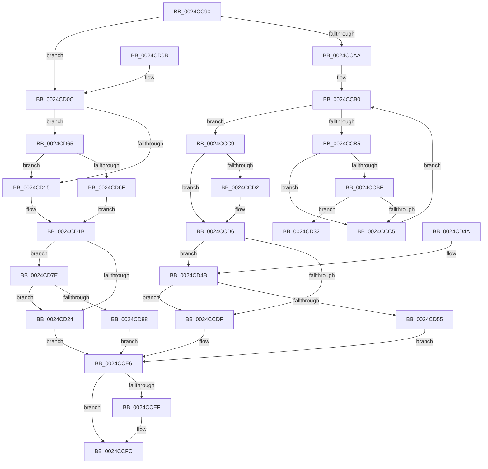

# PopPepReleaseActivityLink

- RVA: `0x0024CC90`–`0x0024CD9B` (길이 `267` bytes)
- VA: `0x000000014024CC90`
- 실행 섹션: `.text`
- PDB 이름 있음: `예`; PDB Function 태그: `아니요`
- unwind 정보 RVA: `0x00062CB8`
- 디코드: `73`개 명령, `267/267` bytes 표시
- 미해석 바이트: `0` (있으면 어셈블리에 `.byte`로 보존)

> 이 문서는 커널 이미지의 기계어와 PDB 기호를 분석해 생성했습니다. 4번과 5번은 함수 원형과 자료형을 바이너리 사용 방식에서 추정한 C 해석이며 원본 소스 복구 결과는 아닙니다.

## 1. Dependencies

- 직접 호출 지점: **5**; 고유 호출 대상: **4**
- 직접 호출자로 확인된 함수: **6**
- RIP 상대 이미지 참조: **3**

### Outgoing calls
- `0x0024CCF7` → [KiLowerIrqlProcessIrqlFlags](../4F/KiLowerIrqlProcessIrqlFlags_function_004F5698.md) (function, `0x004F5698`)
- `0x0024CD3A` → [ExReleaseSpinLockExclusive](../2C/ExReleaseSpinLockExclusive_function_002C0EF0.md) (function, `0x002C0EF0`)
- `0x0024CD5E` → [ExpReleaseSpinLockExclusiveFromDpcLevelInstrumented](../2C/ExpReleaseSpinLockExclusiveFromDpcLevelInstrumented_function_002C0F44.md) (function, `0x002C0F44`)
- `0x0024CD77` → [ExpReleaseSpinLockExclusiveFromDpcLevelInstrumented](../2C/ExpReleaseSpinLockExclusiveFromDpcLevelInstrumented_function_002C0F44.md) (function, `0x002C0F44`)
- `0x0024CD91` → [ExpReleaseSpinLockSharedFromDpcLevelInstrumented](../2F/ExpReleaseSpinLockSharedFromDpcLevelInstrumented_function_002F0F48.md) (function, `0x002F0F48`)

### Direct callers
- [PopPepProcessEvent](PopPepProcessEvent_function_0024B930.md) at `0x0024C21A`
- [PopPepSurprisePowerOn](../26/PopPepSurprisePowerOn_function_0026E480.md) at `0x0026E4C7`
- [PopPepUpdateConstraints](../26/PopPepUpdateConstraints_function_0026F5C8.md) at `0x0026F6A8`
- [PopPepCompleteComponentIdleState](../4D/PopPepCompleteComponentIdleState_function_004D8EC4.md) at `0x004D8F50`
- [PopPepCompleteComponentIdleState](../4D/PopPepCompleteComponentIdleState_function_004D8EC4.md) at `0x004D8F65`
- [PopPepComponentSetResidency](../5D/PopPepComponentSetResidency_function_005DC9A4.md) at `0x005DCA80`
- [PopPepComponentSetWakeHint](../5D/PopPepComponentSetWakeHint_function_005DCAA0.md) at `0x005DCB73`

### Static image references
- `0x0024CCD6` → RVA `0x00FC6B06` (`ALMOSTRO`; read)
- `0x0024CCE6` → RVA `0x00FC6D20` (`ALMOSTRO`; read)
- `0x0024CD4B` → RVA `0x00F0DE58` (`.data`; read)

## 2. Other-region calls and transfers

- 다른 실행 섹션으로 향하는 call: **0**
- 별도 외부 분기/꼬리 이동을 확인하지 못했습니다.

## 3. Assembly (complete function range)

```asm
0024CC90  48 89 5C 24 08                  mov qword ptr [rsp + 8], rbx
0024CC95  57                              push rdi
0024CC96  48 83 EC 20                     sub rsp, 0x20
0024CC9A  41 0F B6 F9                     movzx edi, r9b
0024CC9E  4C 8B CA                        mov r9, rdx
0024CCA1  48 8B D9                        mov rbx, rcx
0024CCA4  41 80 F8 01                     cmp r8b, 1
0024CCA8  75 62                           jne 0x14024cd0c
0024CCAA  33 C0                           xor eax, eax
0024CCAC  0F 1F 40 00                     nop dword ptr [rax]
0024CCB0  83 F8 06                        cmp eax, 6
0024CCB3  73 14                           jae 0x14024ccc9
0024CCB5  4C 8B 44 C1 48                  mov r8, qword ptr [rcx + rax*8 + 0x48]
0024CCBA  4D 85 C0                        test r8, r8
0024CCBD  74 06                           je 0x14024ccc5
0024CCBF  41 83 38 00                     cmp dword ptr [r8], 0
0024CCC3  75 6D                           jne 0x14024cd32
0024CCC5  FF C0                           inc eax
0024CCC7  EB E7                           jmp 0x14024ccb0
0024CCC9  80 B9 88 00 00 00 00            cmp byte ptr [rcx + 0x88], 0
0024CCD0  74 04                           je 0x14024ccd6
0024CCD2  C6 41 7D 00                     mov byte ptr [rcx + 0x7d], 0
0024CCD6  F6 05 29 9E D7 00 01            test byte ptr [rip + 0xd79e29], 1
0024CCDD  75 6C                           jne 0x14024cd4b
0024CCDF  C7 41 40 00 00 00 00            mov dword ptr [rcx + 0x40], 0
0024CCE6  83 3D 33 A0 D7 00 00            cmp dword ptr [rip + 0xd7a033], 0
0024CCED  74 0D                           je 0x14024ccfc
0024CCEF  40 0F B6 D7                     movzx edx, dil
0024CCF3  44 0F 20 C1                     mov rcx, cr8
0024CCF7  E8 9C 89 2A 00                  call 0x1404f5698
0024CCFC  44 0F 22 C7                     mov cr8, rdi
0024CD00  48 8B 5C 24 30                  mov rbx, qword ptr [rsp + 0x30]
0024CD05  48 83 C4 20                     add rsp, 0x20
0024CD09  5F                              pop rdi
0024CD0A  C3                              ret
0024CD0B  CC                              int3
0024CD0C  F6 05 F3 9D D7 00 01            test byte ptr [rip + 0xd79df3], 1
0024CD13  75 50                           jne 0x14024cd65
0024CD15  C7 02 00 00 00 00               mov dword ptr [rdx], 0
0024CD1B  F6 05 E4 9D D7 00 01            test byte ptr [rip + 0xd79de4], 1
0024CD22  75 5A                           jne 0x14024cd7e
0024CD24  F0 81 63 40 FF FF FF BF         lock and dword ptr [rbx + 0x40], 0xbfffffff
0024CD2C  F0 FF 4B 40                     lock dec dword ptr [rbx + 0x40]
0024CD30  EB B4                           jmp 0x14024cce6
0024CD32  48 83 C1 40                     add rcx, 0x40
0024CD36  40 0F B6 D7                     movzx edx, dil
0024CD3A  E8 B1 41 07 00                  call 0x1402c0ef0
0024CD3F  48 8B 5C 24 30                  mov rbx, qword ptr [rsp + 0x30]
0024CD44  48 83 C4 20                     add rsp, 0x20
0024CD48  5F                              pop rdi
0024CD49  C3                              ret
0024CD4A  CC                              int3
0024CD4B  8B 05 07 11 CC 00               mov eax, dword ptr [rip + 0xcc1107]
0024CD51  85 C0                           test eax, eax
0024CD53  75 8A                           jne 0x14024ccdf
0024CD55  48 8B 54 24 28                  mov rdx, qword ptr [rsp + 0x28]
0024CD5A  48 83 C1 40                     add rcx, 0x40
0024CD5E  E8 E1 41 07 00                  call 0x1402c0f44
0024CD63  EB 81                           jmp 0x14024cce6
0024CD65  8B 05 ED 10 CC 00               mov eax, dword ptr [rip + 0xcc10ed]
0024CD6B  85 C0                           test eax, eax
0024CD6D  75 A6                           jne 0x14024cd15
0024CD6F  48 8B 54 24 28                  mov rdx, qword ptr [rsp + 0x28]
0024CD74  49 8B C9                        mov rcx, r9
0024CD77  E8 C8 41 07 00                  call 0x1402c0f44
0024CD7C  EB 9D                           jmp 0x14024cd1b
0024CD7E  8B 05 D4 10 CC 00               mov eax, dword ptr [rip + 0xcc10d4]
0024CD84  85 C0                           test eax, eax
0024CD86  75 9C                           jne 0x14024cd24
0024CD88  48 8B 54 24 28                  mov rdx, qword ptr [rsp + 0x28]
0024CD8D  48 8D 4B 40                     lea rcx, [rbx + 0x40]
0024CD91  E8 B2 41 0A 00                  call 0x1402f0f48
0024CD96  E9 4B FF FF FF                  jmp 0x14024cce6
```

## 4. C-style interpretation (structured pseudocode)

```c
__int64 __fastcall PopPepReleaseActivityLink(__int64 a1, __int64 a2, unsigned __int8 a3, unsigned __int8 a4)
{
    __int64 result;
    __int64 v_rsp;
    unsigned __int64 v_stack_p30;
    unsigned __int64 v_stack_p50;
    unsigned __int64 v_stack_p8;

    v_stack_p8 = v_rbx;
    v_rsp = (v_rsp) - (32);
    if (a3 != 1) goto loc_0024CD0C;
    result = 0;
loc_0024CCB0:
    if (0 >= 6) goto loc_0024CCC9;
    if (*(unsigned __int64 *)(a1 + result * 8 + 72) == 0) goto loc_0024CCC5;
    if ((*(unsigned int *)(*(unsigned __int64 *)(a1 + result * 8 + 72))) != 0) goto loc_0024CD32;
loc_0024CCC5:
    result = (unsigned int)((result) + 1);
    goto loc_0024CCB0;
loc_0024CCC9:
    if ((*(unsigned __int8 *)(a1 + 136)) != 0) {
        *(unsigned __int8 *)(a1 + 125) = 0;
    }
    if (((*(unsigned __int8 *)(v_rip + 14130729)) & (1)) != 0) goto loc_0024CD4B;
loc_0024CCDF:
    *(unsigned int *)(a1 + 64) = 0;
loc_0024CCE6:
    if ((*(unsigned int *)(v_rip + 14131251)) != 0) {
        a2 = a4;
        a1 = v_cr8;
        result = KiLowerIrqlProcessIrqlFlags(a1, a2, *(unsigned __int64 *)(a1 + result * 8 + 72), a2);
    }
    v_rsp = (v_rsp) + (32);
    return result;
loc_0024CD0C:
    if (((*(unsigned __int8 *)(v_rip + 14130675)) & (1)) != 0) goto loc_0024CD65;
loc_0024CD15:
    *(unsigned int *)(a2) = 0;
loc_0024CD1B:
    if (((*(unsigned __int8 *)(v_rip + 14130660)) & (1)) != 0) goto loc_0024CD7E;
loc_0024CD24:
    goto loc_0024CCE6;
loc_0024CD32:
    a1 = (a1) + (64);
    result = ExReleaseSpinLockExclusive(a1, a4, *(unsigned __int64 *)(a1 + result * 8 + 72), a2);
    v_rsp = (v_rsp) + (32);
    return result;
loc_0024CD4B:
    if ((unsigned int)((unsigned int)(*(unsigned int *)(v_rip + 13373703))) != 0) goto loc_0024CCDF;
    a1 = (a1) + (64);
    result = ExpReleaseSpinLockExclusiveFromDpcLevelInstrumented(a1, v_stack_p50, *(unsigned __int64 *)(a1 + result * 8 + 72), a2);
    goto loc_0024CCE6;
loc_0024CD65:
    if ((unsigned int)((unsigned int)(*(unsigned int *)(v_rip + 13373677))) != 0) goto loc_0024CD15;
    result = ExpReleaseSpinLockExclusiveFromDpcLevelInstrumented(a2, v_stack_p50, *(unsigned __int64 *)(a1 + result * 8 + 72), a2);
    goto loc_0024CD1B;
loc_0024CD7E:
    if ((unsigned int)((unsigned int)(*(unsigned int *)(v_rip + 13373652))) != 0) goto loc_0024CD24;
    result = ExpReleaseSpinLockSharedFromDpcLevelInstrumented(v_stack_p30 + 64, v_stack_p50, *(unsigned __int64 *)(a1 + result * 8 + 72), a2);
    goto loc_0024CCE6;
}
```

## 5. (Beta) C Style

```c
int64_t PopPepReleaseActivityLink(void *Arg1, void *Arg2, uint8_t Arg3, uint8_t Arg4)
{
    uint8_t *arg1 = (uint8_t *)Arg1;
    uint8_t *arg2 = (uint8_t *)Arg2;

    int64_t result;
    int64_t local_rsp;
    uint64_t v_stack_p30;
    uint64_t v_stack_p50;
    uint64_t v_stack_p8;

    v_stack_p8 = local_rbx;
    local_rsp = (local_rsp) - (32);
    if (Arg3 != 1) goto loc_0024CD0C;
    result = 0;
loc_0024CCB0:
    if (0 >= 6) goto loc_0024CCC9;
    if (*(uint64_t *)(arg1 + result * 8 + 0x48) == 0) goto loc_0024CCC5;
    if ((*(uint32_t *)(*(uint64_t *)(arg1 + result * 8 + 0x48))) != 0) goto loc_0024CD32;
loc_0024CCC5:
    result = (uint32_t)((result) + 1);
    goto loc_0024CCB0;
loc_0024CCC9:
    if ((*(uint8_t *)(arg1 + 0x88)) != 0) {
        *(uint8_t *)(arg1 + 0x7D) = 0;
    }
    if (((*(uint8_t *)(v_rip + 0xD79E29)) & (1)) != 0) goto loc_0024CD4B;
loc_0024CCDF:
    *(uint32_t *)(arg1 + 0x40) = 0;
loc_0024CCE6:
    if ((*(uint32_t *)(v_rip + 0xD7A033)) != 0) {
        Arg2 = Arg4;
        Arg1 = v_cr8;
        result = KiLowerIrqlProcessIrqlFlags(Arg1, Arg2, *(uint64_t *)(arg1 + result * 8 + 0x48), Arg2);
    }
    local_rsp = (local_rsp) + (32);
    return result;
loc_0024CD0C:
    if (((*(uint8_t *)(v_rip + 0xD79DF3)) & (1)) != 0) goto loc_0024CD65;
loc_0024CD15:
    *(uint32_t *)(arg2) = 0;
loc_0024CD1B:
    if (((*(uint8_t *)(v_rip + 0xD79DE4)) & (1)) != 0) goto loc_0024CD7E;
loc_0024CD24:
    goto loc_0024CCE6;
loc_0024CD32:
    Arg1 = (Arg1) + (64);
    result = ExReleaseSpinLockExclusive(Arg1, Arg4, *(uint64_t *)(arg1 + result * 8 + 0x48), Arg2);
    local_rsp = (local_rsp) + (32);
    return result;
loc_0024CD4B:
    if ((uint32_t)((uint32_t)(*(uint32_t *)(v_rip + 0xCC1107))) != 0) goto loc_0024CCDF;
    Arg1 = (Arg1) + (64);
    result = ExpReleaseSpinLockExclusiveFromDpcLevelInstrumented(Arg1, v_stack_p50, *(uint64_t *)(arg1 + result * 8 + 0x48), Arg2);
    goto loc_0024CCE6;
loc_0024CD65:
    if ((uint32_t)((uint32_t)(*(uint32_t *)(v_rip + 0xCC10ED))) != 0) goto loc_0024CD15;
    result = ExpReleaseSpinLockExclusiveFromDpcLevelInstrumented(Arg2, v_stack_p50, *(uint64_t *)(arg1 + result * 8 + 0x48), Arg2);
    goto loc_0024CD1B;
loc_0024CD7E:
    if ((uint32_t)((uint32_t)(*(uint32_t *)(v_rip + 0xCC10D4))) != 0) goto loc_0024CD24;
    result = ExpReleaseSpinLockSharedFromDpcLevelInstrumented(v_stack_p30 + 64, v_stack_p50, *(uint64_t *)(arg1 + result * 8 + 0x48), Arg2);
    goto loc_0024CCE6;
}
```

### 관측된 메모리 오프셋

구조체 형식이 확인되지 않은 접근은 인자 기준의 오프셋으로만 기록했습니다.

| 기준 인자 | 오프셋 표현 | 폭 (bit) | 접근 |
|---|---:|---:|---|
| `Arg1` | `+ 0x40` | `32` | `R/W` |
| `Arg1` | `+ 0x40` | `32` | `W` |
| `Arg1` | `+ 0x40` | `64` | `R` |
| `Arg1` | `+ 0x48 + rax*8` | `64` | `R` |
| `Arg1` | `+ 0x7D` | `8` | `W` |
| `Arg1` | `+ 0x88` | `8` | `R` |
| `Arg2` | `+ 0x0` | `32` | `W` |

## 6. Execution-region graph

[열기: 2D/3D 그래프와 함수 탐색 컨트롤 패널](../../../control-panel.html?section=text&rva=0x0024CC90&view=graph)

- 2D 그래프는 위에서 아래로 흐르고, 3D 그래프는 빈 공간을 드래그해 회전합니다. Shift+드래그는 이동, 휠은 확대·축소, 함수 노드 선택은 대상 보고서 이동입니다.

### Static fallback


