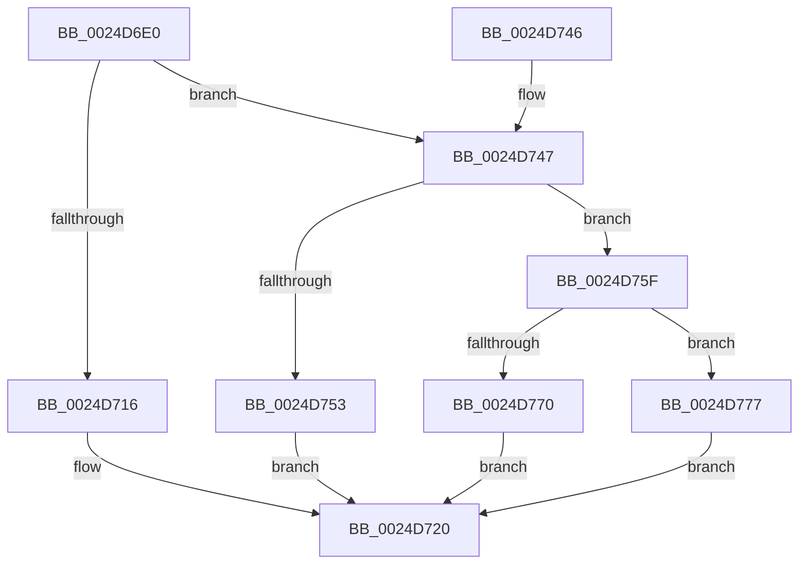

# PopPepStartActivity

- RVA: `0x0024D6E0`–`0x0024D77E` (길이 `158` bytes)
- VA: `0x000000014024D6E0`
- 실행 섹션: `.text`
- PDB 이름 있음: `예`; PDB Function 태그: `아니요`
- unwind 정보 RVA: `0x00062E24`
- 디코드: `42`개 명령, `158/158` bytes 표시
- 미해석 바이트: `0` (있으면 어셈블리에 `.byte`로 보존)

> 이 문서는 커널 이미지의 기계어와 PDB 기호를 분석해 생성했습니다. 4번과 5번은 함수 원형과 자료형을 바이너리 사용 방식에서 추정한 C 해석이며 원본 소스 복구 결과는 아닙니다.

## 1. Dependencies

- 직접 호출 지점: **4**; 고유 호출 대상: **4**
- 직접 호출자로 확인된 함수: **2**
- RIP 상대 이미지 참조: **4**

### Outgoing calls
- `0x0024D71B` → [PopPepStartComponentActivatingActivity](../2B/PopPepStartComponentActivatingActivity_function_002BE740.md) (function, `0x002BE740`)
- `0x0024D758` → [PopPepStartDevicePowerOnActivity](../2B/PopPepStartDevicePowerOnActivity_function_002BE770.md) (function, `0x002BE770`)
- `0x0024D770` → [PopPepStartDevicePowerOffActivity](../2B/PopPepStartDevicePowerOffActivity_function_002BE790.md) (function, `0x002BE790`)
- `0x0024D777` → [guard_dispatch_icall](../6B/guard_dispatch_icall_function_006BAAD0.md) (function, `0x006BAAD0`)

### Direct callers
- [PopPepProcessEvent](PopPepProcessEvent_function_0024B930.md) at `0x0024C206`
- [PopPepProcessEvent](PopPepProcessEvent_function_0024B930.md) at `0x0024C4E6`
- [PopPepProcessEvent](PopPepProcessEvent_function_0024B930.md) at `0x0024CAD7`
- [PopPepWork](../2B/PopPepWork_function_002BCBC0.md) at `0x002BCFF4`

### Static image references
- `0x0024D6F2` → RVA `0x000010A8` (`.rdata`; read)
- `0x0024D70A` → RVA `0x002BE740` (`PopPepStartComponentActivatingActivity`; read)
- `0x0024D747` → RVA `0x002BE770` (`PopPepStartDevicePowerOnActivity`; read)
- `0x0024D75F` → RVA `0x002BE790` (`PopPepStartDevicePowerOffActivity`; read)

## 2. Other-region calls and transfers

- 다른 실행 섹션으로 향하는 call: **0**
- 별도 외부 분기/꼬리 이동을 확인하지 못했습니다.

## 3. Assembly (complete function range)

```asm
0024D6E0  48 89 5C 24 08                  mov qword ptr [rsp + 8], rbx
0024D6E5  57                              push rdi
0024D6E6  48 83 EC 20                     sub rsp, 0x20
0024D6EA  48 8B 44 24 50                  mov rax, qword ptr [rsp + 0x50]
0024D6EF  49 8B F8                        mov rdi, r8
0024D6F2  4C 8D 05 AF 39 DB FF            lea r8, [rip - 0x24c651]
0024D6F9  49 63 D9                        movsxd rbx, r9d
0024D6FC  F0 FF 08                        lock dec dword ptr [rax]
0024D6FF  48 69 C3 88 00 00 00            imul rax, rbx, 0x88
0024D706  4A 8B 04 00                     mov rax, qword ptr [rax + r8]
0024D70A  4C 8D 05 2F 10 07 00            lea r8, [rip + 0x7102f]
0024D711  49 3B C0                        cmp rax, r8
0024D714  75 31                           jne 0x14024d747
0024D716  4C 8B 44 24 58                  mov r8, qword ptr [rsp + 0x58]
0024D71B  E8 20 10 07 00                  call 0x1402be740
0024D720  0F B6 C8                        movzx ecx, al
0024D723  48 8B 04 DF                     mov rax, qword ptr [rdi + rbx*8]
0024D727  83 20 FD                        and dword ptr [rax], 0xfffffffd
0024D72A  48 8B 04 DF                     mov rax, qword ptr [rdi + rbx*8]
0024D72E  83 20 F7                        and dword ptr [rax], 0xfffffff7
0024D731  48 8B 04 DF                     mov rax, qword ptr [rdi + rbx*8]
0024D735  48 8B 5C 24 30                  mov rbx, qword ptr [rsp + 0x30]
0024D73A  83 08 04                        or dword ptr [rax], 4
0024D73D  0F B6 C1                        movzx eax, cl
0024D740  48 83 C4 20                     add rsp, 0x20
0024D744  5F                              pop rdi
0024D745  C3                              ret
0024D746  CC                              int3
0024D747  4C 8D 05 22 10 07 00            lea r8, [rip + 0x71022]
0024D74E  49 3B C0                        cmp rax, r8
0024D751  75 0C                           jne 0x14024d75f
0024D753  4C 8B 44 24 58                  mov r8, qword ptr [rsp + 0x58]
0024D758  E8 13 10 07 00                  call 0x1402be770
0024D75D  EB C1                           jmp 0x14024d720
0024D75F  4C 8D 05 2A 10 07 00            lea r8, [rip + 0x7102a]
0024D766  49 3B C0                        cmp rax, r8
0024D769  4C 8B 44 24 58                  mov r8, qword ptr [rsp + 0x58]
0024D76E  75 07                           jne 0x14024d777
0024D770  E8 1B 10 07 00                  call 0x1402be790
0024D775  EB A9                           jmp 0x14024d720
0024D777  E8 54 D3 46 00                  call 0x1406baad0
0024D77C  EB A2                           jmp 0x14024d720
```

## 4. C-style interpretation (structured pseudocode)

```c
__int64 __fastcall PopPepStartActivity(__int64 a1, __int64 a2, __int64 a3, int a4, __int64 a5, __int64 a6)
{
    __int64 result;
    __int64 v_rsp;
    unsigned __int64 v_stack_p8;

    v_stack_p8 = v_rbx;
    v_rsp = (v_rsp) - (32);
    result = (a5) * ((int)(a4));
    if ((*(unsigned __int64 *)(result + v_rip - 2410065 * 1)) != (v_rip + 462895)) goto loc_0024D747;
    result = PopPepStartComponentActivatingActivity(a1, a2, a6, a4);
loc_0024D720:
    v_rsp = (v_rsp) + (32);
    return (unsigned __int8)((unsigned __int8)(result));
loc_0024D747:
    if (((unsigned __int8)((unsigned __int8)(result))) != (v_rip + 462882)) goto loc_0024D75F;
    result = PopPepStartDevicePowerOnActivity((unsigned __int8)(result), a2, a6, a4);
    goto loc_0024D720;
loc_0024D75F:
    if (result != (v_rip + 462890)) goto loc_0024D777;
    result = PopPepStartDevicePowerOffActivity((unsigned __int8)(result), a2, a6, a4);
    goto loc_0024D720;
loc_0024D777:
    result = guard_dispatch_icall((unsigned __int8)(result), a2, a6, a4);
    goto loc_0024D720;
}
```

## 5. (Beta) C Style

```c
int64_t PopPepStartActivity(int64_t Arg1, int64_t Arg2, void *Arg3, int32_t Arg4, void *Arg5, int64_t Arg6)
{
    uint8_t *arg3 = (uint8_t *)Arg3;
    uint8_t *arg5 = (uint8_t *)Arg5;

    int64_t result;
    int64_t local_rsp;
    uint64_t v_stack_p8;

    v_stack_p8 = local_rbx;
    local_rsp = (local_rsp) - (32);
    result = (Arg5) * ((int32_t)(Arg4));
    if ((*(uint64_t *)(result + v_rip - 0x24C651 * 1)) != (v_rip + 462895)) goto loc_0024D747;
    result = PopPepStartComponentActivatingActivity(Arg1, Arg2, Arg6, Arg4);
loc_0024D720:
    local_rsp = (local_rsp) + (32);
    return (uint8_t)((uint8_t)(result));
loc_0024D747:
    if (((uint8_t)((uint8_t)(result))) != (v_rip + 462882)) goto loc_0024D75F;
    result = PopPepStartDevicePowerOnActivity((uint8_t)(result), Arg2, Arg6, Arg4);
    goto loc_0024D720;
loc_0024D75F:
    if (result != (v_rip + 462890)) goto loc_0024D777;
    result = PopPepStartDevicePowerOffActivity((uint8_t)(result), Arg2, Arg6, Arg4);
    goto loc_0024D720;
loc_0024D777:
    result = guard_dispatch_icall((uint8_t)(result), Arg2, Arg6, Arg4);
    goto loc_0024D720;
}
```

### 관측된 메모리 오프셋

구조체 형식이 확인되지 않은 접근은 인자 기준의 오프셋으로만 기록했습니다.

| 기준 인자 | 오프셋 표현 | 폭 (bit) | 접근 |
|---|---:|---:|---|
| `Arg3` | `+ 0x0 + rbx*8` | `64` | `R` |
| `Arg5` | `+ 0x0` | `32` | `R/W` |
| `Arg5` | `+ 0x0 + r8*1` | `64` | `R` |

## 6. Execution-region graph

[열기: 2D/3D 그래프와 함수 탐색 컨트롤 패널](../../../control-panel.html?section=text&rva=0x0024D6E0&view=graph)

- 2D 그래프는 위에서 아래로 흐르고, 3D 그래프는 빈 공간을 드래그해 회전합니다. Shift+드래그는 이동, 휠은 확대·축소, 함수 노드 선택은 대상 보고서 이동입니다.

### Static fallback


