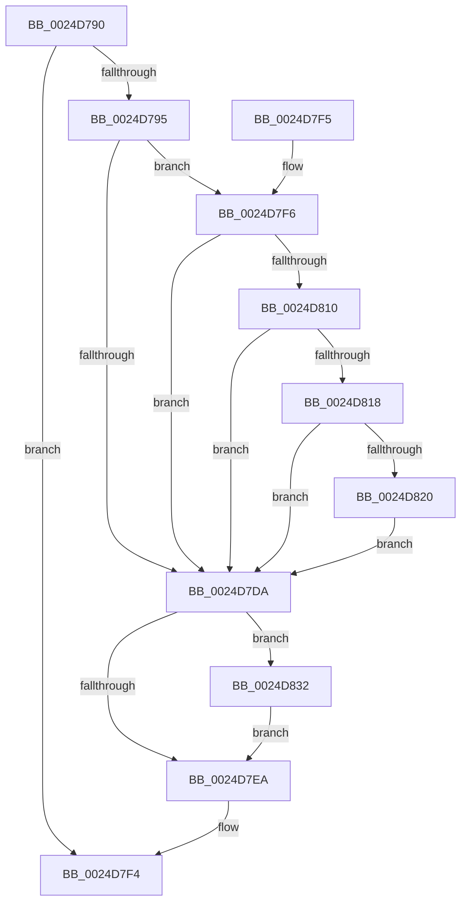

# PopPepTriggerComponentActivatingActivity

- RVA: `0x0024D790`–`0x0024D84C` (길이 `188` bytes)
- VA: `0x000000014024D790`
- 실행 섹션: `.text`
- PDB 이름 있음: `예`; PDB Function 태그: `아니요`
- unwind 정보 RVA: `0x00062E34`
- 디코드: `53`개 명령, `188/188` bytes 표시
- 미해석 바이트: `0` (있으면 어셈블리에 `.byte`로 보존)

> 이 문서는 커널 이미지의 기계어와 PDB 기호를 분석해 생성했습니다. 4번과 5번은 함수 원형과 자료형을 바이너리 사용 방식에서 추정한 C 해석이며 원본 소스 복구 결과는 아닙니다.

## 1. Dependencies

- 직접 호출 지점: **3**; 고유 호출 대상: **2**
- 직접 호출자로 확인된 함수: **2**
- RIP 상대 이미지 참조: **0**

### Outgoing calls
- `0x0024D7DD` → [PopPepGetComponentPreferedIdleState](../2B/PopPepGetComponentPreferedIdleState_function_002BF800.md) (function, `0x002BF800`)
- `0x0024D82B` → [PopPepTriggerActivity](PopPepTriggerActivity_function_0024CDB0.md) (function, `0x0024CDB0`)
- `0x0024D845` → [PopPepTriggerActivity](PopPepTriggerActivity_function_0024CDB0.md) (function, `0x0024CDB0`)

### Direct callers
- [PopPepProcessEvent](PopPepProcessEvent_function_0024B930.md) at `0x0024BBA0`
- [PopPepTriggerActivity](PopPepTriggerActivity_function_0024CDB0.md) at `0x0024CEBF`

### Static image references
- 디코드된 RIP-relative 메모리 참조가 없습니다.

## 2. Other-region calls and transfers

- 다른 실행 섹션으로 향하는 call: **0**
- 별도 외부 분기/꼬리 이동을 확인하지 못했습니다.

## 3. Assembly (complete function range)

```asm
0024D790  48 85 D2                        test rdx, rdx
0024D793  74 5F                           je 0x14024d7f4
0024D795  48 89 5C 24 08                  mov qword ptr [rsp + 8], rbx
0024D79A  57                              push rdi
0024D79B  48 83 EC 20                     sub rsp, 0x20
0024D79F  48 B8 08 00 00 00 80 F7 FF FF   movabs rax, 0xfffff78000000008
0024D7A9  48 8B F9                        mov rdi, rcx
0024D7AC  33 C9                           xor ecx, ecx
0024D7AE  48 8B DA                        mov rbx, rdx
0024D7B1  48 8B 00                        mov rax, qword ptr [rax]
0024D7B4  48 2B 82 88 00 00 00            sub rax, qword ptr [rdx + 0x88]
0024D7BB  4C 8B 82 80 00 00 00            mov r8, qword ptr [rdx + 0x80]
0024D7C2  4C 3B C0                        cmp r8, rax
0024D7C5  89 8A 98 00 00 00               mov dword ptr [rdx + 0x98], ecx
0024D7CB  4C 0F 43 C0                     cmovae r8, rax
0024D7CF  8B 42 04                        mov eax, dword ptr [rdx + 4]
0024D7D2  4C 89 42 78                     mov qword ptr [rdx + 0x78], r8
0024D7D6  A8 02                           test al, 2
0024D7D8  74 1C                           je 0x14024d7f6
0024D7DA  48 8B CB                        mov rcx, rbx
0024D7DD  E8 1E 20 07 00                  call 0x1402bf800
0024D7E2  3B 83 B0 00 00 00               cmp eax, dword ptr [rbx + 0xb0]
0024D7E8  75 48                           jne 0x14024d832
0024D7EA  48 8B 5C 24 30                  mov rbx, qword ptr [rsp + 0x30]
0024D7EF  48 83 C4 20                     add rsp, 0x20
0024D7F3  5F                              pop rdi
0024D7F4  C3                              ret
0024D7F5  CC                              int3
0024D7F6  83 C8 02                        or eax, 2
0024D7F9  89 42 04                        mov dword ptr [rdx + 4], eax
0024D7FC  B8 01 00 00 00                  mov eax, 1
0024D801  F0 0F C1 87 8C 00 00 00         lock xadd dword ptr [rdi + 0x8c], eax
0024D809  FF C0                           inc eax
0024D80B  83 F8 01                        cmp eax, 1
0024D80E  75 CA                           jne 0x14024d7da
0024D810  38 8F 88 00 00 00               cmp byte ptr [rdi + 0x88], cl
0024D816  75 C2                           jne 0x14024d7da
0024D818  48 8B 47 48                     mov rax, qword ptr [rdi + 0x48]
0024D81C  39 08                           cmp dword ptr [rax], ecx
0024D81E  75 BA                           jne 0x14024d7da
0024D820  45 33 C9                        xor r9d, r9d
0024D823  45 33 C0                        xor r8d, r8d
0024D826  33 D2                           xor edx, edx
0024D828  48 8B CF                        mov rcx, rdi
0024D82B  E8 80 F5 FF FF                  call 0x14024cdb0
0024D830  EB A8                           jmp 0x14024d7da
0024D832  0F BA E8 1F                     bts eax, 0x1f
0024D836  41 B8 01 00 00 00               mov r8d, 1
0024D83C  44 8B C8                        mov r9d, eax
0024D83F  48 8B D3                        mov rdx, rbx
0024D842  48 8B CF                        mov rcx, rdi
0024D845  E8 66 F5 FF FF                  call 0x14024cdb0
0024D84A  EB 9E                           jmp 0x14024d7ea
```

## 4. C-style interpretation (structured pseudocode)

```c
__int64 __fastcall PopPepTriggerComponentActivatingActivity(__int64 a1, __int64 a2, __int64 a3, int a4)
{
    __int64 result;
    __int64 v_rsp;
    unsigned __int64 v_stack_p8;

    if (a2 == 0) goto loc_0024D7F4;
    v_stack_p8 = v_rbx;
    v_rsp = (v_rsp) - (32);
    a1 = 0;
    result = (*(unsigned __int64 *)(result)) - (*(unsigned __int64 *)(a2 + 136));
    *(unsigned int *)(a2 + 152) = 0;
    a3 = *(unsigned __int64 *)(a2 + 128);
    if ((*(unsigned __int64 *)(a2 + 128)) >= result) { a3 = result; }
    *(unsigned __int64 *)(a2 + 120) = a3;
    if ((((unsigned __int8)((unsigned int)(*(unsigned int *)(a2 + 4)))) & (2)) == 0) goto loc_0024D7F6;
loc_0024D7DA:
    result = PopPepGetComponentPreferedIdleState(a2, a2, a3, a4);
    if (((unsigned int)(result)) != (*(unsigned int *)(a2 + 176))) goto loc_0024D832;
loc_0024D7EA:
    v_rsp = (v_rsp) + (32);
loc_0024D7F4:
    return result;
loc_0024D7F6:
    result = (unsigned int)((result) | (2));
    *(unsigned int *)(a2 + 4) = (unsigned int)(result);
    result = (unsigned int)((1) + 1);
    if (((unsigned int)(result)) != 1) goto loc_0024D7DA;
    if ((*(unsigned __int8 *)(a1 + 136)) != ((unsigned __int8)(a2))) goto loc_0024D7DA;
    if ((*(unsigned int *)(*(unsigned __int64 *)(a1 + 72))) != ((unsigned int)(a2))) goto loc_0024D7DA;
    a4 = 0;
    a3 = 0;
    a2 = 0;
    result = PopPepTriggerActivity(0, a2, a3, a4);
    goto loc_0024D7DA;
loc_0024D832:
    result = PopPepTriggerActivity(0, v_stack_p8, 1, (unsigned int)((unsigned int)(result)));
    goto loc_0024D7EA;
}
```

## 5. (Beta) C Style

```c
int64_t PopPepTriggerComponentActivatingActivity(void *Arg1, int64_t Arg2, int64_t Arg3, int32_t Arg4)
{
    uint8_t *arg1 = (uint8_t *)Arg1;

    int64_t result;
    int64_t local_rsp;
    uint64_t v_stack_p8;

    if (Arg2 == 0) goto loc_0024D7F4;
    v_stack_p8 = local_rbx;
    local_rsp = (local_rsp) - (32);
    Arg1 = 0;
    result = (*(uint64_t *)(result)) - (*(uint64_t *)(Arg2 + 0x88));
    *(uint32_t *)(Arg2 + 0x98) = 0;
    Arg3 = *(uint64_t *)(Arg2 + 0x80);
    if ((*(uint64_t *)(Arg2 + 0x80)) >= result) { Arg3 = result; }
    *(uint64_t *)(Arg2 + 0x78) = Arg3;
    if ((((uint8_t)((uint32_t)(*(uint32_t *)(Arg2 + 0x4)))) & (2)) == 0) goto loc_0024D7F6;
loc_0024D7DA:
    result = PopPepGetComponentPreferedIdleState(Arg2, Arg2, Arg3, Arg4);
    if (((uint32_t)(result)) != (*(uint32_t *)(Arg2 + 0xB0))) goto loc_0024D832;
loc_0024D7EA:
    local_rsp = (local_rsp) + (32);
loc_0024D7F4:
    return result;
loc_0024D7F6:
    result = (uint32_t)((result) | (2));
    *(uint32_t *)(Arg2 + 0x4) = (uint32_t)(result);
    result = (uint32_t)((1) + 1);
    if (((uint32_t)(result)) != 1) goto loc_0024D7DA;
    if ((*(uint8_t *)(arg1 + 0x88)) != ((uint8_t)(Arg2))) goto loc_0024D7DA;
    if ((*(uint32_t *)(*(uint64_t *)(arg1 + 0x48))) != ((uint32_t)(Arg2))) goto loc_0024D7DA;
    Arg4 = 0;
    Arg3 = 0;
    Arg2 = 0;
    result = PopPepTriggerActivity(0, Arg2, Arg3, Arg4);
    goto loc_0024D7DA;
loc_0024D832:
    result = PopPepTriggerActivity(0, v_stack_p8, 1, (uint32_t)((uint32_t)(result)));
    goto loc_0024D7EA;
}
```

### 관측된 메모리 오프셋

구조체 형식이 확인되지 않은 접근은 인자 기준의 오프셋으로만 기록했습니다.

| 기준 인자 | 오프셋 표현 | 폭 (bit) | 접근 |
|---|---:|---:|---|
| `Arg1` | `+ 0x48` | `64` | `R` |
| `Arg1` | `+ 0x88` | `8` | `R` |
| `Arg1` | `+ 0x8C` | `32` | `R/W` |

## 6. Execution-region graph

[열기: 2D/3D 그래프와 함수 탐색 컨트롤 패널](../../../control-panel.html?section=text&rva=0x0024D790&view=graph)

- 2D 그래프는 위에서 아래로 흐르고, 3D 그래프는 빈 공간을 드래그해 회전합니다. Shift+드래그는 이동, 휠은 확대·축소, 함수 노드 선택은 대상 보고서 이동입니다.

### Static fallback


