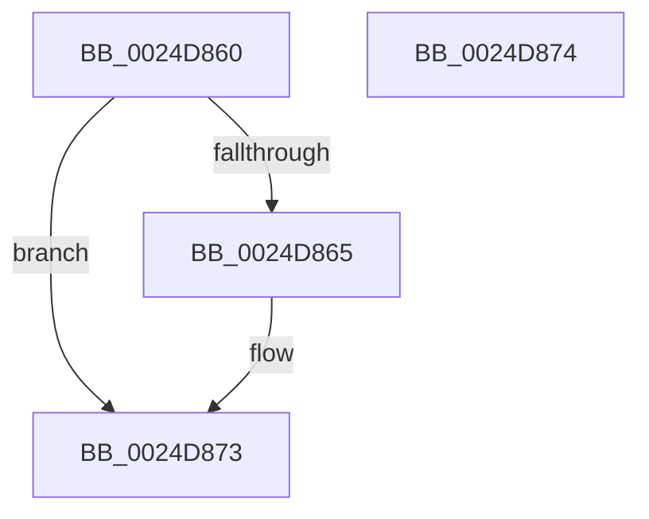

# PopPepTriggerComponentActiveActivity

- RVA: `0x0024D860`–`0x0024D875` (길이 `21` bytes)
- VA: `0x000000014024D860`
- 실행 섹션: `.text`
- PDB 이름 있음: `예`; PDB Function 태그: `아니요`
- unwind 정보 RVA: `0x000DB714`
- 디코드: `7`개 명령, `21/21` bytes 표시
- 미해석 바이트: `0` (있으면 어셈블리에 `.byte`로 보존)

> 이 문서는 커널 이미지의 기계어와 PDB 기호를 분석해 생성했습니다. 4번과 5번은 함수 원형과 자료형을 바이너리 사용 방식에서 추정한 C 해석이며 원본 소스 복구 결과는 아닙니다.

## 1. Dependencies

- 직접 호출 지점: **0**; 고유 호출 대상: **0**
- 직접 호출자로 확인된 함수: **2**
- RIP 상대 이미지 참조: **0**

### Outgoing calls
- 직접 디코드된 call 명령이 없습니다.

### Direct callers
- [PopPepProcessEvent](PopPepProcessEvent_function_0024B930.md) at `0x0024BB96`
- [PopPepTriggerActivity](PopPepTriggerActivity_function_0024CDB0.md) at `0x0024CEB5`

### Static image references
- 디코드된 RIP-relative 메모리 참조가 없습니다.

## 2. Other-region calls and transfers

- 다른 실행 섹션으로 향하는 call: **0**
- 별도 외부 분기/꼬리 이동을 확인하지 못했습니다.

## 3. Assembly (complete function range)

```asm
0024D860  48 85 D2                        test rdx, rdx
0024D863  74 0E                           je 0x14024d873
0024D865  48 8B 42 50                     mov rax, qword ptr [rdx + 0x50]
0024D869  83 4A 04 01                     or dword ptr [rdx + 4], 1
0024D86D  C7 00 04 00 00 00               mov dword ptr [rax], 4
0024D873  C3                              ret
0024D874  CC                              int3
```

## 4. C-style interpretation (structured pseudocode)

```c
__int64 __fastcall PopPepTriggerComponentActiveActivity(__int64 a1, __int64 a2)
{
    __int64 result;

    if (a2 != 0) {
        result = *(unsigned __int64 *)(a2 + 80);
        *(unsigned int *)(result) = 4;
    }
    return result;
}
```

## 5. (Beta) C Style

```c
int64_t PopPepTriggerComponentActiveActivity(int64_t Arg1, int64_t Arg2)
{
    int64_t result;

    if (Arg2 != 0) {
        result = *(uint64_t *)(Arg2 + 0x50);
        *(uint32_t *)(result) = 4;
    }
    return result;
}
```

## 6. Execution-region graph

[열기: 2D/3D 그래프와 함수 탐색 컨트롤 패널](../../../control-panel.html?section=text&rva=0x0024D860&view=graph)

- 2D 그래프는 위에서 아래로 흐르고, 3D 그래프는 빈 공간을 드래그해 회전합니다. Shift+드래그는 이동, 휠은 확대·축소, 함수 노드 선택은 대상 보고서 이동입니다.

### Static fallback


