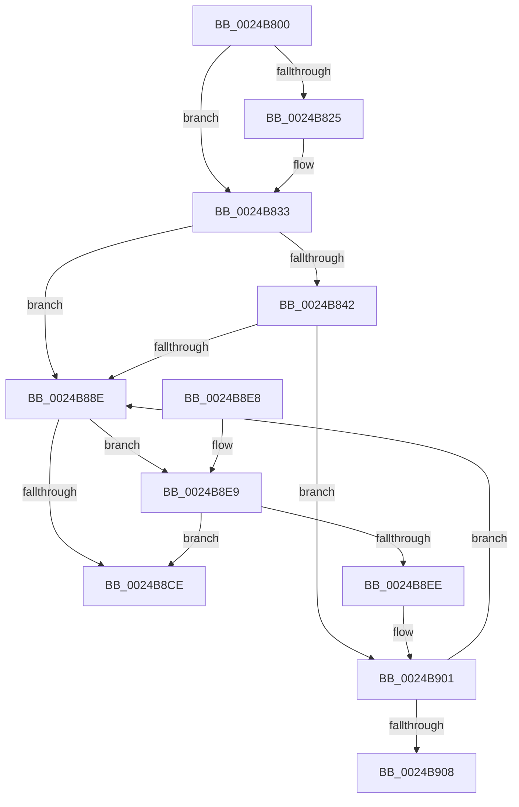

# PopPluginComponentActive

- RVA: `0x0024B800`–`0x0024B91C` (길이 `284` bytes)
- VA: `0x000000014024B800`
- 실행 섹션: `.text`
- PDB 이름 있음: `예`; PDB Function 태그: `아니요`
- unwind 정보 RVA: `0x00062C80`
- 디코드: `75`개 명령, `284/284` bytes 표시
- 미해석 바이트: `0` (있으면 어셈블리에 `.byte`로 보존)

> 이 문서는 커널 이미지의 기계어와 PDB 기호를 분석해 생성했습니다. 4번과 5번은 함수 원형과 자료형을 바이너리 사용 방식에서 추정한 C 해석이며 원본 소스 복구 결과는 아닙니다.

## 1. Dependencies

- 직접 호출 지점: **5**; 고유 호출 대상: **4**
- 직접 호출자로 확인된 함수: **3**
- RIP 상대 이미지 참조: **0**

### Outgoing calls
- `0x0024B82E` → [memset](../6C/memset_function_006C6C40.md) (function, `0x006C6C40`)
- `0x0024B885` → [guard_dispatch_icall](../6B/guard_dispatch_icall_function_006BAAD0.md) (function, `0x006BAAD0`)
- `0x0024B8C5` → [PopPepProcessEvent](PopPepProcessEvent_function_0024B930.md) (function, `0x0024B930`)
- `0x0024B8FB` → [PopFxBugCheck](../2B/PopFxBugCheck_function_002BFC6C.md) (function, `0x002BFC6C`)
- `0x0024B916` → [PopFxBugCheck](../2B/PopFxBugCheck_function_002BFC6C.md) (function, `0x002BFC6C`)

### Direct callers
- [PopFxActivateComponentDependents](../2B/PopFxActivateComponentDependents_function_002BE9F0.md) at `0x002BEF09`
- [PopFxActivateComponentWorker](../2D/PopFxActivateComponentWorker_function_002D9F60.md) at `0x002D9FCB`
- [PopFxIdleWorkerTail](../43/PopFxIdleWorkerTail_function_0043CDA0.md) at `0x0043CE5F`

### Static image references
- 디코드된 RIP-relative 메모리 참조가 없습니다.

## 2. Other-region calls and transfers

- 다른 실행 섹션으로 향하는 call: **0**
- 별도 외부 분기/꼬리 이동을 확인하지 못했습니다.

## 3. Assembly (complete function range)

```asm
0024B800  48 89 5C 24 10                  mov qword ptr [rsp + 0x10], rbx
0024B805  48 89 6C 24 18                  mov qword ptr [rsp + 0x18], rbp
0024B80A  48 89 74 24 20                  mov qword ptr [rsp + 0x20], rsi
0024B80F  57                              push rdi
0024B810  48 83 EC 50                     sub rsp, 0x50
0024B814  8B EA                           mov ebp, edx
0024B816  49 8B F9                        mov rdi, r9
0024B819  41 0F B6 F0                     movzx esi, r8b
0024B81D  48 8B D9                        mov rbx, rcx
0024B820  4D 85 C9                        test r9, r9
0024B823  74 0E                           je 0x14024b833
0024B825  33 D2                           xor edx, edx
0024B827  49 8B C9                        mov rcx, r9
0024B82A  44 8D 42 40                     lea r8d, [rdx + 0x40]
0024B82E  E8 0D B4 47 00                  call 0x1406c6c40
0024B833  48 8B 5B 38                     mov rbx, qword ptr [rbx + 0x38]
0024B837  4C 89 74 24 60                  mov qword ptr [rsp + 0x60], r14
0024B83C  80 7B 7C 00                     cmp byte ptr [rbx + 0x7c], 0
0024B840  74 4C                           je 0x14024b88e
0024B842  48 8B 43 20                     mov rax, qword ptr [rbx + 0x20]
0024B846  48 8D 54 24 30                  lea rdx, [rsp + 0x30]
0024B84B  0F 57 C0                        xorps xmm0, xmm0
0024B84E  B9 07 00 00 00                  mov ecx, 7
0024B853  0F 11 44 24 30                  movups xmmword ptr [rsp + 0x30], xmm0
0024B858  89 6C 24 38                     mov dword ptr [rsp + 0x38], ebp
0024B85C  4C 8B 70 40                     mov r14, qword ptr [rax + 0x40]
0024B860  48 8B 40 48                     mov rax, qword ptr [rax + 0x48]
0024B864  0F 11 44 24 40                  movups xmmword ptr [rsp + 0x40], xmm0
0024B869  48 89 44 24 30                  mov qword ptr [rsp + 0x30], rax
0024B86E  40 88 74 24 3C                  mov byte ptr [rsp + 0x3c], sil
0024B873  48 C7 44 24 40 00 00 00 00      mov qword ptr [rsp + 0x40], 0
0024B87C  C6 44 24 48 00                  mov byte ptr [rsp + 0x48], 0
0024B881  49 8B 46 60                     mov rax, qword ptr [r14 + 0x60]
0024B885  E8 46 F2 46 00                  call 0x1406baad0
0024B88A  84 C0                           test al, al
0024B88C  75 73                           jne 0x14024b901
0024B88E  B9 06 00 00 00                  mov ecx, 6
0024B893  48 89 7C 24 28                  mov qword ptr [rsp + 0x28], rdi
0024B898  44 8B C9                        mov r9d, ecx
0024B89B  40 84 F6                        test sil, sil
0024B89E  B8 02 00 00 00                  mov eax, 2
0024B8A3  41 B8 03 00 00 00               mov r8d, 3
0024B8A9  44 0F 45 C1                     cmovne r8d, ecx
0024B8AD  44 0F 45 C8                     cmovne r9d, eax
0024B8B1  48 69 D5 D0 00 00 00            imul rdx, rbp, 0xd0
0024B8B8  48 8B CB                        mov rcx, rbx
0024B8BB  48 81 C2 C0 00 00 00            add rdx, 0xc0
0024B8C2  48 03 D3                        add rdx, rbx
0024B8C5  E8 66 00 00 00                  call 0x14024b930
0024B8CA  84 C0                           test al, al
0024B8CC  75 1B                           jne 0x14024b8e9
0024B8CE  4C 8B 74 24 60                  mov r14, qword ptr [rsp + 0x60]
0024B8D3  48 8B 5C 24 68                  mov rbx, qword ptr [rsp + 0x68]
0024B8D8  48 8B 6C 24 70                  mov rbp, qword ptr [rsp + 0x70]
0024B8DD  48 8B 74 24 78                  mov rsi, qword ptr [rsp + 0x78]
0024B8E2  48 83 C4 50                     add rsp, 0x50
0024B8E6  5F                              pop rdi
0024B8E7  C3                              ret
0024B8E8  CC                              int3
0024B8E9  48 85 FF                        test rdi, rdi
0024B8EC  75 E0                           jne 0x14024b8ce
0024B8EE  45 33 C9                        xor r9d, r9d
0024B8F1  45 33 C0                        xor r8d, r8d
0024B8F4  33 D2                           xor edx, edx
0024B8F6  B9 12 06 00 00                  mov ecx, 0x612
0024B8FB  E8 6C 43 07 00                  call 0x1402bfc6c
0024B900  CC                              int3
0024B901  80 7C 24 48 00                  cmp byte ptr [rsp + 0x48], 0
0024B906  74 86                           je 0x14024b88e
0024B908  45 33 C9                        xor r9d, r9d
0024B90B  45 33 C0                        xor r8d, r8d
0024B90E  49 8B D6                        mov rdx, r14
0024B911  B9 12 06 00 00                  mov ecx, 0x612
0024B916  E8 51 43 07 00                  call 0x1402bfc6c
0024B91B  CC                              int3
```

## 4. C-style interpretation (structured pseudocode)

```c
__int64 __fastcall PopPluginComponentActive(__int64 a1, int a2, unsigned __int8 a3, __int64 a4)
{
    __int64 result;
    __int64 v_rsp;
    unsigned __int8 v_stack_m10;
    unsigned __int64 v_stack_m18;
    unsigned __int8 v_stack_m1C;
    unsigned int v_stack_m20;
    unsigned __int64 v_stack_m28;
    unsigned __int64 v_stack_m30;
    unsigned __int64 v_stack_p10;
    unsigned __int64 v_stack_p18;
    unsigned __int64 v_stack_p20;
    unsigned __int8 v_stack_p48;
    unsigned __int64 v_stack_p8;

    v_stack_p10 = v_rbx;
    v_stack_p18 = v_rbp;
    v_stack_p20 = v_rsi;
    v_rsp = (v_rsp) - (80);
    if (a4 != 0) {
        a2 = 0;
        a1 = a4;
        a3 = a2 + 64;
        result = memset(a1, a2, a3, a4);
    }
    v_stack_p8 = v_r14;
    if ((*(unsigned __int8 *)(*(unsigned __int64 *)(a1 + 56) + 124)) == 0) goto loc_0024B88E;
    v_stack_m28 = v_xmm0;
    v_stack_m20 = (unsigned int)((unsigned int)(a2));
    v_stack_m18 = v_xmm0;
    v_stack_m28 = *(unsigned __int64 *)(*(unsigned __int64 *)(*(unsigned __int64 *)(a1 + 56) + 32) + 72);
    v_stack_m1C = a3;
    v_stack_m18 = 0;
    v_stack_m10 = 0;
    result = guard_dispatch_icall(7, v_stack_m28, a3, a4);
    if ((unsigned __int8)(result) != 0) goto loc_0024B901;
loc_0024B88E:
    v_stack_m30 = a4;
    a3 = 3;
    if (a3 != 0) { a3 = 6; }
    a4 = 6;
    if (a3 != 0) { a4 = 2; }
    a2 = (v_stack_m28) * ((unsigned int)(a2));
    a2 = (a2) + (192);
    a2 = (a2) + (*(unsigned __int64 *)(a1 + 56));
    result = PopPepProcessEvent(*(unsigned __int64 *)(a1 + 56), a2, a3, a4);
    if ((unsigned __int8)(result) != 0) goto loc_0024B8E9;
loc_0024B8CE:
    v_rsp = (v_rsp) + (80);
    return result;
loc_0024B8E9:
    if (a4 != 0) goto loc_0024B8CE;
    a4 = 0;
    a3 = 0;
    a2 = 0;
    result = PopFxBugCheck((unsigned int)(0x612ULL), a2, a3, a4);
loc_0024B901:
    if (v_stack_p48 == 0) goto loc_0024B88E;
    a4 = 0;
    a3 = 0;
    result = PopFxBugCheck((unsigned int)(0x612ULL), v_stack_p8, a3, a4);
    return result;
}
```

## 5. (Beta) C Style

```c
int64_t PopPluginComponentActive(void *Arg1, int32_t Arg2, uint8_t Arg3, int64_t Arg4)
{
    uint8_t *arg1 = (uint8_t *)Arg1;

    int64_t result;
    int64_t local_rsp;
    uint8_t v_stack_m10;
    uint64_t v_stack_m18;
    uint8_t v_stack_m1C;
    uint32_t v_stack_m20;
    uint64_t v_stack_m28;
    uint64_t v_stack_m30;
    uint64_t v_stack_p10;
    uint64_t v_stack_p18;
    uint64_t v_stack_p20;
    uint8_t v_stack_p48;
    uint64_t v_stack_p8;

    v_stack_p10 = local_rbx;
    v_stack_p18 = local_rbp;
    v_stack_p20 = local_rsi;
    local_rsp = (local_rsp) - (80);
    if (Arg4 != 0) {
        Arg2 = 0;
        Arg1 = Arg4;
        Arg3 = Arg2 + 64;
        result = memset(Arg1, Arg2, Arg3, Arg4);
    }
    v_stack_p8 = local_r14;
    if ((*(uint8_t *)(*(uint64_t *)(arg1 + 0x38) + 0x7C)) == 0) goto loc_0024B88E;
    v_stack_m28 = v_xmm0;
    v_stack_m20 = (uint32_t)((uint32_t)(Arg2));
    v_stack_m18 = v_xmm0;
    v_stack_m28 = *(uint64_t *)(*(uint64_t *)(*(uint64_t *)(arg1 + 0x38) + 0x20) + 0x48);
    v_stack_m1C = Arg3;
    v_stack_m18 = 0;
    v_stack_m10 = 0;
    result = guard_dispatch_icall(7, v_stack_m28, Arg3, Arg4);
    if ((uint8_t)(result) != 0) goto loc_0024B901;
loc_0024B88E:
    v_stack_m30 = Arg4;
    Arg3 = 3;
    if (Arg3 != 0) { Arg3 = 6; }
    Arg4 = 6;
    if (Arg3 != 0) { Arg4 = 2; }
    Arg2 = (v_stack_m28) * ((uint32_t)(Arg2));
    Arg2 = (Arg2) + (192);
    Arg2 = (Arg2) + (*(uint64_t *)(arg1 + 0x38));
    result = PopPepProcessEvent(*(uint64_t *)(arg1 + 0x38), Arg2, Arg3, Arg4);
    if ((uint8_t)(result) != 0) goto loc_0024B8E9;
loc_0024B8CE:
    local_rsp = (local_rsp) + (80);
    return result;
loc_0024B8E9:
    if (Arg4 != 0) goto loc_0024B8CE;
    Arg4 = 0;
    Arg3 = 0;
    Arg2 = 0;
    result = PopFxBugCheck((uint32_t)(0x612ULL), Arg2, Arg3, Arg4);
loc_0024B901:
    if (v_stack_p48 == 0) goto loc_0024B88E;
    Arg4 = 0;
    Arg3 = 0;
    result = PopFxBugCheck((uint32_t)(0x612ULL), v_stack_p8, Arg3, Arg4);
    return result;
}
```

### 관측된 메모리 오프셋

구조체 형식이 확인되지 않은 접근은 인자 기준의 오프셋으로만 기록했습니다.

| 기준 인자 | 오프셋 표현 | 폭 (bit) | 접근 |
|---|---:|---:|---|
| `Arg1` | `+ 0x38` | `64` | `R` |

## 6. Execution-region graph

[열기: 2D/3D 그래프와 함수 탐색 컨트롤 패널](../../../control-panel.html?section=text&rva=0x0024B800&view=graph)

- 2D 그래프는 위에서 아래로 흐르고, 3D 그래프는 빈 공간을 드래그해 회전합니다. Shift+드래그는 이동, 휠은 확대·축소, 함수 노드 선택은 대상 보고서 이동입니다.

### Static fallback


