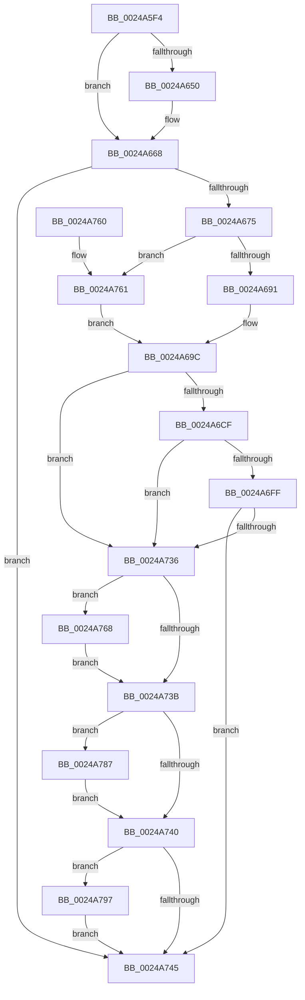

# SMKM_STORE_MGR&lt;SM_TRAITS&gt;::SmpPageEvict

- RVA: `0x0024A5F4`–`0x0024A7AD` (길이 `441` bytes)
- VA: `0x000000014024A5F4`
- 실행 섹션: `.text`
- PDB 이름 있음: `예`; PDB Function 태그: `아니요`
- unwind 정보 RVA: `0x00062B40`
- 디코드: `125`개 명령, `441/441` bytes 표시
- 미해석 바이트: `0` (있으면 어셈블리에 `.byte`로 보존)

> 이 문서는 커널 이미지의 기계어와 PDB 기호를 분석해 생성했습니다. 4번과 5번은 함수 원형과 자료형을 바이너리 사용 방식에서 추정한 C 해석이며 원본 소스 복구 결과는 아닙니다.

## 1. Dependencies

- 직접 호출 지점: **9**; 고유 호출 대상: **8**
- 직접 호출자로 확인된 함수: **1**
- RIP 상대 이미지 참조: **0**

### Outgoing calls
- `0x0024A634` → [SMKM_STORE_MGR<SM_TRAITS>::SmFeEvictInitiate](../2D/SMKM_STORE_MGR_SM_TRAITS_SmFeEvictInitiate_function_002DF8C0.md) (function, `0x002DF8C0`)
- `0x0024A663` → [MmStoreEvictComplete](../3E/MmStoreEvictComplete_function_003E1840.md) (function, `0x003E1840`)
- `0x0024A6C2` → [SmFpAllocate](../31/SmFpAllocate_function_00317D10.md) (function, `0x00317D10`)
- `0x0024A6F2` → [SmFpAllocate](../31/SmFpAllocate_function_00317D10.md) (function, `0x00317D10`)
- `0x0024A72D` → [SMKM_STORE_MGR<SM_TRAITS>::SmIoCtxQueueWork](../31/SMKM_STORE_MGR_SM_TRAITS_SmIoCtxQueueWork_function_00317440.md) (function, `0x00317440`)
- `0x0024A771` → [SMKM_STORE_MGR<SM_TRAITS>::SmFeSetEvictFailed](../60/SMKM_STORE_MGR_SM_TRAITS_SmFeSetEvictFailed_function_0060C7A4.md) (function, `0x0060C7A4`)
- `0x0024A780` → [SmKmStoreDereference](../20/SmKmStoreDereference_function_00206574.md) (function, `0x00206574`)
- `0x0024A790` → [SMKM_STORE_MGR<SM_TRAITS>::SmWorkItemFreeResource](../31/SMKM_STORE_MGR_SM_TRAITS_SmWorkItemFreeResource_function_003179B4.md) (function, `0x003179B4`)
- `0x0024A7A6` → [SmFpFree](../43/SmFpFree_function_00436350.md) (function, `0x00436350`)

### Direct callers
- [sub_00249850](Unknown_function_00249850.md) at `0x00249AC3`
- [sub_00249850](Unknown_function_00249850.md) at `0x00249AE4`

### Static image references
- 디코드된 RIP-relative 메모리 참조가 없습니다.

## 2. Other-region calls and transfers

- 다른 실행 섹션으로 향하는 call: **0**
- 별도 외부 분기/꼬리 이동을 확인하지 못했습니다.

## 3. Assembly (complete function range)

```asm
0024A5F4  4C 8B DC                        mov r11, rsp
0024A5F7  49 89 5B 08                     mov qword ptr [r11 + 8], rbx
0024A5FB  4D 89 4B 20                     mov qword ptr [r11 + 0x20], r9
0024A5FF  55                              push rbp
0024A600  56                              push rsi
0024A601  57                              push rdi
0024A602  41 54                           push r12
0024A604  41 55                           push r13
0024A606  41 56                           push r14
0024A608  41 57                           push r15
0024A60A  48 83 EC 50                     sub rsp, 0x50
0024A60E  33 C0                           xor eax, eax
0024A610  45 89 43 20                     mov dword ptr [r11 + 0x20], r8d
0024A614  41 21 43 18                     and dword ptr [r11 + 0x18], eax
0024A618  4D 8D 4B 18                     lea r9, [r11 + 0x18]
0024A61C  0F 57 C0                        xorps xmm0, xmm0
0024A61F  4D 8D 43 20                     lea r8, [r11 + 0x20]
0024A623  0F 11 44 24 30                  movups xmmword ptr [rsp + 0x30], xmm0
0024A628  49 89 43 B8                     mov qword ptr [r11 - 0x48], rax
0024A62C  4C 8B E2                        mov r12, rdx
0024A62F  48 8B F9                        mov rdi, rcx
0024A632  33 F6                           xor esi, esi
0024A634  E8 87 52 09 00                  call 0x1402df8c0
0024A639  44 8B BC 24 A0 00 00 00         mov r15d, dword ptr [rsp + 0xa0]
0024A641  44 8B F0                        mov r14d, eax
0024A644  8B AC 24 A8 00 00 00            mov ebp, dword ptr [rsp + 0xa8]
0024A64B  44 3B FD                        cmp r15d, ebp
0024A64E  76 18                           jbe 0x14024a668
0024A650  41 8B 14 24                     mov edx, dword ptr [r12]
0024A654  45 8B C7                        mov r8d, r15d
0024A657  48 8B 8F 30 08 00 00            mov rcx, qword ptr [rdi + 0x830]
0024A65E  44 2B C5                        sub r8d, ebp
0024A661  03 D5                           add edx, ebp
0024A663  E8 D8 71 19 00                  call 0x1403e1840
0024A668  41 81 FE 00 04 00 00            cmp r14d, 0x400
0024A66F  0F 84 D0 00 00 00               je 0x14024a745
0024A675  41 8B CE                        mov ecx, r14d
0024A678  81 E1 FF 03 00 00               and ecx, 0x3ff
0024A67E  8B C1                           mov eax, ecx
0024A680  48 C1 E8 05                     shr rax, 5
0024A684  48 8B 14 C7                     mov rdx, qword ptr [rdi + rax*8]
0024A688  48 85 D2                        test rdx, rdx
0024A68B  0F 84 D0 00 00 00               je 0x14024a761
0024A691  83 E1 1F                        and ecx, 0x1f
0024A694  48 8D 04 89                     lea rax, [rcx + rcx*4]
0024A698  48 8D 04 C2                     lea rax, [rdx + rax*8]
0024A69C  8B 8F D0 07 00 00               mov ecx, dword ptr [rdi + 0x7d0]
0024A6A2  45 33 C9                        xor r9d, r9d
0024A6A5  4C 8B 28                        mov r13, qword ptr [rax]
0024A6A8  83 E1 01                        and ecx, 1
0024A6AB  89 8C 24 A0 00 00 00            mov dword ptr [rsp + 0xa0], ecx
0024A6B2  45 33 C0                        xor r8d, r8d
0024A6B5  89 4C 24 20                     mov dword ptr [rsp + 0x20], ecx
0024A6B9  33 D2                           xor edx, edx
0024A6BB  48 8D 8F 30 06 00 00            lea rcx, [rdi + 0x630]
0024A6C2  E8 49 D6 0C 00                  call 0x140317d10
0024A6C7  48 8B D8                        mov rbx, rax
0024A6CA  48 85 C0                        test rax, rax
0024A6CD  74 67                           je 0x14024a736
0024A6CF  48 21 70 08                     and qword ptr [rax + 8], rsi
0024A6D3  48 8D 8F 30 06 00 00            lea rcx, [rdi + 0x630]
0024A6DA  48 21 30                        and qword ptr [rax], rsi
0024A6DD  45 33 C9                        xor r9d, r9d
0024A6E0  8B 84 24 A0 00 00 00            mov eax, dword ptr [rsp + 0xa0]
0024A6E7  4C 8B C3                        mov r8, rbx
0024A6EA  89 44 24 20                     mov dword ptr [rsp + 0x20], eax
0024A6EE  41 8D 51 01                     lea edx, [r9 + 1]
0024A6F2  E8 19 D6 0C 00                  call 0x140317d10
0024A6F7  48 8B F0                        mov rsi, rax
0024A6FA  48 85 C0                        test rax, rax
0024A6FD  74 37                           je 0x14024a736
0024A6FF  83 60 04 00                     and dword ptr [rax + 4], 0
0024A703  4C 8B CE                        mov r9, rsi
0024A706  48 83 60 10 00                  and qword ptr [rax + 0x10], 0
0024A70B  45 8B C6                        mov r8d, r14d
0024A70E  48 83 60 18 00                  and qword ptr [rax + 0x18], 0
0024A713  48 8B D7                        mov rdx, rdi
0024A716  C7 00 01 00 00 00               mov dword ptr [rax], 1
0024A71C  48 8B CB                        mov rcx, rbx
0024A71F  41 8B 04 24                     mov eax, dword ptr [r12]
0024A723  89 46 08                        mov dword ptr [rsi + 8], eax
0024A726  89 6E 0C                        mov dword ptr [rsi + 0xc], ebp
0024A729  48 89 5E 20                     mov qword ptr [rsi + 0x20], rbx
0024A72D  E8 0E CD 0C 00                  call 0x140317440
0024A732  85 C0                           test eax, eax
0024A734  79 0F                           jns 0x14024a745
0024A736  4D 85 ED                        test r13, r13
0024A739  75 2D                           jne 0x14024a768
0024A73B  48 85 F6                        test rsi, rsi
0024A73E  75 47                           jne 0x14024a787
0024A740  48 85 DB                        test rbx, rbx
0024A743  75 52                           jne 0x14024a797
0024A745  48 8B 9C 24 90 00 00 00         mov rbx, qword ptr [rsp + 0x90]
0024A74D  41 8B C7                        mov eax, r15d
0024A750  48 83 C4 50                     add rsp, 0x50
0024A754  41 5F                           pop r15
0024A756  41 5E                           pop r14
0024A758  41 5D                           pop r13
0024A75A  41 5C                           pop r12
0024A75C  5F                              pop rdi
0024A75D  5E                              pop rsi
0024A75E  5D                              pop rbp
0024A75F  C3                              ret
0024A760  CC                              int3
0024A761  33 C0                           xor eax, eax
0024A763  E9 34 FF FF FF                  jmp 0x14024a69c
0024A768  44 8B C5                        mov r8d, ebp
0024A76B  49 8B D4                        mov rdx, r12
0024A76E  48 8B CF                        mov rcx, rdi
0024A771  E8 2E 20 3C 00                  call 0x14060c7a4
0024A776  41 8B 95 90 1A 00 00            mov edx, dword ptr [r13 + 0x1a90]
0024A77D  48 8B CF                        mov rcx, rdi
0024A780  E8 EF BD FB FF                  call 0x140206574
0024A785  EB B4                           jmp 0x14024a73b
0024A787  4C 8B C3                        mov r8, rbx
0024A78A  48 8B D6                        mov rdx, rsi
0024A78D  48 8B CF                        mov rcx, rdi
0024A790  E8 1F D2 0C 00                  call 0x1403179b4
0024A795  EB A9                           jmp 0x14024a740
0024A797  4C 8B CB                        mov r9, rbx
0024A79A  48 8D 8F 30 06 00 00            lea rcx, [rdi + 0x630]
0024A7A1  4C 8B C3                        mov r8, rbx
0024A7A4  33 D2                           xor edx, edx
0024A7A6  E8 A5 BB 1E 00                  call 0x140436350
0024A7AB  EB 98                           jmp 0x14024a745
```

## 4. C-style interpretation (structured pseudocode)

```c
__int64 __fastcall SMKM_STORE_MGR_SM_TRAITS___SmpPageEvict(__int64 a1, __int64 a2, int a3, __int64 a4)
{
    __int64 result;
    __int64 v_rsi;
    __int64 v_rsp;
    unsigned __int64 v_stack_m58;
    unsigned int v_stack_m68;
    unsigned int v_stack_p18;
    unsigned int v_stack_p20;
    unsigned __int64 v_stack_p8;

    *(unsigned __int64 *)(v_rsp + 8) = v_rbx;
    *(unsigned __int64 *)(v_rsp + 32) = a4;
    v_rsp = (v_rsp) - (80);
    result = 0;
    *(unsigned int *)(v_rsp + 32) = a3;
    v_stack_m58 = v_xmm0;
    *(unsigned __int64 *)(v_rsp - 72) = 0;
    v_rsi = 0;
    result = SMKM_STORE_MGR_SM_TRAITS___SmFeEvictInitiate(a1, a2, v_rsp + 32, v_rsp + 24);
    if (((unsigned int)((unsigned int)(v_stack_p18))) >= = ((unsigned int)((unsigned int)(v_stack_p20)))) {
        a2 = *(unsigned int *)(a2);
        a3 = (unsigned int)((unsigned int)(v_stack_p18));
        a1 = *(unsigned __int64 *)(a1 + 2096);
        a3 = (unsigned int)((a3) - ((unsigned int)((unsigned int)(v_stack_p20))));
        a2 = (unsigned int)((a2) + ((unsigned int)((unsigned int)(v_stack_p20))));
        result = MmStoreEvictComplete(a1, a2, a3, v_rsp + 24);
    }
    if (((unsigned int)((unsigned int)((unsigned int)(result)))) == 0x400ULL) goto loc_0024A745;
    a1 = (unsigned int)(((unsigned int)((unsigned int)((unsigned int)((unsigned int)(result))))) & (0x3FFULL));
    result = ((unsigned int)((unsigned int)(a1))) >> (5);
    if (*(unsigned __int64 *)(a1 + result * 8) == 0) goto loc_0024A761;
    a1 = (unsigned int)((a1) & (31));
loc_0024A69C:
    a4 = 0;
    a1 = (unsigned int)(((unsigned int)(*(unsigned int *)(a1 + 2000))) & (1));
    v_stack_p18 = (unsigned int)(a1);
    a3 = 0;
    v_stack_m68 = (unsigned int)(a1);
    a2 = 0;
    result = SmFpAllocate(a1 + 1584, a2, a3, a4);
    if (result == 0) goto loc_0024A736;
    a4 = 0;
    v_stack_m68 = (unsigned int)((unsigned int)(v_stack_p18));
    result = SmFpAllocate(a1 + 1584, a4 + 1, result, a4);
    if (result == 0) goto loc_0024A736;
    *(unsigned int *)(result) = 1;
    *(unsigned int *)(result + 8) = (unsigned int)((unsigned int)(*(unsigned int *)(a2)));
    *(unsigned int *)(result + 12) = (unsigned int)((unsigned int)(v_stack_p20));
    *(unsigned __int64 *)(result + 32) = result;
    result = SMKM_STORE_MGR_SM_TRAITS___SmIoCtxQueueWork(result, a1, (unsigned int)((unsigned int)((unsigned int)((unsigned int)(result)))), result);
    if (!sign_flag) goto loc_0024A745;
loc_0024A736:
    if (*(unsigned __int64 *)(*(unsigned __int64 *)(a1 + result * 8) + a1 + a1 * 4 * 8) != 0) goto loc_0024A768;
loc_0024A73B:
    if (result != 0) goto loc_0024A787;
loc_0024A740:
    if (result != 0) goto loc_0024A797;
loc_0024A745:
    v_rsp = (v_rsp) + (80);
    return (unsigned int)((unsigned int)((unsigned int)(v_stack_p18)));
loc_0024A761:
    result = 0;
    goto loc_0024A69C;
loc_0024A768:
    result = SMKM_STORE_MGR_SM_TRAITS___SmFeSetEvictFailed(a1, 0, (unsigned int)((unsigned int)((unsigned int)(v_stack_p20))), result);
    result = SmKmStoreDereference(a1, (unsigned int)(*(unsigned int *)(*(unsigned __int64 *)(*(unsigned __int64 *)(a1 + result * 8) + a1 + a1 * 4 * 8) + 6800)), (unsigned int)((unsigned int)((unsigned int)(v_stack_p20))), result);
    goto loc_0024A73B;
loc_0024A787:
    result = SMKM_STORE_MGR_SM_TRAITS___SmWorkItemFreeResource(a1, result, v_stack_p8, result);
    goto loc_0024A740;
loc_0024A797:
    a2 = 0;
    result = SmFpFree(a1 + 1584, a2, v_stack_p8, v_stack_p8);
    goto loc_0024A745;
}
```

## 5. (Beta) C Style

```c
int64_t SMKM_STORE_MGR_SM_TRAITS___SmpPageEvict(void *Arg1, void *Arg2, int32_t Arg3, int64_t Arg4)
{
    uint8_t *arg1 = (uint8_t *)Arg1;
    uint8_t *arg2 = (uint8_t *)Arg2;

    int64_t result;
    int64_t local_rsi;
    int64_t local_rsp;
    uint64_t v_stack_m58;
    uint32_t v_stack_m68;
    uint32_t v_stack_p18;
    uint32_t v_stack_p20;
    uint64_t v_stack_p8;

    *(uint64_t *)(local_rsp + 0x8) = local_rbx;
    *(uint64_t *)(local_rsp + 0x20) = Arg4;
    local_rsp = (local_rsp) - (80);
    result = 0;
    *(uint32_t *)(local_rsp + 0x20) = Arg3;
    v_stack_m58 = v_xmm0;
    *(uint64_t *)(local_rsp - 0x48) = 0;
    local_rsi = 0;
    result = SMKM_STORE_MGR_SM_TRAITS___SmFeEvictInitiate(Arg1, Arg2, local_rsp + 32, local_rsp + 24);
    if (((uint32_t)((uint32_t)(v_stack_p18))) >= = ((uint32_t)((uint32_t)(v_stack_p20)))) {
        Arg2 = *(uint32_t *)(arg2);
        Arg3 = (uint32_t)((uint32_t)(v_stack_p18));
        Arg1 = *(uint64_t *)(arg1 + 0x830);
        Arg3 = (uint32_t)((Arg3) - ((uint32_t)((uint32_t)(v_stack_p20))));
        Arg2 = (uint32_t)((Arg2) + ((uint32_t)((uint32_t)(v_stack_p20))));
        result = MmStoreEvictComplete(Arg1, Arg2, Arg3, local_rsp + 24);
    }
    if (((uint32_t)((uint32_t)((uint32_t)(result)))) == 0x400ULL) goto loc_0024A745;
    Arg1 = (uint32_t)(((uint32_t)((uint32_t)((uint32_t)((uint32_t)(result))))) & (0x3FFULL));
    result = ((uint32_t)((uint32_t)(Arg1))) >> (5);
    if (*(uint64_t *)(arg1 + result * 8) == 0) goto loc_0024A761;
    Arg1 = (uint32_t)((Arg1) & (31));
loc_0024A69C:
    Arg4 = 0;
    Arg1 = (uint32_t)(((uint32_t)(*(uint32_t *)(arg1 + 0x7D0))) & (1));
    v_stack_p18 = (uint32_t)(Arg1);
    Arg3 = 0;
    v_stack_m68 = (uint32_t)(Arg1);
    Arg2 = 0;
    result = SmFpAllocate(Arg1 + 1584, Arg2, Arg3, Arg4);
    if (result == 0) goto loc_0024A736;
    Arg4 = 0;
    v_stack_m68 = (uint32_t)((uint32_t)(v_stack_p18));
    result = SmFpAllocate(Arg1 + 1584, Arg4 + 1, result, Arg4);
    if (result == 0) goto loc_0024A736;
    *(uint32_t *)(result) = 1;
    *(uint32_t *)(result + 0x8) = (uint32_t)((uint32_t)(*(uint32_t *)(arg2)));
    *(uint32_t *)(result + 0xC) = (uint32_t)((uint32_t)(v_stack_p20));
    *(uint64_t *)(result + 0x20) = result;
    result = SMKM_STORE_MGR_SM_TRAITS___SmIoCtxQueueWork(result, Arg1, (uint32_t)((uint32_t)((uint32_t)((uint32_t)(result)))), result);
    if (!sign_flag) goto loc_0024A745;
loc_0024A736:
    if (*(uint64_t *)(*(uint64_t *)(arg1 + result * 8) + arg1 + arg1 * 4 * 8) != 0) goto loc_0024A768;
loc_0024A73B:
    if (result != 0) goto loc_0024A787;
loc_0024A740:
    if (result != 0) goto loc_0024A797;
loc_0024A745:
    local_rsp = (local_rsp) + (80);
    return (uint32_t)((uint32_t)((uint32_t)(v_stack_p18)));
loc_0024A761:
    result = 0;
    goto loc_0024A69C;
loc_0024A768:
    result = SMKM_STORE_MGR_SM_TRAITS___SmFeSetEvictFailed(Arg1, 0, (uint32_t)((uint32_t)((uint32_t)(v_stack_p20))), result);
    result = SmKmStoreDereference(Arg1, (uint32_t)(*(uint32_t *)(*(uint64_t *)(*(uint64_t *)(arg1 + result * 8) + arg1 + arg1 * 4 * 8) + 0x1A90)), (uint32_t)((uint32_t)((uint32_t)(v_stack_p20))), result);
    goto loc_0024A73B;
loc_0024A787:
    result = SMKM_STORE_MGR_SM_TRAITS___SmWorkItemFreeResource(Arg1, result, v_stack_p8, result);
    goto loc_0024A740;
loc_0024A797:
    Arg2 = 0;
    result = SmFpFree(Arg1 + 1584, Arg2, v_stack_p8, v_stack_p8);
    goto loc_0024A745;
}
```

### 관측된 메모리 오프셋

구조체 형식이 확인되지 않은 접근은 인자 기준의 오프셋으로만 기록했습니다.

| 기준 인자 | 오프셋 표현 | 폭 (bit) | 접근 |
|---|---:|---:|---|
| `Arg1` | `+ 0x0 + rax*8` | `64` | `R` |
| `Arg1` | `+ 0x630` | `64` | `R` |
| `Arg1` | `+ 0x7D0` | `32` | `R` |
| `Arg1` | `+ 0x830` | `64` | `R` |
| `Arg2` | `+ 0x0` | `32` | `R` |

## 6. Execution-region graph

[열기: 2D/3D 그래프와 함수 탐색 컨트롤 패널](../../../control-panel.html?section=text&rva=0x0024A5F4&view=graph)

- 2D 그래프는 위에서 아래로 흐르고, 3D 그래프는 빈 공간을 드래그해 회전합니다. Shift+드래그는 이동, 휠은 확대·축소, 함수 노드 선택은 대상 보고서 이동입니다.

### Static fallback


