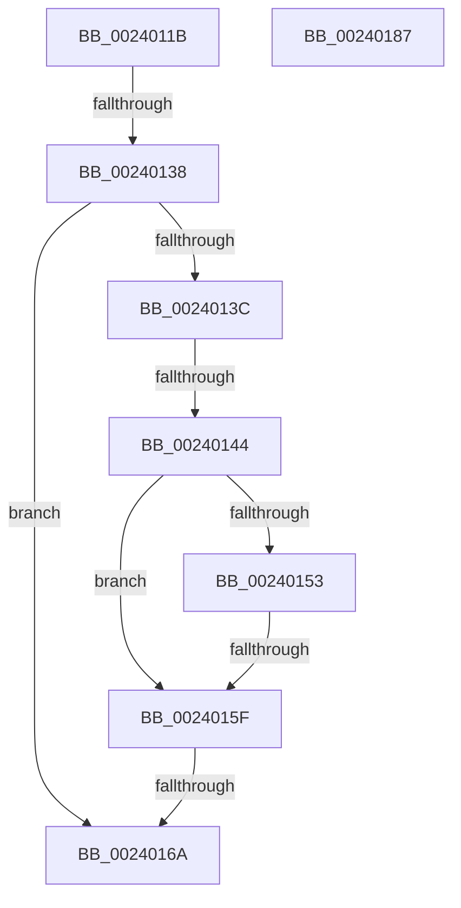

# sub_0024011B

- RVA: `0x0024011B`–`0x00240188` (길이 `109` bytes)
- VA: `0x000000014024011B`
- 실행 섹션: `.text`
- PDB 이름 있음: `아니요`; PDB Function 태그: `아니요`
- unwind 정보 RVA: `0x000616E0`
- 디코드: `33`개 명령, `109/109` bytes 표시
- 미해석 바이트: `0` (있으면 어셈블리에 `.byte`로 보존)

> 이 문서는 커널 이미지의 기계어와 PDB 기호를 분석해 생성했습니다. 4번과 5번은 함수 원형과 자료형을 바이너리 사용 방식에서 추정한 C 해석이며 원본 소스 복구 결과는 아닙니다.

## 1. Dependencies

- 직접 호출 지점: **0**; 고유 호출 대상: **0**
- 직접 호출자로 확인된 함수: **0**
- RIP 상대 이미지 참조: **0**

### Outgoing calls
- 직접 디코드된 call 명령이 없습니다.

### Direct callers
- 이 함수 시작 RVA로 연결되는 직접 call은 확인되지 않았습니다. 간접 호출은 완전히 역산할 수 없습니다.

### Static image references
- 디코드된 RIP-relative 메모리 참조가 없습니다.

## 2. Other-region calls and transfers

- 다른 실행 섹션으로 향하는 call: **0**
- call이 아닌 외부 분기/꼬리 이동: **4**
  - `0x00240132` → [sub_002401BF](Unknown_function_002401BF.md) (`tail-transfer`)
  - `0x0024013E` → [sub_002401BF + 0x4F](Unknown_function_002401BF.md) (`tail-transfer`)
  - `0x00240159` → [sub_002401BF + 0x14B](Unknown_function_002401BF.md) (`tail-transfer`)
  - `0x00240164` → [sub_002401BF + 0x161](Unknown_function_002401BF.md) (`tail-transfer`)

## 3. Assembly (complete function range)

```asm
0024011B  4C 89 64 24 58                  mov qword ptr [rsp + 0x58], r12
00240120  8B C5                           mov eax, ebp
00240122  83 E0 04                        and eax, 4
00240125  4C 89 74 24 60                  mov qword ptr [rsp + 0x60], r14
0024012A  4C 89 7C 24 20                  mov qword ptr [rsp + 0x20], r15
0024012F  F6 C3 20                        test bl, 0x20
00240132  0F 84 87 00 00 00               je 0x1402401bf
00240138  85 C0                           test eax, eax
0024013A  75 2E                           jne 0x14024016a
0024013C  85 D2                           test edx, edx
0024013E  0F 85 CA 00 00 00               jne 0x14024020e
00240144  48 89 7C 24 50                  mov qword ptr [rsp + 0x50], rdi
00240149  33 C9                           xor ecx, ecx
0024014B  49 8B C1                        mov rax, r9
0024014E  48 3B F0                        cmp rsi, rax
00240151  72 0C                           jb 0x14024015f
00240153  49 8B C0                        mov rax, r8
00240156  48 3B F0                        cmp rsi, rax
00240159  0F 86 AB 01 00 00               jbe 0x14024030a
0024015F  48 89 3E                        mov qword ptr [rsi], rdi
00240162  85 C9                           test ecx, ecx
00240164  0F 85 B6 01 00 00               jne 0x140240320
0024016A  B8 01 00 00 00                  mov eax, 1
0024016F  4C 8B 7C 24 20                  mov r15, qword ptr [rsp + 0x20]
00240174  4C 8B 74 24 60                  mov r14, qword ptr [rsp + 0x60]
00240179  4C 8B 64 24 58                  mov r12, qword ptr [rsp + 0x58]
0024017E  48 83 C4 28                     add rsp, 0x28
00240182  5F                              pop rdi
00240183  5E                              pop rsi
00240184  5D                              pop rbp
00240185  5B                              pop rbx
00240186  C3                              ret
00240187  CC                              int3
```

## 4. C-style interpretation (structured pseudocode)

```c
__int64 __fastcall sub_0024011B(int a1, int a2, __int64 a3, __int64 a4, __int64 a5, __int64 a6, __int64 a7, __int64 a8, __int64 a9, __int64 a10, __int64 a11, __int64 a12)
{
    __int64 result;
    __int64 v_rsp;
    unsigned __int64 v_stack_p20;
    unsigned __int64 v_stack_p50;
    unsigned __int64 v_stack_p58;
    unsigned __int64 v_stack_p60;

    v_stack_p58 = v_r12;
    result = (unsigned int)(((unsigned int)((unsigned int)(v_rbp))) & (4));
    v_stack_p60 = v_r14;
    v_stack_p20 = v_r15;
    if ((unsigned int)(result) != 0) goto loc_0024016A;
    v_stack_p50 = v_rdi;
    a1 = 0;
    if (v_rsi < a4) goto loc_0024015F;
loc_0024015F:
    *(unsigned __int64 *)(v_rsi) = v_rdi;
loc_0024016A:
    v_rsp = (v_rsp) + (40);
    return 1;
}
```

## 5. (Beta) C Style

```c
int64_t sub_0024011B(int32_t Arg1, int32_t Arg2, int64_t Arg3, int64_t Arg4, uint64_t Arg5, uint64_t Arg6, uint64_t Arg7, uint64_t Arg8, uint64_t Arg9, uint64_t Arg10, int64_t Arg11, int64_t Arg12)
{
    int64_t result;
    int64_t local_rsp;
    uint64_t v_stack_p20;
    uint64_t v_stack_p50;
    uint64_t v_stack_p58;
    uint64_t v_stack_p60;

    v_stack_p58 = local_r12;
    result = (uint32_t)(((uint32_t)((uint32_t)(local_rbp))) & (4));
    v_stack_p60 = local_r14;
    v_stack_p20 = local_r15;
    if ((uint32_t)(result) != 0) goto loc_0024016A;
    v_stack_p50 = local_rdi;
    Arg1 = 0;
    if (local_rsi < Arg4) goto loc_0024015F;
loc_0024015F:
    *(uint64_t *)(local_rsi) = local_rdi;
loc_0024016A:
    local_rsp = (local_rsp) + (40);
    return 1;
}
```

## 6. Execution-region graph

[열기: 2D/3D 그래프와 함수 탐색 컨트롤 패널](../../../control-panel.html?section=text&rva=0x0024011B&view=graph)

- 2D 그래프는 위에서 아래로 흐르고, 3D 그래프는 빈 공간을 드래그해 회전합니다. Shift+드래그는 이동, 휠은 확대·축소, 함수 노드 선택은 대상 보고서 이동입니다.

### Static fallback


