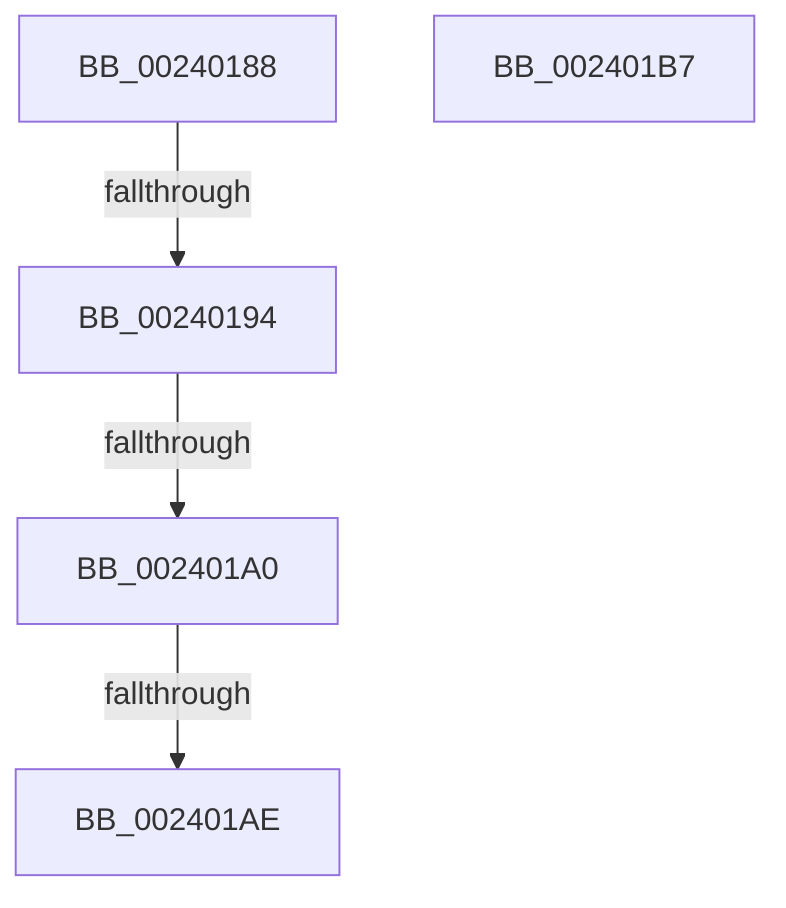

# sub_00240188

- RVA: `0x00240188`–`0x002401BF` (길이 `55` bytes)
- VA: `0x0000000140240188`
- 실행 섹션: `.text`
- PDB 이름 있음: `아니요`; PDB Function 태그: `아니요`
- unwind 정보 RVA: `0x00061700`
- 디코드: `13`개 명령, `55/55` bytes 표시
- 미해석 바이트: `0` (있으면 어셈블리에 `.byte`로 보존)

> 이 문서는 커널 이미지의 기계어와 PDB 기호를 분석해 생성했습니다. 4번과 5번은 함수 원형과 자료형을 바이너리 사용 방식에서 추정한 C 해석이며 원본 소스 복구 결과는 아닙니다.

## 1. Dependencies

- 직접 호출 지점: **1**; 고유 호출 대상: **1**
- 직접 호출자로 확인된 함수: **0**
- RIP 상대 이미지 참조: **0**

### Outgoing calls
- `0x002401A0` → [MiPteHasShadow](../32/MiPteHasShadow_function_0032B998.md) (function, `0x0032B998`)

### Direct callers
- 이 함수 시작 RVA로 연결되는 직접 call은 확인되지 않았습니다. 간접 호출은 완전히 역산할 수 없습니다.

### Static image references
- 디코드된 RIP-relative 메모리 참조가 없습니다.

## 2. Other-region calls and transfers

- 다른 실행 섹션으로 향하는 call: **0**
- call이 아닌 외부 분기/꼬리 이동: **5**
  - `0x0024018E` → [MI_WRITE_INVALID_PTE_TB_FLUSH_NEEDED + 0x35](MI_WRITE_INVALID_PTE_TB_FLUSH_NEEDED_function_002400C0.md) (`tail-transfer`)
  - `0x0024019A` → [MI_WRITE_INVALID_PTE_TB_FLUSH_NEEDED + 0x35](MI_WRITE_INVALID_PTE_TB_FLUSH_NEEDED_function_002400C0.md) (`tail-transfer`)
  - `0x002401A8` → [MI_WRITE_INVALID_PTE_TB_FLUSH_NEEDED + 0x35](MI_WRITE_INVALID_PTE_TB_FLUSH_NEEDED_function_002400C0.md) (`tail-transfer`)
  - `0x002401B2` → [sub_0024011B](Unknown_function_0024011B.md) (`tail-transfer`)
  - `0x002401BA` → [sub_0024011B](Unknown_function_0024011B.md) (`tail-transfer`)

## 3. Assembly (complete function range)

```asm
00240188  49 8B C1                        mov rax, r9
0024018B  48 3B F0                        cmp rsi, rax
0024018E  0F 82 61 FF FF FF               jb 0x1402400f5
00240194  49 8B C0                        mov rax, r8
00240197  48 3B F0                        cmp rsi, rax
0024019A  0F 87 55 FF FF FF               ja 0x1402400f5
002401A0  E8 F3 B7 0E 00                  call 0x14032b998
002401A5  48 85 C0                        test rax, rax
002401A8  0F 84 47 FF FF FF               je 0x1402400f5
002401AE  48 83 CB 20                     or rbx, 0x20
002401B2  E9 64 FF FF FF                  jmp 0x14024011b
002401B7  0F AE E8                        lfence
002401BA  E9 5C FF FF FF                  jmp 0x14024011b
```

## 4. C-style interpretation (structured pseudocode)

```c
__int64 __fastcall sub_00240188(__int64 a1, __int64 a2, __int64 a3, __int64 a4)
{
    __int64 result;
    __int64 v_rbx;

    result = MiPteHasShadow(a1, a2, a3, a4);
    v_rbx = (v_rbx) | (32);
}
```

## 5. (Beta) C Style

```c
int64_t sub_00240188(int64_t Arg1, int64_t Arg2, int64_t Arg3, int64_t Arg4)
{
    int64_t result;
    int64_t local_rbx;

    result = MiPteHasShadow(Arg1, Arg2, Arg3, Arg4);
    local_rbx = (local_rbx) | (32);
}
```

## 6. Execution-region graph

[열기: 2D/3D 그래프와 함수 탐색 컨트롤 패널](../../../control-panel.html?section=text&rva=0x00240188&view=graph)

- 2D 그래프는 위에서 아래로 흐르고, 3D 그래프는 빈 공간을 드래그해 회전합니다. Shift+드래그는 이동, 휠은 확대·축소, 함수 노드 선택은 대상 보고서 이동입니다.

### Static fallback


