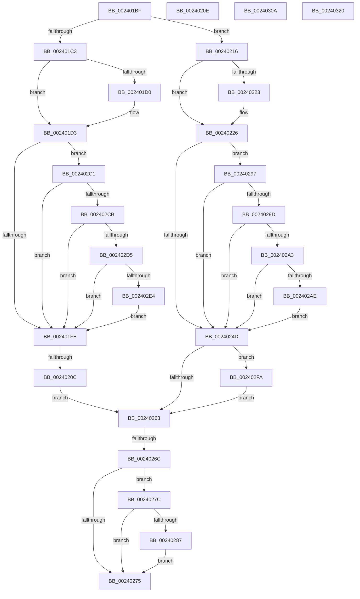

# sub_002401BF

- RVA: `0x002401BF`–`0x00240330` (길이 `369` bytes)
- VA: `0x00000001402401BF`
- 실행 섹션: `.text`
- PDB 이름 있음: `아니요`; PDB Function 태그: `아니요`
- unwind 정보 RVA: `0x00061710`
- 디코드: `84`개 명령, `369/369` bytes 표시
- 미해석 바이트: `0` (있으면 어셈블리에 `.byte`로 보존)

> 이 문서는 커널 이미지의 기계어와 PDB 기호를 분석해 생성했습니다. 4번과 5번은 함수 원형과 자료형을 바이너리 사용 방식에서 추정한 C 해석이며 원본 소스 복구 결과는 아닙니다.

## 1. Dependencies

- 직접 호출 지점: **7**; 고유 호출 대상: **4**
- 직접 호출자로 확인된 함수: **0**
- RIP 상대 이미지 참조: **1**

### Outgoing calls
- `0x00240256` → [MiPteInShadowRange](../23/MiPteInShadowRange_function_0023FB00.md) (function, `0x0023FB00`)
- `0x00240290` → [MiCheckLinearProtectedPteAccessedBit](../29/MiCheckLinearProtectedPteAccessedBit_function_00292D80.md) (function, `0x00292D80`)
- `0x002402BA` → [MiCheckLinearProtectedPteAccessedBit](../29/MiCheckLinearProtectedPteAccessedBit_function_00292D80.md) (function, `0x00292D80`)
- `0x002402F0` → [MiCheckLinearProtectedPteAccessedBit](../29/MiCheckLinearProtectedPteAccessedBit_function_00292D80.md) (function, `0x00292D80`)
- `0x00240300` → [MiWritePteShadow](../29/MiWritePteShadow_function_00294EAC.md) (function, `0x00294EAC`)
- `0x0024030F` → [MiSanitizeShadowPxe](../29/MiSanitizeShadowPxe_function_00294B68.md) (function, `0x00294B68`)
- `0x00240326` → [MiWritePteShadow](../29/MiWritePteShadow_function_00294EAC.md) (function, `0x00294EAC`)

### Direct callers
- 이 함수 시작 RVA로 연결되는 직접 call은 확인되지 않았습니다. 간접 호출은 완전히 역산할 수 없습니다.

### Static image references
- `0x002401C3` → RVA `0x00FC6A88` (`ALMOSTRO`; read)

## 2. Other-region calls and transfers

- 다른 실행 섹션으로 향하는 call: **0**
- call이 아닌 외부 분기/꼬리 이동: **6**
  - `0x00240206` → [sub_0024011B + 0x4F](Unknown_function_0024011B.md) (`tail-transfer`)
  - `0x00240211` → [sub_0024011B + 0x4F](Unknown_function_0024011B.md) (`tail-transfer`)
  - `0x00240266` → [sub_0024011B + 0x4F](Unknown_function_0024011B.md) (`tail-transfer`)
  - `0x00240277` → [sub_0024011B + 0x54](Unknown_function_0024011B.md) (`tail-transfer`)
  - `0x0024031B` → [sub_0024011B + 0x44](Unknown_function_0024011B.md) (`tail-transfer`)
  - `0x0024032B` → [sub_0024011B + 0x4F](Unknown_function_0024011B.md) (`tail-transfer`)

## 3. Assembly (complete function range)

```asm
002401BF  85 C0                           test eax, eax
002401C1  74 53                           je 0x140240216
002401C3  48 F7 05 BA 68 D8 00 00 00 00 02  test qword ptr [rip + 0xd868ba], 0x2000000
002401CE  74 03                           je 0x1402401d3
002401D0  0F AE E8                        lfence
002401D3  49 BE 00 00 00 00 10 00 00 00   movabs r14, 0x1000000000
002401DD  49 BF 00 00 00 00 80 F6 FF FF   movabs r15, 0xfffff68000000000
002401E7  4C 85 35 9A 68 D8 00            test qword ptr [rip + 0xd8689a], r14
002401EE  49 BC 00 00 00 00 40 00 00 00   movabs r12, 0x4000000000
002401F8  0F 85 C3 00 00 00               jne 0x1402402c1
002401FE  48 8B C3                        mov rax, rbx
00240201  F0 48 0F B1 3E                  lock cmpxchg qword ptr [rsi], rdi
00240206  0F 85 5E FF FF FF               jne 0x14024016a
0024020C  EB 55                           jmp 0x140240263
0024020E  48 89 3E                        mov qword ptr [rsi], rdi
00240211  E9 54 FF FF FF                  jmp 0x14024016a
00240216  48 F7 05 67 68 D8 00 00 00 00 02  test qword ptr [rip + 0xd86867], 0x2000000
00240221  74 03                           je 0x140240226
00240223  0F AE E8                        lfence
00240226  49 BE 00 00 00 00 10 00 00 00   movabs r14, 0x1000000000
00240230  49 BF 00 00 00 00 80 F6 FF FF   movabs r15, 0xfffff68000000000
0024023A  4C 85 35 47 68 D8 00            test qword ptr [rip + 0xd86847], r14
00240241  49 BC 00 00 00 00 40 00 00 00   movabs r12, 0x4000000000
0024024B  75 4A                           jne 0x140240297
0024024D  48 8B DF                        mov rbx, rdi
00240250  48 8B CE                        mov rcx, rsi
00240253  48 87 1E                        xchg qword ptr [rsi], rbx
00240256  E8 A5 F8 FF FF                  call 0x14023fb00
0024025B  85 C0                           test eax, eax
0024025D  0F 85 97 00 00 00               jne 0x1402402fa
00240263  F6 C3 20                        test bl, 0x20
00240266  0F 85 FE FE FF FF               jne 0x14024016a
0024026C  4C 85 35 15 68 D8 00            test qword ptr [rip + 0xd86815], r14
00240273  75 07                           jne 0x14024027c
00240275  33 C0                           xor eax, eax
00240277  E9 F3 FE FF FF                  jmp 0x14024016f
0024027C  49 8B C7                        mov rax, r15
0024027F  49 03 C4                        add rax, r12
00240282  48 3B F0                        cmp rsi, rax
00240285  72 EE                           jb 0x140240275
00240287  44 8B C5                        mov r8d, ebp
0024028A  48 8B D3                        mov rdx, rbx
0024028D  48 8B CE                        mov rcx, rsi
00240290  E8 EB 2A 05 00                  call 0x140292d80
00240295  EB DE                           jmp 0x140240275
00240297  40 F6 C7 01                     test dil, 1
0024029B  74 B0                           je 0x14024024d
0024029D  40 F6 C7 20                     test dil, 0x20
002402A1  75 AA                           jne 0x14024024d
002402A3  49 8B C7                        mov rax, r15
002402A6  49 03 C4                        add rax, r12
002402A9  48 3B F0                        cmp rsi, rax
002402AC  72 9F                           jb 0x14024024d
002402AE  41 B8 80 00 00 00               mov r8d, 0x80
002402B4  48 8B D7                        mov rdx, rdi
002402B7  48 8B CE                        mov rcx, rsi
002402BA  E8 C1 2A 05 00                  call 0x140292d80
002402BF  EB 8C                           jmp 0x14024024d
002402C1  40 F6 C7 01                     test dil, 1
002402C5  0F 84 33 FF FF FF               je 0x1402401fe
002402CB  40 F6 C7 20                     test dil, 0x20
002402CF  0F 85 29 FF FF FF               jne 0x1402401fe
002402D5  49 8B C7                        mov rax, r15
002402D8  49 03 C4                        add rax, r12
002402DB  48 3B F0                        cmp rsi, rax
002402DE  0F 82 1A FF FF FF               jb 0x1402401fe
002402E4  41 B8 80 00 00 00               mov r8d, 0x80
002402EA  48 8B D7                        mov rdx, rdi
002402ED  48 8B CE                        mov rcx, rsi
002402F0  E8 8B 2A 05 00                  call 0x140292d80
002402F5  E9 04 FF FF FF                  jmp 0x1402401fe
002402FA  48 8B D7                        mov rdx, rdi
002402FD  48 8B CE                        mov rcx, rsi
00240300  E8 A7 4B 05 00                  call 0x140294eac
00240305  E9 59 FF FF FF                  jmp 0x140240263
0024030A  48 8D 54 24 50                  lea rdx, [rsp + 0x50]
0024030F  E8 54 48 05 00                  call 0x140294b68
00240314  48 8B 7C 24 50                  mov rdi, qword ptr [rsp + 0x50]
00240319  8B C8                           mov ecx, eax
0024031B  E9 3F FE FF FF                  jmp 0x14024015f
00240320  48 8B D7                        mov rdx, rdi
00240323  48 8B CE                        mov rcx, rsi
00240326  E8 81 4B 05 00                  call 0x140294eac
0024032B  E9 3A FE FF FF                  jmp 0x14024016a
```

## 4. C-style interpretation (structured pseudocode)

```c
__int64 __fastcall sub_002401BF(void)
{
    __int64 result;
    unsigned __int64 v_stack_p50;

    if ((unsigned int)(result) == 0) goto loc_00240216;
    if (((*(unsigned __int64 *)(v_rip + 14182586)) & (0x2000000ULL)) != 0) {
    }
    if (((*(unsigned __int64 *)(v_rip + 14182554)) & (v_r14)) != 0) goto loc_002402C1;
loc_002401FE:
    goto loc_00240263;
loc_00240216:
    if (((*(unsigned __int64 *)(v_rip + 14182503)) & (0x2000000ULL)) != 0) {
    }
    if (((*(unsigned __int64 *)(v_rip + 14182471)) & (v_r14)) != 0) goto loc_00240297;
loc_0024024D:
    result = MiPteInShadowRange(v_rsi, a2, a3, a4);
    if ((unsigned int)(result) != 0) goto loc_002402FA;
loc_00240263:
    if (((*(unsigned __int64 *)(v_rip + 14182421)) & (v_r14)) != 0) goto loc_0024027C;
loc_00240275:
    result = 0;
loc_0024027C:
    result = (v_r15) + (v_r12);
    if (v_rsi < result) goto loc_00240275;
    result = MiCheckLinearProtectedPteAccessedBit(v_rsi, v_rdi, (unsigned int)((unsigned int)(v_rbp)), a4);
    goto loc_00240275;
loc_00240297:
    if ((((unsigned __int8)(v_rdi)) & (1)) == 0) goto loc_0024024D;
    if ((((unsigned __int8)(v_rdi)) & (32)) != 0) goto loc_0024024D;
    result = (v_r15) + (v_r12);
    if (v_rsi < result) goto loc_0024024D;
    result = MiCheckLinearProtectedPteAccessedBit(v_rsi, v_rdi, 128, a4);
    goto loc_0024024D;
loc_002402C1:
    if ((((unsigned __int8)(v_rdi)) & (1)) == 0) goto loc_002401FE;
    if ((((unsigned __int8)(v_rdi)) & (32)) != 0) goto loc_002401FE;
    result = (v_r15) + (v_r12);
    if (v_rsi < result) goto loc_002401FE;
    result = MiCheckLinearProtectedPteAccessedBit(v_rsi, v_rdi, 128, a4);
    goto loc_002401FE;
loc_002402FA:
    result = MiWritePteShadow(v_rsi, v_rdi, 128, a4);
    goto loc_00240263;
}
```

## 5. (Beta) C Style

```c
void sub_002401BF(void)
{
    int64_t result;
    uint64_t v_stack_p50;

    if ((uint32_t)(result) == 0) goto loc_00240216;
    if (((*(uint64_t *)(v_rip + 0xD868BA)) & (0x2000000ULL)) != 0) {
    }
    if (((*(uint64_t *)(v_rip + 0xD8689A)) & (local_r14)) != 0) goto loc_002402C1;
loc_002401FE:
    goto loc_00240263;
loc_00240216:
    if (((*(uint64_t *)(v_rip + 0xD86867)) & (0x2000000ULL)) != 0) {
    }
    if (((*(uint64_t *)(v_rip + 0xD86847)) & (local_r14)) != 0) goto loc_00240297;
loc_0024024D:
    result = MiPteInShadowRange(local_rsi, a2, a3, a4);
    if ((uint32_t)(result) != 0) goto loc_002402FA;
loc_00240263:
    if (((*(uint64_t *)(v_rip + 0xD86815)) & (local_r14)) != 0) goto loc_0024027C;
loc_00240275:
    result = 0;
loc_0024027C:
    result = (local_r15) + (local_r12);
    if (local_rsi < result) goto loc_00240275;
    result = MiCheckLinearProtectedPteAccessedBit(local_rsi, local_rdi, (uint32_t)((uint32_t)(local_rbp)), a4);
    goto loc_00240275;
loc_00240297:
    if ((((uint8_t)(local_rdi)) & (1)) == 0) goto loc_0024024D;
    if ((((uint8_t)(local_rdi)) & (32)) != 0) goto loc_0024024D;
    result = (local_r15) + (local_r12);
    if (local_rsi < result) goto loc_0024024D;
    result = MiCheckLinearProtectedPteAccessedBit(local_rsi, local_rdi, 128, a4);
    goto loc_0024024D;
loc_002402C1:
    if ((((uint8_t)(local_rdi)) & (1)) == 0) goto loc_002401FE;
    if ((((uint8_t)(local_rdi)) & (32)) != 0) goto loc_002401FE;
    result = (local_r15) + (local_r12);
    if (local_rsi < result) goto loc_002401FE;
    result = MiCheckLinearProtectedPteAccessedBit(local_rsi, local_rdi, 128, a4);
    goto loc_002401FE;
loc_002402FA:
    result = MiWritePteShadow(local_rsi, local_rdi, 128, a4);
    goto loc_00240263;
}
```

## 6. Execution-region graph

[열기: 2D/3D 그래프와 함수 탐색 컨트롤 패널](../../../control-panel.html?section=text&rva=0x002401BF&view=graph)

- 2D 그래프는 위에서 아래로 흐르고, 3D 그래프는 빈 공간을 드래그해 회전합니다. Shift+드래그는 이동, 휠은 확대·축소, 함수 노드 선택은 대상 보고서 이동입니다.

### Static fallback


