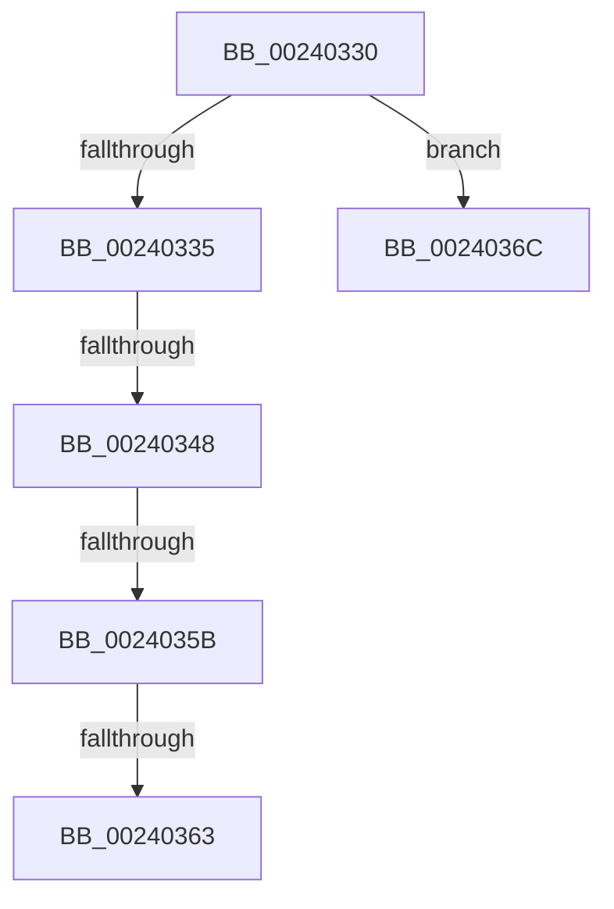

# sub_00240330

- RVA: `0x00240330`–`0x00240375` (길이 `69` bytes)
- VA: `0x0000000140240330`
- 실행 섹션: `.text`
- PDB 이름 있음: `아니요`; PDB Function 태그: `아니요`
- unwind 정보 RVA: `0x0006172C`
- 디코드: `14`개 명령, `69/69` bytes 표시
- 미해석 바이트: `0` (있으면 어셈블리에 `.byte`로 보존)

> 이 문서는 커널 이미지의 기계어와 PDB 기호를 분석해 생성했습니다. 4번과 5번은 함수 원형과 자료형을 바이너리 사용 방식에서 추정한 C 해석이며 원본 소스 복구 결과는 아닙니다.

## 1. Dependencies

- 직접 호출 지점: **0**; 고유 호출 대상: **0**
- 직접 호출자로 확인된 함수: **0**
- RIP 상대 이미지 참조: **0**

### Outgoing calls
- 직접 디코드된 call 명령이 없습니다.

### Direct callers
- 이 함수 시작 RVA로 연결되는 직접 call은 확인되지 않았습니다. 간접 호출은 완전히 역산할 수 없습니다.

### Static image references
- 디코드된 RIP-relative 메모리 참조가 없습니다.

## 2. Other-region calls and transfers

- 다른 실행 섹션으로 향하는 call: **0**
- call이 아닌 외부 분기/꼬리 이동: **5**
  - `0x00240342` → [sub_0024011B](Unknown_function_0024011B.md) (`tail-transfer`)
  - `0x00240355` → [sub_0024011B](Unknown_function_0024011B.md) (`tail-transfer`)
  - `0x0024035D` → [sub_0024011B](Unknown_function_0024011B.md) (`tail-transfer`)
  - `0x00240367` → [sub_0024011B](Unknown_function_0024011B.md) (`tail-transfer`)
  - `0x00240370` → [sub_0024011B](Unknown_function_0024011B.md) (`tail-transfer`)

## 3. Assembly (complete function range)

```asm
00240330  48 85 C9                        test rcx, rcx
00240333  74 37                           je 0x14024036c
00240335  48 B8 00 00 00 40 FB F6 FF FF   movabs rax, 0xfffff6fb40000000
0024033F  48 3B F0                        cmp rsi, rax
00240342  0F 82 D3 FD FF FF               jb 0x14024011b
00240348  48 B8 FF FF FF 7F FB F6 FF FF   movabs rax, 0xfffff6fb7fffffff
00240352  48 3B F0                        cmp rsi, rax
00240355  0F 87 C0 FD FF FF               ja 0x14024011b
0024035B  84 DB                           test bl, bl
0024035D  0F 88 B8 FD FF FF               js 0x14024011b
00240363  48 83 CB 20                     or rbx, 0x20
00240367  E9 AF FD FF FF                  jmp 0x14024011b
0024036C  48 83 CB 20                     or rbx, 0x20
00240370  E9 A6 FD FF FF                  jmp 0x14024011b
```

## 4. C-style interpretation (structured pseudocode)

```c
__int64 __fastcall sub_00240330(__int64 a1)
{
    __int64 v_rbx;

    if (a1 == 0) goto loc_0024036C;
    v_rbx = (v_rbx) | (32);
loc_0024036C:
    v_rbx = (v_rbx) | (32);
}
```

## 5. (Beta) C Style

```c
int64_t sub_00240330(int64_t Arg1)
{
    int64_t local_rbx;

    if (Arg1 == 0) goto loc_0024036C;
    local_rbx = (local_rbx) | (32);
loc_0024036C:
    local_rbx = (local_rbx) | (32);
}
```

## 6. Execution-region graph

[열기: 2D/3D 그래프와 함수 탐색 컨트롤 패널](../../../control-panel.html?section=text&rva=0x00240330&view=graph)

- 2D 그래프는 위에서 아래로 흐르고, 3D 그래프는 빈 공간을 드래그해 회전합니다. Shift+드래그는 이동, 휠은 확대·축소, 함수 노드 선택은 대상 보고서 이동입니다.

### Static fallback


