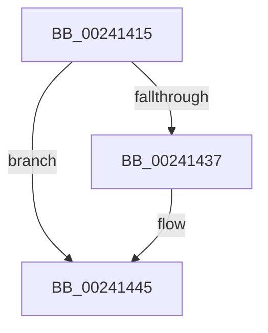

# sub_00241415

- RVA: `0x00241415`–`0x0024145E` (길이 `73` bytes)
- VA: `0x0000000140241415`
- 실행 섹션: `.text`
- PDB 이름 있음: `아니요`; PDB Function 태그: `아니요`
- unwind 정보 RVA: `0x000617F8`
- 디코드: `19`개 명령, `73/73` bytes 표시
- 미해석 바이트: `0` (있으면 어셈블리에 `.byte`로 보존)

> 이 문서는 커널 이미지의 기계어와 PDB 기호를 분석해 생성했습니다. 4번과 5번은 함수 원형과 자료형을 바이너리 사용 방식에서 추정한 C 해석이며 원본 소스 복구 결과는 아닙니다.

## 1. Dependencies

- 직접 호출 지점: **1**; 고유 호출 대상: **1**
- 직접 호출자로 확인된 함수: **0**
- RIP 상대 이미지 참조: **0**

### Outgoing calls
- `0x00241440` → [MiFreeWsleList](MiFreeWsleList_function_00241168.md) (function, `0x00241168`)

### Direct callers
- 이 함수 시작 RVA로 연결되는 직접 call은 확인되지 않았습니다. 간접 호출은 완전히 역산할 수 없습니다.

### Static image references
- 디코드된 RIP-relative 메모리 참조가 없습니다.

## 2. Other-region calls and transfers

- 다른 실행 섹션으로 향하는 call: **0**
- 별도 외부 분기/꼬리 이동을 확인하지 못했습니다.

## 3. Assembly (complete function range)

```asm
00241415  48 01 6B 20                     add qword ptr [rbx + 0x20], rbp
00241419  49 2B C3                        sub rax, r11
0024141C  48 8D 0C 28                     lea rcx, [rax + rbp]
00241420  48 33 C1                        xor rax, rcx
00241423  48 25 00 FC FF FF               and rax, 0xfffffffffffffc00
00241429  48 33 C1                        xor rax, rcx
0024142C  49 89 02                        mov qword ptr [r10], rax
0024142F  8B 43 0C                        mov eax, dword ptr [rbx + 0xc]
00241432  39 43 1C                        cmp dword ptr [rbx + 0x1c], eax
00241435  75 0E                           jne 0x140241445
00241437  45 8B C7                        mov r8d, r15d
0024143A  48 8B D3                        mov rdx, rbx
0024143D  48 8B CF                        mov rcx, rdi
00241440  E8 23 FD FF FF                  call 0x140241168
00241445  4C 8B 6C 24 28                  mov r13, qword ptr [rsp + 0x28]
0024144A  4C 8B 64 24 68                  mov r12, qword ptr [rsp + 0x68]
0024144F  48 8B 6C 24 60                  mov rbp, qword ptr [rsp + 0x60]
00241454  48 8B 5C 24 58                  mov rbx, qword ptr [rsp + 0x58]
00241459  4C 8B 7C 24 20                  mov r15, qword ptr [rsp + 0x20]
```

## 4. C-style interpretation (structured pseudocode)

```c
__int64 __fastcall sub_00241415(__int64 a1, __int64 a2, __int64 a3, __int64 a4, __int64 a5, __int64 a6, __int64 a7, __int64 a8, __int64 a9, __int64 a10, __int64 a11, __int64 a12, __int64 a13)
{
    __int64 result;
    unsigned __int64 v_stack_p20;

    result = (result) - (v_r11);
    result = (result) ^ (result + v_rbp * 1);
    result = (result) & (0xFFFFFFFFFFFFFC00ULL);
    result = (result) ^ (result + v_rbp * 1);
    *(unsigned __int64 *)(v_r10) = result;
    result = (unsigned int)(*(unsigned int *)(v_rbx + 12));
    if ((*(unsigned int *)(v_rbx + 28)) == ((unsigned int)((unsigned int)(*(unsigned int *)(v_rbx + 12))))) {
        a3 = (unsigned int)(v_r15);
        a2 = v_rbx;
        a1 = v_rdi;
        result = MiFreeWsleList(a1, a2, a3, a4);
    }
    return result;
}
```

## 5. (Beta) C Style

```c
int64_t sub_00241415(int64_t Arg1, int64_t Arg2, int64_t Arg3, int64_t Arg4, int64_t Arg5, uint64_t Arg6, uint64_t Arg7, uint64_t Arg8, uint64_t Arg9, uint64_t Arg10, int64_t Arg11, int64_t Arg12, int64_t Arg13)
{
    int64_t result;
    uint64_t v_stack_p20;

    result = (result) - (local_r11);
    result = (result) ^ (result + local_rbp * 1);
    result = (result) & (0xFFFFFFFFFFFFFC00ULL);
    result = (result) ^ (result + local_rbp * 1);
    *(uint64_t *)(local_r10) = result;
    result = (uint32_t)(*(uint32_t *)(local_rbx + 0xC));
    if ((*(uint32_t *)(local_rbx + 0x1C)) == ((uint32_t)((uint32_t)(*(uint32_t *)(local_rbx + 0xC))))) {
        Arg3 = (uint32_t)(local_r15);
        Arg2 = local_rbx;
        Arg1 = local_rdi;
        result = MiFreeWsleList(Arg1, Arg2, Arg3, Arg4);
    }
    return result;
}
```

## 6. Execution-region graph

[열기: 2D/3D 그래프와 함수 탐색 컨트롤 패널](../../../control-panel.html?section=text&rva=0x00241415&view=graph)

- 2D 그래프는 위에서 아래로 흐르고, 3D 그래프는 빈 공간을 드래그해 회전합니다. Shift+드래그는 이동, 휠은 확대·축소, 함수 노드 선택은 대상 보고서 이동입니다.

### Static fallback


