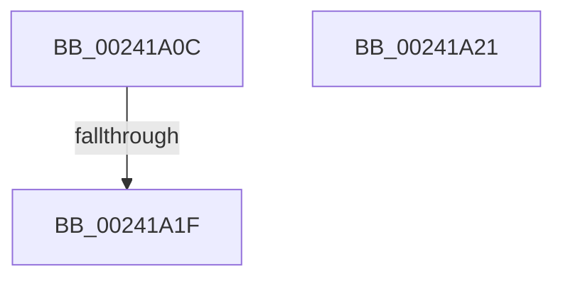

# sub_00241A0C

- RVA: `0x00241A0C`–`0x00241A3E` (길이 `50` bytes)
- VA: `0x0000000140241A0C`
- 실행 섹션: `.text`
- PDB 이름 있음: `아니요`; PDB Function 태그: `아니요`
- unwind 정보 RVA: `0x00061864`
- 디코드: `11`개 명령, `50/50` bytes 표시
- 미해석 바이트: `0` (있으면 어셈블리에 `.byte`로 보존)

> 이 문서는 커널 이미지의 기계어와 PDB 기호를 분석해 생성했습니다. 4번과 5번은 함수 원형과 자료형을 바이너리 사용 방식에서 추정한 C 해석이며 원본 소스 복구 결과는 아닙니다.

## 1. Dependencies

- 직접 호출 지점: **0**; 고유 호출 대상: **0**
- 직접 호출자로 확인된 함수: **0**
- RIP 상대 이미지 참조: **0**

### Outgoing calls
- 직접 디코드된 call 명령이 없습니다.

### Direct callers
- 이 함수 시작 RVA로 연결되는 직접 call은 확인되지 않았습니다. 간접 호출은 완전히 역산할 수 없습니다.

### Static image references
- 디코드된 RIP-relative 메모리 참조가 없습니다.

## 2. Other-region calls and transfers

- 다른 실행 섹션으로 향하는 call: **0**
- call이 아닌 외부 분기/꼬리 이동: **3**
  - `0x00241A19` → [sub_00241476 + 0x1FB](Unknown_function_00241476.md) (`tail-transfer`)
  - `0x00241A1F` → [sub_00241476 + 0x57B](Unknown_function_00241476.md) (`tail-transfer`)
  - `0x00241A39` → [sub_00241415 + 0x1A](Unknown_function_00241415.md) (`tail-transfer`)

## 3. Assembly (complete function range)

```asm
00241A0C  48 B8 FF FF FE FF FF 7F 00 00   movabs rax, 0x7ffffffeffff
00241A16  48 3B F0                        cmp rsi, rax
00241A19  0F 87 52 FC FF FF               ja 0x140241671
00241A1F  EB D0                           jmp 0x1402419f1
00241A21  48 01 6B 20                     add qword ptr [rbx + 0x20], rbp
00241A25  48 8D 0C 28                     lea rcx, [rax + rbp]
00241A29  48 33 C1                        xor rax, rcx
00241A2C  48 25 00 FC FF FF               and rax, 0xfffffffffffffc00
00241A32  48 33 C1                        xor rax, rcx
00241A35  49 89 42 28                     mov qword ptr [r10 + 0x28], rax
00241A39  E9 F1 F9 FF FF                  jmp 0x14024142f
```

## 4. C-style interpretation (structured pseudocode)

```c
__int64 __fastcall sub_00241A0C(void)
{
}
```

## 5. (Beta) C Style

```c
void sub_00241A0C(void)
{
}
```

## 6. Execution-region graph

[열기: 2D/3D 그래프와 함수 탐색 컨트롤 패널](../../../control-panel.html?section=text&rva=0x00241A0C&view=graph)

- 2D 그래프는 위에서 아래로 흐르고, 3D 그래프는 빈 공간을 드래그해 회전합니다. Shift+드래그는 이동, 휠은 확대·축소, 함수 노드 선택은 대상 보고서 이동입니다.

### Static fallback


