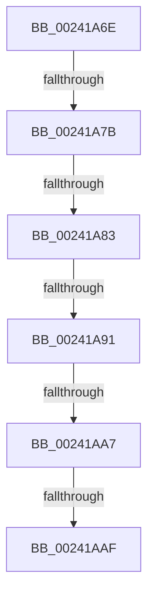

# sub_00241A6E

- RVA: `0x00241A6E`–`0x00241ACB` (길이 `93` bytes)
- VA: `0x0000000140241A6E`
- 실행 섹션: `.text`
- PDB 이름 있음: `아니요`; PDB Function 태그: `아니요`
- unwind 정보 RVA: `0x00061894`
- 디코드: `23`개 명령, `93/93` bytes 표시
- 미해석 바이트: `0` (있으면 어셈블리에 `.byte`로 보존)

> 이 문서는 커널 이미지의 기계어와 PDB 기호를 분석해 생성했습니다. 4번과 5번은 함수 원형과 자료형을 바이너리 사용 방식에서 추정한 C 해석이며 원본 소스 복구 결과는 아닙니다.

## 1. Dependencies

- 직접 호출 지점: **1**; 고유 호출 대상: **1**
- 직접 호출자로 확인된 함수: **0**
- RIP 상대 이미지 참조: **0**

### Outgoing calls
- `0x00241AB6` → [MiDecommitAddToList](MiDecommitAddToList_function_00242264.md) (function, `0x00242264`)

### Direct callers
- 이 함수 시작 RVA로 연결되는 직접 call은 확인되지 않았습니다. 간접 호출은 완전히 역산할 수 없습니다.

### Static image references
- 디코드된 RIP-relative 메모리 참조가 없습니다.

## 2. Other-region calls and transfers

- 다른 실행 섹션으로 향하는 call: **0**
- call이 아닌 외부 분기/꼬리 이동: **5**
  - `0x00241A79` → [sub_00241ACC](Unknown_function_00241ACC.md) (`tail-transfer`)
  - `0x00241A7D` → [sub_00241B6F](Unknown_function_00241B6F.md) (`tail-transfer`)
  - `0x00241A8B` → [sub_00241ACC + 0x84](Unknown_function_00241ACC.md) (`tail-transfer`)
  - `0x00241AA1` → [sub_00241B9E](Unknown_function_00241B9E.md) (`tail-transfer`)
  - `0x00241AA9` → [sub_00241B6F + 0x16](Unknown_function_00241B6F.md) (`tail-transfer`)

## 3. Assembly (complete function range)

```asm
00241A6E  48 89 74 24 38                  mov qword ptr [rsp + 0x38], rsi
00241A73  33 F6                           xor esi, esi
00241A75  48 39 71 10                     cmp qword ptr [rcx + 0x10], rsi
00241A79  74 51                           je 0x140241acc
00241A7B  84 DB                           test bl, bl
00241A7D  0F 88 EC 00 00 00               js 0x140241b6f
00241A83  48 83 BF C0 00 00 00 01         cmp qword ptr [rdi + 0xc0], 1
00241A8B  0F 85 BF 00 00 00               jne 0x140241b50
00241A91  39 77 60                        cmp dword ptr [rdi + 0x60], esi
00241A94  40 0F 95 C6                     setne sil
00241A98  FF C6                           inc esi
00241A9A  83 BF 88 00 00 00 00            cmp dword ptr [rdi + 0x88], 0
00241AA1  0F 85 F7 00 00 00               jne 0x140241b9e
00241AA7  85 F6                           test esi, esi
00241AA9  0F 84 D6 00 00 00               je 0x140241b85
00241AAF  48 8B 57 38                     mov rdx, qword ptr [rdi + 0x38]
00241AB3  48 8B CF                        mov rcx, rdi
00241AB6  E8 A9 07 00 00                  call 0x140242264
00241ABB  48 8B 74 24 38                  mov rsi, qword ptr [rsp + 0x38]
00241AC0  48 8B 5C 24 40                  mov rbx, qword ptr [rsp + 0x40]
00241AC5  48 83 C4 20                     add rsp, 0x20
00241AC9  5F                              pop rdi
00241ACA  C3                              ret
```

## 4. C-style interpretation (structured pseudocode)

```c
__int64 __fastcall sub_00241A6E(__int64 a1, __int64 a2, __int64 a3, __int64 a4, __int64 a5, __int64 a6, __int64 a7, __int64 a8)
{
    __int64 result;
    __int64 v_rsi;
    __int64 v_rsp;
    unsigned __int64 v_stack_p38;

    v_stack_p38 = v_rsi;
    v_rsi = 0;
    v_rsi = ((*(unsigned int *)(v_rdi + 96)) != 0) ? 1 : 0;
    v_rsi = (unsigned int)((v_rsi) + 1);
    result = MiDecommitAddToList(v_rdi, *(unsigned __int64 *)(v_rdi + 56), a3, a4);
    v_rsp = (v_rsp) + (32);
    return result;
}
```

## 5. (Beta) C Style

```c
int64_t sub_00241A6E(void *Arg1, int64_t Arg2, int64_t Arg3, int64_t Arg4, uint64_t Arg5, uint64_t Arg6, int64_t Arg7, int64_t Arg8)
{
    uint8_t *arg1 = (uint8_t *)Arg1;

    int64_t result;
    int64_t local_rsi;
    int64_t local_rsp;
    uint64_t v_stack_p38;

    v_stack_p38 = local_rsi;
    local_rsi = 0;
    local_rsi = ((*(uint32_t *)(local_rdi + 0x60)) != 0) ? 1 : 0;
    local_rsi = (uint32_t)((local_rsi) + 1);
    result = MiDecommitAddToList(local_rdi, *(uint64_t *)(local_rdi + 0x38), Arg3, Arg4);
    local_rsp = (local_rsp) + (32);
    return result;
}
```

### 관측된 메모리 오프셋

구조체 형식이 확인되지 않은 접근은 인자 기준의 오프셋으로만 기록했습니다.

| 기준 인자 | 오프셋 표현 | 폭 (bit) | 접근 |
|---|---:|---:|---|
| `Arg1` | `+ 0x10` | `64` | `R` |

## 6. Execution-region graph

[열기: 2D/3D 그래프와 함수 탐색 컨트롤 패널](../../../control-panel.html?section=text&rva=0x00241A6E&view=graph)

- 2D 그래프는 위에서 아래로 흐르고, 3D 그래프는 빈 공간을 드래그해 회전합니다. Shift+드래그는 이동, 휠은 확대·축소, 함수 노드 선택은 대상 보고서 이동입니다.

### Static fallback


