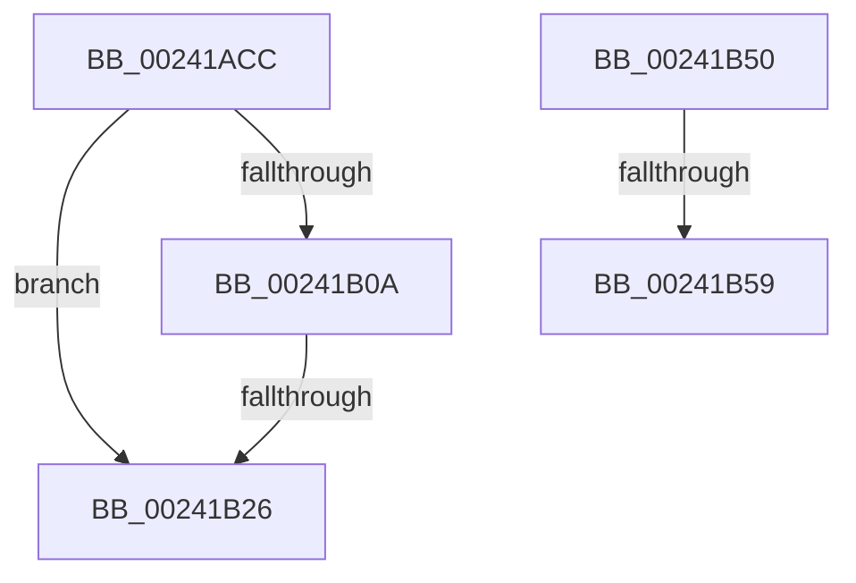

# sub_00241ACC

- RVA: `0x00241ACC`–`0x00241B5E` (길이 `146` bytes)
- VA: `0x0000000140241ACC`
- 실행 섹션: `.text`
- PDB 이름 있음: `아니요`; PDB Function 태그: `아니요`
- unwind 정보 RVA: `0x000618BC`
- 디코드: `35`개 명령, `146/146` bytes 표시
- 미해석 바이트: `0` (있으면 어셈블리에 `.byte`로 보존)

> 이 문서는 커널 이미지의 기계어와 PDB 기호를 분석해 생성했습니다. 4번과 5번은 함수 원형과 자료형을 바이너리 사용 방식에서 추정한 C 해석이며 원본 소스 복구 결과는 아닙니다.

## 1. Dependencies

- 직접 호출 지점: **1**; 고유 호출 대상: **1**
- 직접 호출자로 확인된 함수: **0**
- RIP 상대 이미지 참조: **0**

### Outgoing calls
- `0x00241ACC` → [MiGetProcessorFlushList](MiGetProcessorFlushList_function_00242C90.md) (function, `0x00242C90`)

### Direct callers
- 이 함수 시작 RVA로 연결되는 직접 call은 확인되지 않았습니다. 간접 호출은 완전히 역산할 수 없습니다.

### Static image references
- 디코드된 RIP-relative 메모리 참조가 없습니다.

## 2. Other-region calls and transfers

- 다른 실행 섹션으로 향하는 call: **0**
- call이 아닌 외부 분기/꼬리 이동: **4**
  - `0x00241B24` → [sub_00241B6F + 0xE](Unknown_function_00241B6F.md) (`tail-transfer`)
  - `0x00241B4B` → [sub_00241A6E + 0xD](Unknown_function_00241A6E.md) (`tail-transfer`)
  - `0x00241B53` → [sub_00241A6E + 0x2C](Unknown_function_00241A6E.md) (`tail-transfer`)
  - `0x00241B59` → [sub_00241A6E + 0x23](Unknown_function_00241A6E.md) (`tail-transfer`)

## 3. Assembly (complete function range)

```asm
00241ACC  E8 BF 11 00 00                  call 0x140242c90
00241AD1  4C 8B 47 20                     mov r8, qword ptr [rdi + 0x20]
00241AD5  41 B9 01 00 00 00               mov r9d, 1
00241ADB  48 89 47 10                     mov qword ptr [rdi + 0x10], rax
00241ADF  48 8B D0                        mov rdx, rax
00241AE2  89 70 10                        mov dword ptr [rax + 0x10], esi
00241AE5  44 89 48 14                     mov dword ptr [rax + 0x14], r9d
00241AE9  4C 89 00                        mov qword ptr [rax], r8
00241AEC  41 8B 88 B8 00 00 00            mov ecx, dword ptr [r8 + 0xb8]
00241AF3  C1 E9 08                        shr ecx, 8
00241AF6  C0 E9 03                        shr cl, 3
00241AF9  41 22 C9                        and cl, r9b
00241AFC  88 48 18                        mov byte ptr [rax + 0x18], cl
00241AFF  41 8B 80 B8 00 00 00            mov eax, dword ptr [r8 + 0xb8]
00241B06  A8 0F                           test al, 0xf
00241B08  75 1C                           jne 0x140241b26
00241B0A  65 48 8B 04 25 88 01 00 00      mov rax, qword ptr gs:[0x188]
00241B13  48 8B 88 B8 00 00 00            mov rcx, qword ptr [rax + 0xb8]
00241B1A  48 81 C1 00 04 00 00            add rcx, 0x400
00241B21  4C 3B C1                        cmp r8, rcx
00241B24  75 57                           jne 0x140241b7d
00241B26  41 8B 80 B8 00 00 00            mov eax, dword ptr [r8 + 0xb8]
00241B2D  8B CE                           mov ecx, esi
00241B2F  A8 0F                           test al, 0xf
00241B31  41 0F 44 C9                     cmove ecx, r9d
00241B35  83 62 10 DB                     and dword ptr [rdx + 0x10], 0xffffffdb
00241B39  89 4A 08                        mov dword ptr [rdx + 8], ecx
00241B3C  66 89 72 19                     mov word ptr [rdx + 0x19], si
00241B40  89 72 1C                        mov dword ptr [rdx + 0x1c], esi
00241B43  48 89 72 20                     mov qword ptr [rdx + 0x20], rsi
00241B47  48 89 72 28                     mov qword ptr [rdx + 0x28], rsi
00241B4B  E9 2B FF FF FF                  jmp 0x140241a7b
00241B50  39 77 60                        cmp dword ptr [rdi + 0x60], esi
00241B53  0F 84 41 FF FF FF               je 0x140241a9a
00241B59  E9 33 FF FF FF                  jmp 0x140241a91
```

## 4. C-style interpretation (structured pseudocode)

```c
__int64 __fastcall sub_00241ACC(void)
{
    __int64 result;

    result = MiGetProcessorFlushList(a1, a2, a3, a4);
    *(unsigned __int64 *)(v_rdi + 16) = result;
    *(unsigned int *)(result + 16) = (unsigned int)(v_rsi);
    *(unsigned int *)(result + 20) = 1;
    *(unsigned __int64 *)(result) = *(unsigned __int64 *)(v_rdi + 32);
    a1 = (unsigned int)(((unsigned int)(*(unsigned int *)(*(unsigned __int64 *)(v_rdi + 32) + 184))) >> (8));
    a1 = (unsigned __int8)((a1) >> (3));
    a1 = (unsigned __int8)((a1) & (1));
    *(unsigned __int8 *)(result + 24) = (unsigned __int8)(a1);
    if ((((unsigned __int8)((unsigned int)(*(unsigned int *)(*(unsigned __int64 *)(v_rdi + 32) + 184)))) & (15)) != 0) goto loc_00241B26;
    a1 = (*(unsigned __int64 *)(*(unsigned __int64 *)(gs_base + (0 + 392)) + 184)) + (0x400ULL);
loc_00241B26:
    a1 = (unsigned int)((unsigned int)(v_rsi));
    if ((((unsigned __int8)((unsigned int)(*(unsigned int *)(*(unsigned __int64 *)(v_rdi + 32) + 184)))) & (15)) == 0) { a1 = 1; }
    *(unsigned int *)(result + 8) = (unsigned int)(a1);
    *(unsigned __int16 *)(result + 25) = (unsigned __int16)(v_rsi);
    *(unsigned int *)(result + 28) = (unsigned int)(v_rsi);
    *(unsigned __int64 *)(result + 32) = v_rsi;
    *(unsigned __int64 *)(result + 40) = v_rsi;
}
```

## 5. (Beta) C Style

```c
void sub_00241ACC(void)
{
    int64_t result;

    result = MiGetProcessorFlushList(a1, a2, a3, a4);
    *(uint64_t *)(local_rdi + 0x10) = result;
    *(uint32_t *)(result + 0x10) = (uint32_t)(local_rsi);
    *(uint32_t *)(result + 0x14) = 1;
    *(uint64_t *)(result) = *(uint64_t *)(local_rdi + 0x20);
    a1 = (uint32_t)(((uint32_t)(*(uint32_t *)(*(uint64_t *)(local_rdi + 0x20) + 0xB8))) >> (8));
    a1 = (uint8_t)((a1) >> (3));
    a1 = (uint8_t)((a1) & (1));
    *(uint8_t *)(result + 0x18) = (uint8_t)(a1);
    if ((((uint8_t)((uint32_t)(*(uint32_t *)(*(uint64_t *)(local_rdi + 0x20) + 0xB8)))) & (15)) != 0) goto loc_00241B26;
    a1 = (*(uint64_t *)(*(uint64_t *)(gs_base + (0 + 0x188)) + 0xB8)) + (0x400ULL);
loc_00241B26:
    a1 = (uint32_t)((uint32_t)(local_rsi));
    if ((((uint8_t)((uint32_t)(*(uint32_t *)(*(uint64_t *)(local_rdi + 0x20) + 0xB8)))) & (15)) == 0) { a1 = 1; }
    *(uint32_t *)(result + 0x8) = (uint32_t)(a1);
    *(uint16_t *)(result + 0x19) = (uint16_t)(local_rsi);
    *(uint32_t *)(result + 0x1C) = (uint32_t)(local_rsi);
    *(uint64_t *)(result + 0x20) = local_rsi;
    *(uint64_t *)(result + 0x28) = local_rsi;
}
```

## 6. Execution-region graph

[열기: 2D/3D 그래프와 함수 탐색 컨트롤 패널](../../../control-panel.html?section=text&rva=0x00241ACC&view=graph)

- 2D 그래프는 위에서 아래로 흐르고, 3D 그래프는 빈 공간을 드래그해 회전합니다. Shift+드래그는 이동, 휠은 확대·축소, 함수 노드 선택은 대상 보고서 이동입니다.

### Static fallback


