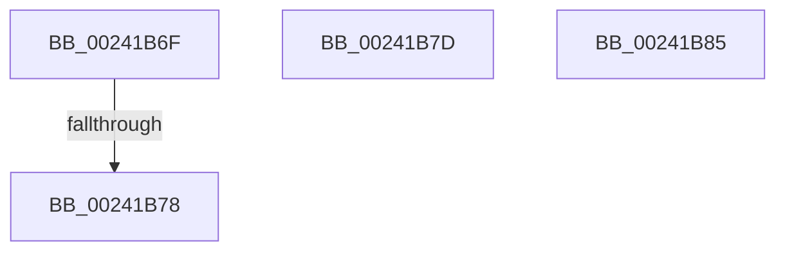

# sub_00241B6F

- RVA: `0x00241B6F`–`0x00241B9D` (길이 `46` bytes)
- VA: `0x0000000140241B6F`
- 실행 섹션: `.text`
- PDB 이름 있음: `아니요`; PDB Function 태그: `아니요`
- unwind 정보 RVA: `0x000618E4`
- 디코드: `13`개 명령, `46/46` bytes 표시
- 미해석 바이트: `0` (있으면 어셈블리에 `.byte`로 보존)

> 이 문서는 커널 이미지의 기계어와 PDB 기호를 분석해 생성했습니다. 4번과 5번은 함수 원형과 자료형을 바이너리 사용 방식에서 추정한 C 해석이며 원본 소스 복구 결과는 아닙니다.

## 1. Dependencies

- 직접 호출 지점: **1**; 고유 호출 대상: **1**
- 직접 호출자로 확인된 함수: **0**
- RIP 상대 이미지 참조: **0**

### Outgoing calls
- `0x00241B88` → [MiDecommitLargePte](../4D/MiDecommitLargePte_function_004D1ED4.md) (function, `0x004D1ED4`)

### Direct callers
- 이 함수 시작 RVA로 연결되는 직접 call은 확인되지 않았습니다. 간접 호출은 완전히 역산할 수 없습니다.

### Static image references
- 디코드된 RIP-relative 메모리 참조가 없습니다.

## 2. Other-region calls and transfers

- 다른 실행 섹션으로 향하는 call: **0**
- call이 아닌 외부 분기/꼬리 이동: **3**
  - `0x00241B72` → [sub_00241A6E + 0x2C](Unknown_function_00241A6E.md) (`tail-transfer`)
  - `0x00241B78` → [sub_00241A6E + 0x15](Unknown_function_00241A6E.md) (`tail-transfer`)
  - `0x00241B83` → [sub_00241ACC + 0x69](Unknown_function_00241ACC.md) (`tail-transfer`)

## 3. Assembly (complete function range)

```asm
00241B6F  39 77 60                        cmp dword ptr [rdi + 0x60], esi
00241B72  0F 85 22 FF FF FF               jne 0x140241a9a
00241B78  E9 06 FF FF FF                  jmp 0x140241a83
00241B7D  83 4A 10 09                     or dword ptr [rdx + 0x10], 9
00241B81  8B CE                           mov ecx, esi
00241B83  EB B0                           jmp 0x140241b35
00241B85  48 8B CF                        mov rcx, rdi
00241B88  E8 47 03 29 00                  call 0x1404d1ed4
00241B8D  48 8B 74 24 38                  mov rsi, qword ptr [rsp + 0x38]
00241B92  48 8B 5C 24 40                  mov rbx, qword ptr [rsp + 0x40]
00241B97  48 83 C4 20                     add rsp, 0x20
00241B9B  5F                              pop rdi
00241B9C  C3                              ret
```

## 4. C-style interpretation (structured pseudocode)

```c
__int64 __fastcall sub_00241B6F(__int64 a1, __int64 a2)
{
    unsigned __int64 v_stack_p38;
    unsigned __int64 v_stack_p40;
}
```

## 5. (Beta) C Style

```c
int64_t sub_00241B6F(int64_t Arg1, int64_t Arg2)
{
    uint64_t v_stack_p38;
    uint64_t v_stack_p40;
}
```

## 6. Execution-region graph

[열기: 2D/3D 그래프와 함수 탐색 컨트롤 패널](../../../control-panel.html?section=text&rva=0x00241B6F&view=graph)

- 2D 그래프는 위에서 아래로 흐르고, 3D 그래프는 빈 공간을 드래그해 회전합니다. Shift+드래그는 이동, 휠은 확대·축소, 함수 노드 선택은 대상 보고서 이동입니다.

### Static fallback


