# sub_00241C55

- RVA: `0x00241C55`–`0x00241E74` (길이 `543` bytes)
- VA: `0x0000000140241C55`
- 실행 섹션: `.text`
- PDB 이름 있음: `아니요`; PDB Function 태그: `아니요`
- unwind 정보 RVA: `0x00061948`
- 디코드: `118`개 명령, `543/543` bytes 표시
- 미해석 바이트: `0` (있으면 어셈블리에 `.byte`로 보존)

> 이 문서는 커널 이미지의 기계어와 PDB 기호를 분석해 생성했습니다. 4번과 5번은 함수 원형과 자료형을 바이너리 사용 방식에서 추정한 C 해석이며 원본 소스 복구 결과는 아닙니다.

## 1. Dependencies

- 직접 호출 지점: **2**; 고유 호출 대상: **2**
- 직접 호출자로 확인된 함수: **0**
- RIP 상대 이미지 참조: **1**

### Outgoing calls
- `0x00241D51` → [MiDecommitAddToList](MiDecommitAddToList_function_00242264.md) (function, `0x00242264`)
- `0x00241E2D` → [EtwTraceShouldYieldProcessor](../27/EtwTraceShouldYieldProcessor_function_00279088.md) (function, `0x00279088`)

### Direct callers
- 이 함수 시작 RVA로 연결되는 직접 call은 확인되지 않았습니다. 간접 호출은 완전히 역산할 수 없습니다.

### Static image references
- `0x00241E1A` → RVA `0x00FC6B04` (`ALMOSTRO`; read)

## 2. Other-region calls and transfers

- 다른 실행 섹션으로 향하는 call: **0**
- call이 아닌 외부 분기/꼬리 이동: **21**
  - `0x00241CA4` → [sub_00241E90 + 0x25F](Unknown_function_00241E90.md) (`tail-transfer`)
  - `0x00241CB5` → [sub_00241E90 + 0x25F](Unknown_function_00241E90.md) (`tail-transfer`)
  - `0x00241CE5` → [sub_00241E90 + 0x23](Unknown_function_00241E90.md) (`tail-transfer`)
  - `0x00241CEE` → [sub_00241E90 + 0xB4](Unknown_function_00241E90.md) (`tail-transfer`)
  - `0x00241CF7` → [sub_00241E90 + 0x8C](Unknown_function_00241E90.md) (`tail-transfer`)
  - `0x00241D01` → [sub_00241E90 + 0x2FA](Unknown_function_00241E90.md) (`tail-transfer`)
  - `0x00241D0C` → [sub_00241E90 + 0x123](Unknown_function_00241E90.md) (`tail-transfer`)
  - `0x00241D1B` → [sub_00241E90 + 0x1B4](Unknown_function_00241E90.md) (`tail-transfer`)
  - `0x00241D23` → [sub_00241E90 + 0x1A9](Unknown_function_00241E90.md) (`tail-transfer`)
  - `0x00241D2C` → [sub_00241E90 + 0x1BC](Unknown_function_00241E90.md) (`tail-transfer`)
  - `0x00241D39` → [sub_00241E90 + 0x395](Unknown_function_00241E90.md) (`tail-transfer`)
  - `0x00241D42` → [sub_00241E90 + 0x386](Unknown_function_00241E90.md) (`tail-transfer`)
  - `0x00241D8C` → [sub_00241E90 + 0x346](Unknown_function_00241E90.md) (`tail-transfer`)
  - `0x00241D9C` → [sub_00241E90 + 0x284](Unknown_function_00241E90.md) (`tail-transfer`)
  - `0x00241DC6` → [sub_00241E90](Unknown_function_00241E90.md) (`tail-transfer`)
  - `0x00241DD0` → [sub_00241E90 + 0x1E2](Unknown_function_00241E90.md) (`tail-transfer`)
  - `0x00241DE4` → [sub_00241E90 + 0x207](Unknown_function_00241E90.md) (`tail-transfer`)
  - `0x00241DF1` → [sub_00241E90 + 0x1CE](Unknown_function_00241E90.md) (`tail-transfer`)
  - `0x00241DFF` → [sub_00241E90 + 0x211](Unknown_function_00241E90.md) (`tail-transfer`)
  - `0x00241E08` → [sub_00241E90 + 0x24B](Unknown_function_00241E90.md) (`tail-transfer`)
  - `0x00241E34` → [sub_00241E90 + 0x2E6](Unknown_function_00241E90.md) (`tail-transfer`)

## 3. Assembly (complete function range)

```asm
00241C55  4C 89 A4 24 80 01 00 00         mov qword ptr [rsp + 0x180], r12
00241C5D  45 33 F6                        xor r14d, r14d
00241C60  4C 89 AC 24 88 01 00 00         mov qword ptr [rsp + 0x188], r13
00241C68  48 BE F8 FF FF FF 7F 00 00 00   movabs rsi, 0x7ffffffff8
00241C72  4C 89 BC 24 90 01 00 00         mov qword ptr [rsp + 0x190], r15
00241C7A  41 BD 01 00 00 00               mov r13d, 1
00241C80  49 BF F8 D7 BE 7D FB F6 FF FF   movabs r15, 0xfffff6fb7dbed7f8
00241C8A  49 BC 00 D0 BE 7D FB F6 FF FF   movabs r12, 0xfffff6fb7dbed000
00241C94  48 BF 00 00 00 00 80 F6 FF FF   movabs rdi, 0xfffff68000000000
00241C9E  66 90                           nop
00241CA0  80 7D 8C 11                     cmp byte ptr [rbp - 0x74], 0x11
00241CA4  0F 84 45 04 00 00               je 0x1402420ef
00241CAA  48 8B 5D B8                     mov rbx, qword ptr [rbp - 0x48]
00241CAE  48 F7 C3 FF 0F 00 00            test rbx, 0xfff
00241CB5  0F 84 34 04 00 00               je 0x1402420ef
00241CBB  48 8B 1B                        mov rbx, qword ptr [rbx]
00241CBE  49 8B C4                        mov rax, r12
00241CC1  48 8B 55 B8                     mov rdx, qword ptr [rbp - 0x48]
00241CC5  48 3B D0                        cmp rdx, rax
00241CC8  72 21                           jb 0x140241ceb
00241CCA  49 8B C7                        mov rax, r15
00241CCD  48 3B D0                        cmp rdx, rax
00241CD0  77 19                           ja 0x140241ceb
00241CD2  41 84 DD                        test r13b, bl
00241CD5  74 14                           je 0x140241ceb
00241CD7  F6 C3 42                        test bl, 0x42
00241CDA  0F 95 C1                        setne cl
00241CDD  F6 C3 20                        test bl, 0x20
00241CE0  0F 95 C0                        setne al
00241CE3  84 C8                           test al, cl
00241CE5  0F 84 C8 01 00 00               je 0x140241eb3
00241CEB  48 85 DB                        test rbx, rbx
00241CEE  0F 84 50 02 00 00               je 0x140241f44
00241CF4  41 84 DD                        test r13b, bl
00241CF7  0F 84 1F 02 00 00               je 0x140241f1c
00241CFD  F6 45 FC 08                     test byte ptr [rbp - 4], 8
00241D01  0F 85 83 04 00 00               jne 0x14024218a
00241D07  4C 39 74 24 70                  cmp qword ptr [rsp + 0x70], r14
00241D0C  0F 84 A1 02 00 00               je 0x140241fb3
00241D12  4C 8B 4D 20                     mov r9, qword ptr [rbp + 0x20]
00241D16  8B 45 C0                        mov eax, dword ptr [rbp - 0x40]
00241D19  84 DB                           test bl, bl
00241D1B  0F 88 23 03 00 00               js 0x140242044
00241D21  85 C0                           test eax, eax
00241D23  0F 85 10 03 00 00               jne 0x140242039
00241D29  4D 3B CD                        cmp r9, r13
00241D2C  0F 85 1A 03 00 00               jne 0x14024204c
00241D32  45 8B C5                        mov r8d, r13d
00241D35  44 39 75 E8                     cmp dword ptr [rbp - 0x18], r14d
00241D39  0F 85 E6 04 00 00               jne 0x140242225
00241D3F  45 85 C0                        test r8d, r8d
00241D42  0F 84 CE 04 00 00               je 0x140242216
00241D48  48 8B 55 98                     mov rdx, qword ptr [rbp - 0x68]
00241D4C  48 8D 4C 24 60                  lea rcx, [rsp + 0x60]
00241D51  E8 0E 05 00 00                  call 0x140242264
00241D56  48 8B 4D A8                     mov rcx, qword ptr [rbp - 0x58]
00241D5A  48 8B 45 F0                     mov rax, qword ptr [rbp - 0x10]
00241D5E  48 8D 04 C1                     lea rax, [rcx + rax*8]
00241D62  48 8B D0                        mov rdx, rax
00241D65  48 89 45 A8                     mov qword ptr [rbp - 0x58], rax
00241D69  48 C1 E2 19                     shl rdx, 0x19
00241D6D  48 8B CF                        mov rcx, rdi
00241D70  44 8B 4D 2C                     mov r9d, dword ptr [rbp + 0x2c]
00241D74  45 8B C6                        mov r8d, r14d
00241D77  48 C1 E1 19                     shl rcx, 0x19
00241D7B  48 2B D1                        sub rdx, rcx
00241D7E  48 C1 FA 10                     sar rdx, 0x10
00241D82  48 89 55 98                     mov qword ptr [rbp - 0x68], rdx
00241D86  48 8B D0                        mov rdx, rax
00241D89  45 3B CD                        cmp r9d, r13d
00241D8C  0F 86 44 04 00 00               jbe 0x1402421d6
00241D92  48 89 55 B8                     mov qword ptr [rbp - 0x48], rdx
00241D96  44 89 45 C0                     mov dword ptr [rbp - 0x40], r8d
00241D9A  A8 78                           test al, 0x78
00241D9C  0F 84 72 03 00 00               je 0x140242114
00241DA2  65 48 8B 0C 25 20 00 00 00      mov rcx, qword ptr gs:[0x20]
00241DAB  45 8B C6                        mov r8d, r14d
00241DAE  45 8B CE                        mov r9d, r14d
00241DB1  8B 91 BC 38 00 00               mov edx, dword ptr [rcx + 0x38bc]
00241DB7  8B B9 AC 83 00 00               mov edi, dword ptr [rcx + 0x83ac]
00241DBD  8B B1 5C 86 00 00               mov esi, dword ptr [rcx + 0x865c]
00241DC3  41 84 D5                        test r13b, dl
00241DC6  0F 85 C4 00 00 00               jne 0x140241e90
00241DCC  44 38 41 20                     cmp byte ptr [rcx + 0x20], r8b
00241DD0  0F 85 9C 02 00 00               jne 0x140242072
00241DD6  F6 C2 1E                        test dl, 0x1e
00241DD9  75 3A                           jne 0x140241e15
00241DDB  0F B6 81 B9 38 00 00            movzx eax, byte ptr [rcx + 0x38b9]
00241DE2  84 C0                           test al, al
00241DE4  0F 85 AD 02 00 00               jne 0x140242097
00241DEA  48 8B 41 10                     mov rax, qword ptr [rcx + 0x10]
00241DEE  48 85 C0                        test rax, rax
00241DF1  0F 85 67 02 00 00               jne 0x14024205e
00241DF7  83 FF 07                        cmp edi, 7
00241DFA  76 3E                           jbe 0x140241e3a
00241DFC  45 85 C0                        test r8d, r8d
00241DFF  0F 84 9C 02 00 00               je 0x1402420a1
00241E05  F6 C2 1E                        test dl, 0x1e
00241E08  0F 84 CD 02 00 00               je 0x1402420db
00241E0E  BB 05 00 00 00                  mov ebx, 5
00241E13  EB 05                           jmp 0x140241e1a
00241E15  BB 02 00 00 00                  mov ebx, 2
00241E1A  F7 05 E0 4C D8 00 00 00 00 04   test dword ptr [rip + 0xd84ce0], 0x4000000
00241E24  74 0C                           je 0x140241e32
00241E26  44 8B C6                        mov r8d, esi
00241E29  8B D7                           mov edx, edi
00241E2B  8B CB                           mov ecx, ebx
00241E2D  E8 56 72 03 00                  call 0x140279088
00241E32  85 DB                           test ebx, ebx
00241E34  0F 85 3C 03 00 00               jne 0x140242176
00241E3A  48 8B 45 B0                     mov rax, qword ptr [rbp - 0x50]
00241E3E  48 BE F8 FF FF FF 7F 00 00 00   movabs rsi, 0x7ffffffff8
00241E48  48 BF 00 00 00 00 80 F6 FF FF   movabs rdi, 0xfffff68000000000
00241E52  48 39 45 A8                     cmp qword ptr [rbp - 0x58], rax
00241E56  0F 86 44 FE FF FF               jbe 0x140241ca0
00241E5C  4C 8B AC 24 88 01 00 00         mov r13, qword ptr [rsp + 0x188]
00241E64  4C 8B A4 24 80 01 00 00         mov r12, qword ptr [rsp + 0x180]
00241E6C  4C 8B BC 24 90 01 00 00         mov r15, qword ptr [rsp + 0x190]
```

## 4. C-style interpretation (structured pseudocode)

```c
__int64 __fastcall sub_00241C55(__int64 a1, __int64 a2, __int64 a3, __int64 a4, __int64 a5, __int64 a6, __int64 a7, __int64 a8, __int64 a9, __int64 a10, __int64 a11, __int64 a12, __int64 a13, __int64 a14, __int64 a15, __int64 a16, __int64 a17, __int64 a18, __int64 a19, __int64 a20, __int64 a21, __int64 a22, __int64 a23, __int64 a24, __int64 a25, __int64 a26, __int64 a27, __int64 a28, __int64 a29, __int64 a30, __int64 a31, __int64 a32, __int64 a33, __int64 a34, __int64 a35, __int64 a36, __int64 a37, __int64 a38, __int64 a39, __int64 a40, __int64 a41, __int64 a42, __int64 a43, __int64 a44, __int64 a45, __int64 a46, __int64 a47, __int64 a48, __int64 a49, __int64 a50)
{
    __int64 result;
    __int64 v_r14;
    unsigned __int64 v_stack_p180;
    unsigned __int64 v_stack_p188;
    unsigned __int64 v_stack_p190;

    v_stack_p180 = v_r12;
    v_r14 = 0;
    v_stack_p188 = v_r13;
    v_stack_p190 = v_r15;
loc_00241CA0:
    if ((*(unsigned __int64 *)(v_rbp - 72)) < v_r12) goto loc_00241CEB;
    if ((*(unsigned __int64 *)(v_rbp - 72)) > v_r15) goto loc_00241CEB;
    if (((1) & ((unsigned __int8)(*(unsigned __int64 *)(*(unsigned __int64 *)(v_rbp - 72))))) == 0) goto loc_00241CEB;
    a1 = ((((unsigned __int8)(*(unsigned __int64 *)(*(unsigned __int64 *)(v_rbp - 72)))) & (66)) != 0) ? 1 : 0;
    result = ((((unsigned __int8)(*(unsigned __int64 *)(*(unsigned __int64 *)(v_rbp - 72)))) & (32)) != 0) ? 1 : 0;
loc_00241CEB:
    result = MiDecommitAddToList(a12, *(unsigned __int64 *)(v_rbp - 104), 1, *(unsigned __int64 *)(v_rbp + 32));
    *(unsigned __int64 *)(v_rbp - 88) = *(unsigned __int64 *)(v_rbp - 88) + *(unsigned __int64 *)(v_rbp - 16) * 8;
    a2 = (*(unsigned __int64 *)(v_rbp - 88) + *(unsigned __int64 *)(v_rbp - 16) * 8) << (25);
    a1 = (v_rdi) << (25);
    a2 = (a2) - (a1);
    a2 = (a2) >> (16);
    *(unsigned __int64 *)(v_rbp - 104) = a2;
    *(unsigned __int64 *)(v_rbp - 72) = *(unsigned __int64 *)(v_rbp - 88) + *(unsigned __int64 *)(v_rbp - 16) * 8;
    *(unsigned int *)(v_rbp - 64) = 0;
    if ((((unsigned __int8)((unsigned int)(*(unsigned int *)(*(unsigned __int64 *)(gs_base + (0 + 32)) + 14524)))) & (30)) != 0) goto loc_00241E15;
    if (((unsigned int)((unsigned int)(*(unsigned int *)(*(unsigned __int64 *)(gs_base + (0 + 32)) + 33708)))) <= 7) goto loc_00241E3A;
    goto loc_00241E1A;
loc_00241E15:
loc_00241E1A:
    result = *(unsigned __int64 *)(*(unsigned __int64 *)(gs_base + (0 + 32)) + 16);
    if (((*(unsigned int *)(v_rip + 14175456)) & (0x4000000ULL)) != 0) {
        a3 = (unsigned int)((unsigned int)(*(unsigned int *)(*(unsigned __int64 *)(gs_base + (0 + 32)) + 34396)));
        a2 = (unsigned int)((unsigned int)(*(unsigned int *)(*(unsigned __int64 *)(gs_base + (0 + 32)) + 33708)));
        a1 = 2;
        result = EtwTraceShouldYieldProcessor(a1, a2, a3, 0);
    }
loc_00241E3A:
    if ((*(unsigned __int64 *)(v_rbp - 88)) <= (*(unsigned __int64 *)(v_rbp - 80))) goto loc_00241CA0;
    return *(unsigned __int64 *)(v_rbp - 80);
}
```

## 5. (Beta) C Style

```c
int64_t sub_00241C55(int64_t Arg1, int64_t Arg2, int64_t Arg3, int64_t Arg4, uint64_t Arg5, uint64_t Arg6, uint64_t Arg7, uint64_t Arg8, uint64_t Arg9, uint64_t Arg10, uint64_t Arg11, int64_t Arg12, uint64_t Arg13, int64_t Arg14, uint64_t Arg15, uint64_t Arg16, uint64_t Arg17, uint64_t Arg18, uint64_t Arg19, uint64_t Arg20, uint64_t Arg21, uint64_t Arg22, uint64_t Arg23, uint64_t Arg24, uint64_t Arg25, uint64_t Arg26, uint64_t Arg27, uint64_t Arg28, uint64_t Arg29, uint64_t Arg30, uint64_t Arg31, uint64_t Arg32, uint64_t Arg33, uint64_t Arg34, uint64_t Arg35, uint64_t Arg36, uint64_t Arg37, uint64_t Arg38, uint64_t Arg39, uint64_t Arg40, uint64_t Arg41, uint64_t Arg42, uint64_t Arg43, uint64_t Arg44, uint64_t Arg45, uint64_t Arg46, uint64_t Arg47, int64_t Arg48, int64_t Arg49, int64_t Arg50)
{
    int64_t result;
    int64_t local_r14;
    uint64_t v_stack_p180;
    uint64_t v_stack_p188;
    uint64_t v_stack_p190;

    v_stack_p180 = local_r12;
    local_r14 = 0;
    v_stack_p188 = local_r13;
    v_stack_p190 = local_r15;
loc_00241CA0:
    if ((*(uint64_t *)(local_rbp - 0x48)) < local_r12) goto loc_00241CEB;
    if ((*(uint64_t *)(local_rbp - 0x48)) > local_r15) goto loc_00241CEB;
    if (((1) & ((uint8_t)(*(uint64_t *)(*(uint64_t *)(local_rbp - 0x48))))) == 0) goto loc_00241CEB;
    Arg1 = ((((uint8_t)(*(uint64_t *)(*(uint64_t *)(local_rbp - 0x48)))) & (66)) != 0) ? 1 : 0;
    result = ((((uint8_t)(*(uint64_t *)(*(uint64_t *)(local_rbp - 0x48)))) & (32)) != 0) ? 1 : 0;
loc_00241CEB:
    result = MiDecommitAddToList(Arg12, *(uint64_t *)(local_rbp - 0x68), 1, *(uint64_t *)(local_rbp + 0x20));
    *(uint64_t *)(local_rbp - 0x58) = *(uint64_t *)(local_rbp - 0x58) + *(uint64_t *)(local_rbp - 0x10) * 8;
    Arg2 = (*(uint64_t *)(local_rbp - 0x58) + *(uint64_t *)(local_rbp - 0x10) * 8) << (25);
    Arg1 = (local_rdi) << (25);
    Arg2 = (Arg2) - (Arg1);
    Arg2 = (Arg2) >> (16);
    *(uint64_t *)(local_rbp - 0x68) = Arg2;
    *(uint64_t *)(local_rbp - 0x48) = *(uint64_t *)(local_rbp - 0x58) + *(uint64_t *)(local_rbp - 0x10) * 8;
    *(uint32_t *)(local_rbp - 0x40) = 0;
    if ((((uint8_t)((uint32_t)(*(uint32_t *)(*(uint64_t *)(gs_base + (0 + 0x20)) + 0x38BC)))) & (30)) != 0) goto loc_00241E15;
    if (((uint32_t)((uint32_t)(*(uint32_t *)(*(uint64_t *)(gs_base + (0 + 0x20)) + 0x83AC)))) <= 7) goto loc_00241E3A;
    goto loc_00241E1A;
loc_00241E15:
loc_00241E1A:
    result = *(uint64_t *)(*(uint64_t *)(gs_base + (0 + 0x20)) + 0x10);
    if (((*(uint32_t *)(v_rip + 0xD84CE0)) & (0x4000000ULL)) != 0) {
        Arg3 = (uint32_t)((uint32_t)(*(uint32_t *)(*(uint64_t *)(gs_base + (0 + 0x20)) + 0x865C)));
        Arg2 = (uint32_t)((uint32_t)(*(uint32_t *)(*(uint64_t *)(gs_base + (0 + 0x20)) + 0x83AC)));
        Arg1 = 2;
        result = EtwTraceShouldYieldProcessor(Arg1, Arg2, Arg3, 0);
    }
loc_00241E3A:
    if ((*(uint64_t *)(local_rbp - 0x58)) <= (*(uint64_t *)(local_rbp - 0x50))) goto loc_00241CA0;
    return *(uint64_t *)(local_rbp - 0x50);
}
```

## 6. Execution-region graph

[열기: 2D/3D 그래프와 함수 탐색 컨트롤 패널](../../../control-panel.html?section=text&rva=0x00241C55&view=graph)

- 2D 그래프는 위에서 아래로 흐르고, 3D 그래프는 빈 공간을 드래그해 회전합니다. Shift+드래그는 이동, 휠은 확대·축소, 함수 노드 선택은 대상 보고서 이동입니다.

### Static fallback

```mermaid
flowchart TD
  bb_00241C55[BB_00241C55]
  bb_00241CA0[BB_00241CA0]
  bb_00241CAA[BB_00241CAA]
  bb_00241CBB[BB_00241CBB]
  bb_00241CCA[BB_00241CCA]
  bb_00241CD2[BB_00241CD2]
  bb_00241CD7[BB_00241CD7]
  bb_00241CEB[BB_00241CEB]
  bb_00241CF4[BB_00241CF4]
  bb_00241CFD[BB_00241CFD]
  bb_00241D07[BB_00241D07]
  bb_00241D12[BB_00241D12]
  bb_00241D21[BB_00241D21]
  bb_00241D29[BB_00241D29]
  bb_00241D32[BB_00241D32]
  bb_00241D3F[BB_00241D3F]
  bb_00241D48[BB_00241D48]
  bb_00241D92[BB_00241D92]
  bb_00241DA2[BB_00241DA2]
  bb_00241DCC[BB_00241DCC]
  bb_00241DD6[BB_00241DD6]
  bb_00241DDB[BB_00241DDB]
  bb_00241DEA[BB_00241DEA]
  bb_00241DF7[BB_00241DF7]
  bb_00241DFC[BB_00241DFC]
  bb_00241E05[BB_00241E05]
  bb_00241E0E[BB_00241E0E]
  bb_00241E15[BB_00241E15]
  bb_00241E1A[BB_00241E1A]
  bb_00241E26[BB_00241E26]
  bb_00241E32[BB_00241E32]
  bb_00241E3A[BB_00241E3A]
  bb_00241E5C[BB_00241E5C]
  bb_00241C55 -->|flow| bb_00241CA0
  bb_00241CA0 -->|fallthrough| bb_00241CAA
  bb_00241CAA -->|fallthrough| bb_00241CBB
  bb_00241CBB -->|branch| bb_00241CEB
  bb_00241CBB -->|fallthrough| bb_00241CCA
  bb_00241CCA -->|branch| bb_00241CEB
  bb_00241CCA -->|fallthrough| bb_00241CD2
  bb_00241CD2 -->|branch| bb_00241CEB
  bb_00241CD2 -->|fallthrough| bb_00241CD7
  bb_00241CD7 -->|fallthrough| bb_00241CEB
  bb_00241CEB -->|fallthrough| bb_00241CF4
  bb_00241CF4 -->|fallthrough| bb_00241CFD
  bb_00241CFD -->|fallthrough| bb_00241D07
  bb_00241D07 -->|fallthrough| bb_00241D12
  bb_00241D12 -->|fallthrough| bb_00241D21
  bb_00241D21 -->|fallthrough| bb_00241D29
  bb_00241D29 -->|fallthrough| bb_00241D32
  bb_00241D32 -->|fallthrough| bb_00241D3F
  bb_00241D3F -->|fallthrough| bb_00241D48
  bb_00241D48 -->|fallthrough| bb_00241D92
  bb_00241D92 -->|fallthrough| bb_00241DA2
  bb_00241DA2 -->|fallthrough| bb_00241DCC
  bb_00241DCC -->|fallthrough| bb_00241DD6
  bb_00241DD6 -->|branch| bb_00241E15
  bb_00241DD6 -->|fallthrough| bb_00241DDB
  bb_00241DDB -->|fallthrough| bb_00241DEA
  bb_00241DEA -->|fallthrough| bb_00241DF7
  bb_00241DF7 -->|branch| bb_00241E3A
  bb_00241DF7 -->|fallthrough| bb_00241DFC
  bb_00241DFC -->|fallthrough| bb_00241E05
  bb_00241E05 -->|fallthrough| bb_00241E0E
  bb_00241E0E -->|branch| bb_00241E1A
  bb_00241E15 -->|flow| bb_00241E1A
  bb_00241E1A -->|branch| bb_00241E32
  bb_00241E1A -->|fallthrough| bb_00241E26
  bb_00241E26 -->|flow| bb_00241E32
  bb_00241E32 -->|fallthrough| bb_00241E3A
  bb_00241E3A -->|branch| bb_00241CA0
  bb_00241E3A -->|fallthrough| bb_00241E5C
```


