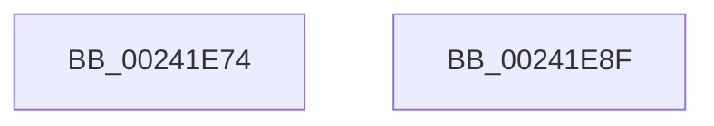

# sub_00241E74

- RVA: `0x00241E74`–`0x00241E90` (길이 `28` bytes)
- VA: `0x0000000140241E74`
- 실행 섹션: `.text`
- PDB 이름 있음: `아니요`; PDB Function 태그: `아니요`
- unwind 정보 RVA: `0x00061964`
- 디코드: `11`개 명령, `28/28` bytes 표시
- 미해석 바이트: `0` (있으면 어셈블리에 `.byte`로 보존)

> 이 문서는 커널 이미지의 기계어와 PDB 기호를 분석해 생성했습니다. 4번과 5번은 함수 원형과 자료형을 바이너리 사용 방식에서 추정한 C 해석이며 원본 소스 복구 결과는 아닙니다.

## 1. Dependencies

- 직접 호출 지점: **1**; 고유 호출 대상: **1**
- 직접 호출자로 확인된 함수: **0**
- RIP 상대 이미지 참조: **0**

### Outgoing calls
- `0x00241E79` → [MiDecommitPagesTail](../27/MiDecommitPagesTail_function_002790FC.md) (function, `0x002790FC`)

### Direct callers
- 이 함수 시작 RVA로 연결되는 직접 call은 확인되지 않았습니다. 간접 호출은 완전히 역산할 수 없습니다.

### Static image references
- 디코드된 RIP-relative 메모리 참조가 없습니다.

## 2. Other-region calls and transfers

- 다른 실행 섹션으로 향하는 call: **0**
- 별도 외부 분기/꼬리 이동을 확인하지 못했습니다.

## 3. Assembly (complete function range)

```asm
00241E74  48 8D 4C 24 60                  lea rcx, [rsp + 0x60]
00241E79  E8 7E 72 03 00                  call 0x1402790fc
00241E7E  8B 45 E4                        mov eax, dword ptr [rbp - 0x1c]
00241E81  48 81 C4 50 01 00 00            add rsp, 0x150
00241E88  41 5E                           pop r14
00241E8A  5F                              pop rdi
00241E8B  5E                              pop rsi
00241E8C  5B                              pop rbx
00241E8D  5D                              pop rbp
00241E8E  C3                              ret
00241E8F  CC                              int3
```

## 4. C-style interpretation (structured pseudocode)

```c
__int64 __fastcall sub_00241E74(__int64 a1, __int64 a2, __int64 a3, __int64 a4, __int64 a5, __int64 a6, __int64 a7, __int64 a8, __int64 a9, __int64 a10, __int64 a11, __int64 a12)
{
    __int64 result;
    __int64 v_rsp;

    result = MiDecommitPagesTail(a12, a2, a3, a4);
    v_rsp = (v_rsp) + (336);
    return (unsigned int)(*(unsigned int *)(v_rbp - 28));
}
```

## 5. (Beta) C Style

```c
int64_t sub_00241E74(int64_t Arg1, int64_t Arg2, int64_t Arg3, int64_t Arg4, uint64_t Arg5, uint64_t Arg6, uint64_t Arg7, uint64_t Arg8, uint64_t Arg9, uint64_t Arg10, uint64_t Arg11, int64_t Arg12)
{
    int64_t result;
    int64_t local_rsp;

    result = MiDecommitPagesTail(Arg12, Arg2, Arg3, Arg4);
    local_rsp = (local_rsp) + (336);
    return (uint32_t)(*(uint32_t *)(local_rbp - 0x1C));
}
```

## 6. Execution-region graph

[열기: 2D/3D 그래프와 함수 탐색 컨트롤 패널](../../../control-panel.html?section=text&rva=0x00241E74&view=graph)

- 2D 그래프는 위에서 아래로 흐르고, 3D 그래프는 빈 공간을 드래그해 회전합니다. Shift+드래그는 이동, 휠은 확대·축소, 함수 노드 선택은 대상 보고서 이동입니다.

### Static fallback


