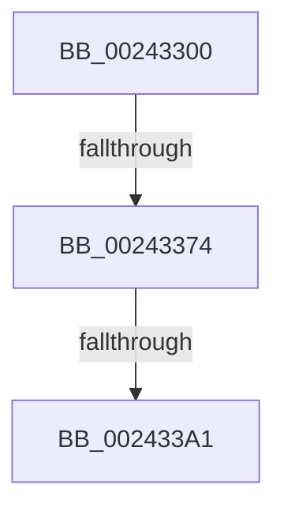

# sub_00243300

- RVA: `0x00243300`–`0x002433D8` (길이 `216` bytes)
- VA: `0x0000000140243300`
- 실행 섹션: `.text`
- PDB 이름 있음: `아니요`; PDB Function 태그: `아니요`
- unwind 정보 RVA: `0x00061AA8`
- 디코드: `45`개 명령, `216/216` bytes 표시
- 미해석 바이트: `0` (있으면 어셈블리에 `.byte`로 보존)

> 이 문서는 커널 이미지의 기계어와 PDB 기호를 분석해 생성했습니다. 4번과 5번은 함수 원형과 자료형을 바이너리 사용 방식에서 추정한 C 해석이며 원본 소스 복구 결과는 아닙니다.

## 1. Dependencies

- 직접 호출 지점: **3**; 고유 호출 대상: **3**
- 직접 호출자로 확인된 함수: **0**
- RIP 상대 이미지 참조: **0**

### Outgoing calls
- `0x00243327` → [memset](../6C/memset_function_006C6C40.md) (function, `0x006C6C40`)
- `0x0024335C` → [MiGetLeafVa](../27/MiGetLeafVa_function_0027C0A0.md) (function, `0x0027C0A0`)
- `0x00243394` → [MiFastLockLeafPageTable](../27/MiFastLockLeafPageTable_function_00276340.md) (function, `0x00276340`)

### Direct callers
- 이 함수 시작 RVA로 연결되는 직접 call은 확인되지 않았습니다. 간접 호출은 완전히 역산할 수 없습니다.

### Static image references
- 디코드된 RIP-relative 메모리 참조가 없습니다.

## 2. Other-region calls and transfers

- 다른 실행 섹션으로 향하는 call: **0**
- call이 아닌 외부 분기/꼬리 이동: **3**
  - `0x0024336E` → [sub_002435CD](Unknown_function_002435CD.md) (`tail-transfer`)
  - `0x0024339B` → [sub_00243541](Unknown_function_00243541.md) (`tail-transfer`)
  - `0x002433D2` → [sub_002434A4 + 0x30](Unknown_function_002434A4.md) (`tail-transfer`)

## 3. Assembly (complete function range)

```asm
00243300  4C 89 A4 24 08 01 00 00         mov qword ptr [rsp + 0x108], r12
00243308  4C 89 AC 24 00 01 00 00         mov qword ptr [rsp + 0x100], r13
00243310  48 8D 4C 24 34                  lea rcx, [rsp + 0x34]
00243315  44 0F B6 6B 2C                  movzx r13d, byte ptr [rbx + 0x2c]
0024331A  33 D2                           xor edx, edx
0024331C  41 B8 BC 00 00 00               mov r8d, 0xbc
00243322  0F 11 44 24 20                  movups xmmword ptr [rsp + 0x20], xmm0
00243327  E8 14 39 48 00                  call 0x1406c6c40
0024332C  4C 8B FE                        mov r15, rsi
0024332F  48 8B 7B 48                     mov rdi, qword ptr [rbx + 0x48]
00243333  4C 8B 63 50                     mov r12, qword ptr [rbx + 0x50]
00243337  48 C1 E7 19                     shl rdi, 0x19
0024333B  49 C1 E7 19                     shl r15, 0x19
0024333F  49 C1 E4 19                     shl r12, 0x19
00243343  49 2B FF                        sub rdi, r15
00243346  48 C1 FF 10                     sar rdi, 0x10
0024334A  4D 2B E7                        sub r12, r15
0024334D  48 8B CF                        mov rcx, rdi
00243350  49 C1 FC 10                     sar r12, 0x10
00243354  C7 44 24 30 61 20 00 00         mov dword ptr [rsp + 0x30], 0x2061
0024335C  E8 3F 8D 03 00                  call 0x14027c0a0
00243361  48 B9 00 00 00 00 00 80 FF FF   movabs rcx, 0xffff800000000000
0024336B  48 3B C1                        cmp rax, rcx
0024336E  0F 83 59 02 00 00               jae 0x1402435cd
00243374  65 48 8B 04 25 88 01 00 00      mov rax, qword ptr gs:[0x188]
0024337D  4C 8B B0 B8 00 00 00            mov r14, qword ptr [rax + 0xb8]
00243384  49 81 C6 00 04 00 00            add r14, 0x400
0024338B  45 33 C0                        xor r8d, r8d
0024338E  48 8B D7                        mov rdx, rdi
00243391  49 8B CE                        mov rcx, r14
00243394  E8 A7 2F 03 00                  call 0x140276340
00243399  85 C0                           test eax, eax
0024339B  0F 84 A0 01 00 00               je 0x140243541
002433A1  48 C1 EF 09                     shr rdi, 9
002433A5  8D 48 FF                        lea ecx, [rax - 1]
002433A8  48 23 FD                        and rdi, rbp
002433AB  48 8B C6                        mov rax, rsi
002433AE  48 03 F8                        add rdi, rax
002433B1  48 8B 53 18                     mov rdx, qword ptr [rbx + 0x18]
002433B5  4C 8B 43 48                     mov r8, qword ptr [rbx + 0x48]
002433B9  4C 8B AC 24 00 01 00 00         mov r13, qword ptr [rsp + 0x100]
002433C1  4C 8B A4 24 08 01 00 00         mov r12, qword ptr [rsp + 0x108]
002433C9  89 8B C8 00 00 00               mov dword ptr [rbx + 0xc8], ecx
002433CF  48 85 FF                        test rdi, rdi
002433D2  0F 84 FC 00 00 00               je 0x1402434d4
```

## 4. C-style interpretation (structured pseudocode)

```c
__int64 __fastcall sub_00243300(__int64 a1, int a2, __int64 a3, __int64 a4, __int64 a5, __int64 a6, __int64 a7, __int64 a8, __int64 a9, __int64 a10, __int64 a11, __int64 a12, __int64 a13, __int64 a14, __int64 a15, __int64 a16, __int64 a17, __int64 a18, __int64 a19, __int64 a20, __int64 a21, __int64 a22, __int64 a23, __int64 a24, __int64 a25, __int64 a26, __int64 a27, __int64 a28, __int64 a29, __int64 a30, __int64 a31, __int64 a32, __int64 a33)
{
    __int64 result;
    __int64 v_r12;
    __int64 v_r14;
    __int64 v_r15;
    __int64 v_rdi;
    unsigned __int64 v_stack_p100;
    unsigned __int64 v_stack_p108;
    unsigned __int64 v_stack_p20;
    unsigned int v_stack_p30;
    unsigned __int64 v_stack_p34;

    v_stack_p108 = v_r12;
    v_stack_p100 = v_r13;
    a2 = 0;
    v_stack_p20 = v_xmm0;
    result = memset(v_stack_p34, a2, 188, a4);
    v_rdi = (*(unsigned __int64 *)(v_rbx + 72)) << (25);
    v_r15 = (v_rsi) << (25);
    v_r12 = (*(unsigned __int64 *)(v_rbx + 80)) << (25);
    v_rdi = (v_rdi) - (v_r15);
    v_rdi = (v_rdi) >> (16);
    v_r12 = (v_r12) - (v_r15);
    v_r12 = (v_r12) >> (16);
    v_stack_p30 = 0x2061ULL;
    result = MiGetLeafVa(v_rdi, a2, 188, a4);
    v_r14 = (*(unsigned __int64 *)(*(unsigned __int64 *)(gs_base + (0 + 392)) + 184)) + (0x400ULL);
    a3 = 0;
    result = MiFastLockLeafPageTable(v_r14, v_rdi, a3, a4);
    v_rdi = (v_rdi) >> (9);
    v_rdi = (v_rdi) & (v_rbp);
    v_rdi = (v_rdi) + (v_rsi);
    *(unsigned int *)(v_rbx + 200) = (unsigned int)(result - 1);
}
```

## 5. (Beta) C Style

```c
int64_t sub_00243300(int64_t Arg1, int32_t Arg2, int64_t Arg3, int64_t Arg4, uint64_t Arg5, uint64_t Arg6, uint64_t Arg7, uint64_t Arg8, uint64_t Arg9, uint64_t Arg10, uint64_t Arg11, uint64_t Arg12, uint64_t Arg13, uint64_t Arg14, uint64_t Arg15, uint64_t Arg16, uint64_t Arg17, uint64_t Arg18, uint64_t Arg19, uint64_t Arg20, uint64_t Arg21, uint64_t Arg22, uint64_t Arg23, uint64_t Arg24, uint64_t Arg25, uint64_t Arg26, uint64_t Arg27, uint64_t Arg28, uint64_t Arg29, uint64_t Arg30, uint64_t Arg31, int64_t Arg32, int64_t Arg33)
{
    int64_t result;
    int64_t local_r12;
    int64_t local_r14;
    int64_t local_r15;
    int64_t local_rdi;
    uint64_t v_stack_p100;
    uint64_t v_stack_p108;
    uint64_t v_stack_p20;
    uint32_t v_stack_p30;
    uint64_t v_stack_p34;

    v_stack_p108 = local_r12;
    v_stack_p100 = local_r13;
    Arg2 = 0;
    v_stack_p20 = v_xmm0;
    result = memset(v_stack_p34, Arg2, 188, Arg4);
    local_rdi = (*(uint64_t *)(local_rbx + 0x48)) << (25);
    local_r15 = (local_rsi) << (25);
    local_r12 = (*(uint64_t *)(local_rbx + 0x50)) << (25);
    local_rdi = (local_rdi) - (local_r15);
    local_rdi = (local_rdi) >> (16);
    local_r12 = (local_r12) - (local_r15);
    local_r12 = (local_r12) >> (16);
    v_stack_p30 = 0x2061ULL;
    result = MiGetLeafVa(local_rdi, Arg2, 188, Arg4);
    local_r14 = (*(uint64_t *)(*(uint64_t *)(gs_base + (0 + 0x188)) + 0xB8)) + (0x400ULL);
    Arg3 = 0;
    result = MiFastLockLeafPageTable(local_r14, local_rdi, Arg3, Arg4);
    local_rdi = (local_rdi) >> (9);
    local_rdi = (local_rdi) & (local_rbp);
    local_rdi = (local_rdi) + (local_rsi);
    *(uint32_t *)(local_rbx + 0xC8) = (uint32_t)(result - 1);
}
```

## 6. Execution-region graph

[열기: 2D/3D 그래프와 함수 탐색 컨트롤 패널](../../../control-panel.html?section=text&rva=0x00243300&view=graph)

- 2D 그래프는 위에서 아래로 흐르고, 3D 그래프는 빈 공간을 드래그해 회전합니다. Shift+드래그는 이동, 휠은 확대·축소, 함수 노드 선택은 대상 보고서 이동입니다.

### Static fallback


