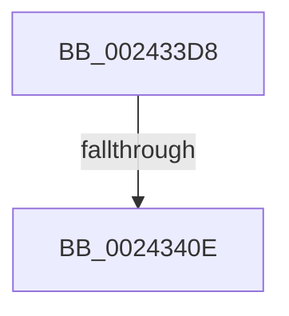

# sub_002433D8

- RVA: `0x002433D8`–`0x00243440` (길이 `104` bytes)
- VA: `0x00000001402433D8`
- 실행 섹션: `.text`
- PDB 이름 있음: `아니요`; PDB Function 태그: `아니요`
- unwind 정보 RVA: `0x00061AC0`
- 디코드: `25`개 명령, `104/104` bytes 표시
- 미해석 바이트: `0` (있으면 어셈블리에 `.byte`로 보존)

> 이 문서는 커널 이미지의 기계어와 PDB 기호를 분석해 생성했습니다. 4번과 5번은 함수 원형과 자료형을 바이너리 사용 방식에서 추정한 C 해석이며 원본 소스 복구 결과는 아닙니다.

## 1. Dependencies

- 직접 호출 지점: **0**; 고유 호출 대상: **0**
- 직접 호출자로 확인된 함수: **0**
- RIP 상대 이미지 참조: **0**

### Outgoing calls
- 직접 디코드된 call 명령이 없습니다.

### Direct callers
- 이 함수 시작 RVA로 연결되는 직접 call은 확인되지 않았습니다. 간접 호출은 완전히 역산할 수 없습니다.

### Static image references
- 디코드된 RIP-relative 메모리 참조가 없습니다.

## 2. Other-region calls and transfers

- 다른 실행 섹션으로 향하는 call: **0**
- call이 아닌 외부 분기/꼬리 이동: **1**
  - `0x00243408` → [sub_002435F5](Unknown_function_002435F5.md) (`tail-transfer`)

## 3. Assembly (complete function range)

```asm
002433D8  48 8B C7                        mov rax, rdi
002433DB  45 33 F6                        xor r14d, r14d
002433DE  49 2B C0                        sub rax, r8
002433E1  48 C1 F8 03                     sar rax, 3
002433E5  48 01 42 18                     add qword ptr [rdx + 0x18], rax
002433E9  48 8B C7                        mov rax, rdi
002433EC  48 C1 E0 19                     shl rax, 0x19
002433F0  49 2B C7                        sub rax, r15
002433F3  48 89 7B 48                     mov qword ptr [rbx + 0x48], rdi
002433F7  48 C1 F8 10                     sar rax, 0x10
002433FB  48 89 43 38                     mov qword ptr [rbx + 0x38], rax
002433FF  8B 83 CC 00 00 00               mov eax, dword ptr [rbx + 0xcc]
00243405  83 F8 01                        cmp eax, 1
00243408  0F 86 E7 01 00 00               jbe 0x1402435f5
0024340E  48 89 7B 58                     mov qword ptr [rbx + 0x58], rdi
00243412  44 89 73 60                     mov dword ptr [rbx + 0x60], r14d
00243416  48 8B 4B 58                     mov rcx, qword ptr [rbx + 0x58]
0024341A  48 C1 E9 09                     shr rcx, 9
0024341E  48 23 CD                        and rcx, rbp
00243421  48 8B C6                        mov rax, rsi
00243424  48 03 C8                        add rcx, rax
00243427  B8 01 00 00 00                  mov eax, 1
0024342C  48 89 4B 40                     mov qword ptr [rbx + 0x40], rcx
00243430  48 8B BC 24 38 01 00 00         mov rdi, qword ptr [rsp + 0x138]
00243438  4C 8B BC 24 F0 00 00 00         mov r15, qword ptr [rsp + 0xf0]
```

## 4. C-style interpretation (structured pseudocode)

```c
__int64 __fastcall sub_002433D8(__int64 a1, __int64 a2, __int64 a3, __int64 a4, __int64 a5, __int64 a6, __int64 a7, __int64 a8, __int64 a9, __int64 a10, __int64 a11, __int64 a12, __int64 a13, __int64 a14, __int64 a15, __int64 a16, __int64 a17, __int64 a18, __int64 a19, __int64 a20, __int64 a21, __int64 a22, __int64 a23, __int64 a24, __int64 a25, __int64 a26, __int64 a27, __int64 a28, __int64 a29, __int64 a30, __int64 a31, __int64 a32, __int64 a33, __int64 a34, __int64 a35, __int64 a36, __int64 a37, __int64 a38, __int64 a39)
{
    __int64 result;
    __int64 v_r14;

    v_r14 = 0;
    result = (v_rdi) - (a3);
    result = (result) >> (3);
    result = (v_rdi) << (25);
    result = (result) - (v_r15);
    *(unsigned __int64 *)(v_rbx + 72) = v_rdi;
    result = (result) >> (16);
    *(unsigned __int64 *)(v_rbx + 56) = result;
    *(unsigned __int64 *)(v_rbx + 88) = v_rdi;
    *(unsigned int *)(v_rbx + 96) = 0;
    a1 = (*(unsigned __int64 *)(v_rbx + 88)) >> (9);
    a1 = (a1) & (v_rbp);
    a1 = (a1) + (v_rsi);
    *(unsigned __int64 *)(v_rbx + 64) = a1;
    return 1;
}
```

## 5. (Beta) C Style

```c
int64_t sub_002433D8(int64_t Arg1, void *Arg2, int64_t Arg3, int64_t Arg4, uint64_t Arg5, uint64_t Arg6, uint64_t Arg7, uint64_t Arg8, uint64_t Arg9, uint64_t Arg10, uint64_t Arg11, uint64_t Arg12, uint64_t Arg13, uint64_t Arg14, uint64_t Arg15, uint64_t Arg16, uint64_t Arg17, uint64_t Arg18, uint64_t Arg19, uint64_t Arg20, uint64_t Arg21, uint64_t Arg22, uint64_t Arg23, uint64_t Arg24, uint64_t Arg25, uint64_t Arg26, uint64_t Arg27, uint64_t Arg28, uint64_t Arg29, int64_t Arg30, uint64_t Arg31, uint64_t Arg32, uint64_t Arg33, uint64_t Arg34, uint64_t Arg35, uint64_t Arg36, uint64_t Arg37, uint64_t Arg38, int64_t Arg39)
{
    uint8_t *arg2 = (uint8_t *)Arg2;

    int64_t result;
    int64_t local_r14;

    local_r14 = 0;
    result = (local_rdi) - (Arg3);
    result = (result) >> (3);
    result = (local_rdi) << (25);
    result = (result) - (local_r15);
    *(uint64_t *)(local_rbx + 0x48) = local_rdi;
    result = (result) >> (16);
    *(uint64_t *)(local_rbx + 0x38) = result;
    *(uint64_t *)(local_rbx + 0x58) = local_rdi;
    *(uint32_t *)(local_rbx + 0x60) = 0;
    Arg1 = (*(uint64_t *)(local_rbx + 0x58)) >> (9);
    Arg1 = (Arg1) & (local_rbp);
    Arg1 = (Arg1) + (local_rsi);
    *(uint64_t *)(local_rbx + 0x40) = Arg1;
    return 1;
}
```

### 관측된 메모리 오프셋

구조체 형식이 확인되지 않은 접근은 인자 기준의 오프셋으로만 기록했습니다.

| 기준 인자 | 오프셋 표현 | 폭 (bit) | 접근 |
|---|---:|---:|---|
| `Arg2` | `+ 0x18` | `64` | `R/W` |

## 6. Execution-region graph

[열기: 2D/3D 그래프와 함수 탐색 컨트롤 패널](../../../control-panel.html?section=text&rva=0x002433D8&view=graph)

- 2D 그래프는 위에서 아래로 흐르고, 3D 그래프는 빈 공간을 드래그해 회전합니다. Shift+드래그는 이동, 휠은 확대·축소, 함수 노드 선택은 대상 보고서 이동입니다.

### Static fallback


