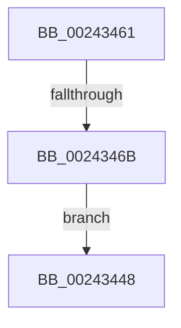

# sub_00243448

- RVA: `0x00243448`–`0x002434A4` (길이 `92` bytes)
- VA: `0x0000000140243448`
- 실행 섹션: `.text`
- PDB 이름 있음: `아니요`; PDB Function 태그: `아니요`
- unwind 정보 RVA: `0x00061AE0`
- 디코드: `20`개 명령, `92/92` bytes 표시
- 미해석 바이트: `0` (있으면 어셈블리에 `.byte`로 보존)

> 이 문서는 커널 이미지의 기계어와 PDB 기호를 분석해 생성했습니다. 4번과 5번은 함수 원형과 자료형을 바이너리 사용 방식에서 추정한 C 해석이며 원본 소스 복구 결과는 아닙니다.

## 1. Dependencies

- 직접 호출 지점: **1**; 고유 호출 대상: **1**
- 직접 호출자로 확인된 함수: **0**
- RIP 상대 이미지 참조: **0**

### Outgoing calls
- `0x00243498` → [MiLockNestedPageTable](../23/MiLockNestedPageTable_function_0023E890.md) (function, `0x0023E890`)

### Direct callers
- 이 함수 시작 RVA로 연결되는 직접 call은 확인되지 않았습니다. 간접 호출은 완전히 역산할 수 없습니다.

### Static image references
- 디코드된 RIP-relative 메모리 참조가 없습니다.

## 2. Other-region calls and transfers

- 다른 실행 섹션으로 향하는 call: **0**
- call이 아닌 외부 분기/꼬리 이동: **1**
  - `0x00243465` → [sub_002432BB](Unknown_function_002432BB.md) (`tail-transfer`)

## 3. Assembly (complete function range)

```asm
00243448  48 8B B4 24 30 01 00 00         mov rsi, qword ptr [rsp + 0x130]
00243450  48 8B AC 24 28 01 00 00         mov rbp, qword ptr [rsp + 0x128]
00243458  48 81 C4 10 01 00 00            add rsp, 0x110
0024345F  5B                              pop rbx
00243460  C3                              ret
00243461  CC                              int3
00243462  83 F9 05                        cmp ecx, 5
00243465  0F 84 50 FE FF FF               je 0x1402432bb
0024346B  48 8B 53 58                     mov rdx, qword ptr [rbx + 0x58]
0024346F  48 BD F8 FF FF FF 7F 00 00 00   movabs rbp, 0x7ffffffff8
00243479  48 C1 EA 09                     shr rdx, 9
0024347D  48 23 D5                        and rdx, rbp
00243480  48 BE 00 00 00 00 80 F6 FF FF   movabs rsi, 0xfffff68000000000
0024348A  48 8B C6                        mov rax, rsi
0024348D  48 8B 4B 20                     mov rcx, qword ptr [rbx + 0x20]
00243491  48 03 D0                        add rdx, rax
00243494  48 89 53 40                     mov qword ptr [rbx + 0x40], rdx
00243498  E8 F3 B3 FF FF                  call 0x14023e890
0024349D  B8 01 00 00 00                  mov eax, 1
002434A2  EB A4                           jmp 0x140243448
```

## 4. C-style interpretation (structured pseudocode)

```c
__int64 __fastcall sub_00243448(int a1, __int64 a2, __int64 a3, __int64 a4, __int64 a5, __int64 a6, __int64 a7, __int64 a8, __int64 a9, __int64 a10, __int64 a11, __int64 a12, __int64 a13, __int64 a14, __int64 a15, __int64 a16, __int64 a17, __int64 a18, __int64 a19, __int64 a20, __int64 a21, __int64 a22, __int64 a23, __int64 a24, __int64 a25, __int64 a26, __int64 a27, __int64 a28, __int64 a29, __int64 a30, __int64 a31, __int64 a32, __int64 a33, __int64 a34, __int64 a35, __int64 a36, __int64 a37, __int64 a38)
{
    __int64 v_rsp;

    v_rsp = (v_rsp) + (272);
    return result;
}
```

## 5. (Beta) C Style

```c
int64_t sub_00243448(int32_t Arg1, int64_t Arg2, int64_t Arg3, int64_t Arg4, uint64_t Arg5, uint64_t Arg6, uint64_t Arg7, uint64_t Arg8, uint64_t Arg9, uint64_t Arg10, uint64_t Arg11, uint64_t Arg12, uint64_t Arg13, uint64_t Arg14, uint64_t Arg15, uint64_t Arg16, uint64_t Arg17, uint64_t Arg18, uint64_t Arg19, uint64_t Arg20, uint64_t Arg21, uint64_t Arg22, uint64_t Arg23, uint64_t Arg24, uint64_t Arg25, uint64_t Arg26, uint64_t Arg27, uint64_t Arg28, uint64_t Arg29, uint64_t Arg30, uint64_t Arg31, uint64_t Arg32, uint64_t Arg33, uint64_t Arg34, uint64_t Arg35, uint64_t Arg36, int64_t Arg37, int64_t Arg38)
{
    int64_t local_rsp;

    local_rsp = (local_rsp) + (272);
    return result;
}
```

## 6. Execution-region graph

[열기: 2D/3D 그래프와 함수 탐색 컨트롤 패널](../../../control-panel.html?section=text&rva=0x00243448&view=graph)

- 2D 그래프는 위에서 아래로 흐르고, 3D 그래프는 빈 공간을 드래그해 회전합니다. Shift+드래그는 이동, 휠은 확대·축소, 함수 노드 선택은 대상 보고서 이동입니다.

### Static fallback


