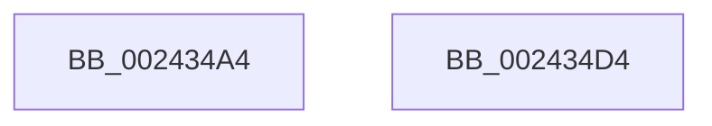

# sub_002434A4

- RVA: `0x002434A4`–`0x002434F4` (길이 `80` bytes)
- VA: `0x00000001402434A4`
- 실행 섹션: `.text`
- PDB 이름 있음: `아니요`; PDB Function 태그: `아니요`
- unwind 정보 RVA: `0x00061AF4`
- 디코드: `21`개 명령, `80/80` bytes 표시
- 미해석 바이트: `0` (있으면 어셈블리에 `.byte`로 보존)

> 이 문서는 커널 이미지의 기계어와 PDB 기호를 분석해 생성했습니다. 4번과 5번은 함수 원형과 자료형을 바이너리 사용 방식에서 추정한 C 해석이며 원본 소스 복구 결과는 아닙니다.

## 1. Dependencies

- 직접 호출 지점: **1**; 고유 호출 대상: **1**
- 직접 호출자로 확인된 함수: **0**
- RIP 상대 이미지 참조: **0**

### Outgoing calls
- `0x002434CA` → [MiMakeSystemAddressValid](../27/MiMakeSystemAddressValid_function_0027FF70.md) (function, `0x0027FF70`)

### Direct callers
- 이 함수 시작 RVA로 연결되는 직접 call은 확인되지 않았습니다. 간접 호출은 완전히 역산할 수 없습니다.

### Static image references
- 디코드된 RIP-relative 메모리 참조가 없습니다.

## 2. Other-region calls and transfers

- 다른 실행 섹션으로 향하는 call: **0**
- call이 아닌 외부 분기/꼬리 이동: **2**
  - `0x002434CF` → [sub_002433D8 + 0x3E](Unknown_function_002433D8.md) (`tail-transfer`)
  - `0x002434EF` → [sub_002433D8 + 0x58](Unknown_function_002433D8.md) (`tail-transfer`)

## 3. Assembly (complete function range)

```asm
002434A4  48 8B 13                        mov rdx, qword ptr [rbx]
002434A7  44 8B 8B 9C 00 00 00            mov r9d, dword ptr [rbx + 0x9c]
002434AE  44 0F B6 43 2C                  movzx r8d, byte ptr [rbx + 0x2c]
002434B3  41 F7 D1                        not r9d
002434B6  48 8B 4B 58                     mov rcx, qword ptr [rbx + 0x58]
002434BA  41 83 E1 01                     and r9d, 1
002434BE  8B 52 30                        mov edx, dword ptr [rdx + 0x30]
002434C1  45 03 C9                        add r9d, r9d
002434C4  C1 EA 0C                        shr edx, 0xc
002434C7  83 E2 7F                        and edx, 0x7f
002434CA  E8 A1 CA 03 00                  call 0x14027ff70
002434CF  E9 42 FF FF FF                  jmp 0x140243416
002434D4  48 8B 4B 50                     mov rcx, qword ptr [rbx + 0x50]
002434D8  48 8B 42 18                     mov rax, qword ptr [rdx + 0x18]
002434DC  49 2B C8                        sub rcx, r8
002434DF  48 C1 F9 03                     sar rcx, 3
002434E3  48 FF C0                        inc rax
002434E6  48 03 C8                        add rcx, rax
002434E9  48 89 4A 18                     mov qword ptr [rdx + 0x18], rcx
002434ED  33 C0                           xor eax, eax
002434EF  E9 3C FF FF FF                  jmp 0x140243430
```

## 4. C-style interpretation (structured pseudocode)

```c
__int64 __fastcall sub_002434A4(void)
{
    __int64 result;

    a4 = (unsigned int)(~((unsigned int)(*(unsigned int *)(v_rbx + 156))));
    a4 = (unsigned int)((a4) & (1));
    a4 = (unsigned int)((a4) + ((unsigned int)(a4)));
    a2 = (unsigned int)(((unsigned int)(*(unsigned int *)(*(unsigned __int64 *)(v_rbx) + 48))) >> (12));
    a2 = (unsigned int)((a2) & (127));
    result = MiMakeSystemAddressValid(*(unsigned __int64 *)(v_rbx + 88), a2, *(unsigned __int8 *)(v_rbx + 44), a4);
}
```

## 5. (Beta) C Style

```c
void sub_002434A4(void)
{
    int64_t result;

    a4 = (uint32_t)(~((uint32_t)(*(uint32_t *)(local_rbx + 0x9C))));
    a4 = (uint32_t)((a4) & (1));
    a4 = (uint32_t)((a4) + ((uint32_t)(a4)));
    a2 = (uint32_t)(((uint32_t)(*(uint32_t *)(*(uint64_t *)(local_rbx) + 0x30))) >> (12));
    a2 = (uint32_t)((a2) & (127));
    result = MiMakeSystemAddressValid(*(uint64_t *)(local_rbx + 0x58), a2, *(uint8_t *)(local_rbx + 0x2C), a4);
}
```

## 6. Execution-region graph

[열기: 2D/3D 그래프와 함수 탐색 컨트롤 패널](../../../control-panel.html?section=text&rva=0x002434A4&view=graph)

- 2D 그래프는 위에서 아래로 흐르고, 3D 그래프는 빈 공간을 드래그해 회전합니다. Shift+드래그는 이동, 휠은 확대·축소, 함수 노드 선택은 대상 보고서 이동입니다.

### Static fallback


