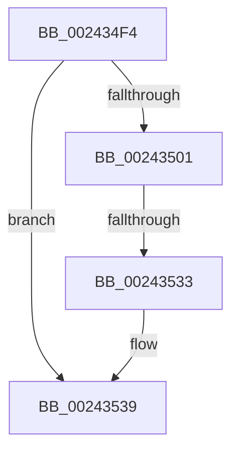

# sub_002434F4

- RVA: `0x002434F4`–`0x00243541` (길이 `77` bytes)
- VA: `0x00000001402434F4`
- 실행 섹션: `.text`
- PDB 이름 있음: `아니요`; PDB Function 태그: `아니요`
- unwind 정보 RVA: `0x00061B10`
- 디코드: `20`개 명령, `77/77` bytes 표시
- 미해석 바이트: `0` (있으면 어셈블리에 `.byte`로 보존)

> 이 문서는 커널 이미지의 기계어와 PDB 기호를 분석해 생성했습니다. 4번과 5번은 함수 원형과 자료형을 바이너리 사용 방식에서 추정한 C 해석이며 원본 소스 복구 결과는 아닙니다.

## 1. Dependencies

- 직접 호출 지점: **1**; 고유 호출 대상: **1**
- 직접 호출자로 확인된 함수: **0**
- RIP 상대 이미지 참조: **0**

### Outgoing calls
- `0x00243514` → [MiLockLowestValidPageTableEx](../28/MiLockLowestValidPageTableEx_function_00280D10.md) (function, `0x00280D10`)

### Direct callers
- 이 함수 시작 RVA로 연결되는 직접 call은 확인되지 않았습니다. 간접 호출은 완전히 역산할 수 없습니다.

### Static image references
- 디코드된 RIP-relative 메모리 참조가 없습니다.

## 2. Other-region calls and transfers

- 다른 실행 섹션으로 향하는 call: **0**
- call이 아닌 외부 분기/꼬리 이동: **2**
  - `0x00243531` → [sub_0024359E](Unknown_function_0024359E.md) (`tail-transfer`)
  - `0x0024353C` → [sub_00243440](Unknown_function_00243440.md) (`tail-transfer`)

## 3. Assembly (complete function range)

```asm
002434F4  45 33 F6                        xor r14d, r14d
002434F7  48 8B 43 50                     mov rax, qword ptr [rbx + 0x50]
002434FB  48 39 43 48                     cmp qword ptr [rbx + 0x48], rax
002434FF  77 38                           ja 0x140243539
00243501  48 8B 53 58                     mov rdx, qword ptr [rbx + 0x58]
00243505  4C 8D 84 24 20 01 00 00         lea r8, [rsp + 0x120]
0024350D  48 8B 4B 20                     mov rcx, qword ptr [rbx + 0x20]
00243511  45 33 C9                        xor r9d, r9d
00243514  E8 F7 D7 03 00                  call 0x140280d10
00243519  48 8B 53 48                     mov rdx, qword ptr [rbx + 0x48]
0024351D  48 C1 EA 09                     shr rdx, 9
00243521  48 23 D5                        and rdx, rbp
00243524  48 89 43 40                     mov qword ptr [rbx + 0x40], rax
00243528  48 8B CE                        mov rcx, rsi
0024352B  48 03 D1                        add rdx, rcx
0024352E  48 3B C2                        cmp rax, rdx
00243531  75 6B                           jne 0x14024359e
00243533  41 BE 01 00 00 00               mov r14d, 1
00243539  41 8B C6                        mov eax, r14d
0024353C  E9 FF FE FF FF                  jmp 0x140243440
```

## 4. C-style interpretation (structured pseudocode)

```c
__int64 __fastcall sub_002434F4(__int64 a1, __int64 a2, __int64 a3, int a4, __int64 a5, __int64 a6, __int64 a7, __int64 a8, __int64 a9, __int64 a10, __int64 a11, __int64 a12, __int64 a13, __int64 a14, __int64 a15, __int64 a16, __int64 a17, __int64 a18, __int64 a19, __int64 a20, __int64 a21, __int64 a22, __int64 a23, __int64 a24, __int64 a25, __int64 a26, __int64 a27, __int64 a28, __int64 a29, __int64 a30, __int64 a31, __int64 a32, __int64 a33, __int64 a34, __int64 a35, __int64 a36)
{
    __int64 result;
    __int64 v_r14;

    v_r14 = 0;
    if ((*(unsigned __int64 *)(v_rbx + 72)) > (*(unsigned __int64 *)(v_rbx + 80))) goto loc_00243539;
    a4 = 0;
    result = MiLockLowestValidPageTableEx(*(unsigned __int64 *)(v_rbx + 32), *(unsigned __int64 *)(v_rbx + 88), a36, a4);
    a2 = (*(unsigned __int64 *)(v_rbx + 72)) >> (9);
    a2 = (a2) & (v_rbp);
    *(unsigned __int64 *)(v_rbx + 64) = result;
    a2 = (a2) + (v_rsi);
loc_00243539:
}
```

## 5. (Beta) C Style

```c
int64_t sub_002434F4(int64_t Arg1, int64_t Arg2, int64_t Arg3, int32_t Arg4, uint64_t Arg5, uint64_t Arg6, uint64_t Arg7, uint64_t Arg8, uint64_t Arg9, uint64_t Arg10, uint64_t Arg11, uint64_t Arg12, uint64_t Arg13, uint64_t Arg14, uint64_t Arg15, uint64_t Arg16, uint64_t Arg17, uint64_t Arg18, uint64_t Arg19, uint64_t Arg20, uint64_t Arg21, uint64_t Arg22, uint64_t Arg23, uint64_t Arg24, uint64_t Arg25, uint64_t Arg26, uint64_t Arg27, uint64_t Arg28, uint64_t Arg29, uint64_t Arg30, uint64_t Arg31, uint64_t Arg32, uint64_t Arg33, uint64_t Arg34, uint64_t Arg35, int64_t Arg36)
{
    int64_t result;
    int64_t local_r14;

    local_r14 = 0;
    if ((*(uint64_t *)(local_rbx + 0x48)) > (*(uint64_t *)(local_rbx + 0x50))) goto loc_00243539;
    Arg4 = 0;
    result = MiLockLowestValidPageTableEx(*(uint64_t *)(local_rbx + 0x20), *(uint64_t *)(local_rbx + 0x58), Arg36, Arg4);
    Arg2 = (*(uint64_t *)(local_rbx + 0x48)) >> (9);
    Arg2 = (Arg2) & (local_rbp);
    *(uint64_t *)(local_rbx + 0x40) = result;
    Arg2 = (Arg2) + (local_rsi);
loc_00243539:
}
```

## 6. Execution-region graph

[열기: 2D/3D 그래프와 함수 탐색 컨트롤 패널](../../../control-panel.html?section=text&rva=0x002434F4&view=graph)

- 2D 그래프는 위에서 아래로 흐르고, 3D 그래프는 빈 공간을 드래그해 회전합니다. Shift+드래그는 이동, 휠은 확대·축소, 함수 노드 선택은 대상 보고서 이동입니다.

### Static fallback


