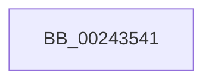

# sub_00243541

- RVA: `0x00243541`–`0x0024359E` (길이 `93` bytes)
- VA: `0x0000000140243541`
- 실행 섹션: `.text`
- PDB 이름 있음: `아니요`; PDB Function 태그: `아니요`
- unwind 정보 RVA: `0x00061B24`
- 디코드: `18`개 명령, `93/93` bytes 표시
- 미해석 바이트: `0` (있으면 어셈블리에 `.byte`로 보존)

> 이 문서는 커널 이미지의 기계어와 PDB 기호를 분석해 생성했습니다. 4번과 5번은 함수 원형과 자료형을 바이너리 사용 방식에서 추정한 C 해석이며 원본 소스 복구 결과는 아닙니다.

## 1. Dependencies

- 직접 호출 지점: **1**; 고유 호출 대상: **1**
- 직접 호출자로 확인된 함수: **0**
- RIP 상대 이미지 참조: **1**

### Outgoing calls
- `0x0024358B` → [MiWalkPageTables](../2C/MiWalkPageTables_function_002C2710.md) (function, `0x002C2710`)

### Direct callers
- 이 함수 시작 RVA로 연결되는 직접 call은 확인되지 않았습니다. 간접 호출은 완전히 역산할 수 없습니다.

### Static image references
- `0x00243572` → RVA `0x00313710` (`MiGetNextPageTableTail`; read)

## 2. Other-region calls and transfers

- 다른 실행 섹션으로 향하는 call: **0**
- call이 아닌 외부 분기/꼬리 이동: **1**
  - `0x00243599` → [sub_00243300 + 0xB1](Unknown_function_00243300.md) (`tail-transfer`)

## 3. Assembly (complete function range)

```asm
00243541  83 4C 24 30 04                  or dword ptr [rsp + 0x30], 4
00243546  48 8D 44 24 20                  lea rax, [rsp + 0x20]
0024354B  48 89 84 24 E8 00 00 00         mov qword ptr [rsp + 0xe8], rax
00243553  48 8D 4C 24 30                  lea rcx, [rsp + 0x30]
00243558  8B 44 24 34                     mov eax, dword ptr [rsp + 0x34]
0024355C  25 7F FE FF FF                  and eax, 0xfffffe7f
00243561  4C 89 74 24 50                  mov qword ptr [rsp + 0x50], r14
00243566  83 C8 40                        or eax, 0x40
00243569  44 88 6C 24 39                  mov byte ptr [rsp + 0x39], r13b
0024356E  89 44 24 34                     mov dword ptr [rsp + 0x34], eax
00243572  48 8D 05 97 01 0D 00            lea rax, [rip + 0xd0197]
00243579  48 89 84 24 E0 00 00 00         mov qword ptr [rsp + 0xe0], rax
00243581  48 89 7C 24 58                  mov qword ptr [rsp + 0x58], rdi
00243586  4C 89 64 24 60                  mov qword ptr [rsp + 0x60], r12
0024358B  E8 80 F1 07 00                  call 0x1402c2710
00243590  8B 4C 24 20                     mov ecx, dword ptr [rsp + 0x20]
00243594  48 8B 7C 24 28                  mov rdi, qword ptr [rsp + 0x28]
00243599  E9 13 FE FF FF                  jmp 0x1402433b1
```

## 4. C-style interpretation (structured pseudocode)

```c
__int64 __fastcall sub_00243541(__int64 a1, __int64 a2, __int64 a3, __int64 a4, __int64 a5, unsigned int a6)
{
    __int64 result;
    unsigned __int64 v_stack_p20;
    unsigned int v_stack_p34;
    unsigned __int8 v_stack_p39;
    unsigned __int64 v_stack_p50;
    unsigned __int64 v_stack_p58;
    unsigned __int64 v_stack_p60;
    unsigned __int64 v_stack_pE0;
    unsigned __int64 v_stack_pE8;

    v_stack_pE8 = v_stack_p20;
    result = (unsigned int)(((unsigned int)(v_stack_p34)) & (0xFFFFFE7FULL));
    v_stack_p50 = v_r14;
    result = (unsigned int)((result) | (64));
    v_stack_p39 = (unsigned __int8)(v_r13);
    v_stack_p34 = (unsigned int)(result);
    v_stack_pE0 = v_rip + 852375;
    v_stack_p58 = v_rdi;
    v_stack_p60 = v_r12;
    result = MiWalkPageTables(a6, a2, a3, a4);
}
```

## 5. (Beta) C Style

```c
int64_t sub_00243541(int64_t Arg1, int64_t Arg2, int64_t Arg3, int64_t Arg4, int64_t Arg5, uint32_t Arg6)
{
    int64_t result;
    uint64_t v_stack_p20;
    uint32_t v_stack_p34;
    uint8_t v_stack_p39;
    uint64_t v_stack_p50;
    uint64_t v_stack_p58;
    uint64_t v_stack_p60;
    uint64_t v_stack_pE0;
    uint64_t v_stack_pE8;

    v_stack_pE8 = v_stack_p20;
    result = (uint32_t)(((uint32_t)(v_stack_p34)) & (0xFFFFFE7FULL));
    v_stack_p50 = local_r14;
    result = (uint32_t)((result) | (64));
    v_stack_p39 = (uint8_t)(local_r13);
    v_stack_p34 = (uint32_t)(result);
    v_stack_pE0 = v_rip + 852375;
    v_stack_p58 = local_rdi;
    v_stack_p60 = local_r12;
    result = MiWalkPageTables(Arg6, Arg2, Arg3, Arg4);
}
```

## 6. Execution-region graph

[열기: 2D/3D 그래프와 함수 탐색 컨트롤 패널](../../../control-panel.html?section=text&rva=0x00243541&view=graph)

- 2D 그래프는 위에서 아래로 흐르고, 3D 그래프는 빈 공간을 드래그해 회전합니다. Shift+드래그는 이동, 휠은 확대·축소, 함수 노드 선택은 대상 보고서 이동입니다.

### Static fallback


