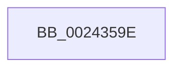

# sub_0024359E

- RVA: `0x0024359E`–`0x002435CD` (길이 `47` bytes)
- VA: `0x000000014024359E`
- 실행 섹션: `.text`
- PDB 이름 있음: `아니요`; PDB Function 태그: `아니요`
- unwind 정보 RVA: `0x00061B48`
- 디코드: `10`개 명령, `47/47` bytes 표시
- 미해석 바이트: `0` (있으면 어셈블리에 `.byte`로 보존)

> 이 문서는 커널 이미지의 기계어와 PDB 기호를 분석해 생성했습니다. 4번과 5번은 함수 원형과 자료형을 바이너리 사용 방식에서 추정한 C 해석이며 원본 소스 복구 결과는 아닙니다.

## 1. Dependencies

- 직접 호출 지점: **2**; 고유 호출 대상: **2**
- 직접 호출자로 확인된 함수: **0**
- RIP 상대 이미지 참조: **0**

### Outgoing calls
- `0x002435A5` → [MiUnlockPageTable](../21/MiUnlockPageTable_function_00216EC0.md) (function, `0x00216EC0`)
- `0x002435C3` → [MiDecommitComputeCheckPte](../41/MiDecommitComputeCheckPte_function_00417330.md) (function, `0x00417330`)

### Direct callers
- 이 함수 시작 RVA로 연결되는 직접 call은 확인되지 않았습니다. 간접 호출은 완전히 역산할 수 없습니다.

### Static image references
- 디코드된 RIP-relative 메모리 참조가 없습니다.

## 2. Other-region calls and transfers

- 다른 실행 섹션으로 향하는 call: **0**
- call이 아닌 외부 분기/꼬리 이동: **1**
  - `0x002435C8` → [sub_002434F4 + 0x3](Unknown_function_002434F4.md) (`tail-transfer`)

## 3. Assembly (complete function range)

```asm
0024359E  48 8B 4B 20                     mov rcx, qword ptr [rbx + 0x20]
002435A2  48 8B D0                        mov rdx, rax
002435A5  E8 16 39 FD FF                  call 0x140216ec0
002435AA  48 8B 53 48                     mov rdx, qword ptr [rbx + 0x48]
002435AE  48 8B CB                        mov rcx, rbx
002435B1  48 81 E2 00 F0 FF FF            and rdx, 0xfffffffffffff000
002435B8  4C 89 73 40                     mov qword ptr [rbx + 0x40], r14
002435BC  48 81 C2 00 10 00 00            add rdx, 0x1000
002435C3  E8 68 3D 1D 00                  call 0x140417330
002435C8  E9 2A FF FF FF                  jmp 0x1402434f7
```

## 4. C-style interpretation (structured pseudocode)

```c
__int64 __fastcall sub_0024359E(void)
{
    __int64 result;

    result = MiUnlockPageTable(*(unsigned __int64 *)(v_rbx + 32), result, a3, a4);
    a2 = (*(unsigned __int64 *)(v_rbx + 72)) & (0xFFFFFFFFFFFFF000ULL);
    *(unsigned __int64 *)(v_rbx + 64) = v_r14;
    a2 = (a2) + (0x1000ULL);
    result = MiDecommitComputeCheckPte(v_rbx, a2, a3, a4);
}
```

## 5. (Beta) C Style

```c
void sub_0024359E(void)
{
    int64_t result;

    result = MiUnlockPageTable(*(uint64_t *)(local_rbx + 0x20), result, a3, a4);
    a2 = (*(uint64_t *)(local_rbx + 0x48)) & (0xFFFFFFFFFFFFF000ULL);
    *(uint64_t *)(local_rbx + 0x40) = local_r14;
    a2 = (a2) + (0x1000ULL);
    result = MiDecommitComputeCheckPte(local_rbx, a2, a3, a4);
}
```

## 6. Execution-region graph

[열기: 2D/3D 그래프와 함수 탐색 컨트롤 패널](../../../control-panel.html?section=text&rva=0x0024359E&view=graph)

- 2D 그래프는 위에서 아래로 흐르고, 3D 그래프는 빈 공간을 드래그해 회전합니다. Shift+드래그는 이동, 휠은 확대·축소, 함수 노드 선택은 대상 보고서 이동입니다.

### Static fallback


