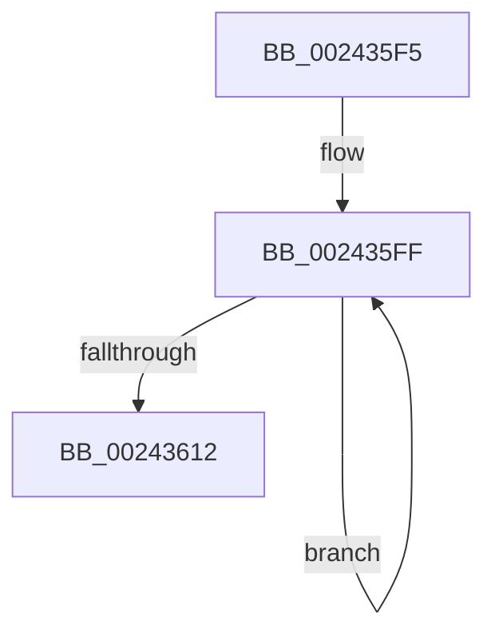

# sub_002435F5

- RVA: `0x002435F5`–`0x00243617` (길이 `34` bytes)
- VA: `0x00000001402435F5`
- 실행 섹션: `.text`
- PDB 이름 있음: `아니요`; PDB Function 태그: `아니요`
- unwind 정보 RVA: `0x00061B80`
- 디코드: `10`개 명령, `34/34` bytes 표시
- 미해석 바이트: `0` (있으면 어셈블리에 `.byte`로 보존)

> 이 문서는 커널 이미지의 기계어와 PDB 기호를 분석해 생성했습니다. 4번과 5번은 함수 원형과 자료형을 바이너리 사용 방식에서 추정한 C 해석이며 원본 소스 복구 결과는 아닙니다.

## 1. Dependencies

- 직접 호출 지점: **0**; 고유 호출 대상: **0**
- 직접 호출자로 확인된 함수: **0**
- RIP 상대 이미지 참조: **0**

### Outgoing calls
- 직접 디코드된 call 명령이 없습니다.

### Direct callers
- 이 함수 시작 RVA로 연결되는 직접 call은 확인되지 않았습니다. 간접 호출은 완전히 역산할 수 없습니다.

### Static image references
- 디코드된 RIP-relative 메모리 참조가 없습니다.

## 2. Other-region calls and transfers

- 다른 실행 섹션으로 향하는 call: **0**
- call이 아닌 외부 분기/꼬리 이동: **1**
  - `0x00243612` → [sub_002433D8 + 0x36](Unknown_function_002433D8.md) (`tail-transfer`)

## 3. Assembly (complete function range)

```asm
002435F5  B9 02 00 00 00                  mov ecx, 2
002435FA  2B C8                           sub ecx, eax
002435FC  44 8B F1                        mov r14d, ecx
002435FF  48 C1 EF 09                     shr rdi, 9
00243603  48 23 FD                        and rdi, rbp
00243606  48 8B C6                        mov rax, rsi
00243609  48 03 F8                        add rdi, rax
0024360C  48 83 E9 01                     sub rcx, 1
00243610  75 ED                           jne 0x1402435ff
00243612  E9 F7 FD FF FF                  jmp 0x14024340e
```

## 4. C-style interpretation (structured pseudocode)

```c
__int64 __fastcall sub_002435F5(void)
{
    __int64 v_rdi;

    a1 = (unsigned int)((2) - ((unsigned int)(result)));
loc_002435FF:
    v_rdi = (v_rdi) >> (9);
    v_rdi = (v_rdi) & (v_rbp);
    v_rdi = (v_rdi) + (v_rsi);
    a1 = (a1) - (1);
    if (condition_is_not_equal) goto loc_002435FF;
}
```

## 5. (Beta) C Style

```c
void sub_002435F5(void)
{
    int64_t local_rdi;

    a1 = (uint32_t)((2) - ((uint32_t)(result)));
loc_002435FF:
    local_rdi = (local_rdi) >> (9);
    local_rdi = (local_rdi) & (local_rbp);
    local_rdi = (local_rdi) + (local_rsi);
    a1 = (a1) - (1);
    if (condition_is_not_equal) goto loc_002435FF;
}
```

## 6. Execution-region graph

[열기: 2D/3D 그래프와 함수 탐색 컨트롤 패널](../../../control-panel.html?section=text&rva=0x002435F5&view=graph)

- 2D 그래프는 위에서 아래로 흐르고, 3D 그래프는 빈 공간을 드래그해 회전합니다. Shift+드래그는 이동, 휠은 확대·축소, 함수 노드 선택은 대상 보고서 이동입니다.

### Static fallback


