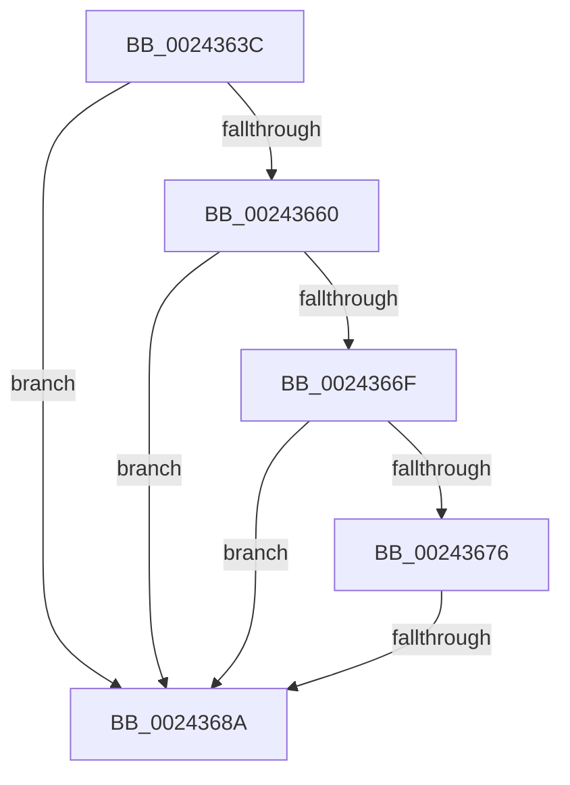

# sub_0024363C

- RVA: `0x0024363C`–`0x002436B7` (길이 `123` bytes)
- VA: `0x000000014024363C`
- 실행 섹션: `.text`
- PDB 이름 있음: `아니요`; PDB Function 태그: `아니요`
- unwind 정보 RVA: `0x00061BB4`
- 디코드: `30`개 명령, `123/123` bytes 표시
- 미해석 바이트: `0` (있으면 어셈블리에 `.byte`로 보존)

> 이 문서는 커널 이미지의 기계어와 PDB 기호를 분석해 생성했습니다. 4번과 5번은 함수 원형과 자료형을 바이너리 사용 방식에서 추정한 C 해석이며 원본 소스 복구 결과는 아닙니다.

## 1. Dependencies

- 직접 호출 지점: **0**; 고유 호출 대상: **0**
- 직접 호출자로 확인된 함수: **0**
- RIP 상대 이미지 참조: **0**

### Outgoing calls
- 직접 디코드된 call 명령이 없습니다.

### Direct callers
- 이 함수 시작 RVA로 연결되는 직접 call은 확인되지 않았습니다. 간접 호출은 완전히 역산할 수 없습니다.

### Static image references
- 디코드된 RIP-relative 메모리 참조가 없습니다.

## 2. Other-region calls and transfers

- 다른 실행 섹션으로 향하는 call: **0**
- call이 아닌 외부 분기/꼬리 이동: **2**
  - `0x00243684` → [sub_0024376F + 0x1E](Unknown_function_0024376F.md) (`tail-transfer`)
  - `0x002436B5` → [sub_002436D0](Unknown_function_002436D0.md) (`tail-transfer`)

## 3. Assembly (complete function range)

```asm
0024363C  48 89 6C 24 30                  mov qword ptr [rsp + 0x30], rbp
00243641  41 8B E9                        mov ebp, r9d
00243644  48 89 74 24 38                  mov qword ptr [rsp + 0x38], rsi
00243649  4C 89 74 24 48                  mov qword ptr [rsp + 0x48], r14
0024364E  45 8B F0                        mov r14d, r8d
00243651  48 B9 00 D0 BE 7D FB F6 FF FF   movabs rcx, 0xfffff6fb7dbed000
0024365B  48 3B D1                        cmp rdx, rcx
0024365E  72 2A                           jb 0x14024368a
00243660  48 B9 F8 D7 BE 7D FB F6 FF FF   movabs rcx, 0xfffff6fb7dbed7f8
0024366A  48 3B D1                        cmp rdx, rcx
0024366D  77 1B                           ja 0x14024368a
0024366F  48 8B C8                        mov rcx, rax
00243672  A8 01                           test al, 1
00243674  74 14                           je 0x14024368a
00243676  A8 42                           test al, 0x42
00243678  41 0F 95 C0                     setne r8b
0024367C  A8 20                           test al, 0x20
0024367E  0F 95 C2                        setne dl
00243681  44 84 C2                        test dl, r8b
00243684  0F 84 03 01 00 00               je 0x14024378d
0024368A  48 C1 E8 0C                     shr rax, 0xc
0024368E  48 B9 FF FF FF FF FF 00 00 00   movabs rcx, 0xffffffffff
00243698  48 23 C1                        and rax, rcx
0024369B  48 8D 1C 40                     lea rbx, [rax + rax*2]
0024369F  48 C1 E3 04                     shl rbx, 4
002436A3  48 B8 00 00 00 00 00 DE FF FF   movabs rax, 0xffffde0000000000
002436AD  48 03 D8                        add rbx, rax
002436B0  8B F5                           mov esi, ebp
002436B2  83 E6 01                        and esi, 1
002436B5  75 19                           jne 0x1402436d0
```

## 4. C-style interpretation (structured pseudocode)

```c
__int64 __fastcall sub_0024363C(__int64 a1, __int64 a2, int a3, int a4)
{
    __int64 result;
    __int64 v_rbx;
    __int64 v_rsi;
    unsigned __int64 v_stack_p30;
    unsigned __int64 v_stack_p38;
    unsigned __int64 v_stack_p48;

    v_stack_p30 = v_rbp;
    v_stack_p38 = v_rsi;
    v_stack_p48 = v_r14;
    if (a2 < a1) goto loc_0024368A;
    if (a2 > a1) goto loc_0024368A;
    if ((((unsigned __int8)(result)) & (1)) == 0) goto loc_0024368A;
    a3 = ((((unsigned __int8)(result)) & (66)) != 0) ? 1 : 0;
    a2 = ((((unsigned __int8)(result)) & (32)) != 0) ? 1 : 0;
loc_0024368A:
    result = (result) >> (12);
    result = (result) & (result);
    v_rbx = (result + result * 2) << (4);
    v_rbx = (v_rbx) + (result);
    v_rsi = (unsigned int)(((unsigned int)((unsigned int)((unsigned int)(a4)))) & (1));
}
```

## 5. (Beta) C Style

```c
int64_t sub_0024363C(int64_t Arg1, int64_t Arg2, int32_t Arg3, int32_t Arg4)
{
    int64_t result;
    int64_t local_rbx;
    int64_t local_rsi;
    uint64_t v_stack_p30;
    uint64_t v_stack_p38;
    uint64_t v_stack_p48;

    v_stack_p30 = local_rbp;
    v_stack_p38 = local_rsi;
    v_stack_p48 = local_r14;
    if (Arg2 < Arg1) goto loc_0024368A;
    if (Arg2 > Arg1) goto loc_0024368A;
    if ((((uint8_t)(result)) & (1)) == 0) goto loc_0024368A;
    Arg3 = ((((uint8_t)(result)) & (66)) != 0) ? 1 : 0;
    Arg2 = ((((uint8_t)(result)) & (32)) != 0) ? 1 : 0;
loc_0024368A:
    result = (result) >> (12);
    result = (result) & (result);
    local_rbx = (result + result * 2) << (4);
    local_rbx = (local_rbx) + (result);
    local_rsi = (uint32_t)(((uint32_t)((uint32_t)((uint32_t)(Arg4)))) & (1));
}
```

## 6. Execution-region graph

[열기: 2D/3D 그래프와 함수 탐색 컨트롤 패널](../../../control-panel.html?section=text&rva=0x0024363C&view=graph)

- 2D 그래프는 위에서 아래로 흐르고, 3D 그래프는 빈 공간을 드래그해 회전합니다. Shift+드래그는 이동, 휠은 확대·축소, 함수 노드 선택은 대상 보고서 이동입니다.

### Static fallback


