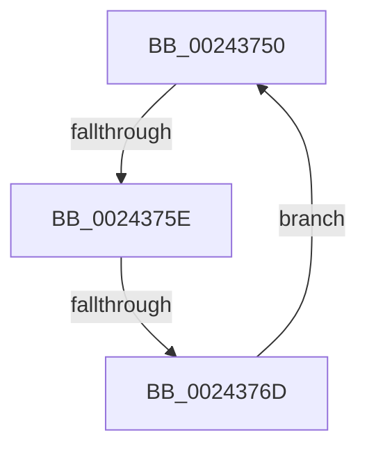

# sub_00243750

- RVA: `0x00243750`–`0x0024376F` (길이 `31` bytes)
- VA: `0x0000000140243750`
- 실행 섹션: `.text`
- PDB 이름 있음: `아니요`; PDB Function 태그: `아니요`
- unwind 정보 RVA: `0x00061C20`
- 디코드: `8`개 명령, `31/31` bytes 표시
- 미해석 바이트: `0` (있으면 어셈블리에 `.byte`로 보존)

> 이 문서는 커널 이미지의 기계어와 PDB 기호를 분석해 생성했습니다. 4번과 5번은 함수 원형과 자료형을 바이너리 사용 방식에서 추정한 C 해석이며 원본 소스 복구 결과는 아닙니다.

## 1. Dependencies

- 직접 호출 지점: **0**; 고유 호출 대상: **0**
- 직접 호출자로 확인된 함수: **0**
- RIP 상대 이미지 참조: **1**

### Outgoing calls
- 직접 디코드된 call 명령이 없습니다.

### Direct callers
- 이 함수 시작 RVA로 연결되는 직접 call은 확인되지 않았습니다. 간접 호출은 완전히 역산할 수 없습니다.

### Static image references
- `0x00243752` → RVA `0x00FC52AC` (`ALMOSTRO`; reference)

## 2. Other-region calls and transfers

- 다른 실행 섹션으로 향하는 call: **0**
- call이 아닌 외부 분기/꼬리 이동: **2**
  - `0x00243758` → [sub_00243804](Unknown_function_00243804.md) (`tail-transfer`)
  - `0x00243767` → [sub_002436B7 + 0x7](Unknown_function_002436B7.md) (`tail-transfer`)

## 3. Assembly (complete function range)

```asm
00243750  FF C7                           inc edi
00243752  85 3D 54 1B D8 00               test dword ptr [rip + 0xd81b54], edi
00243758  0F 84 A6 00 00 00               je 0x140243804
0024375E  F3 90                           pause
00243760  48 8B 43 18                     mov rax, qword ptr [rbx + 0x18]
00243764  48 85 C0                        test rax, rax
00243767  0F 89 51 FF FF FF               jns 0x1402436be
0024376D  EB E1                           jmp 0x140243750
```

## 4. C-style interpretation (structured pseudocode)

```c
__int64 __fastcall sub_00243750(void)
{
    __int64 v_rdi;

    v_rdi = (unsigned int)((v_rdi) + 1);
    goto loc_00243750;
}
```

## 5. (Beta) C Style

```c
void sub_00243750(void)
{
    int64_t local_rdi;

    local_rdi = (uint32_t)((local_rdi) + 1);
    goto loc_00243750;
}
```

## 6. Execution-region graph

[열기: 2D/3D 그래프와 함수 탐색 컨트롤 패널](../../../control-panel.html?section=text&rva=0x00243750&view=graph)

- 2D 그래프는 위에서 아래로 흐르고, 3D 그래프는 빈 공간을 드래그해 회전합니다. Shift+드래그는 이동, 휠은 확대·축소, 함수 노드 선택은 대상 보고서 이동입니다.

### Static fallback


