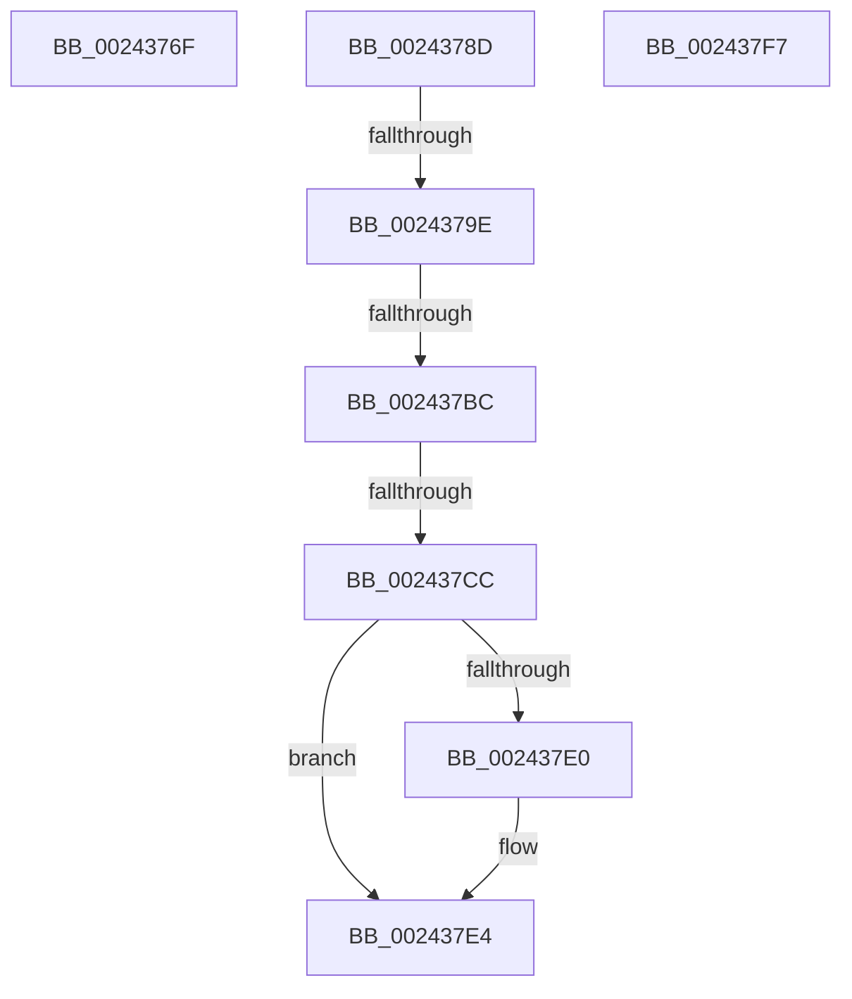

# sub_0024376F

- RVA: `0x0024376F`–`0x00243804` (길이 `149` bytes)
- VA: `0x000000014024376F`
- 실행 섹션: `.text`
- PDB 이름 있음: `아니요`; PDB Function 태그: `아니요`
- unwind 정보 RVA: `0x00061C40`
- 디코드: `31`개 명령, `149/149` bytes 표시
- 미해석 바이트: `0` (있으면 어셈블리에 `.byte`로 보존)

> 이 문서는 커널 이미지의 기계어와 PDB 기호를 분석해 생성했습니다. 4번과 5번은 함수 원형과 자료형을 바이너리 사용 방식에서 추정한 C 해석이며 원본 소스 복구 결과는 아닙니다.

## 1. Dependencies

- 직접 호출 지점: **0**; 고유 호출 대상: **0**
- 직접 호출자로 확인된 함수: **0**
- RIP 상대 이미지 참조: **1**

### Outgoing calls
- 직접 디코드된 call 명령이 없습니다.

### Direct callers
- 이 함수 시작 RVA로 연결되는 직접 call은 확인되지 않았습니다. 간접 호출은 완전히 역산할 수 없습니다.

### Static image references
- `0x0024378D` → RVA `0x00FC6A88` (`ALMOSTRO`; read)

## 2. Other-region calls and transfers

- 다른 실행 섹션으로 향하는 call: **0**
- call이 아닌 외부 분기/꼬리 이동: **6**
  - `0x0024378B` → [sub_002436D0 + 0x4A](Unknown_function_002436D0.md) (`tail-transfer`)
  - `0x00243798` → [sub_0024363C + 0x4E](Unknown_function_0024363C.md) (`tail-transfer`)
  - `0x002437B6` → [sub_0024363C + 0x4E](Unknown_function_0024363C.md) (`tail-transfer`)
  - `0x002437C6` → [sub_0024363C + 0x4E](Unknown_function_0024363C.md) (`tail-transfer`)
  - `0x002437F2` → [sub_0024363C + 0x4E](Unknown_function_0024363C.md) (`tail-transfer`)
  - `0x002437FF` → [sub_002436D0 + 0x14](Unknown_function_002436D0.md) (`tail-transfer`)

## 3. Assembly (complete function range)

```asm
0024376F  48 8B 43 10                     mov rax, qword ptr [rbx + 0x10]
00243773  48 C1 E2 10                     shl rdx, 0x10
00243777  48 8B CA                        mov rcx, rdx
0024377A  48 33 C8                        xor rcx, rax
0024377D  48 81 E1 FF FF 00 FC            and rcx, 0xfffffffffc00ffff
00243784  48 33 CA                        xor rcx, rdx
00243787  48 89 4B 10                     mov qword ptr [rbx + 0x10], rcx
0024378B  EB 8D                           jmp 0x14024371a
0024378D  48 F7 05 F0 32 D8 00 00 00 60 00  test qword ptr [rip + 0xd832f0], 0x600000
00243798  0F 84 EC FE FF FF               je 0x14024368a
0024379E  65 48 8B 14 25 88 01 00 00      mov rdx, qword ptr gs:[0x188]
002437A7  4C 8B 82 B8 00 00 00            mov r8, qword ptr [rdx + 0xb8]
002437AE  41 80 B8 60 01 00 00 01         cmp byte ptr [r8 + 0x160], 1
002437B6  0F 84 CE FE FF FF               je 0x14024368a
002437BC  49 8B 90 08 05 00 00            mov rdx, qword ptr [r8 + 0x508]
002437C3  48 85 D2                        test rdx, rdx
002437C6  0F 84 BE FE FF FF               je 0x14024368a
002437CC  49 C1 EA 03                     shr r10, 3
002437D0  41 81 E2 FF 01 00 00            and r10d, 0x1ff
002437D7  4A 8B 14 D2                     mov rdx, qword ptr [rdx + r10*8]
002437DB  F6 C2 20                        test dl, 0x20
002437DE  74 04                           je 0x1402437e4
002437E0  48 83 C9 20                     or rcx, 0x20
002437E4  48 8B C1                        mov rax, rcx
002437E7  48 83 C8 42                     or rax, 0x42
002437EB  F6 C2 42                        test dl, 0x42
002437EE  48 0F 44 C1                     cmove rax, rcx
002437F2  E9 93 FE FF FF                  jmp 0x14024368a
002437F7  4C 8B 43 10                     mov r8, qword ptr [rbx + 0x10]
002437FB  49 C1 E8 10                     shr r8, 0x10
002437FF  E9 E0 FE FF FF                  jmp 0x1402436e4
```

## 4. C-style interpretation (structured pseudocode)

```c
__int64 __fastcall sub_0024376F(__int64 a1, __int64 a2)
{
    a2 = (a2) << (16);
    a1 = (a2) ^ (*(unsigned __int64 *)(v_rbx + 16));
    a1 = (a1) & (0xFFFFFFFFFC00FFFFULL);
    a1 = (a1) ^ (a2);
    *(unsigned __int64 *)(v_rbx + 16) = a1;
}
```

## 5. (Beta) C Style

```c
int64_t sub_0024376F(int64_t Arg1, int64_t Arg2)
{
    Arg2 = (Arg2) << (16);
    Arg1 = (Arg2) ^ (*(uint64_t *)(local_rbx + 0x10));
    Arg1 = (Arg1) & (0xFFFFFFFFFC00FFFFULL);
    Arg1 = (Arg1) ^ (Arg2);
    *(uint64_t *)(local_rbx + 0x10) = Arg1;
}
```

## 6. Execution-region graph

[열기: 2D/3D 그래프와 함수 탐색 컨트롤 패널](../../../control-panel.html?section=text&rva=0x0024376F&view=graph)

- 2D 그래프는 위에서 아래로 흐르고, 3D 그래프는 빈 공간을 드래그해 회전합니다. Shift+드래그는 이동, 휠은 확대·축소, 함수 노드 선택은 대상 보고서 이동입니다.

### Static fallback


