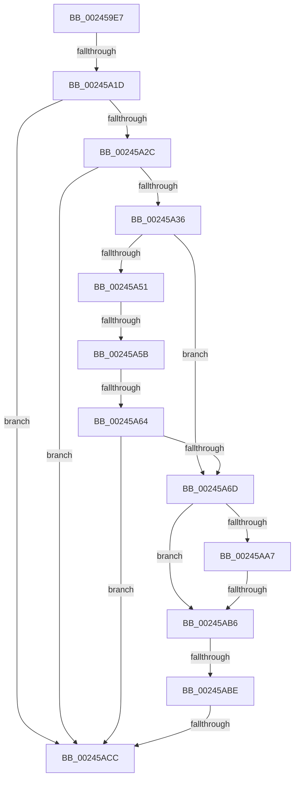

# sub_002459E7

- RVA: `0x002459E7`–`0x00245AE3` (길이 `252` bytes)
- VA: `0x00000001402459E7`
- 실행 섹션: `.text`
- PDB 이름 있음: `아니요`; PDB Function 태그: `아니요`
- unwind 정보 RVA: `0x00061D14`
- 디코드: `59`개 명령, `252/252` bytes 표시
- 미해석 바이트: `0` (있으면 어셈블리에 `.byte`로 보존)

> 이 문서는 커널 이미지의 기계어와 PDB 기호를 분석해 생성했습니다. 4번과 5번은 함수 원형과 자료형을 바이너리 사용 방식에서 추정한 C 해석이며 원본 소스 복구 결과는 아닙니다.

## 1. Dependencies

- 직접 호출 지점: **0**; 고유 호출 대상: **0**
- 직접 호출자로 확인된 함수: **0**
- RIP 상대 이미지 참조: **0**

### Outgoing calls
- 직접 디코드된 call 명령이 없습니다.

### Direct callers
- 이 함수 시작 RVA로 연결되는 직접 call은 확인되지 않았습니다. 간접 호출은 완전히 역산할 수 없습니다.

### Static image references
- 디코드된 RIP-relative 메모리 참조가 없습니다.

## 2. Other-region calls and transfers

- 다른 실행 섹션으로 향하는 call: **0**
- call이 아닌 외부 분기/꼬리 이동: **6**
  - `0x00245A17` → [sub_00245BBB + 0x22](Unknown_function_00245BBB.md) (`tail-transfer`)
  - `0x00245A55` → [sub_00245BBB](Unknown_function_00245BBB.md) (`tail-transfer`)
  - `0x00245A5E` → [sub_00245E59](Unknown_function_00245E59.md) (`tail-transfer`)
  - `0x00245AB4` → [sub_00245AE4](Unknown_function_00245AE4.md) (`tail-transfer`)
  - `0x00245ABC` → [sub_00245AE4](Unknown_function_00245AE4.md) (`tail-transfer`)
  - `0x00245AC6` → [sub_00245BBB + 0x42](Unknown_function_00245BBB.md) (`tail-transfer`)

## 3. Assembly (complete function range)

```asm
002459E7  48 89 7C 24 50                  mov qword ptr [rsp + 0x50], rdi
002459EC  49 B8 00 00 00 00 00 00 20 00   movabs r8, 0x20000000000000
002459F6  8B 79 20                        mov edi, dword ptr [rcx + 0x20]
002459F9  89 7C 24 70                     mov dword ptr [rsp + 0x70], edi
002459FD  66 83 EF 01                     sub di, 1
00245A01  66 89 7C 24 70                  mov word ptr [rsp + 0x70], di
00245A06  8B 44 24 70                     mov eax, dword ptr [rsp + 0x70]
00245A0A  4C 89 6C 24 40                  mov qword ptr [rsp + 0x40], r13
00245A0F  89 41 20                        mov dword ptr [rcx + 0x20], eax
00245A12  4C 89 74 24 38                  mov qword ptr [rsp + 0x38], r14
00245A17  0F 84 C0 01 00 00               je 0x140245bdd
00245A1D  48 8B 41 28                     mov rax, qword ptr [rcx + 0x28]
00245A21  48 0F BA E0 28                  bt rax, 0x28
00245A26  0F 82 A0 00 00 00               jb 0x140245acc
00245A2C  4C 85 41 28                     test qword ptr [rcx + 0x28], r8
00245A30  0F 85 96 00 00 00               jne 0x140245acc
00245A36  8B 53 20                        mov edx, dword ptr [rbx + 0x20]
00245A39  49 BE FF FF FF FF FF FF FF 3F   movabs r14, 0x3fffffffffffffff
00245A43  48 8B 43 18                     mov rax, qword ptr [rbx + 0x18]
00245A47  33 C9                           xor ecx, ecx
00245A49  49 23 C6                        and rax, r14
00245A4C  66 85 D2                        test dx, dx
00245A4F  74 1C                           je 0x140245a6d
00245A51  66 83 FA 01                     cmp dx, 1
00245A55  0F 85 60 01 00 00               jne 0x140245bbb
00245A5B  48 85 C0                        test rax, rax
00245A5E  0F 84 F5 03 00 00               je 0x140245e59
00245A64  B9 01 00 00 00                  mov ecx, 1
00245A69  85 C9                           test ecx, ecx
00245A6B  74 5F                           je 0x140245acc
00245A6D  48 8B 4B 08                     mov rcx, qword ptr [rbx + 8]
00245A71  49 B9 00 00 00 00 80 F6 FF FF   movabs r9, 0xfffff68000000000
00245A7B  49 8B C1                        mov rax, r9
00245A7E  48 BA 78 FF FF FF 3F 00 00 00   movabs rdx, 0x3fffffff78
00245A88  49 B8 00 00 00 00 00 00 00 80   movabs r8, 0x8000000000000000
00245A92  48 03 D0                        add rdx, rax
00245A95  49 0B C8                        or rcx, r8
00245A98  49 BD 00 00 00 00 00 00 00 40   movabs r13, 0x4000000000000000
00245AA2  48 3B CA                        cmp rcx, rdx
00245AA5  77 0F                           ja 0x140245ab6
00245AA7  48 8B 4B 08                     mov rcx, qword ptr [rbx + 8]
00245AAB  49 0B C8                        or rcx, r8
00245AAE  49 8B C1                        mov rax, r9
00245AB1  48 3B C8                        cmp rcx, rax
00245AB4  73 2E                           jae 0x140245ae4
00245AB6  0F B6 43 23                     movzx eax, byte ptr [rbx + 0x23]
00245ABA  A8 20                           test al, 0x20
00245ABC  74 26                           je 0x140245ae4
00245ABE  24 DF                           and al, 0xdf
00245AC0  88 43 23                        mov byte ptr [rbx + 0x23], al
00245AC3  66 85 FF                        test di, di
00245AC6  0F 84 31 01 00 00               je 0x140245bfd
00245ACC  33 C0                           xor eax, eax
00245ACE  48 8B 7C 24 50                  mov rdi, qword ptr [rsp + 0x50]
00245AD3  4C 8B 6C 24 40                  mov r13, qword ptr [rsp + 0x40]
00245AD8  4C 8B 74 24 38                  mov r14, qword ptr [rsp + 0x38]
00245ADD  48 83 C4 60                     add rsp, 0x60
00245AE1  5B                              pop rbx
00245AE2  C3                              ret
```

## 4. C-style interpretation (structured pseudocode)

```c
__int64 __fastcall sub_002459E7(__int64 a1, __int64 a2, __int64 a3, __int64 a4, __int64 a5, __int64 a6, __int64 a7, __int64 a8, __int64 a9, __int64 a10, __int64 a11, __int64 a12, __int64 a13, unsigned int a14)
{
    __int64 result;
    __int64 v_rdi;
    __int64 v_rsp;
    unsigned __int64 v_stack_p38;
    unsigned __int64 v_stack_p40;
    unsigned __int64 v_stack_p50;
    unsigned int v_stack_p70;

    v_stack_p50 = v_rdi;
    v_stack_p70 = (unsigned int)((unsigned int)(*(unsigned int *)(a1 + 32)));
    v_rdi = (unsigned __int16)(((unsigned int)(*(unsigned int *)(a1 + 32))) - (1));
    v_stack_p70 = (unsigned __int16)(v_rdi);
    v_stack_p40 = v_r13;
    *(unsigned int *)(a1 + 32) = (unsigned int)((unsigned int)(a14));
    v_stack_p38 = v_r14;
    if (condition_is_below) goto loc_00245ACC;
    if (((*(unsigned __int64 *)(a1 + 40)) & (a3)) != 0) goto loc_00245ACC;
    a1 = 0;
    result = (*(unsigned __int64 *)(v_rbx + 24)) & (v_r14);
    if ((unsigned __int16)((unsigned int)(*(unsigned int *)(v_rbx + 32))) == 0) goto loc_00245A6D;
    if (1 == 0) goto loc_00245ACC;
loc_00245A6D:
    a2 = ((unsigned int)(*(unsigned int *)(v_rbx + 32))) + (a4);
    a1 = (*(unsigned __int64 *)(v_rbx + 8)) | (a3);
    if (a1 > a2) goto loc_00245AB6;
    a1 = (*(unsigned __int64 *)(v_rbx + 8)) | (a3);
loc_00245AB6:
    result = (unsigned __int8)((*(unsigned __int8 *)(v_rbx + 35)) & (223));
    *(unsigned __int8 *)(v_rbx + 35) = (unsigned __int8)(result);
loc_00245ACC:
    result = 0;
    v_rsp = (v_rsp) + (96);
    return result;
}
```

## 5. (Beta) C Style

```c
int64_t sub_002459E7(void *Arg1, int64_t Arg2, int64_t Arg3, int64_t Arg4, uint64_t Arg5, uint64_t Arg6, int64_t Arg7, int64_t Arg8, uint64_t Arg9, int64_t Arg10, uint64_t Arg11, uint64_t Arg12, uint64_t Arg13, uint32_t Arg14)
{
    uint8_t *arg1 = (uint8_t *)Arg1;

    int64_t result;
    int64_t local_rdi;
    int64_t local_rsp;
    uint64_t v_stack_p38;
    uint64_t v_stack_p40;
    uint64_t v_stack_p50;
    uint32_t v_stack_p70;

    v_stack_p50 = local_rdi;
    v_stack_p70 = (uint32_t)((uint32_t)(*(uint32_t *)(arg1 + 0x20)));
    local_rdi = (uint16_t)(((uint32_t)(*(uint32_t *)(arg1 + 0x20))) - (1));
    v_stack_p70 = (uint16_t)(local_rdi);
    v_stack_p40 = local_r13;
    *(uint32_t *)(arg1 + 0x20) = (uint32_t)((uint32_t)(Arg14));
    v_stack_p38 = local_r14;
    if (condition_is_below) goto loc_00245ACC;
    if (((*(uint64_t *)(arg1 + 0x28)) & (Arg3)) != 0) goto loc_00245ACC;
    Arg1 = 0;
    result = (*(uint64_t *)(local_rbx + 0x18)) & (local_r14);
    if ((uint16_t)((uint32_t)(*(uint32_t *)(local_rbx + 0x20))) == 0) goto loc_00245A6D;
    if (1 == 0) goto loc_00245ACC;
loc_00245A6D:
    Arg2 = ((uint32_t)(*(uint32_t *)(local_rbx + 0x20))) + (Arg4);
    Arg1 = (*(uint64_t *)(local_rbx + 0x8)) | (Arg3);
    if (Arg1 > Arg2) goto loc_00245AB6;
    Arg1 = (*(uint64_t *)(local_rbx + 0x8)) | (Arg3);
loc_00245AB6:
    result = (uint8_t)((*(uint8_t *)(local_rbx + 0x23)) & (223));
    *(uint8_t *)(local_rbx + 0x23) = (uint8_t)(result);
loc_00245ACC:
    result = 0;
    local_rsp = (local_rsp) + (96);
    return result;
}
```

### 관측된 메모리 오프셋

구조체 형식이 확인되지 않은 접근은 인자 기준의 오프셋으로만 기록했습니다.

| 기준 인자 | 오프셋 표현 | 폭 (bit) | 접근 |
|---|---:|---:|---|
| `Arg1` | `+ 0x20` | `32` | `R` |
| `Arg1` | `+ 0x20` | `32` | `W` |
| `Arg1` | `+ 0x28` | `64` | `R` |

## 6. Execution-region graph

[열기: 2D/3D 그래프와 함수 탐색 컨트롤 패널](../../../control-panel.html?section=text&rva=0x002459E7&view=graph)

- 2D 그래프는 위에서 아래로 흐르고, 3D 그래프는 빈 공간을 드래그해 회전합니다. Shift+드래그는 이동, 휠은 확대·축소, 함수 노드 선택은 대상 보고서 이동입니다.

### Static fallback


