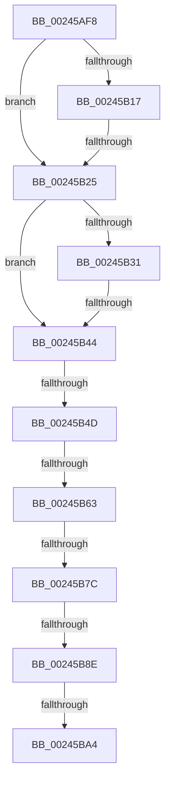

# sub_00245AF8

- RVA: `0x00245AF8`–`0x00245BBB` (길이 `195` bytes)
- VA: `0x0000000140245AF8`
- 실행 섹션: `.text`
- PDB 이름 있음: `아니요`; PDB Function 태그: `아니요`
- unwind 정보 RVA: `0x00061D60`
- 디코드: `42`개 명령, `195/195` bytes 표시
- 미해석 바이트: `0` (있으면 어셈블리에 `.byte`로 보존)

> 이 문서는 커널 이미지의 기계어와 PDB 기호를 분석해 생성했습니다. 4번과 5번은 함수 원형과 자료형을 바이너리 사용 방식에서 추정한 C 해석이며 원본 소스 복구 결과는 아닙니다.

## 1. Dependencies

- 직접 호출 지점: **0**; 고유 호출 대상: **0**
- 직접 호출자로 확인된 함수: **0**
- RIP 상대 이미지 참조: **1**

### Outgoing calls
- 직접 디코드된 call 명령이 없습니다.

### Direct callers
- 이 함수 시작 RVA로 연결되는 직접 call은 확인되지 않았습니다. 간접 호출은 완전히 역산할 수 없습니다.

### Static image references
- `0x00245B4D` → RVA `0x00E38D00` (`.data`; read)

## 2. Other-region calls and transfers

- 다른 실행 섹션으로 향하는 call: **0**
- call이 아닌 외부 분기/꼬리 이동: **8**
  - `0x00245B1F` → [sub_00245CC3 + 0xD](Unknown_function_00245CC3.md) (`tail-transfer`)
  - `0x00245B3E` → [sub_00245E68 + 0x8](Unknown_function_00245E68.md) (`tail-transfer`)
  - `0x00245B47` → [sub_00245CC3](Unknown_function_00245CC3.md) (`tail-transfer`)
  - `0x00245B5D` → [sub_00245DA0 + 0x6](Unknown_function_00245DA0.md) (`tail-transfer`)
  - `0x00245B76` → [sub_00245DA0](Unknown_function_00245DA0.md) (`tail-transfer`)
  - `0x00245B88` → [sub_00245DFB + 0x29](Unknown_function_00245DFB.md) (`tail-transfer`)
  - `0x00245B9E` → [sub_00245DFB + 0x20](Unknown_function_00245DFB.md) (`tail-transfer`)
  - `0x00245BB6` → [sub_002459E7 + 0xDC](Unknown_function_002459E7.md) (`tail-transfer`)

## 3. Assembly (complete function range)

```asm
00245AF8  48 89 AC 24 80 00 00 00         mov qword ptr [rsp + 0x80], rbp
00245B00  48 89 74 24 58                  mov qword ptr [rsp + 0x58], rsi
00245B05  4C 89 7C 24 30                  mov qword ptr [rsp + 0x30], r15
00245B0A  48 8B 34 C1                     mov rsi, qword ptr [rcx + rax*8]
00245B0E  48 8B 43 28                     mov rax, qword ptr [rbx + 0x28]
00245B12  48 85 C0                        test rax, rax
00245B15  79 0E                           jns 0x140245b25
00245B17  8B 43 10                        mov eax, dword ptr [rbx + 0x10]
00245B1A  48 0F BA E0 0A                  bt rax, 0xa
00245B1F  0F 82 AB 01 00 00               jb 0x140245cd0
00245B25  48 8B 43 08                     mov rax, qword ptr [rbx + 8]
00245B29  49 0B C0                        or rax, r8
00245B2C  48 3B C2                        cmp rax, rdx
00245B2F  77 13                           ja 0x140245b44
00245B31  48 8B 4B 08                     mov rcx, qword ptr [rbx + 8]
00245B35  49 0B C8                        or rcx, r8
00245B38  49 8B C1                        mov rax, r9
00245B3B  48 3B C8                        cmp rcx, rax
00245B3E  0F 83 2C 03 00 00               jae 0x140245e70
00245B44  66 85 FF                        test di, di
00245B47  0F 84 76 01 00 00               je 0x140245cc3
00245B4D  4C 8D 3D AC 31 BF 00            lea r15, [rip + 0xbf31ac]
00245B54  41 B9 01 00 00 00               mov r9d, 1
00245B5A  49 3B F7                        cmp rsi, r15
00245B5D  0F 85 43 02 00 00               jne 0x140245da6
00245B63  65 4C 8B 04 25 20 00 00 00      mov r8, qword ptr gs:[0x20]
00245B6C  41 8B 90 9C 8B 00 00            mov edx, dword ptr [r8 + 0x8b9c]
00245B73  83 FA FF                        cmp edx, -1
00245B76  0F 84 24 02 00 00               je 0x140245da0
00245B7C  48 63 C2                        movsxd rax, edx
00245B7F  48 FF C0                        inc rax
00245B82  48 3D 00 01 00 00               cmp rax, 0x100
00245B88  0F 87 96 02 00 00               ja 0x140245e24
00245B8E  8D 4A 01                        lea ecx, [rdx + 1]
00245B91  8B C2                           mov eax, edx
00245B93  F0 41 0F B1 88 9C 8B 00 00      lock cmpxchg dword ptr [r8 + 0x8b9c], ecx
00245B9C  8B D0                           mov edx, eax
00245B9E  0F 85 77 02 00 00               jne 0x140245e1b
00245BA4  48 8B AC 24 80 00 00 00         mov rbp, qword ptr [rsp + 0x80]
00245BAC  48 8B 74 24 58                  mov rsi, qword ptr [rsp + 0x58]
00245BB1  4C 8B 7C 24 30                  mov r15, qword ptr [rsp + 0x30]
00245BB6  E9 08 FF FF FF                  jmp 0x140245ac3
```

## 4. C-style interpretation (structured pseudocode)

```c
__int64 __fastcall sub_00245AF8(__int64 a1, __int64 a2, __int64 a3, __int64 a4, __int64 a5, __int64 a6, __int64 a7, __int64 a8, __int64 a9, __int64 a10, __int64 a11, __int64 a12, __int64 a13, __int64 a14, __int64 a15, __int64 a16)
{
    __int64 result;
    unsigned __int64 v_stack_p30;
    unsigned __int64 v_stack_p58;
    unsigned __int64 v_stack_p80;

    v_stack_p80 = v_rbp;
    v_stack_p58 = v_rsi;
    v_stack_p30 = v_r15;
    if (!sign_flag) goto loc_00245B25;
loc_00245B25:
    result = (*(unsigned __int64 *)(v_rbx + 8)) | (a3);
    if (result > a2) goto loc_00245B44;
    a1 = (*(unsigned __int64 *)(v_rbx + 8)) | (a3);
loc_00245B44:
    result = ((int)((unsigned int)((unsigned int)(*(unsigned int *)(*(unsigned __int64 *)(gs_base + (0 + 32)) + 35740))))) + 1;
}
```

## 5. (Beta) C Style

```c
int64_t sub_00245AF8(void *Arg1, int64_t Arg2, int64_t Arg3, int64_t Arg4, uint64_t Arg5, int64_t Arg6, uint64_t Arg7, uint64_t Arg8, uint64_t Arg9, uint64_t Arg10, int64_t Arg11, uint64_t Arg12, uint64_t Arg13, uint64_t Arg14, uint64_t Arg15, int64_t Arg16)
{
    uint8_t *arg1 = (uint8_t *)Arg1;

    int64_t result;
    uint64_t v_stack_p30;
    uint64_t v_stack_p58;
    uint64_t v_stack_p80;

    v_stack_p80 = local_rbp;
    v_stack_p58 = local_rsi;
    v_stack_p30 = local_r15;
    if (!sign_flag) goto loc_00245B25;
loc_00245B25:
    result = (*(uint64_t *)(local_rbx + 0x8)) | (Arg3);
    if (result > Arg2) goto loc_00245B44;
    Arg1 = (*(uint64_t *)(local_rbx + 0x8)) | (Arg3);
loc_00245B44:
    result = ((int32_t)((uint32_t)((uint32_t)(*(uint32_t *)(*(uint64_t *)(gs_base + (0 + 0x20)) + 0x8B9C))))) + 1;
}
```

### 관측된 메모리 오프셋

구조체 형식이 확인되지 않은 접근은 인자 기준의 오프셋으로만 기록했습니다.

| 기준 인자 | 오프셋 표현 | 폭 (bit) | 접근 |
|---|---:|---:|---|
| `Arg1` | `+ 0x0 + rax*8` | `64` | `R` |

## 6. Execution-region graph

[열기: 2D/3D 그래프와 함수 탐색 컨트롤 패널](../../../control-panel.html?section=text&rva=0x00245AF8&view=graph)

- 2D 그래프는 위에서 아래로 흐르고, 3D 그래프는 빈 공간을 드래그해 회전합니다. Shift+드래그는 이동, 휠은 확대·축소, 함수 노드 선택은 대상 보고서 이동입니다.

### Static fallback


