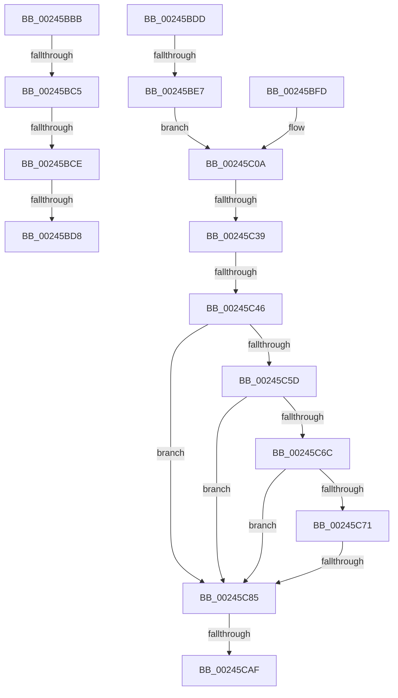

# sub_00245BBB

- RVA: `0x00245BBB`–`0x00245CC3` (길이 `264` bytes)
- VA: `0x0000000140245BBB`
- 실행 섹션: `.text`
- PDB 이름 있음: `아니요`; PDB Function 태그: `아니요`
- unwind 정보 RVA: `0x00061D7C`
- 디코드: `55`개 명령, `264/264` bytes 표시
- 미해석 바이트: `0` (있으면 어셈블리에 `.byte`로 보존)

> 이 문서는 커널 이미지의 기계어와 PDB 기호를 분석해 생성했습니다. 4번과 5번은 함수 원형과 자료형을 바이너리 사용 방식에서 추정한 C 해석이며 원본 소스 복구 결과는 아닙니다.

## 1. Dependencies

- 직접 호출 지점: **1**; 고유 호출 대상: **1**
- 직접 호출자로 확인된 함수: **0**
- RIP 상대 이미지 참조: **0**

### Outgoing calls
- `0x00245CB4` → [MiInsertPageInList](../2B/MiInsertPageInList_function_002BA000.md) (function, `0x002BA000`)

### Direct callers
- 이 함수 시작 RVA로 연결되는 직접 call은 확인되지 않았습니다. 간접 호출은 완전히 역산할 수 없습니다.

### Static image references
- 디코드된 RIP-relative 메모리 참조가 없습니다.

## 2. Other-region calls and transfers

- 다른 실행 섹션으로 향하는 call: **0**
- call이 아닌 외부 분기/꼬리 이동: **10**
  - `0x00245BBF` → [sub_002459E7 + 0xE5](Unknown_function_002459E7.md) (`tail-transfer`)
  - `0x00245BC8` → [sub_002459E7 + 0xE5](Unknown_function_002459E7.md) (`tail-transfer`)
  - `0x00245BD2` → [sub_002459E7 + 0x86](Unknown_function_002459E7.md) (`tail-transfer`)
  - `0x00245BD8` → [sub_002459E7 + 0xE5](Unknown_function_002459E7.md) (`tail-transfer`)
  - `0x00245BE1` → [sub_002459E7 + 0x36](Unknown_function_002459E7.md) (`tail-transfer`)
  - `0x00245C33` → [sub_00245E7F + 0x7D](Unknown_function_00245E7F.md) (`tail-transfer`)
  - `0x00245C40` → [sub_00245E7F](Unknown_function_00245E7F.md) (`tail-transfer`)
  - `0x00245C7F` → [sub_00245DB3](Unknown_function_00245DB3.md) (`tail-transfer`)
  - `0x00245CA9` → [sub_00245D8C](Unknown_function_00245D8C.md) (`tail-transfer`)
  - `0x00245CBE` → [sub_002459E7 + 0xE7](Unknown_function_002459E7.md) (`tail-transfer`)

## 3. Assembly (complete function range)

```asm
00245BBB  66 83 FA 02                     cmp dx, 2
00245BBF  0F 85 07 FF FF FF               jne 0x140245acc
00245BC5  48 85 C0                        test rax, rax
00245BC8  0F 84 FE FE FF FF               je 0x140245acc
00245BCE  F6 43 22 08                     test byte ptr [rbx + 0x22], 8
00245BD2  0F 85 95 FE FF FF               jne 0x140245a6d
00245BD8  E9 EF FE FF FF                  jmp 0x140245acc
00245BDD  4C 85 41 28                     test qword ptr [rcx + 0x28], r8
00245BE1  0F 84 36 FE FF FF               je 0x140245a1d
00245BE7  49 BE FF FF FF FF FF FF FF 3F   movabs r14, 0x3fffffffffffffff
00245BF1  49 BD 00 00 00 00 00 00 00 40   movabs r13, 0x4000000000000000
00245BFB  EB 0D                           jmp 0x140245c0a
00245BFD  48 8B CB                        mov rcx, rbx
00245C00  49 B8 00 00 00 00 00 00 20 00   movabs r8, 0x20000000000000
00245C0A  48 B8 00 00 00 00 00 DE FF FF   movabs rax, 0xffffde0000000000
00245C14  48 8B FB                        mov rdi, rbx
00245C17  48 2B F8                        sub rdi, rax
00245C1A  48 B8 AB AA AA AA AA AA AA AA   movabs rax, 0xaaaaaaaaaaaaaaab
00245C24  48 C1 FF 04                     sar rdi, 4
00245C28  48 0F AF F8                     imul rdi, rax
00245C2C  48 8B 43 18                     mov rax, qword ptr [rbx + 0x18]
00245C30  49 85 C6                        test r14, rax
00245C33  0F 85 C3 02 00 00               jne 0x140245efc
00245C39  48 8B 43 18                     mov rax, qword ptr [rbx + 0x18]
00245C3D  49 85 C5                        test r13, rax
00245C40  0F 85 39 02 00 00               jne 0x140245e7f
00245C46  48 8B 53 10                     mov rdx, qword ptr [rbx + 0x10]
00245C4A  4C 8D 43 10                     lea r8, [rbx + 0x10]
00245C4E  48 B8 00 D0 BE 7D FB F6 FF FF   movabs rax, 0xfffff6fb7dbed000
00245C58  4C 3B C0                        cmp r8, rax
00245C5B  72 28                           jb 0x140245c85
00245C5D  48 B8 F8 D7 BE 7D FB F6 FF FF   movabs rax, 0xfffff6fb7dbed7f8
00245C67  4C 3B C0                        cmp r8, rax
00245C6A  77 19                           ja 0x140245c85
00245C6C  F6 C2 01                        test dl, 1
00245C6F  74 14                           je 0x140245c85
00245C71  F6 C2 42                        test dl, 0x42
00245C74  0F 95 C1                        setne cl
00245C77  F6 C2 20                        test dl, 0x20
00245C7A  0F 95 C0                        setne al
00245C7D  84 C8                           test al, cl
00245C7F  0F 84 2E 01 00 00               je 0x140245db3
00245C85  48 0F BA E2 0A                  bt rdx, 0xa
00245C8A  48 C7 C1 FF F7 FF FF            mov rcx, 0xfffffffffffff7ff
00245C91  48 C7 C0 F7 FF FF FF            mov rax, 0xfffffffffffffff7
00245C98  48 0F 42 C1                     cmovb rax, rcx
00245C9C  48 8B CB                        mov rcx, rbx
00245C9F  48 23 C2                        and rax, rdx
00245CA2  49 89 00                        mov qword ptr [r8], rax
00245CA5  F6 43 22 10                     test byte ptr [rbx + 0x22], 0x10
00245CA9  0F 84 DD 00 00 00               je 0x140245d8c
00245CAF  BA 08 00 00 00                  mov edx, 8
00245CB4  E8 47 43 07 00                  call 0x1402ba000
00245CB9  B8 01 00 00 00                  mov eax, 1
00245CBE  E9 0B FE FF FF                  jmp 0x140245ace
```

## 4. C-style interpretation (structured pseudocode)

```c
__int64 __fastcall sub_00245BBB(__int64 a1, unsigned __int16 a2, __int64 a3)
{
}
```

## 5. (Beta) C Style

```c
int64_t sub_00245BBB(int64_t Arg1, uint16_t Arg2, int64_t Arg3)
{
}
```

## 6. Execution-region graph

[열기: 2D/3D 그래프와 함수 탐색 컨트롤 패널](../../../control-panel.html?section=text&rva=0x00245BBB&view=graph)

- 2D 그래프는 위에서 아래로 흐르고, 3D 그래프는 빈 공간을 드래그해 회전합니다. Shift+드래그는 이동, 휠은 확대·축소, 함수 노드 선택은 대상 보고서 이동입니다.

### Static fallback


