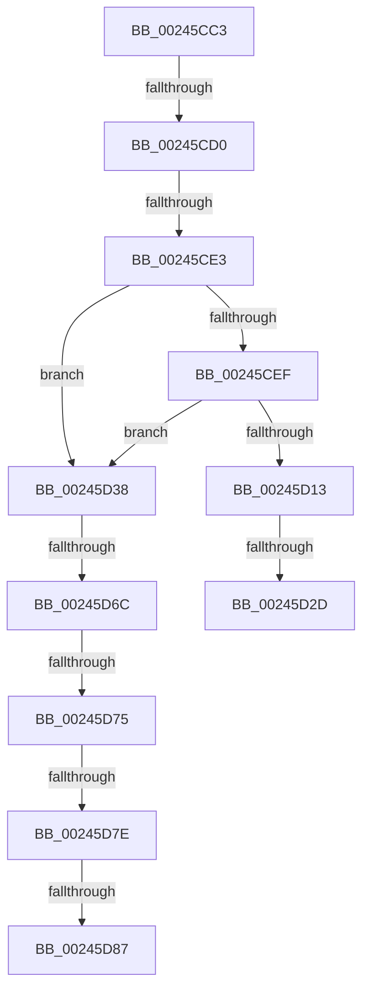

# sub_00245CC3

- RVA: `0x00245CC3`–`0x00245D8C` (길이 `201` bytes)
- VA: `0x0000000140245CC3`
- 실행 섹션: `.text`
- PDB 이름 있음: `아니요`; PDB Function 태그: `아니요`
- unwind 정보 RVA: `0x00061D8C`
- 디코드: `40`개 명령, `201/201` bytes 표시
- 미해석 바이트: `0` (있으면 어셈블리에 `.byte`로 보존)

> 이 문서는 커널 이미지의 기계어와 PDB 기호를 분석해 생성했습니다. 4번과 5번은 함수 원형과 자료형을 바이너리 사용 방식에서 추정한 C 해석이며 원본 소스 복구 결과는 아닙니다.

## 1. Dependencies

- 직접 호출 지점: **0**; 고유 호출 대상: **0**
- 직접 호출자로 확인된 함수: **0**
- RIP 상대 이미지 참조: **1**

### Outgoing calls
- 직접 디코드된 call 명령이 없습니다.

### Direct callers
- 이 함수 시작 RVA로 연결되는 직접 call은 확인되지 않았습니다. 간접 호출은 완전히 역산할 수 없습니다.

### Static image references
- `0x00245CE3` → RVA `0x00E38D00` (`.data`; read)

## 2. Other-region calls and transfers

- 다른 실행 섹션으로 향하는 call: **0**
- call이 아닌 외부 분기/꼬리 이동: **9**
  - `0x00245CCA` → [sub_00245AF8 + 0x55](Unknown_function_00245AF8.md) (`tail-transfer`)
  - `0x00245CDD` → [sub_00245F1D](Unknown_function_00245F1D.md) (`tail-transfer`)
  - `0x00245D27` → [sub_00245E68](Unknown_function_00245E68.md) (`tail-transfer`)
  - `0x00245D33` → [sub_00245AF8 + 0x6B](Unknown_function_00245AF8.md) (`tail-transfer`)
  - `0x00245D66` → [sub_00245DFB](Unknown_function_00245DFB.md) (`tail-transfer`)
  - `0x00245D6F` → [sub_00245F85 + 0xA5](Unknown_function_00245F85.md) (`tail-transfer`)
  - `0x00245D78` → [sub_00245AF8 + 0x5C](Unknown_function_00245AF8.md) (`tail-transfer`)
  - `0x00245D81` → [sub_00245AF8 + 0x5C](Unknown_function_00245AF8.md) (`tail-transfer`)
  - `0x00245D87` → [sub_00245F85 + 0xAE](Unknown_function_00245F85.md) (`tail-transfer`)

## 3. Assembly (complete function range)

```asm
00245CC3  48 8B 43 18                     mov rax, qword ptr [rbx + 0x18]
00245CC7  49 85 C5                        test r13, rax
00245CCA  0F 84 7D FE FF FF               je 0x140245b4d
00245CD0  48 83 BE 08 42 00 00 00         cmp qword ptr [rsi + 0x4208], 0
00245CD8  BD 01 00 00 00                  mov ebp, 1
00245CDD  0F 85 3A 02 00 00               jne 0x140245f1d
00245CE3  4C 8D 3D 16 30 BF 00            lea r15, [rip + 0xbf3016]
00245CEA  49 3B F7                        cmp rsi, r15
00245CED  75 49                           jne 0x140245d38
00245CEF  65 4C 8B 04 25 20 00 00 00      mov r8, qword ptr gs:[0x20]
00245CF8  41 0F 0D 88 98 8B 00 00         prefetchw byte ptr [r8 + 0x8b98]
00245D00  41 8B 90 98 8B 00 00            mov edx, dword ptr [r8 + 0x8b98]
00245D07  48 8D 04 2A                     lea rax, [rdx + rbp]
00245D0B  48 3D 00 01 00 00               cmp rax, 0x100
00245D11  77 25                           ja 0x140245d38
00245D13  8D 0C 2A                        lea ecx, [rdx + rbp]
00245D16  8B C2                           mov eax, edx
00245D18  F0 41 0F B1 88 98 8B 00 00      lock cmpxchg dword ptr [r8 + 0x8b98], ecx
00245D21  48 63 C8                        movsxd rcx, eax
00245D24  48 3B CA                        cmp rcx, rdx
00245D27  0F 85 3B 01 00 00               jne 0x140245e68
00245D2D  41 B9 01 00 00 00               mov r9d, 1
00245D33  E9 2B FE FF FF                  jmp 0x140245b63
00245D38  48 8B C5                        mov rax, rbp
00245D3B  48 F7 D8                        neg rax
00245D3E  F0 48 01 86 80 4B 00 00         lock add qword ptr [rsi + 0x4b80], rax
00245D46  F0 48 0F C1 86 40 4B 00 00      lock xadd qword ptr [rsi + 0x4b40], rax
00245D4F  4C 8B 86 E0 41 00 00            mov r8, qword ptr [rsi + 0x41e0]
00245D56  48 8B D0                        mov rdx, rax
00245D59  48 8B 8E D8 41 00 00            mov rcx, qword ptr [rsi + 0x41d8]
00245D60  48 2B D5                        sub rdx, rbp
00245D63  48 3B D0                        cmp rdx, rax
00245D66  0F 87 8F 00 00 00               ja 0x140245dfb
00245D6C  49 3B C0                        cmp rax, r8
00245D6F  0F 83 B5 02 00 00               jae 0x14024602a
00245D75  48 3B C1                        cmp rax, rcx
00245D78  0F 82 D6 FD FF FF               jb 0x140245b54
00245D7E  48 3B D1                        cmp rdx, rcx
00245D81  0F 83 CD FD FF FF               jae 0x140245b54
00245D87  E9 A7 02 00 00                  jmp 0x140246033
```

## 4. C-style interpretation (structured pseudocode)

```c
__int64 __fastcall sub_00245CC3(void)
{
    __int64 result;

    if (v_rsi != (v_rip + 12529686)) goto loc_00245D38;
    if (((unsigned int)(*(unsigned int *)(*(unsigned __int64 *)(gs_base + (0 + 32)) + 35736)) + 1 * 1) > 256) goto loc_00245D38;
loc_00245D38:
    result = -(1);
    a2 = (result) - (1);
}
```

## 5. (Beta) C Style

```c
void sub_00245CC3(void)
{
    int64_t result;

    if (local_rsi != (v_rip + 12529686)) goto loc_00245D38;
    if (((uint32_t)(*(uint32_t *)(*(uint64_t *)(gs_base + (0 + 0x20)) + 0x8B98)) + 1 * 1) > 256) goto loc_00245D38;
loc_00245D38:
    result = -(1);
    a2 = (result) - (1);
}
```

## 6. Execution-region graph

[열기: 2D/3D 그래프와 함수 탐색 컨트롤 패널](../../../control-panel.html?section=text&rva=0x00245CC3&view=graph)

- 2D 그래프는 위에서 아래로 흐르고, 3D 그래프는 빈 공간을 드래그해 회전합니다. Shift+드래그는 이동, 휠은 확대·축소, 함수 노드 선택은 대상 보고서 이동입니다.

### Static fallback


