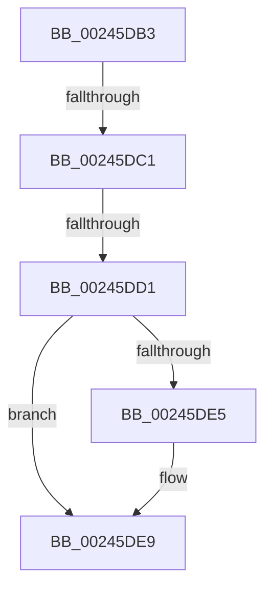

# sub_00245DB3

- RVA: `0x00245DB3`–`0x00245DFB` (길이 `72` bytes)
- VA: `0x0000000140245DB3`
- 실행 섹션: `.text`
- PDB 이름 있음: `아니요`; PDB Function 태그: `아니요`
- unwind 정보 RVA: `0x00061DD4`
- 디코드: `18`개 명령, `72/72` bytes 표시
- 미해석 바이트: `0` (있으면 어셈블리에 `.byte`로 보존)

> 이 문서는 커널 이미지의 기계어와 PDB 기호를 분석해 생성했습니다. 4번과 5번은 함수 원형과 자료형을 바이너리 사용 방식에서 추정한 C 해석이며 원본 소스 복구 결과는 아닙니다.

## 1. Dependencies

- 직접 호출 지점: **1**; 고유 호출 대상: **1**
- 직접 호출자로 확인된 함수: **0**
- RIP 상대 이미지 참조: **0**

### Outgoing calls
- `0x00245DB3` → [MiPteHasShadow](../32/MiPteHasShadow_function_0032B998.md) (function, `0x0032B998`)

### Direct callers
- 이 함수 시작 RVA로 연결되는 직접 call은 확인되지 않았습니다. 간접 호출은 완전히 역산할 수 없습니다.

### Static image references
- 디코드된 RIP-relative 메모리 참조가 없습니다.

## 2. Other-region calls and transfers

- 다른 실행 섹션으로 향하는 call: **0**
- call이 아닌 외부 분기/꼬리 이동: **3**
  - `0x00245DBB` → [sub_00245BBB + 0xCA](Unknown_function_00245BBB.md) (`tail-transfer`)
  - `0x00245DCB` → [sub_00245BBB + 0xCA](Unknown_function_00245BBB.md) (`tail-transfer`)
  - `0x00245DF6` → [sub_00245BBB + 0xCA](Unknown_function_00245BBB.md) (`tail-transfer`)

## 3. Assembly (complete function range)

```asm
00245DB3  E8 E0 5B 0E 00                  call 0x14032b998
00245DB8  48 85 C0                        test rax, rax
00245DBB  0F 84 C4 FE FF FF               je 0x140245c85
00245DC1  48 8B 88 08 05 00 00            mov rcx, qword ptr [rax + 0x508]
00245DC8  48 85 C9                        test rcx, rcx
00245DCB  0F 84 B4 FE FF FF               je 0x140245c85
00245DD1  49 8B C0                        mov rax, r8
00245DD4  48 C1 E8 03                     shr rax, 3
00245DD8  25 FF 01 00 00                  and eax, 0x1ff
00245DDD  48 8B 04 C1                     mov rax, qword ptr [rcx + rax*8]
00245DE1  A8 20                           test al, 0x20
00245DE3  74 04                           je 0x140245de9
00245DE5  48 83 CA 20                     or rdx, 0x20
00245DE9  48 8B CA                        mov rcx, rdx
00245DEC  48 83 CA 42                     or rdx, 0x42
00245DF0  A8 42                           test al, 0x42
00245DF2  48 0F 44 D1                     cmove rdx, rcx
00245DF6  E9 8A FE FF FF                  jmp 0x140245c85
```

## 4. C-style interpretation (structured pseudocode)

```c
__int64 __fastcall sub_00245DB3(__int64 a1, __int64 a2, __int64 a3)
{
    __int64 result;

    result = MiPteHasShadow(a1, a2, a3, a4);
    result = (a3) >> (3);
    result = (unsigned int)((result) & (511));
    if ((((unsigned __int8)(*(unsigned __int64 *)(*(unsigned __int64 *)(result + 1288) + result * 8))) & (32)) != 0) {
        a2 = (a2) | (32);
    }
    a2 = (a2) | (66);
    if ((((unsigned __int8)(*(unsigned __int64 *)(*(unsigned __int64 *)(result + 1288) + result * 8))) & (66)) == 0) { a2 = a2; }
}
```

## 5. (Beta) C Style

```c
int64_t sub_00245DB3(int64_t Arg1, int64_t Arg2, int64_t Arg3)
{
    int64_t result;

    result = MiPteHasShadow(Arg1, Arg2, Arg3, a4);
    result = (Arg3) >> (3);
    result = (uint32_t)((result) & (511));
    if ((((uint8_t)(*(uint64_t *)(*(uint64_t *)(result + 0x508) + result * 8))) & (32)) != 0) {
        Arg2 = (Arg2) | (32);
    }
    Arg2 = (Arg2) | (66);
    if ((((uint8_t)(*(uint64_t *)(*(uint64_t *)(result + 0x508) + result * 8))) & (66)) == 0) { Arg2 = Arg2; }
}
```

## 6. Execution-region graph

[열기: 2D/3D 그래프와 함수 탐색 컨트롤 패널](../../../control-panel.html?section=text&rva=0x00245DB3&view=graph)

- 2D 그래프는 위에서 아래로 흐르고, 3D 그래프는 빈 공간을 드래그해 회전합니다. Shift+드래그는 이동, 휠은 확대·축소, 함수 노드 선택은 대상 보고서 이동입니다.

### Static fallback


