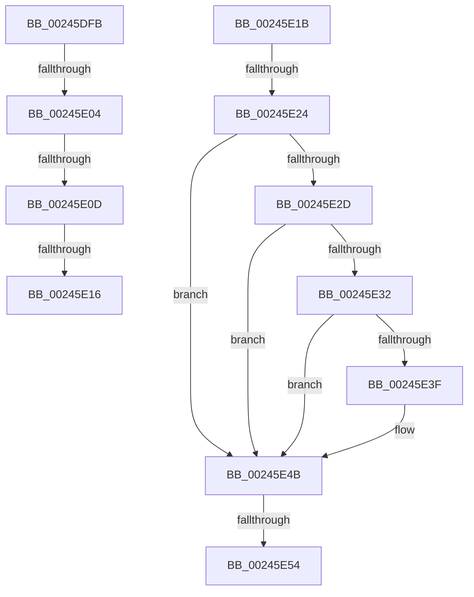

# sub_00245DFB

- RVA: `0x00245DFB`–`0x00245E59` (길이 `94` bytes)
- VA: `0x0000000140245DFB`
- 실행 섹션: `.text`
- PDB 이름 있음: `아니요`; PDB Function 태그: `아니요`
- unwind 정보 RVA: `0x00061DE4`
- 디코드: `23`개 명령, `94/94` bytes 표시
- 미해석 바이트: `0` (있으면 어셈블리에 `.byte`로 보존)

> 이 문서는 커널 이미지의 기계어와 PDB 기호를 분석해 생성했습니다. 4번과 5번은 함수 원형과 자료형을 바이너리 사용 방식에서 추정한 C 해석이며 원본 소스 복구 결과는 아닙니다.

## 1. Dependencies

- 직접 호출 지점: **0**; 고유 호출 대상: **0**
- 직접 호출자로 확인된 함수: **0**
- RIP 상대 이미지 참조: **0**

### Outgoing calls
- 직접 디코드된 call 명령이 없습니다.

### Direct callers
- 이 함수 시작 RVA로 연결되는 직접 call은 확인되지 않았습니다. 간접 호출은 완전히 역산할 수 없습니다.

### Static image references
- 디코드된 RIP-relative 메모리 참조가 없습니다.

## 2. Other-region calls and transfers

- 다른 실행 섹션으로 향하는 call: **0**
- call이 아닌 외부 분기/꼬리 이동: **7**
  - `0x00245DFE` → [sub_00245F85](Unknown_function_00245F85.md) (`tail-transfer`)
  - `0x00245E07` → [sub_00245AF8 + 0x5C](Unknown_function_00245AF8.md) (`tail-transfer`)
  - `0x00245E10` → [sub_00245AF8 + 0x5C](Unknown_function_00245AF8.md) (`tail-transfer`)
  - `0x00245E16` → [sub_00245F85 + 0xAE](Unknown_function_00245F85.md) (`tail-transfer`)
  - `0x00245E1E` → [sub_00245AF8 + 0x84](Unknown_function_00245AF8.md) (`tail-transfer`)
  - `0x00245E4E` → [sub_00245DA0 + 0x6](Unknown_function_00245DA0.md) (`tail-transfer`)
  - `0x00245E54` → [sub_00245AF8 + 0xAC](Unknown_function_00245AF8.md) (`tail-transfer`)

## 3. Assembly (complete function range)

```asm
00245DFB  49 3B D0                        cmp rdx, r8
00245DFE  0F 83 81 01 00 00               jae 0x140245f85
00245E04  48 3B D1                        cmp rdx, rcx
00245E07  0F 82 47 FD FF FF               jb 0x140245b54
00245E0D  48 3B C1                        cmp rax, rcx
00245E10  0F 83 3E FD FF FF               jae 0x140245b54
00245E16  E9 18 02 00 00                  jmp 0x140246033
00245E1B  83 F8 FF                        cmp eax, -1
00245E1E  0F 85 58 FD FF FF               jne 0x140245b7c
00245E24  B9 C0 00 00 00                  mov ecx, 0xc0
00245E29  3B D1                           cmp edx, ecx
00245E2B  7E 1E                           jle 0x140245e4b
00245E2D  83 FA FF                        cmp edx, -1
00245E30  74 19                           je 0x140245e4b
00245E32  8B C2                           mov eax, edx
00245E34  F0 41 0F B1 88 9C 8B 00 00      lock cmpxchg dword ptr [r8 + 0x8b9c], ecx
00245E3D  75 0C                           jne 0x140245e4b
00245E3F  8D 82 40 FF FF FF               lea eax, [rdx - 0xc0]
00245E45  4C 63 C8                        movsxd r9, eax
00245E48  49 FF C1                        inc r9
00245E4B  4D 85 C9                        test r9, r9
00245E4E  0F 85 52 FF FF FF               jne 0x140245da6
00245E54  E9 4B FD FF FF                  jmp 0x140245ba4
```

## 4. C-style interpretation (structured pseudocode)

```c
__int64 __fastcall sub_00245DFB(__int64 a1, __int64 a2, __int64 a3)
{
}
```

## 5. (Beta) C Style

```c
int64_t sub_00245DFB(int64_t Arg1, int64_t Arg2, int64_t Arg3)
{
}
```

## 6. Execution-region graph

[열기: 2D/3D 그래프와 함수 탐색 컨트롤 패널](../../../control-panel.html?section=text&rva=0x00245DFB&view=graph)

- 2D 그래프는 위에서 아래로 흐르고, 3D 그래프는 빈 공간을 드래그해 회전합니다. Shift+드래그는 이동, 휠은 확대·축소, 함수 노드 선택은 대상 보고서 이동입니다.

### Static fallback


