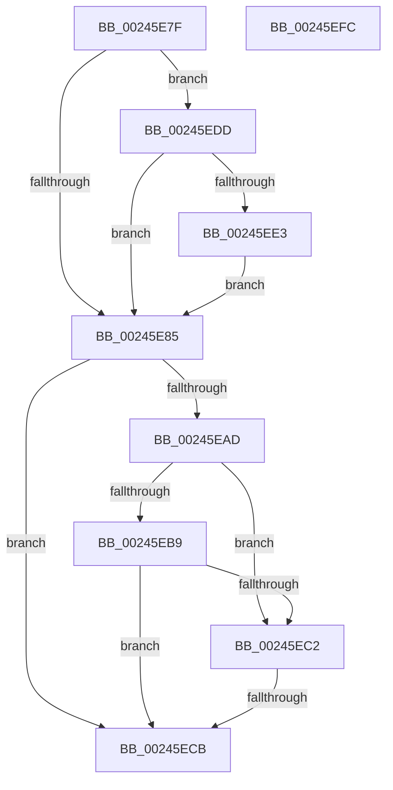

# sub_00245E7F

- RVA: `0x00245E7F`–`0x00245F1D` (길이 `158` bytes)
- VA: `0x0000000140245E7F`
- 실행 섹션: `.text`
- PDB 이름 있음: `아니요`; PDB Function 태그: `아니요`
- unwind 정보 RVA: `0x00061E2C`
- 디코드: `43`개 명령, `158/158` bytes 표시
- 미해석 바이트: `0` (있으면 어셈블리에 `.byte`로 보존)

> 이 문서는 커널 이미지의 기계어와 PDB 기호를 분석해 생성했습니다. 4번과 5번은 함수 원형과 자료형을 바이너리 사용 방식에서 추정한 C 해석이며 원본 소스 복구 결과는 아닙니다.

## 1. Dependencies

- 직접 호출 지점: **2**; 고유 호출 대상: **2**
- 직접 호출자로 확인된 함수: **0**
- RIP 상대 이미지 참조: **1**

### Outgoing calls
- `0x00245ED3` → [MiInsertPageInFreeOrZeroedList](../33/MiInsertPageInFreeOrZeroedList_function_00334D20.md) (function, `0x00334D20`)
- `0x00245F17` → [KeBugCheckEx](../4F/KeBugCheckEx_function_004FD660.md) (function, `0x004FD660`)

### Direct callers
- 이 함수 시작 RVA로 연결되는 직접 call은 확인되지 않았습니다. 간접 호출은 완전히 역산할 수 없습니다.

### Static image references
- `0x00245E89` → RVA `0x00E30088` (`.data`; read)

## 2. Other-region calls and transfers

- 다른 실행 섹션으로 향하는 call: **0**
- call이 아닌 외부 분기/꼬리 이동: **2**
  - `0x00245EC5` → [sub_00245F6B](Unknown_function_00245F6B.md) (`tail-transfer`)
  - `0x00245ED8` → [sub_00245BBB + 0xFE](Unknown_function_00245BBB.md) (`tail-transfer`)

## 3. Assembly (complete function range)

```asm
00245E7F  F6 43 23 10                     test byte ptr [rbx + 0x23], 0x10
00245E83  75 58                           jne 0x140245edd
00245E85  48 8B 41 28                     mov rax, qword ptr [rcx + 0x28]
00245E89  48 8B 0D F8 A1 BE 00            mov rcx, qword ptr [rip + 0xbea1f8]
00245E90  48 C1 E8 2B                     shr rax, 0x2b
00245E94  25 FF 03 00 00                  and eax, 0x3ff
00245E99  48 8B 0C C1                     mov rcx, qword ptr [rcx + rax*8]
00245E9D  48 8B 43 10                     mov rax, qword ptr [rbx + 0x10]
00245EA1  48 89 44 24 78                  mov qword ptr [rsp + 0x78], rax
00245EA6  48 0F BA E0 0A                  bt rax, 0xa
00245EAB  72 1E                           jb 0x140245ecb
00245EAD  48 8B 54 24 78                  mov rdx, qword ptr [rsp + 0x78]
00245EB2  C0 E8 02                        shr al, 2
00245EB5  A8 01                           test al, 1
00245EB7  75 09                           jne 0x140245ec2
00245EB9  0F B6 C2                        movzx eax, dl
00245EBC  D0 E8                           shr al, 1
00245EBE  A8 01                           test al, 1
00245EC0  74 09                           je 0x140245ecb
00245EC2  48 85 D2                        test rdx, rdx
00245EC5  0F 85 A0 00 00 00               jne 0x140245f6b
00245ECB  BA 02 00 00 00                  mov edx, 2
00245ED0  48 8B CF                        mov rcx, rdi
00245ED3  E8 48 EE 0E 00                  call 0x140334d20
00245ED8  E9 DC FD FF FF                  jmp 0x140245cb9
00245EDD  4C 85 41 28                     test qword ptr [rcx + 0x28], r8
00245EE1  75 A2                           jne 0x140245e85
00245EE3  8B 43 20                        mov eax, dword ptr [rbx + 0x20]
00245EE6  89 44 24 70                     mov dword ptr [rsp + 0x70], eax
00245EEA  C1 E8 18                        shr eax, 0x18
00245EED  24 EF                           and al, 0xef
00245EEF  88 44 24 73                     mov byte ptr [rsp + 0x73], al
00245EF3  8B 44 24 70                     mov eax, dword ptr [rsp + 0x70]
00245EF7  89 43 20                        mov dword ptr [rbx + 0x20], eax
00245EFA  EB 89                           jmp 0x140245e85
00245EFC  4C 8B 4B 18                     mov r9, qword ptr [rbx + 0x18]
00245F00  BA 07 00 00 00                  mov edx, 7
00245F05  4D 23 CE                        and r9, r14
00245F08  48 C7 44 24 20 00 00 00 00      mov qword ptr [rsp + 0x20], 0
00245F11  4C 8B C7                        mov r8, rdi
00245F14  8D 4A 47                        lea ecx, [rdx + 0x47]
00245F17  E8 44 77 2B 00                  call 0x1404fd660
00245F1C  CC                              int3
```

## 4. C-style interpretation (structured pseudocode)

```c
__int64 __fastcall sub_00245E7F(__int64 a1, __int64 a2, __int64 a3, __int64 a4, __int64 a5, __int64 a6, __int64 a7, __int64 a8, __int64 a9, __int64 a10, __int64 a11, __int64 a12, __int64 a13, unsigned int a14, __int64 a15)
{
    __int64 result;
    unsigned __int64 v_stack_p20;
    unsigned int v_stack_p70;
    unsigned __int8 v_stack_p73;
    unsigned __int64 v_stack_p78;

    if (((*(unsigned __int8 *)(v_rbx + 35)) & (16)) != 0) goto loc_00245EDD;
loc_00245E85:
    result = (*(unsigned __int64 *)(a1 + 40)) >> (43);
    result = (unsigned int)((result) & (0x3FFULL));
    v_stack_p78 = *(unsigned __int64 *)(v_rbx + 16);
    if (condition_is_below) goto loc_00245ECB;
    result = (unsigned __int8)((*(unsigned __int64 *)(v_rbx + 16)) >> (2));
    if ((((unsigned __int8)(result)) & (1)) != 0) goto loc_00245EC2;
    result = (unsigned __int8)(((unsigned __int8)(a15)) >> (1));
    if ((((unsigned __int8)(result)) & (1)) == 0) goto loc_00245ECB;
loc_00245EC2:
loc_00245ECB:
    result = MiInsertPageInFreeOrZeroedList(v_rdi, 2, a3, a4);
loc_00245EDD:
    if (((*(unsigned __int64 *)(v_rdi + 40)) & (a3)) != 0) goto loc_00245E85;
    v_stack_p70 = (unsigned int)((unsigned int)(*(unsigned int *)(v_rbx + 32)));
    result = (unsigned int)(((unsigned int)(*(unsigned int *)(v_rbx + 32))) >> (24));
    result = (unsigned __int8)((result) & (239));
    v_stack_p73 = (unsigned __int8)(result);
    *(unsigned int *)(v_rbx + 32) = (unsigned int)((unsigned int)(a14));
    goto loc_00245E85;
}
```

## 5. (Beta) C Style

```c
int64_t sub_00245E7F(void *Arg1, int64_t Arg2, int64_t Arg3, int64_t Arg4, uint64_t Arg5, uint64_t Arg6, uint64_t Arg7, uint64_t Arg8, uint64_t Arg9, uint64_t Arg10, uint64_t Arg11, uint64_t Arg12, uint64_t Arg13, uint32_t Arg14, int64_t Arg15)
{
    uint8_t *arg1 = (uint8_t *)Arg1;

    int64_t result;
    uint64_t v_stack_p20;
    uint32_t v_stack_p70;
    uint8_t v_stack_p73;
    uint64_t v_stack_p78;

    if (((*(uint8_t *)(local_rbx + 0x23)) & (16)) != 0) goto loc_00245EDD;
loc_00245E85:
    result = (*(uint64_t *)(arg1 + 0x28)) >> (43);
    result = (uint32_t)((result) & (0x3FFULL));
    v_stack_p78 = *(uint64_t *)(local_rbx + 0x10);
    if (condition_is_below) goto loc_00245ECB;
    result = (uint8_t)((*(uint64_t *)(local_rbx + 0x10)) >> (2));
    if ((((uint8_t)(result)) & (1)) != 0) goto loc_00245EC2;
    result = (uint8_t)(((uint8_t)(Arg15)) >> (1));
    if ((((uint8_t)(result)) & (1)) == 0) goto loc_00245ECB;
loc_00245EC2:
loc_00245ECB:
    result = MiInsertPageInFreeOrZeroedList(local_rdi, 2, Arg3, Arg4);
loc_00245EDD:
    if (((*(uint64_t *)(local_rdi + 0x28)) & (Arg3)) != 0) goto loc_00245E85;
    v_stack_p70 = (uint32_t)((uint32_t)(*(uint32_t *)(local_rbx + 0x20)));
    result = (uint32_t)(((uint32_t)(*(uint32_t *)(local_rbx + 0x20))) >> (24));
    result = (uint8_t)((result) & (239));
    v_stack_p73 = (uint8_t)(result);
    *(uint32_t *)(local_rbx + 0x20) = (uint32_t)((uint32_t)(Arg14));
    goto loc_00245E85;
}
```

### 관측된 메모리 오프셋

구조체 형식이 확인되지 않은 접근은 인자 기준의 오프셋으로만 기록했습니다.

| 기준 인자 | 오프셋 표현 | 폭 (bit) | 접근 |
|---|---:|---:|---|
| `Arg1` | `+ 0x28` | `64` | `R` |

## 6. Execution-region graph

[열기: 2D/3D 그래프와 함수 탐색 컨트롤 패널](../../../control-panel.html?section=text&rva=0x00245E7F&view=graph)

- 2D 그래프는 위에서 아래로 흐르고, 3D 그래프는 빈 공간을 드래그해 회전합니다. Shift+드래그는 이동, 휠은 확대·축소, 함수 노드 선택은 대상 보고서 이동입니다.

### Static fallback


