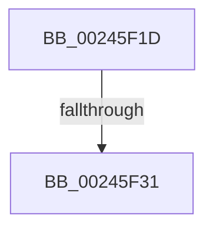

# sub_00245F1D

- RVA: `0x00245F1D`–`0x00245F66` (길이 `73` bytes)
- VA: `0x0000000140245F1D`
- 실행 섹션: `.text`
- PDB 이름 있음: `아니요`; PDB Function 태그: `아니요`
- unwind 정보 RVA: `0x00061E3C`
- 디코드: `17`개 명령, `73/73` bytes 표시
- 미해석 바이트: `0` (있으면 어셈블리에 `.byte`로 보존)

> 이 문서는 커널 이미지의 기계어와 PDB 기호를 분석해 생성했습니다. 4번과 5번은 함수 원형과 자료형을 바이너리 사용 방식에서 추정한 C 해석이며 원본 소스 복구 결과는 아닙니다.

## 1. Dependencies

- 직접 호출 지점: **3**; 고유 호출 대상: **3**
- 직접 호출자로 확인된 함수: **0**
- RIP 상대 이미지 참조: **0**

### Outgoing calls
- `0x00245F31` → [ExAcquireSpinLockExclusive](ExAcquireSpinLockExclusive_function_00248690.md) (function, `0x00248690`)
- `0x00245F40` → [MiRestockOverCommit](../40/MiRestockOverCommit_function_00407D94.md) (function, `0x00407D94`)
- `0x00245F53` → [MiReleaseSpinLockExclusive](MiReleaseSpinLockExclusive_function_002482C0.md) (function, `0x002482C0`)

### Direct callers
- 이 함수 시작 RVA로 연결되는 직접 call은 확인되지 않았습니다. 간접 호출은 완전히 역산할 수 없습니다.

### Static image references
- 디코드된 RIP-relative 메모리 참조가 없습니다.

## 2. Other-region calls and transfers

- 다른 실행 섹션으로 향하는 call: **0**
- call이 아닌 외부 분기/꼬리 이동: **2**
  - `0x00245F2F` → [sub_00245F7B](Unknown_function_00245F7B.md) (`tail-transfer`)
  - `0x00245F60` → [sub_00245AF8 + 0x55](Unknown_function_00245AF8.md) (`tail-transfer`)

## 3. Assembly (complete function range)

```asm
00245F1D  4C 89 64 24 48                  mov qword ptr [rsp + 0x48], r12
00245F22  44 0F 20 C0                     mov rax, cr8
00245F26  48 8D 8E F8 41 00 00            lea rcx, [rsi + 0x41f8]
00245F2D  3C 02                           cmp al, 2
00245F2F  74 4A                           je 0x140245f7b
00245F31  E8 5A 27 00 00                  call 0x140248690
00245F36  44 0F B6 E0                     movzx r12d, al
00245F3A  48 8B D5                        mov rdx, rbp
00245F3D  48 8B CE                        mov rcx, rsi
00245F40  E8 4F 1E 1C 00                  call 0x140407d94
00245F45  41 0F B6 D4                     movzx edx, r12b
00245F49  48 8D 8E F8 41 00 00            lea rcx, [rsi + 0x41f8]
00245F50  48 8B E8                        mov rbp, rax
00245F53  E8 68 23 00 00                  call 0x1402482c0
00245F58  4C 8B 64 24 48                  mov r12, qword ptr [rsp + 0x48]
00245F5D  48 85 ED                        test rbp, rbp
00245F60  0F 84 E7 FB FF FF               je 0x140245b4d
```

## 4. C-style interpretation (structured pseudocode)

```c
__int64 __fastcall sub_00245F1D(__int64 a1, __int64 a2, __int64 a3, __int64 a4, __int64 a5, __int64 a6, __int64 a7, __int64 a8, __int64 a9)
{
    __int64 result;
    unsigned __int64 v_stack_p48;

    v_stack_p48 = v_r12;
    result = ExAcquireSpinLockExclusive(v_rsi + 16888, a2, a3, a4);
    result = MiRestockOverCommit(v_rsi, v_rbp, a3, a4);
    result = MiReleaseSpinLockExclusive(v_rsi + 16888, (unsigned __int8)((unsigned __int8)(result)), a3, a4);
}
```

## 5. (Beta) C Style

```c
int64_t sub_00245F1D(int64_t Arg1, int64_t Arg2, int64_t Arg3, int64_t Arg4, uint64_t Arg5, uint64_t Arg6, uint64_t Arg7, uint64_t Arg8, int64_t Arg9)
{
    int64_t result;
    uint64_t v_stack_p48;

    v_stack_p48 = local_r12;
    result = ExAcquireSpinLockExclusive(local_rsi + 16888, Arg2, Arg3, Arg4);
    result = MiRestockOverCommit(local_rsi, local_rbp, Arg3, Arg4);
    result = MiReleaseSpinLockExclusive(local_rsi + 16888, (uint8_t)((uint8_t)(result)), Arg3, Arg4);
}
```

## 6. Execution-region graph

[열기: 2D/3D 그래프와 함수 탐색 컨트롤 패널](../../../control-panel.html?section=text&rva=0x00245F1D&view=graph)

- 2D 그래프는 위에서 아래로 흐르고, 3D 그래프는 빈 공간을 드래그해 회전합니다. Shift+드래그는 이동, 휠은 확대·축소, 함수 노드 선택은 대상 보고서 이동입니다.

### Static fallback


