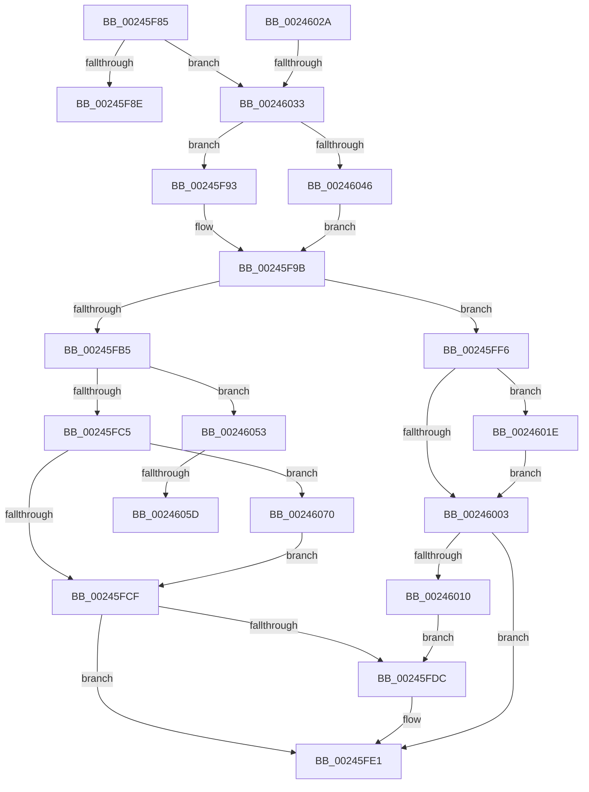

# sub_00245F85

- RVA: `0x00245F85`–`0x00246089` (길이 `260` bytes)
- VA: `0x0000000140245F85`
- 실행 섹션: `.text`
- PDB 이름 있음: `아니요`; PDB Function 태그: `아니요`
- unwind 정보 RVA: `0x00061E9C`
- 디코드: `58`개 명령, `260/260` bytes 표시
- 미해석 바이트: `0` (있으면 어셈블리에 `.byte`로 보존)

> 이 문서는 커널 이미지의 기계어와 PDB 기호를 분석해 생성했습니다. 4번과 5번은 함수 원형과 자료형을 바이너리 사용 방식에서 추정한 C 해석이며 원본 소스 복구 결과는 아닙니다.

## 1. Dependencies

- 직접 호출 지점: **9**; 고유 호출 대상: **5**
- 직접 호출자로 확인된 함수: **0**
- RIP 상대 이미지 참조: **0**

### Outgoing calls
- `0x00245F96` → [ExAcquireSpinLockExclusiveAtDpcLevel](ExAcquireSpinLockExclusiveAtDpcLevel_function_00248E80.md) (function, `0x00248E80`)
- `0x00245FDC` → [KeResetEvent](KeResetEvent_function_00248350.md) (function, `0x00248350`)
- `0x00245FEC` → [MiReleaseSpinLockExclusive](MiReleaseSpinLockExclusive_function_002482C0.md) (function, `0x002482C0`)
- `0x00246010` → [KeResetEvent](KeResetEvent_function_00248350.md) (function, `0x00248350`)
- `0x00246023` → [KeSetEvent](../33/KeSetEvent_function_0033F310.md) (function, `0x0033F310`)
- `0x00246046` → [ExAcquireSpinLockExclusive](ExAcquireSpinLockExclusive_function_00248690.md) (function, `0x00248690`)
- `0x00246065` → [KeSetEvent](../33/KeSetEvent_function_0033F310.md) (function, `0x0033F310`)
- `0x00246073` → [KeResetEvent](KeResetEvent_function_00248350.md) (function, `0x00248350`)
- `0x0024607F` → [KeResetEvent](KeResetEvent_function_00248350.md) (function, `0x00248350`)

### Direct callers
- 이 함수 시작 RVA로 연결되는 직접 call은 확인되지 않았습니다. 간접 호출은 완전히 역산할 수 없습니다.

### Static image references
- 디코드된 RIP-relative 메모리 참조가 없습니다.

## 2. Other-region calls and transfers

- 다른 실행 섹션으로 향하는 call: **0**
- call이 아닌 외부 분기/꼬리 이동: **5**
  - `0x00245F8E` → [sub_00245DFB + 0x9](Unknown_function_00245DFB.md) (`tail-transfer`)
  - `0x00245FF1` → [sub_00245AF8 + 0x5C](Unknown_function_00245AF8.md) (`tail-transfer`)
  - `0x0024602D` → [sub_00245CC3 + 0xB2](Unknown_function_00245CC3.md) (`tail-transfer`)
  - `0x00246057` → [sub_006D7F56](../6D/Unknown_function_006D7F56.md) (`tail-transfer`)
  - `0x0024606B` → [sub_006D7F56](../6D/Unknown_function_006D7F56.md) (`tail-transfer`)

## 3. Assembly (complete function range)

```asm
00245F85  49 3B C0                        cmp rax, r8
00245F88  0F 82 A5 00 00 00               jb 0x140246033
00245F8E  E9 71 FE FF FF                  jmp 0x140245e04
00245F93  40 B5 11                        mov bpl, 0x11
00245F96  E8 E5 2E 00 00                  call 0x140248e80
00245F9B  48 8B 8E 40 4B 00 00            mov rcx, qword ptr [rsi + 0x4b40]
00245FA2  48 8B 86 D8 41 00 00            mov rax, qword ptr [rsi + 0x41d8]
00245FA9  48 8B 96 E0 41 00 00            mov rdx, qword ptr [rsi + 0x41e0]
00245FB0  48 3B C8                        cmp rcx, rax
00245FB3  72 41                           jb 0x140245ff6
00245FB5  48 8B 86 30 01 00 00            mov rax, qword ptr [rsi + 0x130]
00245FBC  48 3B CA                        cmp rcx, rdx
00245FBF  0F 83 8E 00 00 00               jae 0x140246053
00245FC5  83 78 04 01                     cmp dword ptr [rax + 4], 1
00245FC9  0F 84 A1 00 00 00               je 0x140246070
00245FCF  48 8B 8E 28 01 00 00            mov rcx, qword ptr [rsi + 0x128]
00245FD6  83 79 04 01                     cmp dword ptr [rcx + 4], 1
00245FDA  75 05                           jne 0x140245fe1
00245FDC  E8 6F 23 00 00                  call 0x140248350
00245FE1  48 8D 8E F8 41 00 00            lea rcx, [rsi + 0x41f8]
00245FE8  40 0F B6 D5                     movzx edx, bpl
00245FEC  E8 CF 22 00 00                  call 0x1402482c0
00245FF1  E9 5E FB FF FF                  jmp 0x140245b54
00245FF6  48 8B 8E 28 01 00 00            mov rcx, qword ptr [rsi + 0x128]
00245FFD  83 79 04 00                     cmp dword ptr [rcx + 4], 0
00246001  74 1B                           je 0x14024601e
00246003  48 8B 8E 30 01 00 00            mov rcx, qword ptr [rsi + 0x130]
0024600A  83 79 04 01                     cmp dword ptr [rcx + 4], 1
0024600E  75 D1                           jne 0x140245fe1
00246010  E8 3B 23 00 00                  call 0x140248350
00246015  48 8B 8E 38 01 00 00            mov rcx, qword ptr [rsi + 0x138]
0024601C  EB BE                           jmp 0x140245fdc
0024601E  45 33 C0                        xor r8d, r8d
00246021  33 D2                           xor edx, edx
00246023  E8 E8 92 0F 00                  call 0x14033f310
00246028  EB D9                           jmp 0x140246003
0024602A  49 3B D0                        cmp rdx, r8
0024602D  0F 83 42 FD FF FF               jae 0x140245d75
00246033  44 0F 20 C0                     mov rax, cr8
00246037  48 8D 8E F8 41 00 00            lea rcx, [rsi + 0x41f8]
0024603E  3C 02                           cmp al, 2
00246040  0F 84 4D FF FF FF               je 0x140245f93
00246046  E8 45 26 00 00                  call 0x140248690
0024604B  0F B6 E8                        movzx ebp, al
0024604E  E9 48 FF FF FF                  jmp 0x140245f9b
00246053  83 78 04 00                     cmp dword ptr [rax + 4], 0
00246057  0F 85 F9 1E 49 00               jne 0x1406d7f56
0024605D  45 33 C0                        xor r8d, r8d
00246060  33 D2                           xor edx, edx
00246062  48 8B C8                        mov rcx, rax
00246065  E8 A6 92 0F 00                  call 0x14033f310
0024606A  90                              nop
0024606B  E9 E6 1E 49 00                  jmp 0x1406d7f56
00246070  48 8B C8                        mov rcx, rax
00246073  E8 D8 22 00 00                  call 0x140248350
00246078  48 8B 8E 38 01 00 00            mov rcx, qword ptr [rsi + 0x138]
0024607F  E8 CC 22 00 00                  call 0x140248350
00246084  E9 46 FF FF FF                  jmp 0x140245fcf
```

## 4. C-style interpretation (structured pseudocode)

```c
__int64 __fastcall sub_00245F85(__int64 a1, __int64 a2, __int64 a3)
{
    __int64 result;

    if (result < a3) goto loc_00246033;
loc_00245F93:
    result = ExAcquireSpinLockExclusiveAtDpcLevel(a1, a2, a3, a4);
loc_00245F9B:
    if ((*(unsigned __int64 *)(v_rsi + 19264)) < (*(unsigned __int64 *)(v_rsi + 16856))) goto loc_00245FF6;
    if ((*(unsigned __int64 *)(v_rsi + 19264)) >= (*(unsigned __int64 *)(v_rsi + 16864))) goto loc_00246053;
    if ((*(unsigned int *)(*(unsigned __int64 *)(v_rsi + 304) + 4)) == 1) goto loc_00246070;
loc_00245FCF:
    result = *(unsigned __int64 *)(v_rsi + 304);
    if ((*(unsigned int *)(*(unsigned __int64 *)(v_rsi + 296) + 4)) == 1) {
        result = KeResetEvent(*(unsigned __int64 *)(v_rsi + 296), *(unsigned __int64 *)(v_rsi + 16864), a3, a4);
    }
    result = MiReleaseSpinLockExclusive(v_rsi + 16888, 17, a3, a4);
loc_00245FF6:
    if ((*(unsigned int *)(*(unsigned __int64 *)(v_rsi + 296) + 4)) == 0) goto loc_0024601E;
loc_00246003:
    if ((*(unsigned int *)(*(unsigned __int64 *)(v_rsi + 304) + 4)) != 1) goto loc_00245FE1;
    result = KeResetEvent(*(unsigned __int64 *)(v_rsi + 304), 17, a3, a4);
    goto loc_00245FDC;
loc_0024601E:
    a3 = 0;
    a2 = 0;
    result = KeSetEvent(*(unsigned __int64 *)(v_rsi + 312), a2, a3, a4);
    goto loc_00246003;
loc_00246033:
    if (((unsigned __int8)(v_cr8)) == 2) goto loc_00245F93;
    result = ExAcquireSpinLockExclusive(v_rsi + 16888, a2, a3, a4);
    goto loc_00245F9B;
loc_00246053:
    a3 = 0;
    a2 = 0;
    result = KeSetEvent(result, a2, a3, a4);
loc_00246070:
    result = KeResetEvent(result, a2, a3, a4);
    result = KeResetEvent(*(unsigned __int64 *)(v_rsi + 312), a2, a3, a4);
    goto loc_00245FCF;
}
```

## 5. (Beta) C Style

```c
int64_t sub_00245F85(int64_t Arg1, int64_t Arg2, int64_t Arg3)
{
    int64_t result;

    if (result < Arg3) goto loc_00246033;
loc_00245F93:
    result = ExAcquireSpinLockExclusiveAtDpcLevel(Arg1, Arg2, Arg3, a4);
loc_00245F9B:
    if ((*(uint64_t *)(local_rsi + 0x4B40)) < (*(uint64_t *)(local_rsi + 0x41D8))) goto loc_00245FF6;
    if ((*(uint64_t *)(local_rsi + 0x4B40)) >= (*(uint64_t *)(local_rsi + 0x41E0))) goto loc_00246053;
    if ((*(uint32_t *)(*(uint64_t *)(local_rsi + 0x130) + 0x4)) == 1) goto loc_00246070;
loc_00245FCF:
    result = *(uint64_t *)(local_rsi + 0x130);
    if ((*(uint32_t *)(*(uint64_t *)(local_rsi + 0x128) + 0x4)) == 1) {
        result = KeResetEvent(*(uint64_t *)(local_rsi + 0x128), *(uint64_t *)(local_rsi + 0x41E0), Arg3, a4);
    }
    result = MiReleaseSpinLockExclusive(local_rsi + 16888, 17, Arg3, a4);
loc_00245FF6:
    if ((*(uint32_t *)(*(uint64_t *)(local_rsi + 0x128) + 0x4)) == 0) goto loc_0024601E;
loc_00246003:
    if ((*(uint32_t *)(*(uint64_t *)(local_rsi + 0x130) + 0x4)) != 1) goto loc_00245FE1;
    result = KeResetEvent(*(uint64_t *)(local_rsi + 0x130), 17, Arg3, a4);
    goto loc_00245FDC;
loc_0024601E:
    Arg3 = 0;
    Arg2 = 0;
    result = KeSetEvent(*(uint64_t *)(local_rsi + 0x138), Arg2, Arg3, a4);
    goto loc_00246003;
loc_00246033:
    if (((uint8_t)(v_cr8)) == 2) goto loc_00245F93;
    result = ExAcquireSpinLockExclusive(local_rsi + 16888, Arg2, Arg3, a4);
    goto loc_00245F9B;
loc_00246053:
    Arg3 = 0;
    Arg2 = 0;
    result = KeSetEvent(result, Arg2, Arg3, a4);
loc_00246070:
    result = KeResetEvent(result, Arg2, Arg3, a4);
    result = KeResetEvent(*(uint64_t *)(local_rsi + 0x138), Arg2, Arg3, a4);
    goto loc_00245FCF;
}
```

## 6. Execution-region graph

[열기: 2D/3D 그래프와 함수 탐색 컨트롤 패널](../../../control-panel.html?section=text&rva=0x00245F85&view=graph)

- 2D 그래프는 위에서 아래로 흐르고, 3D 그래프는 빈 공간을 드래그해 회전합니다. Shift+드래그는 이동, 휠은 확대·축소, 함수 노드 선택은 대상 보고서 이동입니다.

### Static fallback


