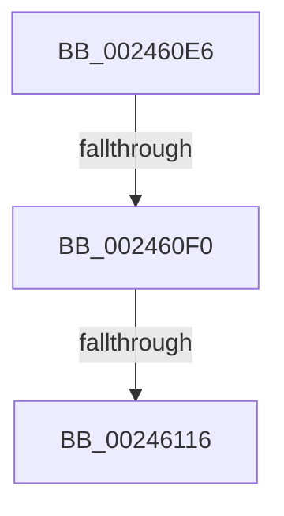

# sub_002460E6

- RVA: `0x002460E6`–`0x00246120` (길이 `58` bytes)
- VA: `0x00000001402460E6`
- 실행 섹션: `.text`
- PDB 이름 있음: `아니요`; PDB Function 태그: `아니요`
- unwind 정보 RVA: `0x00061EEC`
- 디코드: `18`개 명령, `58/58` bytes 표시
- 미해석 바이트: `0` (있으면 어셈블리에 `.byte`로 보존)

> 이 문서는 커널 이미지의 기계어와 PDB 기호를 분석해 생성했습니다. 4번과 5번은 함수 원형과 자료형을 바이너리 사용 방식에서 추정한 C 해석이며 원본 소스 복구 결과는 아닙니다.

## 1. Dependencies

- 직접 호출 지점: **1**; 고유 호출 대상: **1**
- 직접 호출자로 확인된 함수: **0**
- RIP 상대 이미지 참조: **0**

### Outgoing calls
- `0x00246119` → [MiBadRefCount](MiBadRefCount_function_00246E08.md) (function, `0x00246E08`)

### Direct callers
- 이 함수 시작 RVA로 연결되는 직접 call은 확인되지 않았습니다. 간접 호출은 완전히 역산할 수 없습니다.

### Static image references
- 디코드된 RIP-relative 메모리 참조가 없습니다.

## 2. Other-region calls and transfers

- 다른 실행 섹션으로 향하는 call: **0**
- call이 아닌 외부 분기/꼬리 이동: **2**
  - `0x002460EE` → [sub_0024613F](Unknown_function_0024613F.md) (`tail-transfer`)
  - `0x00246110` → [sub_002461E9](Unknown_function_002461E9.md) (`tail-transfer`)

## 3. Assembly (complete function range)

```asm
002460E6  4C 89 74 24 38                  mov qword ptr [rsp + 0x38], r14
002460EB  48 85 C1                        test rcx, rax
002460EE  75 4F                           jne 0x14024613f
002460F0  8B 43 20                        mov eax, dword ptr [rbx + 0x20]
002460F3  45 33 F6                        xor r14d, r14d
002460F6  89 44 24 78                     mov dword ptr [rsp + 0x78], eax
002460FA  C1 E8 10                        shr eax, 0x10
002460FD  24 DF                           and al, 0xdf
002460FF  88 44 24 7A                     mov byte ptr [rsp + 0x7a], al
00246103  8B 44 24 78                     mov eax, dword ptr [rsp + 0x78]
00246107  89 43 20                        mov dword ptr [rbx + 0x20], eax
0024610A  8B 43 20                        mov eax, dword ptr [rbx + 0x20]
0024610D  66 85 C0                        test ax, ax
00246110  0F 85 D3 00 00 00               jne 0x1402461e9
00246116  48 8B CB                        mov rcx, rbx
00246119  E8 EA 0C 00 00                  call 0x140246e08
0024611E  CC                              int3
0024611F  90                              nop
```

## 4. C-style interpretation (structured pseudocode)

```c
__int64 __fastcall sub_002460E6(__int64 a1, __int64 a2, __int64 a3, __int64 a4, __int64 a5, __int64 a6, __int64 a7, __int64 a8, __int64 a9, __int64 a10, __int64 a11, __int64 a12, __int64 a13, __int64 a14, unsigned int a15)
{
    __int64 result;
    __int64 v_r14;
    unsigned __int64 v_stack_p38;
    unsigned int v_stack_p78;
    unsigned __int8 v_stack_p7A;

    v_stack_p38 = v_r14;
    v_r14 = 0;
    v_stack_p78 = (unsigned int)((unsigned int)(*(unsigned int *)(v_rbx + 32)));
    result = (unsigned int)(((unsigned int)(*(unsigned int *)(v_rbx + 32))) >> (16));
    result = (unsigned __int8)((result) & (223));
    v_stack_p7A = (unsigned __int8)(result);
    *(unsigned int *)(v_rbx + 32) = (unsigned int)((unsigned int)(a15));
    result = MiBadRefCount(v_rbx, a2, a3, a4);
    return result;
}
```

## 5. (Beta) C Style

```c
int64_t sub_002460E6(int64_t Arg1, int64_t Arg2, int64_t Arg3, int64_t Arg4, uint64_t Arg5, uint64_t Arg6, uint64_t Arg7, uint64_t Arg8, uint64_t Arg9, uint64_t Arg10, uint64_t Arg11, uint64_t Arg12, uint64_t Arg13, uint64_t Arg14, uint32_t Arg15)
{
    int64_t result;
    int64_t local_r14;
    uint64_t v_stack_p38;
    uint32_t v_stack_p78;
    uint8_t v_stack_p7A;

    v_stack_p38 = local_r14;
    local_r14 = 0;
    v_stack_p78 = (uint32_t)((uint32_t)(*(uint32_t *)(local_rbx + 0x20)));
    result = (uint32_t)(((uint32_t)(*(uint32_t *)(local_rbx + 0x20))) >> (16));
    result = (uint8_t)((result) & (223));
    v_stack_p7A = (uint8_t)(result);
    *(uint32_t *)(local_rbx + 0x20) = (uint32_t)((uint32_t)(Arg15));
    result = MiBadRefCount(local_rbx, Arg2, Arg3, Arg4);
    return result;
}
```

## 6. Execution-region graph

[열기: 2D/3D 그래프와 함수 탐색 컨트롤 패널](../../../control-panel.html?section=text&rva=0x002460E6&view=graph)

- 2D 그래프는 위에서 아래로 흐르고, 3D 그래프는 빈 공간을 드래그해 회전합니다. Shift+드래그는 이동, 휠은 확대·축소, 함수 노드 선택은 대상 보고서 이동입니다.

### Static fallback


